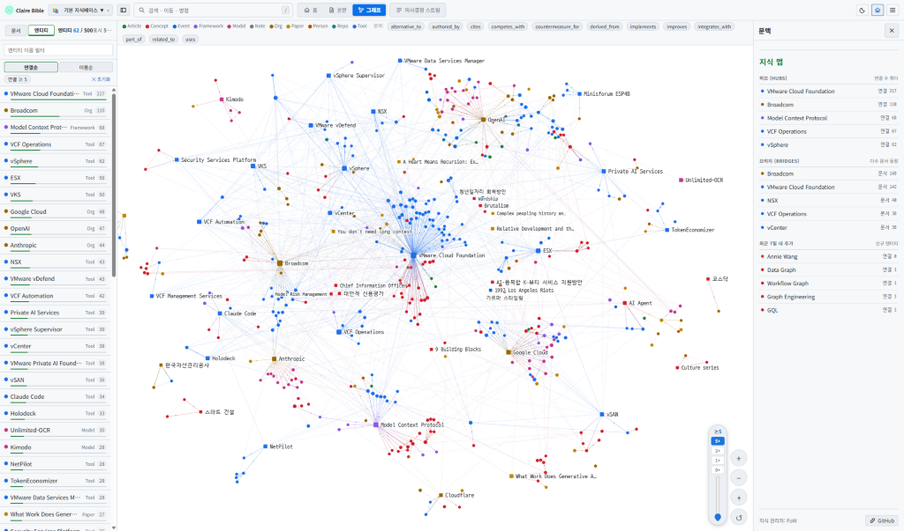
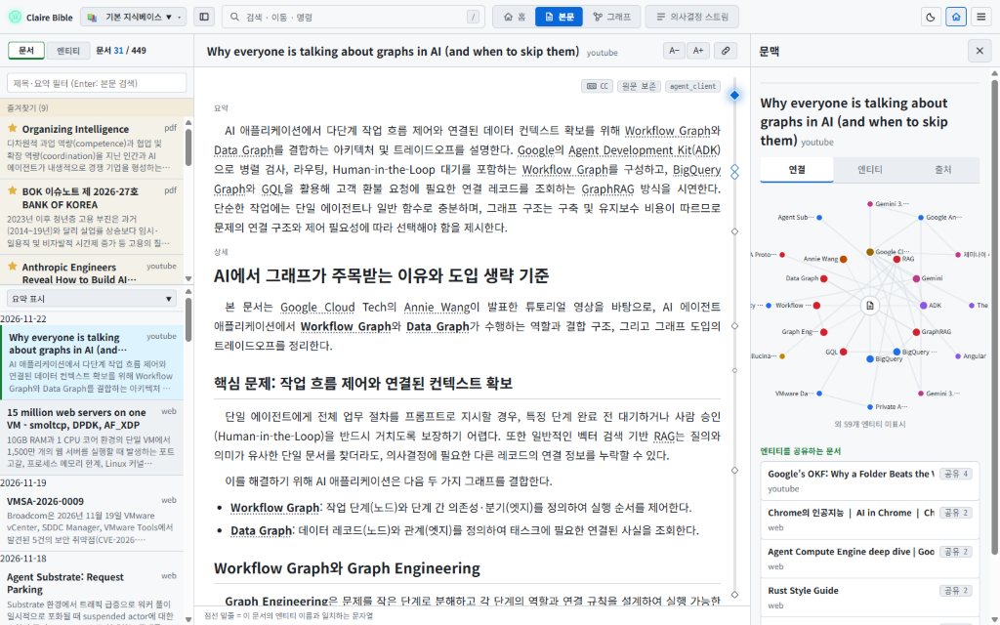
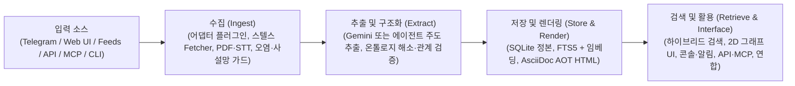

# Claire Bible

> **멀티소스 수집 기반 개인·공유 지식 베이스 및 온톨로지 지식 그래프 엔진**

Claire Bible은 웹 페이지, YouTube·웹 비디오(자막/STT), X(트위터), PDF, RSS/Atom/JSON Feed·OPML 피드, 일반 텍스트 등 다양한 정보 소스를 수집해 구조화된 지식으로 정제하는 지식 관리 시스템이다.  
서버 측 Gemini 프로바이더 또는 외부 AI 에이전트(MCP)를 통해 핵심 요약, AsciiDoc 상세 본문, 엔티티·관계 온톨로지 그래프를 추출하며, 단일 정본 SQLite 데이터베이스(`data/claire.db`)를 중심으로 하이브리드 검색, 2D 지식 그래프 탐색, 멀티 계정 통합 콘솔, ActivityPub·지식 연합을 제공한다.

| 2D 지식 그래프 탐색 | 문서 리더 및 문맥 패널 |
| :---: | :---: |
| [](docs/screenshots/knowledge-graph-overview.png) | [](docs/screenshots/document-reader.png) |

---

## 핵심 파이프라인



1. **Ingest (수집)**: 모든 입력 경로(텔레그램 봇, Web UI, 피드 폴러, REST API/MCP, CLI)가 단일 `IngestService`와 어댑터 플러그인을 거쳐 원문을 정규화·중복 판정·zstd 보관한다.
2. **Extract (구조화 추출)**: 서버 측 Gemini 또는 클라이언트 AI 에이전트가 요약, AsciiDoc 상세 본문, 엔티티·관계를 추출하고 기존 그래프 노드로 해소·병합한다.
3. **Store & Render (저장 및 렌더링)**: 지식 정본은 `data/claire.db`(`kb_id` 격리, FTS5·임베딩·사전 컴파일 `detail_html`)에, 인증·감사·키 자료는 `data/auth/auth.db`에, 알림·피드·연합 타임라인·미디어 캐시는 `data/client.db`에, Fedify 사이드카 상태는 `data/fedify/fedify.db`에 분리 영속화한다.
4. **Retrieve & Interface (검색 및 활용)**: RRF 하이브리드 검색과 2D 그래프 UI, 통합 콘솔, 텔레그램 봇, REST API·MCP, PWA 웹 푸시 알림, ActivityPub·지식 연합으로 지식을 탐색하고 공유한다.

---

## 주요 기능

- **다채로운 소스 수집과 어댑터 플러그인**: 정적·동적 JS 페이지(스텔스 Fetcher 에스컬레이션), PDF(적응형 추론 및 VLM), YouTube·웹 비디오(자막/STT), RSS/Atom/JSON Feed·OPML 피드를 지원하며, 사설망·콘텐츠 가드와 격리된 적재 어댑터 플러그인(`claire.youtube`, `claire.xcom`, `claire.hoyolab` 등)을 제공한다.
- **온톨로지 지식 그래프와 링크 확장**: 닫힌 온톨로지(11종 엔티티·11종 관계)와 도메인/레인지 규칙으로 그래프를 축적하고, 다단계 엔티티 해소, 링크 자동 확장·동일 주제 출처 병합, 중복 정리(MinHash LSH, canonical URL/콘텐츠 해시)를 수행한다.
- **하이브리드 검색과 AsciiDoc AOT 렌더링**: SQLite FTS5(BM25, 한국어 `kiwipiepy` 형태소 분석)와 지식 베이스별 고정 임베딩 공간의 코사인 유사도, 그래프 이웃 확장을 RRF로 결합한다. 본문은 AsciiDoc 원문에서 사전 컴파일한 `detail_html`(KaTeX 수식·표·코드 지원)로 렌더링하며, AsciiDoc/Markdown 내보내기와 Asciidoctor reveal.js 프레젠테이션 저작을 지원한다.
- **개인·공유 지식 베이스와 테마**: 단일 `claire.db` 내 `kb_id` 격리로 계정별 개인 지식 베이스와 협업용 공유 지식 베이스를 운영하며, 주제별 컬렉션 테마와 기여·검토·평판 워크플로를 제공한다.
- **멀티 계정·보안·통합 콘솔·PWA 알림**: 싱글·네트워크 모드, 초대제 가입, OIDC/GitHub 외부 IdP, 4계층 RBAC(`owner`/`write`/`readonly`/`anonymous`), OAuth 2.1(`S256` PKCE, RFC 8628 `/device`, RFC 8693 토큰 교환)을 지원한다. 한/영 i18n 기반 Web UI(홈 개요, 엔티티 마크 리더, 2D 그래프, 명령 팔레트, `/syndication`, `/directory`)와 `/account/*`·`/settings/*`·`/moderation/*`·`/admin/*` 통합 콘솔, 연계 요청 알림 및 PWA Web Push를 제공한다.
- **서버 프로바이더와 외부 AI 에이전트 연동**: `data/providers.json` 기반 Gemini 프로바이더(관리자·멤버 BYOK·서버 등급 격리)뿐만 아니라 클라이언트 에이전트 주도 추출(`extraction_mode=client`)을 지원한다. Streamable HTTP MCP 서버와 `agent_clients/` 공식 플러그인(`fofwisdom/claire-agents`, Antigravity·Claude Code)으로 OAuth 2.1 인증, 직접 적재, 격리된 추출, 그래프 질의를 연결한다.
- **ActivityPub 및 지식 연합**: Deno 기반 Fedify 사이드카로 계정 액터 발행, 원격 타임라인·노트·답글·부스트·인용(FEP-044f)을 처리하며, 서버 간 공유 지식 베이스 큐레이션·교차 기여(Knowledge Federation)와 운영 환경 내장 `edge` 리버스 프록시를 제공한다.

---

## 시작하기 (Getting Started)

### 사전 요구사항

- **로컬 개발**: `uv`, Python 3.15 (선택: Fedify 사이드카 테스트용 `deno`, E2E 테스트용 Playwright)
- **운영 배포**: Docker 및 Docker Compose (`./cb-manuscript`는 호스트 `python3` 표준 라이브러리만 사용)
- **AI 추출**: 서버 측 Gemini API 키(Web UI 또는 BYOK 설정) 또는 클라이언트 에이전트 주도 추출(MCP)

### 1. 개발 빠른 시작 (Local Development)

평소 개발은 현재 체크아웃을 `uv`로 직접 실행한다. Docker 개발 스택(`./cb-manuscript dev up`)은 운영과 같은 조건을 확인할 때만 사용한다. 설정 로딩과 역할 호스트 포트 확인은 [COMMANDS.md §1.1](docs/implementation/COMMANDS.md#11-개발-절차-평소-uv-운영-조건-확인-docker)을 본다.

```bash
# 1. 의존성 동기화 및 개발 설정 초기화
uv sync --extra dev --extra stealth --extra audio --extra ko
./cb-manuscript dev init

# 2. 개발 서버 (.env 위에 .env.dev를 겹치고, 데이터는 .dev/data 사용)
CLAIRE_INJECT_HOST=127.0.0.1 CLAIRE_INJECT_PORT=8766 CLAIRE_DB_PATH=.dev/data/claire.db \
  uv run --env-file .env.dev claire serve-api   # http://127.0.0.1:8766/

# 3. CI 전체 검증 (구문, Compose 설정, uv.lock, ty 타입 검사, pytest)
bash ./scripts/ci.sh
```

---

### 2. 프로덕션 시작 — 에이전트 무인 파이프라인 (Production Launch - Agent)

AI 코딩 에이전트(Antigravity, Claude Code, Cursor, CI/CD 러너)가 대화형 프롬프트 없이 프로덕션을 빌드·배포·검증하고 소유자 로그인 링크를 발급하는 표준 절차이다.

```bash
# Step 1. 인프라 및 환경 사전 점검 (종료 코드 0 확인)
./cb-manuscript preflight

# Step 2. 빌드, DB 마이그레이션 및 서비스 기동
./cb-manuscript install

# Step 3. 시스템 및 지식그래프 무결성 전수 감사 (clean: true 확인)
./cb-manuscript app audit --check all --json

# Step 4. 최종 서비스 헬스체크 (status: success 확인)
./cb-manuscript app health --json

# Step 5. 소유자(Owner) Web UI 1회용 매직 로그인 링크 획득
./cb-manuscript app auth --scope owner --json
```

---

### 3. 프로덕션 시작 — 직접 배포 (Production Launch - Manual)

운영자가 호스트 셸에서 직접 프로덕션 서비스를 배포하고 관리하는 절차이다.

```bash
# 1. 환경 설정 초기화 (소유자 토큰 자동 생성 및 파일 권한 0600 부여)
./cb-manuscript init

# 2. 도커 및 설정 사전 점검
./cb-manuscript preflight

# 3. 배포 파이프라인 실행 (빌드 -> DB 마이그레이션 -> 컨테이너 기동 -> 헬스체크)
./cb-manuscript install

# 4. 웹 UI 1회용 로그인 링크 발급
./cb-manuscript app auth --scope owner

# [운영 및 유지보수]
./cb-manuscript status             # 컨테이너 구동 현황 확인
./cb-manuscript logs -f api        # 실시간 서비스 로그 모니터링
./cb-manuscript app audit --heal   # 지식그래프 결함 점검 및 자동 수복
./cb-manuscript update             # 최신 소스코드 빌드 및 안전 재기동
```

> 운영 환경에서는 내장 `edge` 서비스가 단일 포트(`CB_API_PORT`)에서 API와 Fedify 연합 경로를 분기하므로 외부 리버스 프록시는 단일 업스트림으로만 연결하면 된다([FEDERATION.md](docs/implementation/FEDERATION.md), [EXTERNAL_ACCESS.md](docs/implementation/EXTERNAL_ACCESS.md)).

---

## 주요 CLI 명령어

운영 호스트에서는 `./cb-manuscript app <command>`, 로컬 개발 환경에서는 `uv run claire <command>` 형태로 `claire` CLI를 실행한다.

| 명령어 | 설명 |
| :--- | :--- |
| `claire ingest` | 단일 웹 페이지, 영상(자막/STT), PDF 또는 텍스트 즉시 수집 및 구조화 |
| `claire search` | 하이브리드 검색 (BM25 전문 색인 + 임베딩 유사도 + 그래프 확장) |
| `claire reprocess` | 요약, 상세, 그래프, 포맷 등 파생 데이터 일괄 재처리 |
| `claire kb` | 개인·공유 지식 베이스 파티션 관리 (`list`, `define`, `update`, `delete`, `reset`) |
| `claire theme` | 주제별 지식 베이스 컬렉션 테마 관리 (`list`, `judge`, `rename`, `pin`, `merge`) |
| `claire auth` | Web UI 1회용 로그인 매직 링크 및 세션 토큰 발급 (`--scope owner\|readonly`) |
| `claire audit` / `doctor` | 지식그래프·DB 무결성·오염 잔재·툼스톤 전수 감사 및 자동 수복 (`--heal`) |
| `claire health` / `queue` | DB·인박스·비동기 큐(`inbox`, `refresh`, `expand`) 상태 진단 및 조회 |
| `claire server check` | 네트워크 모드(`--network`, G1–G9) 및 연합(`--federation`, GF1–GF20) 준비 점검 |
| `claire support-bundle` | RCA 및 문제 해결용 zstd 압축 Support Bundle 생성·조회·정리 |

기여(`contribute`), 피드(`feeds`), 플러그인(`plugin`), 프로바이더(`providers`), 연합·미디어 유지보수(`federation`, `media`) 등 전체 명령과 옵션은 `uv run claire --help` 및 [docs/implementation/COMMANDS.md](docs/implementation/COMMANDS.md)를 참조한다.

---

## 프로젝트 구조

```text
claire-bible/
├── src/bible/                # 순수 렌더링·UI 엔진 — AsciiDoc AOT(adoc/), 슬라이드(slides/), 공통 크롬·번들(web/, templates/, static/) [claire import 금지]
├── src/claire/               # 도메인 코어 — 적재(ingest/), 추출·온톨로지(extract/, ontology/), 확장(expand/), 검색(retrieval/), 저장(store/), 계정·협업·API(accounts/, collaboration/, api/), 알림(notifications/), 연합·피드(federation/, feeds/), 플러그인 호스트·SDK(plugin_host/, plugin_sdk/), 봇·운영(telegram/, ops/, cli.py) [bible import 금지]
├── src/claire_bible/         # 조합 루트 — 포트 연결(bootstrap.py), CLI·웹 진입점, 페이지 하이드레이션
├── plugins/                  # 서버 적재 어댑터 플러그인 (ingest_adapter/, project.lock)
├── agent_clients/            # 공식 AI 에이전트 플러그인 소스 (common/, clients/antigravity/, clients/claude/)
├── sidecar/fedify/           # Deno 기반 Fedify ActivityPub 연합 사이드카
├── ops/                      # 호스트 운영 도구(cb_manuscript.py), edge/ 리버스 프록시, 외부 프로브
├── docs/                     # 원칙(PRINCIPLES.md), 목표(GOALS.md), 구현 정본(implementation/), 설계(design/)
├── scripts/                  # CI 게이트(ci.sh), E2E 러너(e2e.sh), 에이전트 마켓플레이스 빌더, 엔트리포인트
├── tests/                    # pytest 단위·통합·계약·문서 정합성 테스트
├── e2e/                      # Playwright 기반 브라우저 E2E 테스트
├── data/                     # 런타임 DB(claire.db, client.db, auth/auth.db, fedify/fedify.db) 및 설정
├── cb-manuscript             # 호스트 운영·배포 래퍼 스크립트
├── pyproject.toml            # 패키지 명세, 의존성 및 ty 타입 검사 설정
├── docker-compose.yml        # 프로덕션 서비스(api, bot, refresh, recover, expand, fedify, edge)
└── docker-compose.dev.yml    # 개발용 Docker Compose 오버레이
```

---

## 주요 문서

- [문서 구조 안내](docs/README.md): 전체 문서 체계(`implementation/`, `design/`, `ideas/`) 및 정합성 검사 규칙
- [프로젝트 원칙](docs/PRINCIPLES.md): 구현 변경에도 유지되는 불변 원칙
- [구현 상태 및 제약](docs/implementation/IMPLEMENTATION_STATUS.md): 현재 알려진 제약, 보류 결정, 테스트 기준선
- [CLI 명령어 레퍼런스](docs/implementation/COMMANDS.md): `cb-manuscript` 및 `claire` 전체 명령어 설명서
- [REST API 및 MCP 가이드](docs/implementation/API_AND_MCP_GUIDE.md): HTTP API, RBAC, OAuth 2.1, MCP 및 에이전트 플러그인 연동
- [계정 및 통합 콘솔](docs/implementation/ACCOUNTS.md): 계정 수명주기, IdP, `/account/*`·`/settings/*`·`/moderation/*`·`/admin/*` 콘솔
- [ActivityPub 연합](docs/implementation/FEDERATION.md) · [지식 연합](docs/implementation/KNOWLEDGE_FEDERATION.md): Fedify 사이드카, 원격 읽기·상호작용, 서버 간 공유 지식 연합
- [알림 및 PWA 웹 푸시](docs/implementation/NOTIFICATIONS.md): 연계 요청 알림, Web Push(VAPID), 서비스 워커
- [운영 명령 경계](docs/implementation/OPERATIONS.md): 호스트 배포, 백업·복원 및 서비스 수명주기

---

## 라이선스

이 프로젝트는 [LICENSE.md](LICENSE.md)에 명시된 MIT 라이선스 조건을 따른다.
