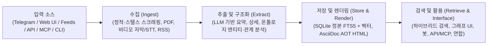

# Claire Bible

> **멀티소스 수집 기반 개인·팀 지식 베이스 및 온톨로지 지식 그래프 엔진**

Claire Bible은 웹 페이지, X(트위터), YouTube·비디오(자막/STT), PDF, RSS/Atom/OPML 피드, 일반 텍스트 등 다양한 정보 소스를 수집하여 구조화된 지식으로 정제하는 지식 관리 시스템이다.  
Gemini를 비롯한 LLM 프로바이더를 통해 핵심 요약, AsciiDoc 기반 상세 문서, 엔티티 및 관계(Palantir 스타일 온톨로지)를 추출하며, 단일 정본 SQLite 데이터베이스(`claire.db`, FTS5 + 벡터 임베딩 + 사전 컴파일 HTML)에 영속화하여 하이브리드 검색, 2D 지식 그래프 탐색, 다중 사용자 콘솔, ActivityPub 연합을 제공한다.

---

## 핵심 파이프라인



1. **Ingest (수집)**: 계정별 텔레그램 봇, Web UI, 피드 폴러(RSS/Atom/JSON Feed), REST API/MCP, CLI를 통해 URL·파일·텍스트를 통합 적재 파이프라인(`IngestService`)으로 수집한다. Pre-LLM Content Guard, 스텔스 Fetcher 에스컬레이션, PDF 적응형 추론, 비디오 STT 전사를 지원한다.
2. **Extract (구조화 추출)**: 설정된 LLM 프로바이더(Gemini)를 호출하여 요약, 상세 본문, 닫힌 온톨로지 타입과 도메인/레인지 규칙 기반의 엔티티·관계를 추출하고 기존 노드로 해소·병합한다.
3. **Store & Render (저장 및 렌더링)**: 모든 지식 문서는 단일 SQLite 정본(`data/claire.db`, `theme_id` 파티셔닝)에 FTS5 전문 색인·벡터 임베딩과 함께 저장되며, `detail_html`은 사전 컴파일(AOT)된다. 자격 비밀과 감사 로그는 `data/auth/auth.db`에, 계정 피드·연합 클라이언트 상태는 `data/client.db`에 분리 저장한다.
4. **Retrieve & Interface (검색 및 활용)**: BM25 전문 검색·벡터 유사도·그래프 이웃 확장을 RRF로 결합한 하이브리드 검색을 제공하며, Web UI(개요 홈, 엔티티 마크 리더, 2D 지식 그래프, 명령 팔레트, `/admin/*`·`/settings/*` 콘솔), 텔레그램 봇, REST API/MCP, Fedify 사이드카 기반 ActivityPub 연합으로 조회·공유할 수 있다.

---

## 주요 기능

- **다채로운 소스 파싱**: 정적 웹 문서, 동적 JS 렌더링 페이지(스텔스 Fetcher), 리다이렉트 체인, X(트위터), YouTube·웹 비디오 자막 및 음성 전사(STT), PDF(적응형 추론 및 비전 파싱), RSS/Atom/OPML 피드 지원.
- **온톨로지 지식 그래프 및 링크 확장**: 엔티티 간 연결 관계(Entity-Relation Graph)를 추출·해소·축적하고, 관련 링크 자동 확장 및 중복 병합(MinHash LSH, canonical URL/콘텐츠 해시) 수행.
- **하이브리드 검색 (Hybrid Search)**: SQLite FTS5 전문 검색(BM25, 한국어 `kiwipiepy` 형태소 분석 지원)과 `sqlite-vec`(또는 코사인 유사도 폴백) 벡터 검색, 그래프 문맥 확장을 결합.
- **AsciiDoc AOT 렌더링 및 내보내기**: SQLite 정본(`raw_text`)과 사전 컴파일된 `detail_html`(KaTeX 수식·표·코드 지원)을 유지하며, AsciiDoc/Markdown 내보내기 및 Asciidoctor reveal.js 프레젠테이션 저작 지원(레거시 Obsidian Vault 동기화 서브시스템은 제거됨).
- **멀티 테마 및 계정·보안 아키텍처**: 단일 DB(`claire.db`) 내 `theme_id` 파티셔닝으로 테마를 논리 격리하며, 싱글·네트워크 모드, 초대제 가입, OIDC/GitHub 외부 IdP, 4계층 RBAC(`owner`/`collaborator`/`readonly`/`anonymous`), OAuth 2.1 및 RFC 8693 토큰 교환 지원.
- **멀티 인터페이스 및 연합**: 한/영 i18n을 지원하는 Web UI, 계정별 텔레그램 봇, OpenAPI 3.1.0 기반 REST API, MCP(Streamable HTTP) 서버, Deno 기반 Fedify 사이드카 ActivityPub 연합(`network` 모드) 제공.

---

## 시작하기 (Getting Started)

### 1. 개발 빠른 시작 (Local Development)

평소 개발은 현재 체크아웃을 `uv`로 직접 실행한다. Docker 개발 스택(`./cb-manuscript dev up`)은 운영과 같은 조건을 확인할 때만 사용한다. 설정 로딩과 역할 호스트 포트 확인은 [COMMANDS.md §1.1](docs/implementation/COMMANDS.md#11-개발-절차-평소-uv-운영-조건-확인-docker)을 본다.

```bash
# 1. 의존성 동기화 및 개발 설정 초기화
uv sync --extra dev --extra stealth --extra audio --extra ko
./cb-manuscript dev init

# 2. 개발 서버 (.env 위에 .env.dev를 겹치고, 데이터는 .dev/data)
CLAIRE_INJECT_HOST=127.0.0.1 CLAIRE_INJECT_PORT=8766 CLAIRE_DB_PATH=.dev/data/claire.db \
  uv run --env-file .env.dev claire serve-api   # http://127.0.0.1:8766/

# 3. CI 전체 검증 (구문, Compose 설정, uv.lock, pytest)
bash ./scripts/ci.sh
```

---

### 2. 프로덕션 시작 - 에이전트 명령 (Production Launch - Agent)

AI 코딩 에이전트(Antigravity, Claude Code, Cursor, CI/CD 러너)가 대화형 프롬프트 없이 무인으로 프로덕션을 빌드·배포·검증하고 관리자 로그인 링크를 발급하는 표준 파이프라인이다.

```bash
# Step 1. 인프라 및 환경 사전 점검 (종료 코드 0 확인)
./cb-manuscript preflight

# Step 2. 무중단 빌드, DB 마이그레이션 및 서비스 기동
./cb-manuscript install

# Step 3. 시스템 및 지식그래프 무결성 전수 감사 (clean: true 확인)
./cb-manuscript app audit --check all --json

# Step 4. 최종 서비스 헬스체크 (status: success 확인)
./cb-manuscript app health --json

# Step 5. 소유자(Owner) Web UI 1회용 매직 로그인 링크 획득
./cb-manuscript app auth --scope owner --json
```

---

### 3. 프로덕션 시작 - 직접 (Production Launch - Manual)

시스템 운영자가 호스트 셸에서 직접 프로덕션 서비스를 배포하고 관리하는 절차이다.

```bash
# 1. 환경 설정 초기화 (소유자 토큰 자동 생성 및 파일 권한 0600 부여)
./cb-manuscript init

# 2. 도커 및 설정 사전 점검
./cb-manuscript preflight

# 3. 배포 파이프라인 실행 (빌드 -> DB 마이그레이션 -> 컨테이너 기동 -> 헬스체크)
./cb-manuscript install

# 4. 웹 UI 1회용 로그인 링크 발급
./cb-manuscript app auth --scope owner

# [운영 및 유지보수]
./cb-manuscript status             # 컨테이너 구동 현황 확인
./cb-manuscript logs -f api        # 실시간 서비스 로그 모니터링
./cb-manuscript app audit --heal   # 지식그래프 결함 점검 및 자동 수복
./cb-manuscript update             # 최신 소스코드 무중단 롤링 업데이트
```

---

## 주요 CLI 명령어

운영 호스트에서는 `./cb-manuscript app <command>`, 로컬 개발 환경에서는 `uv run claire <command>` 형태로 `claire` CLI를 실행한다.

| 명령어 | 설명 |
| :--- | :--- |
| `claire audit` | **[통합 감사]** 지식그래프 무결성, 오염 잔재, 툼스톤 위반 전수 점검 및 자동 수복 (`--heal`) |
| `claire doctor` | **[진단/수복]** 지식그래프 및 DB 무결성 진단과 자동 수복 (`--heal`) |
| `claire reprocess` | **[통합 재처리]** 요약, 상세, 그래프, 포맷 등 파생 데이터 일괄 갱신 엔진 |
| `claire auth` | Web UI 1회용 로그인 매직 링크 및 세션 토큰 즉시 발급 (`--scope owner/collab/readonly`) |
| `claire token` | 상시 API/MCP 액세스 토큰 목록 조회, 생성, 폐기 (`list`, `create`, `revoke`) |
| `claire doc` | 문서 상태 플래그(상단 고정 `--pin`, 숨김 `--hide`, 읽음 `--seen`) 수동 제어 |
| `claire share` | 특정 문서의 외부 공개용 익명 공유 링크(`/p?s=token`) 발급 |
| `claire health` | DB, 인박스, 큐 상태를 에이전트 친화적 JSON 형태로 진단 |
| `claire queue` | 비동기 처리 큐(`inbox`, `refresh`, `expand`) 상태 및 대기 항목 조회 |
| `claire ingest` | 단일 웹 페이지, 영상(자막/STT), PDF 또는 텍스트 즉시 수집 및 구조화 |
| `claire search` | 하이브리드 검색 (BM25 전문 색인 + 벡터 시맨틱 유사도 + LLM 요약) |
| `claire theme` | 다중 지식 테마 레지스트리 및 격리 상태 관리 (`list`, `define`, `update`, `delete`, `reset`) |
| `claire feeds` | 계정 RSS/Atom/JSON Feed 구독 즉시 폴링 (`poll`) |
| `claire server` | 네트워크 모드(`--network`, G1-G9) 및 연합(`--federation`, GF1-GF20) 준비 상태 점검 (`check`) |
| `claire federation` | Fedify 사이드카 DB 손실 시 아웃박스 작업 복구 (`requeue`) |
| `claire providers` | `data/providers.json` 기반 LLM/STT/VLM 프로바이더 조회 및 연결 테스트 (`list`, `migrate`, `test`) |
| `claire support-bundle` | RCA 및 문제 해결용 zstd 압축 Support Bundle 생성·조회·정리 |

전체 옵션 및 파라미터는 `uv run claire --help` 및 [docs/implementation/COMMANDS.md](docs/implementation/COMMANDS.md)를 참조한다.

---

## 프로젝트 구조

```text
claire-bible/
├── src/bible/           # 순수 렌더링·UI 엔진 (claire/claire_bible import 금지)
│   ├── adoc/            # AsciiDoc AOT HTML 렌더링, 미디어 변환 및 Markdown 내보내기
│   ├── slides/          # 슬라이드 전처리, Asciidoctor reveal.js 컴파일, HUD·뷰어
│   ├── web/             # 공통 UI 크롬, 파비콘, 메타데이터, 독립 HTML 번들 조립
│   ├── static/          # Web UI 정적 자산 (JS, CSS, 폰트, 아이콘, 벤더 라이브러리)
│   └── templates/       # 작업 공간·공유·신디케이션 HTML 템플릿 및 공용 파셜
├── src/claire/          # 도메인 코어 (bible/claire_bible import 금지)
│   ├── accounts/        # USERNAME 정책, 초대 코드, 서버 등급, 지식베이스 접근 제어(kb_access), 프로바이더·연합 준비 검사
│   ├── api/             # ASGI 웹 서비스, 계정·인증·OAuth/OIDC·MCP·연합 라우트 및 콘솔·인증 템플릿(api/templates/)
│   ├── collaboration/   # 공유 지식베이스 기여, 자동 기여, 평판, 테마 판정, 캠페인 안내
│   ├── core/            # 아웃바운드 렌더러 포트(ports.py), 설정(config.py), ID(ids.py), 비밀 마스킹(secret_scrub.py), 프로바이더·적재 한도 관리, 진행률
│   ├── expand/          # 링크 확장 (자동 확장, 확장 제안, 확장 게이트)
│   ├── extract/         # LLM(Gemini), STT/VLM, 엔티티 해소, 분류기 및 프레젠테이션 저작 서비스(presentation_service.py)
│   ├── federation/      # ActivityPub 지식 연합(knowledge/), 연합 노트(notes.py), 원격 미디어 프록시(media_proxy.py)
│   ├── feeds/           # RSS/Atom/JSON Feed 파서, 폴러 및 OPML 처리
│   ├── i18n/            # 한/영(ko/en) 다국어 카탈로그(locales/) 및 미들웨어 지원
│   ├── ingest/          # 통합 적재 파이프라인, Fetcher(웹/YouTube/X/PDF), 정규화
│   ├── ontology/        # 온톨로지 스키마, 엔티티/관계 타입 및 레지스트리
│   ├── ops/             # 계정·그래프 번들, 계정 백업, 건강 진단(health.py), 상태, 알림(notify.py), 루프 런타임, 서포트 번들
│   ├── plugin_host/     # 플러그인 발견·상태·검증·잠금·런타임 서비스
│   ├── plugin_sdk/      # 플러그인용 공개 SDK (routing, session, testing)
│   ├── retrieval/       # FTS5(kiwipiepy 토크나이저 포함) + 벡터 하이브리드 검색 엔진 및 맥락 조사(research.py)
│   ├── store/           # SQLite 저장소(claire.db, auth.db, client.db), 테마, 벡터, 비밀 관리
│   ├── telegram/        # 계정별 텔레그램 봇(bot.py), 슈퍼바이저(supervisor.py), 봇 토큰 검증(api.py)
│   └── cli.py           # CLI 파서 및 명령 구현 (`src/claire_bible/cli.py`가 포트 연결 후 위임)
├── src/claire_bible/    # 조합 루트 (bootstrap, CLI·웹 진입점, 요청·DB 페이지 하이드레이션)
├── plugins/             # 프로젝트 플러그인 (ingest_adapter/, agent_client/)
├── sidecar/fedify/      # Deno 기반 Fedify ActivityPub 연합 사이드카
├── ops/                 # 호스트 오케스트레이션 도구 구현 (cb_manuscript.py)
├── docs/                # 원칙(PRINCIPLES.md), 목표(GOALS.md), 구현 정본(implementation/), 설계 기록(design/)
├── scripts/             # CI 게이트(ci.sh) 및 컨테이너 엔트리포인트 스크립트
├── tests/               # pytest 단위·통합·계약 테스트
├── e2e/                 # Playwright 기반 브라우저 E2E 테스트
├── data/                # 런타임 SQLite DB(claire.db, client.db, auth/auth.db) 및 상태 저장소
├── cb-manuscript        # 호스트 운영·배포 래퍼 스크립트
├── pyproject.toml       # 패키지 명세 및 의존성
├── docker-compose.yml   # 프로덕션 컨테이너(api, bot, refresh, recover, expand, fedify) 구성
└── docker-compose.dev.yml # 개발용 Docker Compose 오버레이
```

---

## 주요 문서

- [문서 구조 안내](docs/README.md): 전체 문서 체계 및 정합성 검사 규칙
- [프로젝트 원칙](docs/PRINCIPLES.md): 구현 변경에도 유지되는 불변 원칙
- [구현 상태 및 제약](docs/implementation/IMPLEMENTATION_STATUS.md): 현재 알려진 제약, 보류 결정, E2E 기준선
- [REST API 및 MCP 가이드](docs/implementation/API_AND_MCP_GUIDE.md): HTTP API, RBAC, OAuth 2.1, MCP 연동
- [Fedify 연합 구현 정본](docs/implementation/FEDERATION.md): ActivityPub 연합 아키텍처 및 운영
- [운영 명령 경계](docs/implementation/OPERATIONS.md): 호스트 배포 및 서비스 수명주기

---

## 라이선스

이 프로젝트는 [LICENSE.md](LICENSE.md)에 명시된 MIT 라이선스 조건을 따른다.
