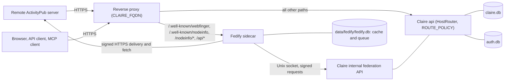

# Account, IdP, and Fedify MIT Sidecar Integration Design

- **Document Identifier**: `DESIGN-ACCOUNT-IDP-FEDIFY-SIDECAR-20261110`
- **Status**: Approved for implementation (not implemented). Owner decisions FD1–FD12 are locked (Section 15, 2026-11-10). Phase FP0 is complete: technical items FT1–FT7 are confirmed (Section 15.1, 2026-11-10).
- **Date**: 2026-11-10 · Base Commit `7bc536f`
- **Related Documents**:
  - [`PRINCIPLES.md`](../PRINCIPLES.md)
  - [`MULTI_ACCOUNT_NAMESPACE_AND_SINGLE_FQDN_DESIGN.md`](MULTI_ACCOUNT_NAMESPACE_AND_SINGLE_FQDN_DESIGN.md) (account, namespace, host roles, IdP)
  - [`SYNDICATION_ENDPOINT_DESIGN.md`](SYNDICATION_ENDPOINT_DESIGN.md) (connected-account client model)
  - [`EXTERNAL_IDP_AND_PER_USER_WORKSPACE_DESIGN.md`](EXTERNAL_IDP_AND_PER_USER_WORKSPACE_DESIGN.md) (OIDC rules)
  - [`ACCOUNTS.md`](../implementation/ACCOUNTS.md), [`TOKEN_EXCHANGE.md`](../implementation/TOKEN_EXCHANGE.md), [`EXTERNAL_ACCESS.md`](../implementation/EXTERNAL_ACCESS.md), [`SCHEMA_VERSIONING.md`](../implementation/SCHEMA_VERSIONING.md)
- **External Reference**: Fedify (`https://fedify.dev`), MIT License. Release line 2.3.x at the date of this document.

Evidence tags follow [`PRINCIPLES.md`](../PRINCIPLES.md) F1: **[code]** (confirmed in source at the base commit), **[decision]** (owner policy), **[unverified]** (not confirmed; do not cite as fact).

---

## 1. Objective and Scope

### 1.1 Objective

Each Claire account with a public profile becomes an ActivityPub actor with the handle `@username@CLAIRE_FQDN`. A separate process, the Fedify sidecar, does the federation protocol work. Claire stays the canonical source for accounts, identity, authorization, and content.

The three terms in the title have these meanings in this document.

| Term | Meaning |
| :--- | :--- |
| Account | The canonical account row in `data/claire.db` (`accounts`). The `profile_public` contract is sealed at the base commit. |
| IdP | Claire has two identity roles. Claire is an OIDC relying party for external IdPs (login). Claire is also the OAuth 2.1 authorization server for MCP and token exchange. In this design, Claire is the only identity authority. The sidecar has no user database, no login, and no session. |
| Fedify MIT sidecar | A TypeScript process that uses the Fedify library. The sidecar source is in this repository under the repository MIT license. Fedify has the MIT license. |

### 1.2 Preconditions Sealed at the Base Commit

| Seal | Fact at `7bc536f` | Use in this design |
| :--- | :--- | :--- |
| R1 | **[code]** `PATCH /api/me` accepts `profile_public` (0 or 1). `GET /api/me` returns it. `/settings/account` shows the switch in network mode only. | `profile_public` is the per-account gate for federation (FK4). |
| R2 | **[code]** `RESERVED_USERNAMES` contains 21 federation and IdP words (`inbox`, `outbox`, `actor`, `actors`, `ap`, `fedify`, `federation`, `nodeinfo`, `oauth`, `auth`, `followers`, `following`, `shared_inbox`, `sharedinbox`, `webfinger`, `idp`, `oidc`, `openid`, `activitypub`, `wellknown`, `well_known`). | No account can impersonate a protocol endpoint name in a handle. |
| R3 | **[code]** RFC 8693 token exchange in `src/claire/api/oauth.py` requires a session binding and an account in `CREDENTIAL_ACCEPTING_STATUSES`. It never falls back to admin account ID 1. | Each credential has an explicit account. The federation layer adds no path without an account (Section 8.3). |
| R5 | **[code]** `/prototype/syndication` is behind `_system("read")`. Live `/syndication` does not read prototype seed data. | No mock federation data can go to a remote server. |

### 1.3 Change to an Earlier Decision

This design changes one earlier decision. The owner approved the change on 2026-11-10 (FD1).

- [`SYNDICATION_ENDPOINT_DESIGN.md`](SYNDICATION_ENDPOINT_DESIGN.md) §1.2 withdrew the direct implementation of an ActivityPub actor.
- [`MULTI_ACCOUNT_NAMESPACE_AND_SINGLE_FQDN_DESIGN.md`](MULTI_ACCOUNT_NAMESPACE_AND_SINGLE_FQDN_DESIGN.md) §1.2 and §14-10 kept that withdrawal. It reserved `acct:username@FQDN` and did not implement WebFinger.

The reasons for the withdrawal were key custody, signature verification, delivery queues, remote moderation, abuse handling, and a larger public attack surface. This table shows where each concern goes now.

| Concern | Owner in this design |
| :--- | :--- |
| Signature verification (HTTP Signatures, Linked Data Signatures, Object Integrity Proofs) | Fedify sidecar |
| Delivery queue, retry, fan-out, shared inbox | Fedify sidecar |
| WebFinger, NodeInfo, JSON-LD processing | Fedify sidecar |
| Key custody | Claire (`auth.db` and `SecretService`), Section 7 |
| Moderation and abuse handling | Claire policy with a small v1 scope, Section 11 |
| Public attack surface | A fixed set of paths in a separate process, Section 5 |

The connected-account client model (`syndication_accounts`, Mastodon client API, AT Protocol) does not change. The two models operate at the same time.

### 1.4 Non-Goals (v1)

- Theme actors. Only accounts are actors.
- Federation in single mode.
- A Mastodon-compatible client API on Claire.
- Claire as an OIDC provider for third-party fediverse applications.
- Account migration (`Move`, `alsoKnownAs`).
- Direct messages and follower-only visibility.
- Relays.
- A native AT Protocol server.
- Reading remote content through the native actor. Phase FP4 needs a separate design revision.

---

## 2. Facts at the Base Commit

1. **[code] Account row.** `accounts` has `id`, `public_id` (UNIQUE), `username` (UNIQUE, immutable by trigger), `role`, `status`, `display_name`, `profile_public` (default 0), `created_at`, `activated_at`, `delete_after`, `updated_at`.
2. **[code] Namespace rule N1.** `/@{username}` returns the same 404 for single mode, an unknown account, an account that is not `active`, and a profile that is not public for another principal (`src/claire/api/namespace.py`). A purged account that was public returns 410.
3. **[code] Route policy.** `ROUTE_POLICY` in `src/claire/api/security.py` is an exact `(method, path)` table. A path that is not in the table returns 404. `/.well-known/oauth-protected-resource` and `/.well-known/oauth-authorization-server` are `_system("public")` entries.
4. **[code] Host roles.** `HostRouter` selects a sub-application by host role: `app`, `usercontent`, `media`, `legacy`. Each role has its own route table.
5. **[code] OAuth server.** `POST /oauth/token` supports `authorization_code`, `refresh_token`, and token exchange. Token exchange issues a `readonly` token bound to the account of the subject session.
6. **[code] OIDC client.** `src/claire/api/oidc.py` identifies an external identity by `(iss, sub)` in `account_identities`. Client secrets come from environment variables or secret files only.
7. **[code] Secret service.** `SecretService` (`src/claire/store/secrets.py`) uses AES-256-GCM with a master key from `CLAIRE_SECRET_KEY` or `data/auth/master.key`. Additional authenticated data binds a ciphertext to its owner row.
8. **[code] Account lifecycle.** `suspended`, `deleting`, and `purged` accounts cannot use credentials. A purged USERNAME stays in `username_tombstones` until the admin releases it.
9. **[code] Syndication.** `syndication_accounts` rows belong to a theme. `syndication_dispatches.dispatched_by_account_id` records the publisher account.
10. **[code] Deployment.** `docker-compose.yml` runs `bot`, `api`, `refresh`, `recover`, and `expand` from one Python image. The image has no JavaScript runtime. The `api` service is one ASGI worker.
11. **[code] Schema versions.** `claire.db` is at version 16. `auth.db` is at version 3.

---

## 3. Key Decisions

| ID | Decision | Reason |
| :--- | :--- | :--- |
| FK1 | Claire is canonical. The sidecar is a protocol adapter. The sidecar stores only a remote-document cache and a message queue. The queue contains sender private keys while a delivery waits (Section 7). | One source of truth for account state. Account suspension and purge must stop federation without a second database to clean. |
| FK2 | There is one identity authority. The sidecar has no user-facing authentication. A browser never sends a session or a bearer token to the sidecar. | All user actions go through `ROUTE_POLICY` and `Principal`. The sidecar cannot become a second authorization path. |
| FK3 | Federation operates in network mode only. | Single mode must not show the admin USERNAME (S9). A handle shows the USERNAME. |
| FK4 | An account is an actor when all of these are true: instance setting `federation` is `on`, mode is `network`, `status` is `active`, and `profile_public` is 1. All other states return the same 404. | The rule is the same as N1. A remote server cannot find which private accounts exist. |
| FK5 | The actor ID contains `accounts.public_id`, not the USERNAME: `https://{CLAIRE_FQDN}/ap/actors/{public_id}`. The USERNAME is in `preferredUsername` and in the WebFinger subject. | A released USERNAME can go to a new account (S15). The new account must not get the old actor identity, followers, or trust. `public_id` is never used again. |
| FK6 | Federation endpoints are fixed system paths on the app host. The reverse proxy sends these paths to the sidecar. Claire does not register these paths. | The handle host is `CLAIRE_FQDN` (K1). Inbound federation load does not go through the one ASGI worker. A wrong proxy rule fails closed with 404. |
| FK7 | The sidecar calls a versioned internal API on Claire. The internal API has a dedicated listener and a dedicated route table. Claire does not call the sidecar. | One direction of control. The sidecar has no command port. The internal API is not reachable from the public port. |
| FK8 | Claire keeps the actor private keys in `auth.db`, encrypted by `SecretService`. The sidecar gets a key only through the internal API. | Backup, purge, and key rotation follow the existing secret rules. |
| FK9 | No fallback. If the sidecar is not available, outbound tasks stay `pending` and the user interface shows that state. Claire does not send the content through a connected account as a substitute. | PRINCIPLES C1 and C2. |
| FK10 | A schema object is added in the phase that first reads it. | The owner policy is to control schema growth and to remove schema that is not used. |

---

## 4. Architecture



### 4.1 Responsibilities

| Function | Claire | Sidecar |
| :--- | :--- | :--- |
| Account, USERNAME, profile, status | Canonical | Reads through the internal API |
| Login, sessions, external IdP, OAuth tokens | Only owner | None |
| Decision to publish, permission check | Only owner (`ROUTE_POLICY`, permission matrix) | None |
| Actor keys | Generates and stores | Holds in memory for a limited time |
| Followers | Stores | Sends and receives the protocol messages |
| Published objects | Stores the canonical object | Converts the object to ActivityStreams |
| HTTP signature verification, JSON-LD | None | Only owner |
| Delivery retry and fan-out | None | Only owner |
| Domain blocks | Stores, makes the final decision | Applies a cached copy early |

### 4.2 Sidecar Runtime and Source Layout

- Source directory: `sidecar/fedify/`. The directory has its own `Dockerfile`, lock file, and tests. The Python image does not get a JavaScript runtime.
- Runtime: Deno with a frozen lock file (FD7). Deno permission flags limit the process to the network, the data directory, and the socket directory.
- Storage: `data/fedify/fedify.db` with `SqliteKvStore` and `SqliteMessageQueue` from `@fedify/sqlite`, in WAL mode.
- Compose: a new service `fedify` behind the Compose profile `federation`. The service is not started when the profile is not active.
- License rule: a sidecar dependency must have the MIT, Apache-2.0, BSD, or ISC license. Other licenses need owner approval. The sidecar image keeps the license files of its dependencies.

### 4.3 Sidecar Loss Model

The sidecar database can be lost without loss of canonical data. The effects are limited to these items.

- Remote actor and key caches are fetched again.
- Activity deduplication records are lost. Claire applies inbox events idempotently (Section 6.3), so a repeated activity has no second effect.
- Deliveries that are in the queue are lost. Section 9.4 gives the recovery rule.
- The private keys in queued messages are lost with the file. Claire keeps the canonical keys, so no key is lost.

A copy of the sidecar database that goes to a third party is a key leak. The response is key rotation for each actor that had a queued delivery.

---

## 5. Public Federation Surface

### 5.1 Paths

All paths are on the app host. All paths return 404 when federation is `off` or the mode is `single`.

| Method | Path | Content |
| :--- | :--- | :--- |
| `GET` | `/.well-known/webfinger?resource=acct:{username}@{CLAIRE_FQDN}` | JRD with a `self` link to the actor ID and a profile-page link to `/@{username}/` |
| `GET` | `/.well-known/nodeinfo`, `/nodeinfo/2.1` | Software name `claire-bible`, version, protocol `activitypub`, `openRegistrations: false` |
| `GET` | `/ap/actors/{public_id}` | Actor document |
| `POST` | `/ap/actors/{public_id}/inbox` | Personal inbox |
| `POST` | `/ap/inbox` | Shared inbox |
| `GET` | `/ap/actors/{public_id}/outbox` | Paged `OrderedCollection` of public objects (FP3) |
| `GET` | `/ap/actors/{public_id}/followers` | `totalItems` only. The collection does not list followers to the public. |
| `GET` | `/ap/objects/{object_public_id}` | Published object (FP3) |
| `GET` | `/ap/actors/instance` | Instance actor of type `Application`. The sidecar uses its key to sign fetches. |

Rules:

1. The reverse proxy routes exact paths for `/.well-known/webfinger` and `/.well-known/nodeinfo`. It never routes the `/.well-known/` prefix. `/.well-known/oauth-authorization-server` and `/.well-known/oauth-protected-resource` stay on Claire.
2. `/@{username}/` has no content negotiation. One path has one format ([`MULTI_ACCOUNT_NAMESPACE_AND_SINGLE_FQDN_DESIGN.md`](MULTI_ACCOUNT_NAMESPACE_AND_SINGLE_FQDN_DESIGN.md) §6.5). The HTML profile page adds `<link rel="alternate" type="application/activity+json">` and the equivalent `Link` header that point to the actor ID.
3. The sidecar ignores `Cookie` and `Authorization: Bearer` headers on all public paths. It never sets a cookie. This is the same rule as the `usercontent` role host.
4. The sidecar builds all URLs from the canonical origin that Claire supplies (Section 6.2). It does not build URLs from the request `Host` header.
5. The sidecar reads `X-Forwarded-*` headers only from the trusted proxies that Claire configures (`CLAIRE_TRUSTED_PROXIES`).
6. NodeInfo `usage.users.total` counts federated actors only. It does not show the number of private accounts.

### 5.2 Actor Document

| Property | Source |
| :--- | :--- |
| `id` | `https://{CLAIRE_FQDN}/ap/actors/{public_id}` |
| `type` | `Person` |
| `preferredUsername` | `accounts.username` |
| `name` | `accounts.display_name` |
| `url` | `https://{CLAIRE_FQDN}/@{username}/` |
| `inbox`, `outbox`, `followers`, `endpoints.sharedInbox` | Section 5.1 |
| `publicKey` | RSA public key (HTTP Signatures) |
| `assertionMethod` | Ed25519 public key (Object Integrity Proofs) |
| `published` | `accounts.activated_at` |
| `manuallyApprovesFollowers` | `false` (FD9) |

The actor document never contains an email address, an `(iss, sub)` pair, a provider ID, the instance role, or the internal `accounts.id`. The document has no `summary` and no `icon` in v1, because the account has no such fields. The sidecar does not make these values (C1).

### 5.3 Error Semantics

| Condition | Response |
| :--- | :--- |
| Federation `off`, single mode, unknown account, account not `active`, `profile_public` is 0 | 404, same body for all |
| Purged account that was an actor, or deleted object | 410 with a `Tombstone` |
| Inbox request with an invalid signature | 401 |
| Inbox request from a blocked domain | 403 after signature verification |
| Request body larger than the inbox limit | 413 |

---

## 6. Internal Federation API

### 6.1 Transport and Authentication

- **Listener.** The `api` process opens a second listener on a Unix domain socket: `data/run/federation.sock`, mode 0660. The `fedify` container mounts only the socket directory, `data/fedify/`, and the service key file. It does not mount `data/auth/` or `data/claire.db`.
- **Listener binding.** Claire selects the internal sub-application from the listener that accepted the connection (ASGI `scope["server"]`). It never selects it from the `Host` header. The internal paths do not exist on the public listener.
- **Route table.** The internal sub-application has its own route table. Its paths are not in `ROUTE_POLICY`. No `Principal` credential (cookie, API token, OAuth token) is valid there.
- **Service credential.** `claire migrate` makes `data/auth/fedify_service.key` (32 random bytes, mode 0600) if the file does not exist. Each request has a timestamp header and a signature header: HMAC-SHA256 of the method, path, timestamp, and body hash. Claire rejects a request that is more than 60 seconds old.
- **Version.** The path prefix is `/internal/federation/v1`. The sidecar sends its contract version in a heartbeat. Claire refuses a sidecar with a different major version.
- **Models.** Request and response models are sealed (`extra="forbid"`, `strict=True`).

A TCP port on the Compose network was the alternative to the socket. The design uses the socket because it has no network exposure.

### 6.2 Endpoints

| Method | Path under `/internal/federation/v1` | Function |
| :--- | :--- | :--- |
| `GET` | `/config` | Canonical origin, handle host, mode, `federation` state, software version, trusted proxies, limits, domain-block ETag |
| `POST` | `/heartbeat` | Sidecar version, queue depth, result of the public self-check (Section 12) |
| `GET` | `/actors/by-username/{username}` | Actor record, or 404 |
| `GET` | `/actors/{public_id}` | Actor record, 404, or 410 with the time of removal |
| `GET` | `/actors/{public_id}/keys` | Key pairs in JWK format. `Cache-Control: no-store` |
| `GET` | `/actors/{public_id}/followers` | Cursor page of follower inbox addresses, and the total |
| `GET` | `/actors/{public_id}/outbox` | Cursor page of public object references (FP3) |
| `GET` | `/objects/{object_public_id}` | Canonical object, 404, or 410 (FP3) |
| `POST` | `/inbox-events` | One verified inbound activity. The response is the decision. |
| `GET` | `/outbox-tasks` | Outbound tasks that are ready, with a lease (FP3) |
| `POST` | `/outbox-tasks/{id}/ack` | Result of the handoff to the Fedify queue (FP3) |
| `GET` | `/domain-blocks` | Blocked domains, with an ETag |

The actor record contains `public_id`, `username`, `display_name`, `activated_at`, `updated_at`, and `profile_url`. It contains no field from `auth.db`.

Cursors use `max_id`, `min_id`, and `since_id` on time-ordered numbers, the same as the collection contract in [`MULTI_ACCOUNT_NAMESPACE_AND_SINGLE_FQDN_DESIGN.md`](MULTI_ACCOUNT_NAMESPACE_AND_SINGLE_FQDN_DESIGN.md) §7.4. Numbers are decimal strings in JSON.

### 6.3 Inbox Event Contract

The sidecar sends an event to Claire only after Fedify verifies the signature.

```json
{
  "event_id": "https://remote.example/activities/123",
  "type": "Follow",
  "recipient_public_id": "116412345678901234",
  "actor": {"iri": "https://remote.example/users/bob", "inbox": "https://remote.example/users/bob/inbox", "shared_inbox": "https://remote.example/inbox"},
  "object_iri": "https://claire.example.com/ap/actors/116412345678901234",
  "verified_by": "http-signature"
}
```

Claire replies with one decision.

| Decision | Meaning | Sidecar action |
| :--- | :--- | :--- |
| `accepted` with `reply: "accept"` | Claire stored the follower. | Sends `Accept(Follow)` |
| `accepted` | Claire applied the event. | None |
| `rejected` | Policy refused the event (blocked domain, recipient is not an actor). | Sends `Reject` for a `Follow`. Drops other types. |
| `ignored` | The type is not in the v1 set. | Drops the activity and increments a telemetry counter |

Rules:

- v1 applies `Follow`, `Undo(Follow)`, `Delete` of a remote actor, and `Update` of a remote actor. All other types are `ignored`.
- Each event is idempotent. The follower key is `(account_id, actor_iri)`. A repeated `Follow` gives the same decision again.
- If the internal API is not available, the inbox handler fails and the Fedify inbox queue tries again. The sidecar does not accept an event on behalf of Claire.

---

## 7. Keys

1. Claire generates two key pairs for an account when the account first becomes an actor: RSA 2048 for HTTP Signatures and Ed25519 for Object Integrity Proofs. Claire uses the `cryptography` package, which is already a dependency.
2. Claire stores the keys in `auth.db` table `actor_keys`. `SecretService` encrypts each private key with additional authenticated data `actor_key|{account_id}|{alg}`.
3. The instance actor has its own key pairs with the same storage rule.
4. The sidecar keeps a key in memory for 60 seconds at most. It does not write a key to a log.
5. **[code]** Fedify queue messages for outbound delivery contain the sender private keys in JWK format (FT3). Thus `data/fedify/fedify.db` is a secret store. The file has mode 0600. Support bundles, graph bundles, and default backups do not include it, the same as `data/auth/master.key`. The 60-second limit in item 4 applies to the memory cache. A key in a queued message stays until the delivery completes or the retry policy stops.
6. Relation to K6: K6 applies to secrets that an account owner enters. Actor keys are generated by the instance. But this design adds one path that returns a private key in plaintext, on the internal socket only. The owner accepted this path (FD5). The rejected alternative is that the sidecar generates and stores the keys. That alternative makes the sidecar database canonical and adds purge and backup rules for it.

---

## 8. Account and IdP Integration

### 8.1 Account Lifecycle Mapping

| Account event | Federation effect |
| :--- | :--- |
| `profile_public` changes 0 → 1 (federation `on`) | The change requires recent authentication (Section 8.4). Claire generates keys if there are none. The actor and the WebFinger subject become available. |
| `profile_public` changes 1 → 0 | Pause. Actor, WebFinger, and inbox return 404. Claire makes no new outbound task. Followers stay stored. Claire sends no `Delete`. |
| `active` → `suspended`, or → `deleting` | Pause, as above. |
| `suspended` or `deleting` → `active` | The actor is available again with the same ID, keys, and followers. |
| Purge | Claire writes a tombstone and makes a `delete_actor` task. After the sidecar acknowledges the handoff, Claire deletes the followers and the keys. The actor ID returns 410 from then on. |
| USERNAME release after purge | A new account with the same USERNAME gets a new `public_id` and thus a new actor ID. The old actor ID stays 410. |
| `display_name` change | Claire makes an `Update(Person)` task for followers (FP3). |
| Admin sets `federation` to `off` | All federation paths return 404. Claire sends no mass `Delete`. |
| Network mode → single mode | Claire refuses the mode change while `federation` is `on`. |

Notes:

- Pause must be reversible. A `Delete(Person)` is not reversible on most remote servers. Thus only purge sends it (FD10).
- A paused actor does not remove copies that remote servers already have. The `/settings/account` switch text must say this.
- If the sidecar is not available at purge, the purge waits in a visible state. The admin can continue with an explicit option that skips the federated delete. Claire records that choice in `admin_audit`.
- The release preview ([`MULTI_ACCOUNT_NAMESPACE_AND_SINGLE_FQDN_DESIGN.md`](MULTI_ACCOUNT_NAMESPACE_AND_SINGLE_FQDN_DESIGN.md) §8.9) must warn that remote servers can keep an old handle-to-actor mapping for some time.

### 8.2 External IdP (Claire as Relying Party)

1. No external identity data goes into federation. `iss`, `sub`, email, and provider ID are not in the actor document, WebFinger, NodeInfo, or any internal API payload. A test puts canary values in `account_identities` and searches all federation output for them.
2. The actor identity is the Claire account. To link or unlink an IdP does not change the actor ID, the keys, or the followers.
3. An account that has only an IdP login and no password can be an actor.
4. An IdP claim cannot turn federation on, cannot set `profile_public`, and cannot set the USERNAME. This extends rules 4 and 6 of [`MULTI_ACCOUNT_NAMESPACE_AND_SINGLE_FQDN_DESIGN.md`](MULTI_ACCOUNT_NAMESPACE_AND_SINGLE_FQDN_DESIGN.md) §12.
5. A back-channel logout from an IdP ends sessions only. It does not pause the actor. Account suspension is the control that pauses federation.

### 8.3 Claire as Authorization Server

1. The sidecar is not an OAuth client and not an OAuth protected resource. Federation paths accept no Claire credential.
2. The sidecar does not use RFC 8693 token exchange. Token exchange needs a subject session and issues an account-bound `readonly` token. A service has no account. The R3 seal stays complete: no account, no token.
3. The service credential (Section 6.1) gives access to the internal federation API only. It is not a `Principal`. It cannot call a `ROUTE_POLICY` route.
4. A user action that causes federation (publish, retract, remove a follower) is a normal Claire route. The route requires `owner` or `collaborator` access in the account namespace. A `readonly` token, including an MCP OAuth token, cannot cause an outbound activity.
5. Each outbound task has `account_id NOT NULL`. No federation function has a default account. A test fails if a federation module refers to `ADMIN_ACCOUNT_ID` as a default.
6. The admin is not a content superuser (K5). The admin can turn federation on or off and can block domains. The admin cannot publish as a member and cannot read follower lists of a member through the internal API.

### 8.4 Step-Up Authentication

With federation `on`, the `profile_public` switch has a larger effect than before. Thus the sealed `PATCH /api/me` contract gets one more condition (FD11).

- When federation is `on`, a `profile_public` change from 0 to 1 requires recent authentication (`require_recent_auth`). Without it, the route gives the same step-up response as the other step-up routes.
- A change from 1 to 0 never requires recent authentication. A user must always be able to pause quickly.
- When federation is `off`, the contract is the same as at the base commit.
- A bearer credential has no `authenticated_at` value. Thus a bearer credential cannot make the 0 → 1 change when federation is `on`.
- Phase FP1 implements this condition together with the instance switch. `console_account.js` opens the step-up dialog before it sends the change.

---

## 9. Publishing (Phase FP3)

### 9.1 What Is Published

- Only an ingested body from a public theme (`is_public`) of a federated account can be published.
- The object type is `Article` with `name`, `content`, `url`, `attributedTo`, `published`, and `updated` (FD8). `content` is HTML that the `nh3` allowlist sanitizer cleaned. `url` is the public Claire page of the document.
- The audience is public, with the followers collection in `cc`.
- v1 sends no hashtags. Entity names are not converted to tags (FD8).
- Media in the body uses `media_url` links. v1 sends no attachments.

### 9.2 Routes on Claire

| Method | Path | Access | Function |
| :--- | :--- | :--- | :--- |
| `POST` | `/api/federation/publish` | `collaborator`, network mode | Publish or update one document through the actor of the theme owner |
| `POST` | `/api/federation/retract` | `collaborator`, network mode | Send `Delete` for one published object |
| `GET` | `/api/federation/status` | `owner`, network mode | Handle, actor state, follower count, pending task count |
| `DELETE` | `/api/federation/followers` | `owner`, network mode | Remove one follower |
| `GET`, `PUT` | `/api/admin/federation` | `admin` | Federation switch, domain blocks, sidecar health |

The console gets `/settings/federation` and `/admin/federation` sections in the shared console shell. The `/syndication` publish dialog shows the native actor as one more target next to connected accounts.

### 9.3 Transactional Outbox

1. The publish route writes the `federation_objects` row and the `federation_outbox` row in one transaction.
2. The sidecar polls `/outbox-tasks`, converts each task to an activity, gives it to the Fedify queue, and acknowledges it.
3. Task states are `pending`, `handed_off`, and `rejected`. Per-inbox delivery results go to the telemetry store, not to `claire.db` (PRINCIPLES A4).
4. A task lease expires if the sidecar does not acknowledge it. Then the task is `pending` again. Activity IDs are stable, so a second handoff does not make a second object on a remote server.

### 9.4 Privacy Triggers

Claire makes `Delete` tasks for all published objects of a theme when one of these occurs:

- The theme changes from public to private.
- The document is purged.
- The theme is deleted.

The `visibility_epoch` increment and the `Delete` tasks are in the same transaction. A remote server can ignore a `Delete`. The user interface must say that removal on remote servers is a request, not a guarantee.

If the sidecar database is lost, tasks in state `handed_off` that are less than the maximum retry period old go back to `pending`. The admin starts this recovery with a command. It does not start automatically.

---

## 10. Data Model

### 10.1 `claire.db` Version 17

```sql
-- FP2
CREATE TABLE federation_followers (
    public_id INTEGER UNIQUE NOT NULL,           -- time-ordered number, collection cursor
    account_id INTEGER NOT NULL REFERENCES accounts(id) ON DELETE CASCADE,
    actor_iri TEXT NOT NULL,
    inbox_iri TEXT NOT NULL,
    shared_inbox_iri TEXT,
    created_at REAL NOT NULL,
    updated_at REAL NOT NULL,
    PRIMARY KEY (account_id, actor_iri)
);
CREATE TABLE federation_tombstones (
    public_id INTEGER PRIMARY KEY,               -- actor or object number. No USERNAME (K4)
    kind TEXT NOT NULL CHECK (kind IN ('actor', 'object')),
    gone_at REAL NOT NULL
);
CREATE TABLE federation_domain_blocks (
    domain TEXT PRIMARY KEY,                     -- lowercase ASCII (punycode)
    created_at REAL NOT NULL,
    created_by INTEGER NOT NULL REFERENCES accounts(id),
    note TEXT NOT NULL DEFAULT ''
);

-- FP3
CREATE TABLE federation_objects (
    public_id INTEGER PRIMARY KEY,               -- time-ordered number, object ID and outbox cursor
    account_id INTEGER NOT NULL REFERENCES accounts(id) ON DELETE CASCADE,
    theme_id INTEGER NOT NULL REFERENCES themes(id) ON DELETE CASCADE,
    document_id TEXT NOT NULL,
    published_by_account_id INTEGER NOT NULL REFERENCES accounts(id),
    published_at REAL NOT NULL,
    updated_at REAL NOT NULL,
    UNIQUE (theme_id, document_id)
);
CREATE TABLE federation_outbox (
    id INTEGER PRIMARY KEY AUTOINCREMENT,
    account_id INTEGER NOT NULL,                 -- no default (Section 8.3)
    kind TEXT NOT NULL CHECK (kind IN ('create', 'update', 'delete', 'update_actor', 'delete_actor')),
    object_public_id INTEGER,
    status TEXT NOT NULL CHECK (status IN ('pending', 'handed_off', 'rejected')),
    lease_until REAL,
    error_code TEXT,
    created_at REAL NOT NULL,
    handed_off_at REAL
);
CREATE INDEX idx_federation_outbox_ready ON federation_outbox(status, id);
```

- `instance_settings` gets the key `federation` with the values `off` (default) and `on`.
- The migration is idempotent and adds tables only (PRINCIPLES A3).
- `federation_objects` and `federation_followers` are theme-independent account data, except `federation_objects.theme_id`. The AST test for explicit `theme_id` (S3) must cover `federation_objects` queries.
- `federation_tombstones` has no foreign key to `accounts`, because the row must stay after the purge.
- A deleted object is a `federation_tombstones` row. The `federation_objects` row is deleted in the same transaction.

### 10.2 `auth.db` Version 4

```sql
-- FP1
CREATE TABLE actor_keys (
    account_id INTEGER NOT NULL,                 -- 0 = instance actor
    alg TEXT NOT NULL CHECK (alg IN ('rsa2048', 'ed25519')),
    public_jwk TEXT NOT NULL,
    private_ciphertext BLOB NOT NULL,
    private_nonce BLOB NOT NULL,
    key_version INTEGER NOT NULL,
    created_at REAL NOT NULL,
    PRIMARY KEY (account_id, alg)
);
```

### 10.3 Sidecar Database

`data/fedify/fedify.db` contains only the Fedify tables (`fedify_kv`, `fedify_message` by default). Claire does not read this file. The sidecar does not read `claire.db` or `auth.db`.

---

## 11. Moderation and Abuse (v1 Scope)

1. **Domain blocks.** The admin keeps a list of blocked domains. The sidecar refuses inbound activities and outbound deliveries for those domains. Claire makes the final check on each inbox event.
2. **Follower removal.** An account owner can remove a follower. Claire deletes the row and the sidecar sends `Reject(Follow)`.
3. **Small inbound set.** v1 applies four activity types only (Section 6.3). Replies, likes, and announces are not stored. Thus v1 stores no remote HTML and shows no remote content.
4. **Limits.** The sidecar enforces an inbox body limit and a method allowlist. Request rate limits are a reverse proxy function. [`EXTERNAL_ACCESS.md`](../implementation/EXTERNAL_ACCESS.md) must give the rules when FP1 is implemented.
5. **Reports.** Inbound `Flag` activities are `ignored` in v1 and counted in telemetry.

---

## 12. Readiness Checks

The admin can set `federation` to `on` only when all checks pass. `claire instance check --federation --json` and the `/admin/federation` screen use the same checks.

| ID | Check |
| :--- | :--- |
| GF1 | The instance mode is `network`. |
| GF2 | The sidecar heartbeat is recent and its contract major version is the same as that of Claire. |
| GF3 | `data/auth/fedify_service.key` exists with mode 0600. |
| GF4 | `SecretService` can load the master key. |
| GF5 | In production, the canonical origin uses `https`. |
| GF6 | The sidecar public self-check passed: a request to `https://{CLAIRE_FQDN}/.well-known/webfinger` for the instance actor returned the sidecar response. This shows that the reverse proxy rules are correct. |
| GF7 | A request to `/.well-known/oauth-authorization-server` through the public origin still returns the Claire metadata. |

---

## 13. Security Risks and Controls

| ID | Risk | Control | Phase |
| :--- | :--- | :--- | :--- |
| FS1 | Server-side request forgery through sidecar fetches and deliveries | The sidecar refuses private and loopback addresses (PRINCIPLES B2). **[code]** Fedify refuses them by default for fetches and deliveries (FT4). The sidecar must never set `allowPrivateAddress`. A sidecar test fails if the option is set. | FP1 |
| FS2 | Forged or replayed inbound activity | Fedify signature verification, activity ID deduplication, idempotent events in Claire | FP2 |
| FS3 | Exposure of the internal API | Unix socket, listener binding, signed requests, dedicated route table | FP1 |
| FS4 | Private key leak through the queue file, logs, or bundles | Section 7 items 4 and 5. A canary key test searches logs and bundles. | FP1 |
| FS5 | Account enumeration through WebFinger | The same 404 for all states that are not federated (FK4) | FP1 |
| FS6 | USERNAME leak in single mode (S9) | All federation paths return 404 in single mode. The S9 test also calls the sidecar. | FP1 |
| FS7 | A new account gets the trust of an old USERNAME (S15) | Actor ID from `public_id` (FK5), permanent tombstone | FP1 |
| FS8 | Inbound load stops the one ASGI worker | Federation ingress goes to the sidecar. Only verified v1 events get to Claire. | FP1 |
| FS9 | Content stays on remote servers after a theme becomes private | `Delete` tasks in the same transaction as `visibility_epoch` (Section 9.4), and user interface text | FP3 |
| FS10 | Wrong reverse proxy rules | Fail closed: Claire and the sidecar return 404 for paths of the other. GF6 and GF7. | FP1 |
| FS11 | Supply chain risk in sidecar dependencies | Frozen lock file, pinned Fedify minor version, license rule (Section 4.2), limited runtime permissions | FP1 |
| FS12 | The sidecar becomes a path to account data | The sidecar mounts no canonical database. The internal API exposes public actor data, follower inboxes, and public objects only. | FP1 |
| FS13 | External identity data in federation output | Section 8.2 item 1 canary test | FP1 |

---

## 14. Phases and Verification

### 14.1 Phases

| Phase | Scope | Completion criteria |
| :--- | :--- | :--- |
| **FP0** Technical checks (complete, 2026-11-10) | Confirmation of each **[unverified]** item (Section 15.1) with a small test program. Contract fixture format. No product code. | No **[unverified]** tag remains in Sections 4–13. A check that fails goes back to the owner before FP1 starts. |
| **FP1** Internal contract and discovery | Internal listener and sub-application, service key, `instance_settings.federation`, `auth.db` v4, actor and key endpoints, sidecar with WebFinger, NodeInfo, actor document, instance actor, Compose profile and `cb-manuscript` wiring, alternate link on the profile page, readiness checks, step-up condition on `profile_public` (Section 8.4) | A remote-style client resolves a handle to an actor document and verifies a signed fetch. Single mode shows no USERNAME. |
| **FP2** Followers | `claire.db` v17 (FP2 tables), inbox events, `Accept` and `Reject`, domain blocks, follower removal, `/settings/federation`, `/admin/federation` | A signed `Follow` from a second instance makes one follower row. A repeated `Follow` makes no second row. A blocked domain gets 403. |
| **FP3** Publishing | `claire.db` FP3 tables, publish, update, retract, outbox collection, object endpoint, lifecycle tasks, privacy triggers, publish dialog target | A published document arrives at a test inbox with a valid signature. A change of the theme to private sends `Delete`. |
| **FP4** Remote reading | Follow remote actors and show their posts as syndication items | Needs a design revision. Remote HTML must render on the `usercontent` origin (K10). |

Dependencies: `FP0 → FP1 → FP2 → FP3`. FP4 is independent of FP3.

### 14.2 Tests

The tests follow the repository test policy.

- **Module interfaces.** The internal API contract has shared JSON fixtures. Python tests and sidecar tests read the same fixtures. A change to one side without the other fails.
- **I/O.** Migration idempotence for `claire.db` v17 and `auth.db` v4. Listener binding of the internal sub-application. Service key file mode. Outbox lease and acknowledgement.
- **External library calls.** Key generation and JWK export with `cryptography`. Fedify dispatcher wiring in the sidecar.
- **End-to-end.** One test for each feature phase at minimum: discovery (FP1), follow from a second development instance (FP2), publish to a test inbox (FP3).
- **Determinism.** All federation tests use fixed keys, fixed clocks, and local test servers. No test calls a public fediverse server (PRINCIPLES A2).

Verification is in development mode only. The agent does not access the production server (PRINCIPLES E4).

### 14.3 Documentation Updates per Phase

| Phase | Documents |
| :--- | :--- |
| FP1 | New `docs/implementation/FEDERATION.md`. Updates to `ACCOUNTS.md`, `EXTERNAL_ACCESS.md` (proxy rules), `ENVIRONMENT_VARIABLES.md`, `OPERATIONS.md`, `SCHEMA_VERSIONING.md` (`auth.db` v4). |
| FP2 | `FEDERATION.md`, `SCHEMA_VERSIONING.md` (`claire.db` v17), `API_HTTP_CONTRACT.md`, `openapi.yaml` |
| FP3 | `FEDERATION.md`, `API_AND_MCP_GUIDE.md`, `openapi.yaml` |

This design document is a historical record after implementation starts (PRINCIPLES F2).

### 14.4 Work Units

"FP" means "Federation Phase". Each phase FP1 to FP3 is divided into work units. A unit ID has the phase and a sequence number: `FP1-3` is the third unit of phase FP1. The owner starts each unit with an instruction that names the unit ID, for example "Do FP1-3".

Rules for each unit:

1. The agent does one unit for each instruction and then stops. It does not start the next unit.
2. A unit starts only when all units in its "After" column are complete.
3. A unit ends with passing tests for its scope and one commit. If a unit cannot be completed, the agent commits nothing that breaks the tests and reports what remains.
4. The agent records the status and the commit of each unit in the table in `PROJECT.md`. A new session reads that table and this section to continue.
5. A unit can be done in a new session. This decreases the cost of each turn.
6. The size column is a relative estimate of the work: S (small), M (medium), L (large). Start an L unit when the usage limit has sufficient margin.

**Phase FP1: internal contract and discovery**

| Unit | Scope | Completion criteria | After | Size |
| :--- | :--- | :--- | :--- | :--- |
| FP1-1 | Internal listener on a Unix socket, internal sub-application with its own route table, service key file, signed-request verification (Section 6.1) | The internal paths answer on the socket only. A request with a bad signature or an old timestamp is refused. The public listener returns 404 for internal paths. | FP0 | M |
| FP1-2 | `auth.db` version 4 with `actor_keys`, key generation and encrypted storage for accounts and the instance actor (Sections 7, 10.2) | The migration is idempotent. A stored private key decrypts only with its own account and algorithm. | FP0 | S |
| FP1-3 | `instance_settings.federation`, internal endpoints `config`, `heartbeat`, `actors`, `keys`, contract fixtures (Section 6.2) | Each endpoint agrees with its fixture. A non-federated account gets 404. No `auth.db` identity field is in a response. | FP1-1, FP1-2 | M |
| FP1-4 | Recent authentication for the `profile_public` change 0 → 1 when federation is `on` (FD11), step-up dialog in `console_account.js`, alternate link on the profile page (Sections 5.1, 8.4) | The change without recent authentication is refused when federation is `on`. The contract is unchanged when federation is `off`. | FP1-3 | S |
| FP1-5 | Sidecar source in `sidecar/fedify/`: internal API client, WebFinger, NodeInfo, actor document, instance actor, sidecar tests. Removal of `sidecar/fedify/spike/`. (Sections 4.2, 5) | The sidecar tests pass against the contract fixtures. A handle resolves to an actor document with the canonical origin. | FP1-3 | L |
| FP1-6 | Compose service `fedify` with profile `federation`, `cb-manuscript` wiring, environment variables, readiness checks GF1–GF7, `/api/admin/federation` switch (Sections 4.2, 12) | `scripts/ci.sh` passes its Compose checks. The switch refuses `on` when a readiness check fails. | FP1-5 | M |
| FP1-7 | End-to-end test for discovery, single-mode USERNAME test for the sidecar (S9), implementation documents (Section 14.3), full CI | The end-to-end test passes in development mode. `scripts/ci.sh` passes. | FP1-4, FP1-6 | M |

**Phase FP2: followers**

| Unit | Scope | Completion criteria | After | Size |
| :--- | :--- | :--- | :--- | :--- |
| FP2-1 | `claire.db` version 17 with `federation_followers`, `federation_tombstones`, `federation_domain_blocks`, and the store functions (Section 10.1) | The migration is idempotent. The follower key is `(account_id, actor_iri)`. | FP1-7 | S |
| FP2-2 | Internal endpoints `inbox-events`, `followers`, `domain-blocks`, with fixtures (Sections 6.2, 6.3) | A repeated `Follow` event makes one row. An event from a blocked domain is `rejected`. An event type outside the v1 set is `ignored`. | FP2-1 | M |
| FP2-3 | Sidecar inbox listeners, `Accept` and `Reject`, followers collection with the total only, cached domain blocks (Sections 5.1, 6.3, 11) | A signed `Follow` gives an `Accept`. An invalid signature gets 401. A blocked domain gets 403. | FP2-2 | M |
| FP2-4 | Console sections `/settings/federation` and `/admin/federation`, routes `GET /api/federation/status`, `DELETE /api/federation/followers`, domain block management (Section 9.2) | An owner sees the handle and the follower count and can remove a follower. Only the admin can change domain blocks. | FP2-2 | M |
| FP2-5 | End-to-end test for a follow from a second development instance, implementation documents, full CI | The end-to-end test passes. `scripts/ci.sh` passes. | FP2-3, FP2-4 | S |

**Phase FP3: publishing**

| Unit | Scope | Completion criteria | After | Size |
| :--- | :--- | :--- | :--- | :--- |
| FP3-1 | `federation_objects` and `federation_outbox` tables, routes `POST /api/federation/publish` and `POST /api/federation/retract` (Sections 9.1–9.3, 10.1) | Only a document of a public theme of a federated account can be published. The object row and the task row are in one transaction. Each task has an account. | FP2-5 | M |
| FP3-2 | Internal endpoints `outbox-tasks`, task acknowledgement, lease expiry, `objects`, `outbox`, with fixtures (Sections 6.2, 9.3) | A task that is not acknowledged becomes `pending` again after its lease. A deleted object returns 410. | FP3-1 | S |
| FP3-3 | Sidecar task poller, conversion to `Create`, `Update`, and `Delete` of an `Article`, delivery to followers, object endpoint and outbox collection (Sections 5.1, 9.1, 9.3) | A published document arrives at a test inbox with a valid signature. A second handoff of the same task makes no second object. | FP3-2 | L |
| FP3-4 | Lifecycle tasks: `Update(Person)`, purge with `Delete(Person)` and the skip option, privacy triggers for a private theme, a purged document, and a deleted theme (Sections 8.1, 9.4) | A theme change to private makes `Delete` tasks in the same transaction as the `visibility_epoch` increment. A purged actor returns 410. | FP3-3 | M |
| FP3-5 | Native actor as a target in the `/syndication` publish dialog, end-to-end test for publishing, recovery command for a lost sidecar database, implementation documents, full CI | The end-to-end test passes. `scripts/ci.sh` passes. | FP3-4 | M |

Units that can be done in any order after their "After" units: FP1-1 and FP1-2; FP1-4 and FP1-5; FP2-3 and FP2-4.

---

## 15. Owner Decisions

The owner locked all decisions on 2026-11-10. Each decision is the recommendation of the first revision of this document. A change to a locked decision needs a new revision of this document.

| ID | Topic | Locked Decision | Section |
| :--- | :--- | :--- | :--- |
| FD1 | Native actors | Claire hosts ActivityPub actors through a Fedify sidecar. This replaces the withdrawal in the syndication design. The connected-account client model stays. | §1.3 |
| FD2 | Instance mode | Federation operates in network mode only. | FK3 |
| FD3 | Per-account gate | The gate is `profile_public` together with the instance switch. There is no separate per-account federation switch. | FK4 |
| FD4 | Actor ID | The actor ID uses `public_id`: `/ap/actors/{public_id}`. | FK5 |
| FD5 | Key custody | Claire keeps the actor keys and gives them to the sidecar on the internal socket only. | §7 |
| FD6 | Ingress | The reverse proxy routes the federation paths to the sidecar. Claire does not proxy them. | FK6 |
| FD7 | Sidecar runtime | Deno. | §4.2 |
| FD8 | Object type | A published body is an `Article`. v1 sends no hashtags. | §9.1 |
| FD9 | Follow approval | Follow requests are accepted automatically in v1. | §5.2 |
| FD10 | Pause | A `profile_public` change to 0 is a reversible pause. Only purge sends `Delete(Person)`. | §8.1 |
| FD11 | Step-up | When federation is `on`, the `profile_public` change 0 → 1 requires recent authentication. This adds a condition to the sealed `PATCH /api/me` contract. | §8.4 |
| FD12 | Theme actors | Theme actors are out of scope for v1. | §1.4 |

### 15.1 Technical Items Confirmed in FP0

All items were confirmed on 2026-11-10 with Deno 2.9.8, `@fedify/fedify` 2.3.15, `@fedify/sqlite` 2.3.15, and uvicorn 0.54.0. The check programs and the commands are in `sidecar/fedify/spike/`. No check failed, so no locked decision changes.

| ID | Item | Result |
| :--- | :--- | :--- |
| FT1 | Fedify accepts an actor path that uses a number as the identifier and maps the WebFinger USERNAME to it (`mapHandle`). | **[code]** Confirmed. `acct:{username}@host` resolves to `/ap/actors/{public_id}`. The number is not accepted as a USERNAME. |
| FT2 | Fedify accepts a fixed canonical origin that is different from the request host. | **[code]** Confirmed with the `origin` option. No URL contains the request host. |
| FT3 | Fedify queue messages contain sender private keys. | **[code]** Confirmed: they do. Section 7 item 5 and Section 4.3 give the rules. |
| FT4 | Fedify refuses private network addresses by default for fetches and deliveries. | **[code]** Confirmed. The option is `allowPrivateAddress`, default `false`. |
| FT5 | The followers collection can give `totalItems` to the public and the full list to the delivery code only. | **[code]** Confirmed. The dispatcher gives an empty list when the context has a request. A counter callback gives the total. |
| FT6 | The selected runtime can serve HTTP on a TCP port and call an HTTP API on a Unix socket. | **[code]** Confirmed. The Deno permission flags must name the socket path and the placeholder host of the internal URL. |
| FT7 | The `api` process can open the internal listener in the same event loop as the public listener in production and in local `uv` runs. | **[code]** Confirmed. One uvicorn `Server` serves both sockets, the same pattern as the development role-host listeners. `scope["server"]` identifies the Unix socket. A forged `Host` header does not change it. |

The contract fixture format for FP1 is one JSON file for each internal API call in `tests/fixtures/federation_contract/`. Each file has the keys `request`, `response`, and `status`. The Python tests and the sidecar tests read the same files.
