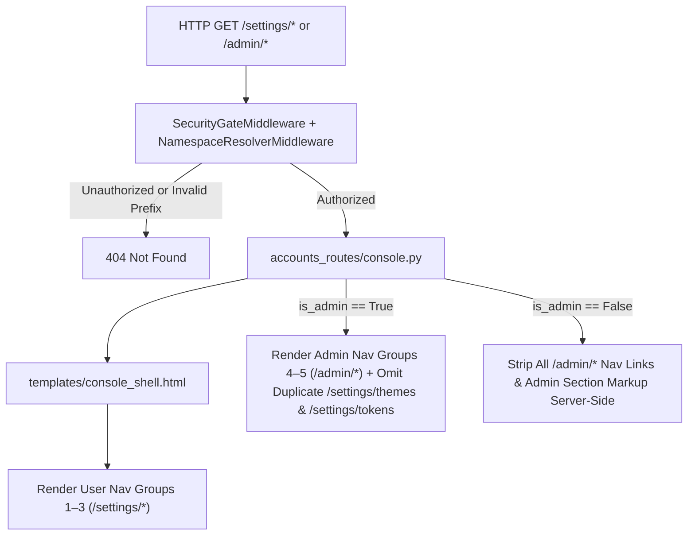

# Functional Path Separation of `admin/` and `settings/` with a Unified Console UI

- **Document Identifier**: `DESIGN-ADMIN-SETTINGS-CONSOLE-20261104`
- **Status**: Implemented (Owner Decisions D1–D5 Locked) · `P1` `2aeedc4` · `P2` `2a04ae8` · `P3` `82e4558` · `P4` `cdc0f2a` · `P5` implementation docs and OpenAPI sync (this change)
- **Date**: 2026-11-04 · Base Commit `8efce1a`
- **Related Documents**:
  - [`PRINCIPLES.md`](../PRINCIPLES.md)
  - [`MULTI_ACCOUNT_NAMESPACE_AND_SINGLE_FQDN_DESIGN.md`](MULTI_ACCOUNT_NAMESPACE_AND_SINGLE_FQDN_DESIGN.md)
  - [`SYNDICATION_ENDPOINT_DESIGN.md`](SYNDICATION_ENDPOINT_DESIGN.md)
  - [`ACCOUNTS.md`](../implementation/ACCOUNTS.md)
  - [`API_HTTP_CONTRACT.md`](../implementation/API_HTTP_CONTRACT.md)
  - [`THEMES.md`](../implementation/THEMES.md)

---

## 1. Objective and Locked Owner Decisions

### 1.1 Objective

Split the capabilities in `/syndication/preferences` (`src/claire/templates/syndication_preferences.html`) across two functional URL prefixes while unifying fragmented management screens into one shared Console UI shell:

1. **`/admin/*`** — Administrator-only (`admin`) routes. This path group includes all administrator-scoped items from `/syndication/preferences`, all items from `'상세 메뉴' → '관리 및 설정'` on `/` (`src/claire/templates/index.html`), and all existing `/admin/*` capabilities (`src/claire/api/accounts_routes/`).
2. **`/settings/*`** — End-user (`owner`) routes. This path group includes all user-scoped and theme-scoped preferences from `/syndication/preferences`, personal account controls from `/me`, BYOK credentials (`/api/me/keys`), and member theme/token management.

Path separation enforces server-side privilege boundaries (`ROUTE_POLICY`), not UI separation. Both `/admin/*` and `/settings/*` render inside one shared Console UI shell (`src/claire/templates/console_shell.html`).

### 1.2 Locked Owner Decisions (D1–D5)

| ID | Topic | Locked Decision |
| :--- | :--- | :--- |
| **D1** | `/settings/*` `RouteSurface` | Use `_system("owner")` for `/settings` and `/settings/{section}` routes. Canonical URLs are `/settings/*` (with optional `?theme={ref}` for theme-scoped syndication tabs) in both `single` and `network` modes. Prefixed paths (`/@{username}/settings/*`, `/themes/{n}/settings/*`) return `404 Not Found` (rule N5). Reserve `"settings"` in `RESERVED_USERNAMES`. |
| **D2** | Service root `/` `'상세 메뉴' → '관리 및 설정'` | Keep the inline right-drawer quick panels on `/` backed by shared JS modules (`src/claire/static/js/manage/`), add `"is_admin"` to `GET /whoami` so non-admin members never see `⚡ 프로바이더` or `📏 적재 제한`, and add a Console entry button (`🛠️ 관리자 콘솔` → `/admin` for admin; `⚙️ 내 설정` → `/settings` for non-admin owners). |
| **D3** | Account-scoped items (`📁 테마 관리`, `🔑 API/MCP 키`) | Provide `/admin/themes` and `/admin/tokens` for the administrator (managing `ADMIN_ACCOUNT_ID = 1` themes/tokens plus read-only instance slot/policy counts without member content access), and `/settings/themes` and `/settings/tokens` for regular members. When `is_admin` is true, display these two items once under the `/admin/*` sidebar group and redirect `GET /settings/themes` → `/admin/themes` and `GET /settings/tokens` → `/admin/tokens` (`302 Found`). |
| **D4** | Legacy `/me` and `/syndication/preferences` | Keep `GET /me` → `/settings/account` and `GET /syndication/preferences?tab=...` → mapped `/settings/*` (or `/admin/*` when `is_admin` is true and `?tab=idp\|userdb`) as `302 Found` compatibility redirects. Keep `/api/me*` JSON endpoints unchanged. |
| **D5** | Phased Agent Execution Plan | Structure this specification into self-contained, CI-green phases (`P1`–`P5`) with explicit file ownership, interface contracts, test boundaries, and verification gates so autonomous agents can execute one phase at a time. |

### 1.3 Non-Negotiable Architecture and Security Invariants

1. **Stealth 404 on Privilege Failure (`PRINCIPLES.md` B1, N5)**: Non-administrator requests (`member`, `collaborator`, `readonly`, `anonymous`) to any `/admin` or `/admin/*` route must receive `404 Not Found` before any redirect (`302`) executes. Never return `403 Forbidden` on `/admin/*`.
2. **Zero Admin Content Peeking (`ACCOUNTS.md` D5, K5)**: Administrator screens manage instance configuration, account lifecycle, quotas, and the administrator's own workspace (`ADMIN_ACCOUNT_ID = 1`). Administrator routes must never read or mutate a member's private themes, syndication feeds, connected AP/AT tokens, or BYOK secret values.
3. **Strict Server-Side Admin DOM Stripping**: When `is_admin` is false, the server must omit all `/admin/*` navigation links and `<section>` templates from the rendered HTML. Do not hide administrator panels with CSS `hidden` attributes in member responses.
4. **Single-Mode `USERNAME` Concealment (`ACCOUNTS.md` S9)**: When `instance.mode == "single"`, `/admin/*`, `/settings/*`, and `GET /whoami` must not emit `@username` strings in HTML, JSON, or redirect headers.
5. **1:1 AST Route Policy Parity (`tests/test_route_surface_contract.py`)**: Every mounted Starlette `(method, path)` must match one literal helper call (`_root`, `_system`, `_namespaced`, `_any`) in `src/claire/api/security.py:ROUTE_POLICY`. Never generate `ROUTE_POLICY` entries with comprehensions or loops.
6. **Zero Speculation (`PRINCIPLES.md` C1)**: Unknown section paths and unknown `?theme=` references must fail closed with `404 Not Found`. Never fall back to Theme `0` or to a default tab when an explicit identifier is invalid.

---

## 2. Complete Feature and Route Taxonomy

### 2.1 Exact Route Table

All new Console HTML routes use exact `(method, path)` entries in `ROUTE_POLICY` (`_EXACT_ROUTE_POLICY` O(1) lookup, `Referrer-Policy: same-origin` on `200` HTML responses).

#### Administrator Routes (`_system("admin")`, `ALL_MODES`)

| Path | Methods | Sidebar Group | Capability Summary | Backing APIs & Stores |
| :--- | :--- | :--- | :--- | :--- |
| `/admin` | `GET`, `HEAD` | Entry Redirect | `302 Found` → `/admin/instance` (executes only after `_system("admin")` passes; non-admins get `404`). | — |
| `/admin/instance` | `GET`, `HEAD` | Group 4: 인스턴스 · 계정 · 인증 | `single` ↔ `network` mode switch, G1–G9 readiness gates, legacy host sunset, and `ServerTier` defaults. | `/api/admin/instance*`, `/api/admin/server-tier` |
| `/admin/accounts` | `GET`, `HEAD` | Group 4: 인스턴스 · 계정 · 인증 | Admin account card, member directory & lifecycle (`suspend`, `resume`, `schedule_delete`, `cancel_delete`, `purge`, `reset_password_link`), signup invitations, retired `USERNAME` release, and operator workspace summary from `panel-userdb`. | `/api/admin/accounts`, `/api/admin/usernames/*`, `/api/invites` |
| `/admin/idp` | `GET`, `HEAD` | Group 4: 인스턴스 · 계정 · 인증 | OIDC/GitHub provider registry, Discovery check, login mode, signup/domain policy, Back-Channel Logout, and login simulator from `panel-idp`. | `/api/admin/idp` |
| `/admin/providers` | `GET`, `HEAD` | Group 5: 시스템 관리 및 설정 | Instance LLM/STT/VLM & hyperscaler provider settings (`⚡ 프로바이더` from `/` `'관리 및 설정'`). | `/providers`, `/providers/test` (`data/providers.json`) |
| `/admin/limits` | `GET`, `HEAD` | Group 5: 시스템 관리 및 설정 | Instance ingestion & slicing budgets (`📏 적재 제한` from `/` `'관리 및 설정'`). | `/limits`, `/ingest-limits` (`data/ingest_limits.json`) |
| `/admin/themes` | `GET`, `HEAD` | Group 5: 시스템 관리 및 설정 | Admin's own knowledge themes (`📁 테마 관리`, `ADMIN_ACCOUNT_ID = 1`) plus read-only aggregate theme slot count across the instance (no member labels/content). | `/themes` + aggregate SQL count |
| `/admin/tokens` | `GET`, `HEAD` | Group 5: 시스템 관리 및 설정 | Admin's persistent API/MCP tokens (`🔑 API/MCP 키`, `ADMIN_ACCOUNT_ID = 1`), admin OAuth clients, and instance token policy summary. | `/tokens`, `/tokens/revoke` |
| `/admin/mcp` | `GET`, `HEAD` | Group 5: 시스템 관리 및 설정 | Instance `mcp_telemetry` audit table, RBAC vs. MCP parity check, global WebMCP `Permissions-Policy: tools=()` switch, and `POST /support/bundle` trigger. | `/api/admin/mcp/telemetry`, `POST /support/bundle` |
| `/api/admin/mcp/telemetry` | `GET`, `HEAD` | JSON API | Bounded read (`limit <= 200`) from `query_mcp_telemetry` (`src/claire/store/telemetry.py`). | `data/telemetry.db` |

#### End-User Routes (`_system("owner")`, `ALL_MODES`)

| Path | Methods | Sidebar Group | Capability Summary | Backing APIs & Stores |
| :--- | :--- | :--- | :--- | :--- |
| `/settings` | `GET`, `HEAD` | Entry Redirect | `302 Found` → `/settings/account` (or `/settings/reader` when `?from=syndication`, preserving valid `?theme=`). | — |
| `/settings/account` | `GET`, `HEAD` | Group 1: 내 계정 · 워크스페이스 | Profile (`username` in network mode, `display_name`, `profile_public`), password, step-up reauth, linked OIDC/GitHub identities, quota usage, theme `POST /graph/bundle` export, self-deletion request (`panel-userdb` user slice + `/me`). | `/api/me`, `/api/me/password`, `/api/auth/reauth`, `/api/me/identities*`, `POST /graph/bundle` |
| `/settings/keys` | `GET`, `HEAD` | Group 1: 내 계정 · 워크스페이스 | Member BYOK provider API keys and `ServerTier` allowance view. In `single` mode, shows a clean notice that instance providers are managed at `/admin/providers`. | `/api/me/keys`, `/api/me/keys/verify` (`NETWORK_ONLY` API) |
| `/settings/themes` | `GET`, `HEAD` | Group 1: 내 계정 · 워크스페이스 | Member's own knowledge themes (`📁 테마 관리`). For `admin`, redirects `302` → `/admin/themes` (D3). | `/themes` |
| `/settings/tokens` | `GET`, `HEAD` | Group 1: 내 계정 · 워크스페이스 | Member's own persistent API/MCP tokens (`🔑 API/MCP 키`) and OAuth 2.1 authorized clients. For `admin`, redirects `302` → `/admin/tokens` (D3). | `/tokens`, `/tokens/revoke` |
| `/settings/reader` | `GET`, `HEAD` | Group 2: 신디케이션 · 리더 | Workspace default tab, list density, 3/2-panel layout, excerpt, content tab priority, font, font size, auto-mark-read (`#panel-reader`). | Theme-scoped syndication preferences |
| `/settings/connections` | `GET`, `HEAD` | Group 2: 신디케이션 · 리더 | Connected ActivityPub (Mastodon 5.0+) and AT Protocol client accounts (`#panel-accounts`). | `syndication_accounts` (theme-isolated) |
| `/settings/feeds` | `GET`, `HEAD` | Group 2: 신디케이션 · 리더 | Periodic RSS/Atom/AP/AT feeds, folders, and polling intervals (`#panel-feeds`). | Theme-scoped feed subscriptions |
| `/settings/tags` | `GET`, `HEAD` | Group 2: 신디케이션 · 리더 | Source tag → `[태그]` entity promotion, `provisional=1`, hashtag export, noise-tag filter (`#panel-tags`). | Theme-scoped tag policy |
| `/settings/rules` | `GET`, `HEAD` | Group 2: 신디케이션 · 리더 | Entity affinity threshold (`autoIngestThreshold`) and auto-ingest rules (`#panel-rules`). | Theme-scoped rules |
| `/settings/outbound` | `GET`, `HEAD` | Group 2: 신디케이션 · 리더 | Default publish modes per protocol, `/p?s=...` attachment, quote template, and `peerSharePolicy` (`#panel-outbound`). | Theme-scoped outbound policy |
| `/settings/opml` | `GET`, `HEAD` | Group 2: 신디케이션 · 리더 | Theme OPML 2.0 export/import and `purged_tombstones` inspection (`#panel-opml`). | Theme DB tombstones & OPML |
| `/settings/mcp` | `GET`, `HEAD` | Group 3: AI 에이전트 연동 | `/mcp` endpoint URL, `theme` argument snippet generator, Claude/Cursor/Gemini setup guides, read-only tool catalog, per-theme syndication draft scope (`#panel-mcp` user slice). | Read-only config + link to `/settings/tokens` (or `/admin/tokens` for admin) |
| `/settings/webmcp` | `GET`, `HEAD` | Group 3: AI 에이전트 연동 | Per-theme WebMCP exposure, registration mode, confirmation policy, activity bar toggle, tool list, and call simulator (`#panel-webmcp` user slice). | Theme/browser WebMCP state |

### 2.2 Legacy `?tab=` Redirect Mapping for `/syndication/preferences` (D4)

When an `owner`-authenticated caller requests `GET /syndication/preferences` (after strict validation of any `?theme=` query parameter so invalid themes still return `404`):

| Query `?tab=` | Caller `is_admin == True` | Caller `is_admin == False` (`member`) |
| :--- | :--- | :--- |
| `(omitted)` or `reader` | `302` → `/settings/reader` (+ `?theme=`) | `302` → `/settings/reader` (+ `?theme=`) |
| `accounts` | `302` → `/settings/connections` (+ `?theme=`) | `302` → `/settings/connections` (+ `?theme=`) |
| `feeds` | `302` → `/settings/feeds` (+ `?theme=`) | `302` → `/settings/feeds` (+ `?theme=`) |
| `tags` | `302` → `/settings/tags` (+ `?theme=`) | `302` → `/settings/tags` (+ `?theme=`) |
| `rules` | `302` → `/settings/rules` (+ `?theme=`) | `302` → `/settings/rules` (+ `?theme=`) |
| `outbound` | `302` → `/settings/outbound` (+ `?theme=`) | `302` → `/settings/outbound` (+ `?theme=`) |
| `opml` | `302` → `/settings/opml` (+ `?theme=`) | `302` → `/settings/opml` (+ `?theme=`) |
| `mcp` | `302` → `/settings/mcp` (+ `?theme=`) | `302` → `/settings/mcp` (+ `?theme=`) |
| `webmcp` | `302` → `/settings/webmcp` (+ `?theme=`) | `302` → `/settings/webmcp` (+ `?theme=`) |
| `idp` | `302` → `/admin/idp` | `302` → `/settings/account` |
| `userdb` | `302` → `/admin/accounts` | `302` → `/settings/account` |
| Unknown `?tab=` | `404 Not Found` (C1) | `404 Not Found` (C1) |

Non-`owner` callers (`collaborator`, `readonly`, `anonymous`) hitting `/syndication/preferences` receive `403` or `404` consistent with tightening `/syndication/preferences` from `_namespaced("read")` to `_namespaced("owner")` in Phase P4.

---

## 3. Unified Console UI Shell Contract



1. **Single Layout Shell (`src/claire/templates/console_shell.html`)**:
   - Reuses `theme.css` CSS tokens (`--bg`, `--fg`, `--panel-bg`, `--border`, `--accent`) and the responsive `.pref-shell` two-column layout (`260px` sticky sidebar + fluid `.pref-main` content container).
   - **Topbar**: Back link to Graph (`/` in `single` mode; `/@{username}/` in `network` mode when `username` is set) and Syndication (`/syndication` or `/@{username}/syndication`), conditional Theme Selector `<select id="console-theme-select">` (enabled on Group 2–3 theme-scoped sections; hidden or marked `"인스턴스 전역"` on `/admin/*` and `"계정 전역"` on Group 1 sections), dark/light theme sync, and `POST /logout` form (`action="/logout"`, required when session cookie auth is active).
   - **Security Headers**: All `200 OK` HTML responses from `/admin/*` and `/settings/*` set `Referrer-Policy: same-origin` and `Cache-Control: no-store` (matching `accounts_routes/common.py:html_page`).
2. **Client Navigation**:
   - Sidebar items are standard `<a href="/settings/...">` and `<a href="/admin/...">` links so middle-click, deep links, browser refresh, and server-side `ROUTE_POLICY` checks always work natively.
   - When switching between sections that are already pre-rendered in the current privilege tier or share cached state, progressive enhancement or fast page navigation preserves scroll and `?theme=` selection cleanly.

---

## 4. Agent Execution Protocol

Autonomous agents executing this specification must follow these rules in every phase:

1. **Working Language & Formatting**:
   - Use **ASD-STE100** (Simplified Technical English) for technical artifacts and commit messages; write Git commits in English only.
   - **Never hard-wrap code lines** in Python, JavaScript, HTML, or CSS files.
2. **CLI & Environment Safety**:
   - Run tests via `uv run pytest ...` and project CLI checks via `./cb-manuscript ...` (never bare `claire <cmd>`, per `PRINCIPLES.md` C5).
   - Isolate all test state in `tmp_path` and clear `CLAIRE_*` environment variables in test fixtures. Never write to repository root `data/` and never touch production hosts (`PRINCIPLES.md` E4).
3. **Testing Scope Rule**:
   - Write **unit tests** strictly for: (a) interfaces between modules, (b) input/output (I/O) operations, and (c) calls to external libraries.
   - Write **at least one end-to-end (E2E) test** when adding user-facing features (landed in Phase P4).
4. **Hotspot Ownership**:
   - `src/claire/api/security.py`, `src/claire/api/server.py`, and `src/claire/static/js/app.js` are hotspots. Within any single phase, at most **one** subagent lane may edit a hotspot file.
5. **Phase Handoff**:
   - Each phase must leave the full existing + new test suite passing (`0` failures) before advancing to the next phase. Record phase completion notes in `.agent-work/admin-settings/P{n}.md` (untracked).

---

## 5. Phased Implementation Plan (`P1`–`P5`)

### Phase P1: Routing Contract, `whoami.is_admin`, Telemetry API, and Console Shell Skeleton

- **Preconditions**: Base commit `8efce1a` (clean working tree).
- **Goal**: Register all exact `/admin`, `/admin/*`, `/settings`, `/settings/*`, and `/api/admin/mcp/telemetry` routes in `ROUTE_POLICY` and Starlette; reserve `"settings"` in `RESERVED_USERNAMES`; extend `GET /whoami` with `"is_admin"`; and mount `accounts_routes/console.py` with the base `console_shell.html` skeleton while keeping existing `/admin/instance`, `/admin/accounts`, `/admin/idp`, `/me`, and `/syndication/preferences` operational so zero existing tests break.

#### P1 Lane Ownership

| Lane | Parallel | Owned Files |
| :--- | :---: | :--- |
| **P1-a** (Core Routing, Policy & Skeleton) | Serial | `src/claire/accounts/username_policy.py`, `src/claire/api/security.py`, `src/claire/api/server.py`, `src/claire/api/accounts_routes/__init__.py`, `src/claire/api/accounts_routes/console.py` (new), `src/claire/templates/console_shell.html` (new), `tests/test_route_surface_contract.py`, `tests/test_username_policy.py`, `tests/test_console_routing.py` (new) |

#### P1 Exact Implementation Steps

1. **`RESERVED_USERNAMES` (`src/claire/accounts/username_policy.py`)**:
   - Add `"settings"` under the `# 서비스` group of `RESERVED_USERNAMES`.
2. **`GET /whoami` (`src/claire/api/server.py`)**:
   - Add `"is_admin": bool(principal.instance_role == "admin" and principal.scope == "owner")` to the JSON response dict:
     `{"scope": scope, "instance": {"mode": namespace.mode}, "relation": relation, "is_admin": is_admin}`.
   - Do not include `username` in `/whoami` (preserves rule S9 and `tests/test_single_mode_no_username_leak.py`).
3. **`ROUTE_POLICY` (`src/claire/api/security.py`)**:
   - Add literal `_system("admin")` `GET` and `HEAD` entries for: `/admin`, `/admin/providers`, `/admin/limits`, `/admin/themes`, `/admin/tokens`, `/admin/mcp`, and `/api/admin/mcp/telemetry`.
   - Add literal `_system("owner")` `GET` and `HEAD` entries for: `/settings`, `/settings/account`, `/settings/keys`, `/settings/themes`, `/settings/tokens`, `/settings/reader`, `/settings/connections`, `/settings/feeds`, `/settings/tags`, `/settings/rules`, `/settings/outbound`, `/settings/opml`, `/settings/mcp`, and `/settings/webmcp`.
4. **Console Router & Telemetry API (`src/claire/api/accounts_routes/console.py` & `__init__.py`)**:
   - Implement `GET/HEAD /admin` → `302 Found` to `/admin/instance`.
   - Implement `GET/HEAD /settings` → `302 Found` to `/settings/reader` (preserving validated `?theme=` when `?from=syndication` is set) or `/settings/account` by default.
   - Implement D3 redirect rule on `GET/HEAD /settings/themes` and `GET/HEAD /settings/tokens`: when `principal.instance_role == "admin" and principal.scope == "owner"`, return `302 Found` to `/admin/themes` or `/admin/tokens`.
   - Validate optional `?theme=` query parameter strictly against the caller's owned themes (`AccountStore` / `ThemeManager` with strict lookup, no fallback to Theme `0`); return `404` if `?theme=` does not exist or belongs to another account.
   - Implement `GET/HEAD /api/admin/mcp/telemetry`: parse optional `limit` (`1..200`, default `50`), `status`, and `tool_name` query parameters; reject non-integer or out-of-range `limit` with `400`; read records via `query_mcp_telemetry(ctx.data_dir, tool_name=..., status=..., limit=...)` in `asyncio.to_thread` and return `JSONResponse({"records": rows})`.
   - Render `src/claire/templates/console_shell.html` for all mounted console sections with role-gated sidebar groups (Groups 1–3 for all `owner` callers; Groups 4–5 added iff `is_admin`, with `/settings/themes` and `/settings/tokens` omitted from Group 1 when `is_admin` is true per D3).
   - Register `*console.routes(ctx)` inside `build_account_routes` (`src/claire/api/accounts_routes/__init__.py`).
5. **Contract & Interface Unit Tests**:
   - Update `SYSTEM` and `ADMIN_KEYS` in `tests/test_route_surface_contract.py`.
   - Add `"settings"` check in `tests/test_username_policy.py`.
   - Create `tests/test_console_routing.py` testing:
     - Non-admin `member`, `collaborator`, `readonly`, and `anonymous` callers get `404` on `/admin`, `/admin/providers`, `/admin/limits`, `/admin/themes`, `/admin/tokens`, `/admin/mcp`, and `/api/admin/mcp/telemetry` (never `302` or `403`).
     - Prefixed paths (`/@alice/settings/account`, `/themes/1/settings/reader`, `/@alice/admin/providers`) return `404`.
     - Admin gets `302` from `/admin` → `/admin/instance`, `/settings/themes` → `/admin/themes`, and `/settings/tokens` → `/admin/tokens`, while regular member gets `200` on `/settings/themes` and `/settings/tokens`.
     - `GET /whoami` returns `is_admin: true` only for `admin` `owner` credentials and leaks no `username` in `single` mode.
     - `/api/admin/mcp/telemetry` I/O returns `mcp_telemetry` rows and validates `limit`.

#### P1 Verification Gate
```bash
uv run pytest tests/test_route_surface_contract.py tests/test_username_policy.py tests/test_single_mode_no_username_leak.py tests/test_console_routing.py tests/test_account_routes.py
```

---

### Phase P2: Shared Management Modules, Root `'관리 및 설정'` Integration (D2), and Full `admin/` Console

- **Preconditions**: Phase P1 complete and green.
- **Goal**: Extract shared JS controllers for `providers`, `limits`, `themes`, and `tokens`; fix root `/` `'상세 메뉴' → '관리 및 설정'` visibility for non-admin members and add Console entry links (D2); and migrate all 8 `/admin/*` screens (`/admin/instance`, `/admin/accounts`, `/admin/idp`, `/admin/providers`, `/admin/limits`, `/admin/themes`, `/admin/tokens`, `/admin/mcp`) into the Unified Console Shell.

#### P2 Lane Ownership

| Lane | Parallel | Owned Files |
| :--- | :---: | :--- |
| **P2-a** (Shared JS Modules & Root `'관리 및 설정'`) | Yes (with P2-b) | `src/claire/static/js/manage_panels.js` (new), `src/claire/static/js/app.js`, `src/claire/templates/index.html` |
| **P2-b** (`admin/` Unified Console Panels) | Yes (with P2-a) | `src/claire/api/accounts_routes/admin.py`, `src/claire/api/accounts_routes/instance.py`, `src/claire/api/accounts_routes/idp.py`, `src/claire/api/accounts_routes/console.py`, `src/claire/templates/console_shell.html`, `src/claire/static/js/console_admin.js` (new), `tests/test_account_routes.py`, `tests/test_admin_instance.py`, `tests/test_oidc_flow.py` |

#### P2 Exact Implementation Steps

1. **Lane P2-a — Shared Management Controllers & `/` Drawer Integration (D2)**:
   - Extract reusable DOM/API controller helpers (`renderProviderManager(container, opts)`, `renderLimitManager(container, opts)`, `renderThemeManager(container, opts)`, `renderTokenManager(container, opts)`) into `src/claire/static/js/manage_panels.js` (loaded by both `index.html` and `console_shell.html`).
   - In `src/claire/static/js/app.js`:
     - Track `let IS_ADMIN = false;` populated from `GET /whoami` (`data.is_admin === true`). Reset `IS_ADMIN = false` when auth fails or expires.
     - In `setAccessScope`: display `#providermanagebtn` and `#limitmanagebtn` **only** when `canWrite() && IS_ADMIN`. Keep `#thememanagebtn` and `#tokenmanagebtn` visible for `canWrite()` (and `collaborator` read view on themes as today).
   - In `src/claire/templates/index.html` (`#manage-section`):
     - Add an entry link/button `#consolelinkbtn` inside `#manage-section`: when `IS_ADMIN` is true, label `🛠️ 관리자 콘솔` (`href="/admin"`); when `canWrite() && !IS_ADMIN`, label `⚙️ 내 설정` (`href="/settings"`). Keep the inline right-drawer actions working via `manage_panels.js`.
2. **Lane P2-b — Unified `admin/` Console Screens**:
   - Render `/admin/instance`, `/admin/accounts`, and `/admin/idp` inside `console_shell.html` while preserving all existing form IDs, JSON payload contracts, `Referrer-Policy: same-origin`, `action="/logout"`, step-up reauth modals (`/api/auth/reauth`), and single-mode vs. network-mode notices tested by `tests/test_account_routes.py`, `tests/test_admin_instance.py`, and `tests/test_oidc_flow.py`:
     - `/admin/instance`: Mode switch, G1–G9 checklist, legacy host sunset, and `ServerTier` default quota form (`/api/admin/server-tier`).
     - `/admin/accounts`: Admin overview, member table + lifecycle actions, invitations (`/api/invites` in network mode), retired `USERNAME` release (`/api/admin/usernames/*`), and workspace directory overview migrated from `panel-userdb` (`운영자 보기`).
     - `/admin/idp`: OIDC/GitHub provider CRUD + Discovery check (`/api/admin/idp`), login/signup/domain policy controls, Back-Channel Logout toggle, and login simulator migrated from `panel-idp`.
   - Implement the remaining 5 `/admin/*` sections inside `console_shell.html` + `console_admin.js` (using `manage_panels.js`):
     - `/admin/providers`: Full-page host for `renderProviderManager` (`/providers`, `/providers/test`).
     - `/admin/limits`: Full-page host for `renderLimitManager` (`/limits`, `/ingest-limits`).
     - `/admin/themes`: Full-page host for `renderThemeManager` (admin's own themes) + read-only instance summary card (`total_accounts`, `total_themes` count from SQLite without reading member theme names/descriptions).
     - `/admin/tokens`: Full-page host for `renderTokenManager` (admin's own tokens) + admin OAuth 2.1 authorized client list.
     - `/admin/mcp`: Live `mcp_telemetry` audit table fetched from `GET /api/admin/mcp/telemetry`, RBAC vs. MCP parity table, global WebMCP `Permissions-Policy` policy card, and `POST /support/bundle` export trigger.

#### P2 Verification Gate
```bash
uv run pytest tests/test_account_routes.py tests/test_admin_instance.py tests/test_oidc_flow.py tests/test_console_routing.py tests/test_single_mode_no_username_leak.py
```

---

### Phase P3: Full `settings/` User Console Consolidation

- **Preconditions**: Phase P2 complete and green.
- **Goal**: Populate all 13 `/settings/*` sections inside `console_shell.html` for both regular `member` accounts and the `admin` account's personal/syndication settings, with strict server-side exclusion of `/admin/*` DOM when `is_admin` is false.

#### P3 Lane Ownership

| Lane | Parallel | Owned Files |
| :--- | :---: | :--- |
| **P3-a** (Group 1: Account, Keys, Themes, Tokens) | Yes (with P3-b) | `src/claire/api/accounts_routes/me.py` (shared helpers if needed), `src/claire/api/accounts_routes/console.py`, `src/claire/static/js/console_account.js` (new), `tests/test_settings_account.py` (new) |
| **P3-b** (Groups 2–3: Syndication & AI Agent Settings) | Yes (with P3-a) | `src/claire/static/js/console_syndication.js` (new), `src/claire/templates/console_shell.html` (Groups 2–3 section partials/markup), `tests/test_settings_syndication.py` (new) |

> **Coordination Note**: If P3-a and P3-b run in parallel, split section partial templates into `src/claire/templates/partials/settings_account_panels.html` (owned by P3-a) and `src/claire/templates/partials/settings_syndication_panels.html` (owned by P3-b) loaded by `console.py` so neither lane collides on `console_shell.html`.

#### P3 Exact Implementation Steps

1. **Lane P3-a — Group 1 (`내 계정 · 워크스페이스`)**:
   - `/settings/account`: Consolidate all controls from `me.html` (`display_name`, `profile_public` in network mode, local password set/change with `current_password` or step-up reauth, linked OIDC/GitHub identities via `/api/me/identities*`), plus user quota/usage summary, personal theme bundle export (`POST /graph/bundle`), and account deletion request flow from `panel-userdb` (`사용자 보기`). Preserve `single` mode `USERNAME` hiding (rule S9: hide `@username` and `profile_public` toggle when `mode == "single"`).
   - `/settings/keys`: In `network` mode, render the write-only BYOK API key manager (`GET/PUT/DELETE /api/me/keys`, `POST /api/me/keys/verify`) and current `ServerTier` allowance summary (replacing the broken `/me/keys` link in `syndication_preferences.html`). In `single` mode, render a concise card linking the administrator to `/admin/providers`.
   - `/settings/themes` & `/settings/tokens`: Render `renderThemeManager` and `renderTokenManager` (from `manage_panels.js`) + caller's own `oauth_tokens` authorized client list for regular members (`is_admin == False`; `is_admin == True` already redirects `302` to `/admin/themes` and `/admin/tokens` per P1/D3).
2. **Lane P3-b — Group 2 (`신디케이션 · 리더`) & Group 3 (`AI 에이전트 연동`)**:
   - Port the 7 syndication panels (`reader`, `connections`, `feeds`, `tags`, `rules`, `outbound`, `opml`) and the user-scoped slices of `mcp` and `webmcp` from `src/claire/templates/syndication_preferences.html` into `settings_syndication_panels.html` + `src/claire/static/js/console_syndication.js`:
     - Preserve all control IDs, Mastodon 5.0+ capability metadata, `peerSharePolicy` controls (`#pref-peer-listed`, `#pref-peer-quote`, `#pref-peer-import`, `#pref-peer-license`), `/mcp` discovery/snippet helpers, and WebMCP tool table + call simulator (`document.modelContext`, `consequentialHint`, no `requestUserInteraction`).
     - Do **not** include `mcp_telemetry` audit rows, `panel-idp` operator config, or `panel-userdb` operator directory in any `/settings/*` template or JS bundle.
     - Bind the Topbar `<select id="console-theme-select">` to the caller's owned themes (`GET /themes`), updating `?theme={number_or_ref}` across Group 2–3 navigation links and localStorage (`claire_synd_prefs_v2` scoped by account/theme).

#### P3 Verification Gate
```bash
uv run pytest tests/test_settings_account.py tests/test_settings_syndication.py tests/test_secret_write_only.py tests/test_me_keys.py tests/test_single_mode_no_username_leak.py
```

---

### Phase P4: Entry-Point Cutover, Legacy `302` Redirects (D4), Template Cleanup, and E2E Suite

- **Preconditions**: Phase P3 complete and green.
- **Goal**: Point `/syndication` entry links directly to `/settings/*`; convert `GET/HEAD /me` and `GET/HEAD /syndication/preferences` into `302 Found` compatibility redirects (D4); remove obsolete standalone templates; update legacy route assertions in existing tests; and land the end-to-end (E2E) test suite.

#### P4 Lane Ownership

| Lane | Parallel | Owned Files |
| :--- | :---: | :--- |
| **P4-a** (Redirect Cutover, Syndication Links & E2E) | Serial | `src/claire/api/security.py`, `src/claire/api/server.py`, `src/claire/api/accounts_routes/me.py`, `src/claire/graphview.py`, `src/claire/templates/syndication.html`, `src/claire/static/js/syndication_app.js`, removal of superseded templates (`syndication_preferences.html`, `me.html`, `admin_accounts.html`, `admin_idp.html`), updates to `tests/test_account_routes.py`, `tests/test_setup_flow.py`, `tests/test_me_keys.py`, `tests/test_secret_write_only.py`, `tests/test_syndication_route.py`, `tests/test_e2e_syndication_namespace.py`, `e2e/test_syndication_e2e.py`, and new `e2e/test_admin_and_settings_console_e2e.py` |

#### P4 Exact Implementation Steps

1. **Syndication Entry Links (`src/claire/templates/syndication.html`, `src/claire/static/js/syndication_app.js`)**:
   - Update `#top-pref-link` and `#menu-pref-link` default `href` to `/settings/reader` (with `?theme=${encodeURIComponent(state.themeId)}` injected when a theme is selected; note that in `network` mode, `/settings/*` is always root-mounted without `/@{username}` prefix because `/settings/*` is `_system("owner")` per D1!).
   - Update popover deep links (`?tab=accounts`, `?tab=tags`, `?tab=outbound`) to `/settings/connections`, `/settings/tags`, and `/settings/outbound` (appending `?theme=...` when active).
2. **`GET/HEAD /me` Compatibility Redirect (`src/claire/api/accounts_routes/me.py`, `src/claire/api/security.py`)**:
   - Change `("GET", "/me")` and `("HEAD", "/me")` to return `302 Found` with `Location: /settings/account` (keep `_any("owner")` or tighten to `_system("owner")`; if tightened to `_system("owner")`, move `"/me"` from `ANY` to `SYSTEM` in `tests/test_route_surface_contract.py`). Keep `GET/HEAD/PATCH /api/me` and `POST /api/me/password` unchanged.
   - Ensure single-session-cookie renewal behavior (`test_cookie_routes_emit_exactly_one_session_cookie`) and `Referrer-Policy` headers pass on `/settings/account` (and on the `302` `/me` response).
3. **`GET/HEAD /syndication/preferences` Compatibility Redirect (`src/claire/api/server.py`, `src/claire/api/security.py`)**:
   - Tighten `("GET", "/syndication/preferences")` and `("HEAD", "/syndication/preferences")` in `ROUTE_POLICY` from `_namespaced("read")` to `_namespaced("owner")` so anonymous/readonly callers receive `403`/`404` without leaking redirect targets.
   - Inside `syndication_preferences_ui_route`:
     1. Perform strict `?theme=` lookup via `_get_theme_ctx(request)` when `_extract_theme_ref(request) is not None` **before** building the redirect so invalid `?theme=nope` continues to return `404` (`tests/test_theme_strict_lookup.py`).
     2. Map `?tab=` using the Section 2.2 table; return `404` on unknown `?tab=`; return `302 Found` to the target `/settings/*` (preserving `?theme=`) or `/admin/*` path.
4. **Retire Superseded Standalone Templates**:
   - Delete `src/claire/templates/syndication_preferences.html`, `src/claire/templates/me.html`, `src/claire/templates/admin_accounts.html`, and `src/claire/templates/admin_idp.html` (plus `render_syndication_preferences_html` in `src/claire/graphview.py` once unused) so there is a single source of truth (`console_shell.html` + partials).
5. **Update Existing Tests & Add E2E Suite (`e2e/test_admin_and_settings_console_e2e.py`)**:
   - Update `tests/test_account_routes.py`, `tests/test_setup_flow.py`, `tests/test_me_keys.py`, and `tests/test_secret_write_only.py` where `follow_redirects=False` previously asserted `200` on `GET /me` so they assert `302` → `/settings/account` on `GET /me` and `200` (with `Referrer-Policy: same-origin` and zero secret leakage) on `GET /settings/account`.
   - Update `tests/test_syndication_route.py`, `tests/test_e2e_syndication_namespace.py`, and `e2e/test_syndication_e2e.py` so user preference assertions check `/settings/*`, admin panel assertions check `/admin/idp` and `/admin/accounts`, and legacy `/syndication/preferences?tab=...` redirect behavior is verified.
   - Add `e2e/test_admin_and_settings_console_e2e.py` covering end-to-end workflows in both `single` and `network` modes:
     1. **Admin E2E**: Root `/` `'상세 메뉴' → '관리 및 설정'` inline quick actions + `🛠️ 관리자 콘솔` navigation → unified sidebar switching across all `/admin/*` (`instance`, `accounts`, `idp`, `providers`, `limits`, `themes`, `tokens`, `mcp`) and `/settings/*` (`account`, `reader`, `connections`, `feeds`, `tags`, `rules`, `outbound`, `opml`, `mcp`, `webmcp`) sections + D3 redirect (`/settings/themes` → `/admin/themes`).
     2. **Member Isolation E2E (`network` mode)**: Root `/` hides `⚡ 프로바이더` and `📏 적재 제한` and shows `⚙️ 내 설정`; `/settings/*` renders zero `/admin/*` links or hidden admin DOM sections; BYOK key flow works at `/settings/keys`; every `/admin/*` URL and `/api/admin/mcp/telemetry` returns `404`.

#### P4 Verification Gate
```bash
uv run pytest tests/ e2e/test_syndication_e2e.py e2e/test_admin_and_settings_console_e2e.py
```

---

### Phase P5: Implementation Documentation Sync and Full CI Gate

- **Preconditions**: Phase P4 complete and green.
- **Goal**: Synchronize `docs/implementation/` with the implemented routes and UI contracts (`PRINCIPLES.md` F1, F2) and pass repository-wide CI.

#### P5 Lane Ownership

| Lane | Parallel | Owned Files |
| :--- | :---: | :--- |
| **P5-a** (Implementation Docs & OpenAPI) | Serial | `docs/implementation/ACCOUNTS.md`, `docs/implementation/API_HTTP_CONTRACT.md`, `docs/implementation/API_AND_MCP_GUIDE.md`, `docs/implementation/THEMES.md`, `docs/implementation/openapi.yaml` |

#### P5 Exact Implementation Steps

1. Update `docs/implementation/ACCOUNTS.md` to document the Unified Console routes (`/admin/*` and `/settings/*`), D1 `_system("owner")` surface, D3 admin theme/token route behavior, D4 `/me` → `/settings/account` redirect, and `"settings"` in `RESERVED_USERNAMES`.
2. Update `docs/implementation/API_HTTP_CONTRACT.md` and `docs/implementation/openapi.yaml` with `whoami.is_admin`, `GET /api/admin/mcp/telemetry`, `/admin/*`, `/settings/*`, and the updated `/syndication/preferences` / `/me` redirect contracts.
3. Update `docs/implementation/API_AND_MCP_GUIDE.md` and `docs/implementation/THEMES.md` references that pointed to `/me` or `/syndication/preferences` so they reference `/settings/account`, `/settings/tokens`, `/settings/mcp`, `/settings/themes`, and `/admin/*`.
4. Update the `Status` line at the top of `docs/design/ADMIN_AND_SETTINGS_PATH_SEPARATION_DESIGN.md` to record completion and commit hashes if desired.

#### P5 Verification Gate
```bash
uv run pytest tests/test_docs_consistency.py
./scripts/ci.sh
```

---

## 6. Subagent Dispatch Prompt Template

Copy and adapt the prompt template below when launching an implementation subagent for any lane in Phases `P1`–`P5`:

```text
[Role] Phase <Pn> Lane <Pn-x> Implementation Agent
[Read First]
- docs/design/ADMIN_AND_SETTINGS_PATH_SEPARATION_DESIGN.md (Sections 1–4 and Phase <Pn>)
- docs/PRINCIPLES.md
- .agent-work/admin-settings/P<n-1>.md (if n > 1)
[Owned Files]
- <exact list from Phase Pn Lane Ownership table — do not edit any file outside this list>
[Rules]
- Use ASD-STE100 for technical notes and commit messages.
- Do not hard-wrap code lines.
- Write unit tests only for module interfaces, I/O operations, and external library calls; write E2E tests in P4.
- Isolate all test files in tmp_path and clear CLAIRE_* env vars; never write to root data/ or touch production servers.
[Done Criteria]
- All steps for Lane <Pn-x> in Phase <Pn> are implemented without silent fallbacks (C1).
- Phase <Pn> Verification Gate pytest command passes with 0 failures.
[Report Format (<= 40 lines)]
1. Changed/created/deleted files
2. Added/updated tests
3. Last 10 lines of `uv run pytest ...` output
4. Any contract blocker requiring orchestrator attention
```
