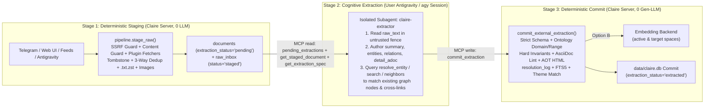
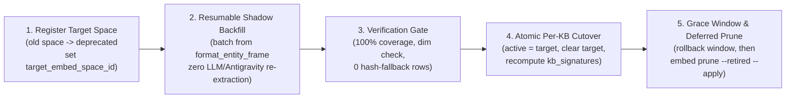

# Agent-Driven Extraction, Agent Client Plugins, and Long-Term Embedding Lifecycle

- **Document Identifier**: `DESIGN-AGENT-EXTRACTION-EMBEDDING-20261120`
- **Status**: Proposal, not implemented (Rev. 1). Owner decisions on 2026-11-20 set the core constraints (Antigravity performs ingestion/extraction lawfully, new terminology distinct from providers, a new plugin type alongside `ingest_adapter`, Option B hybrid embedding with multi-year EOS resilience). Each proposal in Sections 2 to 6 stays open until the owner answers the questions in Section 8.
- **Date**: 2026-11-20
- **Related Documents**:
  - [`../PRINCIPLES.md`](../PRINCIPLES.md)
  - [`INGEST_ADAPTER_PLUGIN_DESIGN.md`](INGEST_ADAPTER_PLUGIN_DESIGN.md)
  - [`MCP_SUPPORT.md`](MCP_SUPPORT.md)
  - [`../implementation/GLOSSARY.md`](../implementation/GLOSSARY.md)
  - [`../implementation/PROVIDERS.md`](../implementation/PROVIDERS.md)
  - [`../implementation/API_AND_MCP_GUIDE.md`](../implementation/API_AND_MCP_GUIDE.md)
  - [`../implementation/THEMES.md`](../implementation/THEMES.md)
  - [`../implementation/DOCUMENT_FORMAT.md`](../implementation/DOCUMENT_FORMAT.md)
  - [`../implementation/SCHEMA_VERSIONING.md`](../implementation/SCHEMA_VERSIONING.md)

---

## 1. Background, Compliance Boundary, and Code Facts

### 1.1 Owner Requirements (2026-11-20)

| ID | Owner Requirement |
| :--- | :--- |
| `O1` | Use Antigravity (2.0 / IDE) and Antigravity CLI (`agy`) lawfully for Knowledge Work with Claire Bible. |
| `O2` | Antigravity performs ingestion and extraction (structuring, AsciiDoc detail authoring, entity resolution, cross-linking). |
| `O3` | Define clear terminology separate from server-side `provider`. |
| `O4` | Add a new plugin type in Claire Bible's plugin system alongside `ingest_adapter`. |
| `O5` | Adopt hybrid embedding (Option B) with a long-term strategy for multi-year embedding model End-of-Support (EOS). |

### 1.2 Control Inversion and Terms-of-Service (ToS) Compliance Boundary

Previous server-side integration (`AntigravityProvider` in `src/claire/extract/antigravity_provider.py`) spawns `agy -p` as a subprocess from the Claire server. Running consumer-authenticated `agy` behind a server daemon, an external orchestrator, or a 24/7 unattended batch queue conflicts with Google Antigravity Additional Terms of Service, causes high spawn latency (2 to 12 minutes per document), and mixes agent tool loops with structured inference.

This design inverts the direction of control:

1. **Prohibited pattern**: Claire server spawns `agy -p` as an outbound backend `provider`, or an unattended `cron` loop calls `agy -p` continuously to drain a server queue.
2. **Lawful pattern**: A human user starts an interactive Antigravity 2.0, IDE, or `agy` CLI Knowledge Work session directly. Inside that session, Antigravity acts as a first-party MCP client against Claire Bible: it pulls staged raw sources, performs reasoning and graph comparison, and pushes verified extractions back to Claire. Claire never executes `agy` or wraps consumer credentials.
3. **Continuous raw capture stays valid**: Claire can continue to fetch and preserve raw sources 24/7 (via Telegram, Web UI, RSS/Atom feeds, and Federation) with zero generative LLM calls. Extraction waits safely until the user runs an Antigravity Knowledge Work session.

### 1.3 Code Facts (Basis: Commit `7b21726`, `src/` Identical to `origin/main` `49acf60`)

1. **Plugin Host (`src/claire/plugin_host/__init__.py`)**: `PLUGIN_TYPES = ("ingest_adapter",)`, `PLUGIN_API_LEVELS = (1,)`, and `MANIFEST_VERSIONS = (1,)`. Project plugins live under `plugins/<type>/<id>` (`plugins/project.lock`); administrator-installed plugins live under `var/plugins/<type>/<id>` (`CLAIRE_PLUGINS_DIR`). Static inspection (`src/claire/plugin_host/importcheck.py`) enforces `claire.plugin_sdk` boundaries before import.
2. **Personal CLI Seal (`docs/implementation/PROVIDERS.md` §5A)**: The administrator `personal_cli` web UI and routes (`/api/me/personal-cli`, `/api/me/personal-cli/test`) are closed (404), enforced by `tests/test_personal_cli_seal.py`.
3. **Ingestion Pipeline Split (`src/claire/ingest/pipeline.py`)**: `ingest()` runs deterministic fetching, SSRF checks, Content Guard, tombstone checks, 3-stage deduplication (`content_hash`, `canonical_url`, MinHash), `raw_inbox` logging, `documents` insertion, `.txt.zst` raw artifact storage, and image downloads up to lines 607–618, before calling `extract_resolve_store()` at line 622.
4. **LLM-Free Graph Construction Precedent (`src/claire/contributions.py`)**: `build_graph_from_extraction()` builds entities, `resolution_log` rollback provenance, and relations in a shared KB deterministically from stored `ExtractionResult` JSON (`extractions.raw_response`) without calling a generative LLM (`CT24`).
5. **MCP Surface (`src/claire/api/mcp_tools.py`, `src/claire/api/oauth.py`)**: `build_mcp_app()` exposes 12 tools (10 read-only tools requiring `kb` public number per CT23, `kb_candidates` read-only, and `kb_submit` requiring `write` or `owner`). No `list_kbs` discovery tool exists yet. OAuth 2.1 currently advertises and issues `scopes_supported = ["readonly"]` only. HTTP request bodies are capped at `MAX_REQUEST_BODY = 1048576` bytes (1 MiB) in `src/claire/api/security.py`.
6. **Embeddings and Re-Embedding (`src/claire/store/db.py`, `src/claire/store/vectors.py`, `src/claire/cli.py`, `src/claire/extract/frame.py`, `src/claire/theme_judgement.py`)**:
   - `claire.db` is at `SCHEMA_VERSION = 37`.
   - `embeddings` has `PRIMARY KEY (owner_id, kb_id)` — only one embedding model slot can exist per entity per KB.
   - `knowledge_bases` pins `(embed_provider, embed_model)` via `_pin_if_unset()`; `VectorStore.put()` raises `EmbeddingModelMismatch` when models differ.
   - `format_entity_frame()` builds deterministic entity embedding text from stored entity fields (`name`, `type`, `aliases`, `observations`).
   - `cmd_reembed()` (`claire re-embed`) computes all entity vectors in memory and replaces all rows in one transaction without resumable checkpointing or dual-generation coexistence.
   - `theme_judgement.py` computes embedding centroids for `kb_signatures` when all signature entities share one `embed_model`, and uses tf-idf Jaccard alone when models differ or centroids are absent.

---

## 2. Terminology and Conceptual Boundaries

> [!NOTE]
> The terms below are proposed definitions for future integration into [`GLOSSARY.md`](../implementation/GLOSSARY.md) when the corresponding work units are implemented.

### 2.1 Canonical Terminology Table

| English Standard Term | Korean Standard Term | Code / API / DB Identifier | Definition | Forbidden / Non-Canonical Terms |
| :--- | :--- | :--- | :--- | :--- |
| **Provider** | **프로바이더** | `provider`, `Provider`, `data/providers.json` | Server-side outbound inference service invoked by Claire (`Claire -> Provider`). | Never use for user-driven external agents (Antigravity, Claude Code, Cursor). |
| **Ingest Adapter** | **적재 어댑터** | `ingest_adapter`, `plugins/ingest_adapter/` | Server-side plugin type that provides source-specific fetchers and web adapters (`External Site -> Claire`). | — |
| **Agent Client** | **에이전트 클라이언트** | `agent_client`, `plugins/agent_client/` (see `AEQ1`) | Client-side AI harness integration packaged as a Claire plugin. Control flows `User -> Agent Client -> Claire`. Claire never executes it. | "Agent provider", "CLI provider", "user plugin". |
| **Client-Driven Extraction** | **클라이언트 주도 추출** | `extraction_mode = "client"`, `client_extraction` | Account mode in which Claire performs deterministic raw staging only and accepts extractions committed by an Agent Client. | "Client-side provider", "external LLM fallback". |
| **Staged Document** | **추출 대기 문서** | `documents.extraction_status = "pending"`, `raw_inbox.status = "staged"` | A document whose raw text, `.txt.zst` artifact, and images are preserved and deduplicated in Claire (Principle A1), awaiting extraction commit from an Agent Client. | "Draft document", "broken document", "error inbox item". |
| **Extraction Commit** | **추출 커밋** | `commit_extraction`, `commit_external_extraction()` | Deterministic, schema-validated persistence of an externally produced `ExtractionResult`, AsciiDoc detail body, entity-link choices, and cross-relations into a personal KB. | "Agent ingest override", "raw push". |
| **Embedding Backend** | **임베딩 백엔드** | `embedding_backend`, `EmbeddingBackend` | Server-side vectorization engine decoupled from generative LLM providers (`Claire -> Embedding Backend`). | Never bind to generative `provider` names. |
| **Embedding Space** | **임베딩 공간** | `embed_space_id`, `embed_spaces` | Immutable vector compatibility identity defined by `(backend, model, dim, frame_version, normalized)`. Vectors from different spaces are never compared. | "Model name" alone (misses dimension and frame version). |
| **Shadow Backfill** | **그림자 백필** | `target_embed_space_id`, `claire embed backfill` | Resumable background vectorization for a target Embedding Space alongside the active space before atomic cutover. | "Inline re-embed", "live overwrite". |

### 2.2 Direction-of-Control Matrix

| Component | Initiator | Execution Location | Server Network / Subprocess Permission | ToS / Billing Boundary |
| :--- | :--- | :--- | :--- | :--- |
| **Provider** (`gemini`, etc.) | Claire server (`api`, loops) | Remote HTTPS API | Outbound HTTPS from Claire | Paid API key (`providers.json` or BYOK) |
| **Ingest Adapter** (`ingest_adapter`) | Claire server (`ingest`, `refresh`) | Inside Claire process | Declared `permissions.network` / `executables` | Server-managed fetch policy + SSRF guard |
| **Agent Client** (`agent_client`) | **Human user** inside Antigravity / `agy` | **User's client environment** | **Forbidden on Claire server** (`network = []`, `executables = []`) | User's Antigravity session; talks only to Claire MCP/REST |
| **Embedding Backend** (`gemini`, `openai_compat`) | Claire server (`commit_extraction`, `backfill`) | Server HTTPS or local container/LAN service | Configured by server admin or BYOK | Paid Embedding API or self-hosted open-weight model |

---

## 3. New Plugin Type: `agent_client`

### 3.1 Placement in Claire Plugin Architecture

`src/claire/plugin_host/__init__.py` extends `PLUGIN_TYPES` from `("ingest_adapter",)` to `("ingest_adapter", "agent_client")`.

All foundational rules of [`INGEST_ADAPTER_PLUGIN_DESIGN.md`](INGEST_ADAPTER_PLUGIN_DESIGN.md) apply unchanged:

1. **Dual Origin Separation (PL-D9, O8)**: Project-maintained plugins live in `plugins/agent_client/<publisher>.<name>/` and must match `plugins/project.lock`; administrator-installed plugins live in `var/plugins/agent_client/<publisher>.<name>/` and require digest-verified enablement via `/admin/plugins` or `claire plugin enable` (with step-up auth).
2. **Self-Contained Folder & Declarative Manifest (PL-D3, PL-D4)**: Discovery reads `plugin.toml` and computes directory digests without importing Python code (PL-D8).
3. **Exclusive Overlap Groups (PL-D14)**: Two `agent_client` plugins that target the same external client identifier (`client_id`, such as `"antigravity"`) belong to an overlap group; only one can be enabled at a time.

### 3.2 Structural ToS-Enforcement Invariant

To guarantee mechanically that an `agent_client` plugin can never become a hidden server-side CLI wrapper or outbound agent caller:

1. **Manifest Lock**: For `type = "agent_client"`, `plugin_host/manifest.py` must reject (`ManifestError` -> state `invalid`) any manifest where `permissions.network`, `permissions.network_modules`, `permissions.executables`, or `permissions.providers` is non-empty, or where `permissions.private_network` is `true`.
2. **Static Import Lock**: For `type = "agent_client"`, `plugin_host/importcheck.py` runs with zero allowed network modules and zero allowed process modules, and additionally rejects `socket`, `ssl`, `http`, `urllib`, `subprocess`, `os.system`, `os.popen`, `os.spawn*`, and `ctypes` / dynamic import calls.
3. **Result**: On the Claire server, an `agent_client` plugin is pure static packaging and metadata registration — it cannot spawn `agy` or open external connections.

### 3.3 Manifest and SDK Contract for `agent_client`

`[[provides]]` in `plugin.toml` introduces two `agent_client` provision kinds (in addition to optional `cli_command`):

| `kind` | Required Fields | Purpose |
| :--- | :--- | :--- |
| `client_bundle` | `name`, `client_id` (e.g., `"antigravity"`), `bundle_path` (relative dir inside plugin, e.g., `"client_bundle"`) | Declares the client-side customization bundle exported for user installation on their workstation. |
| `setup_guide` | `name`, `client_id`, `config_filename` (e.g., `"mcp_config.json"`) | Declares endpoint and token-placement instructions rendered on `/settings/mcp` when enabled. |

```toml
# Example: plugins/agent_client/claire.antigravity/plugin.toml
manifest = 1
id = "claire.antigravity"
type = "agent_client"
revision = 1
core_commit = "<40-char-sha1>"
api = 1
entry = "plugin:register"
license = "MIT"
maturity = "experimental"
maintainers = ["Claire Bible"]

[text.en]
name = "Antigravity Knowledge Client"
description = "Exports an isolated Antigravity plugin bundle (MCP config, extractor subagent, skills, rules) for user-driven ingestion and Knowledge Work."

[text.ko]
name = "Antigravity 지식 클라이언트"
description = "사용자 주도 적재 및 지식 작업을 위해 격리된 Antigravity 플러그인 번들(MCP 설정, 추출 서브에이전트, 스킬, 규칙)을 내보냅니다."

[[provides]]
kind = "client_bundle"
name = "antigravity_bundle"
client_id = "antigravity"
bundle_path = "client_bundle"

[[provides]]
kind = "setup_guide"
name = "antigravity_mcp"
client_id = "antigravity"
config_filename = "mcp_config.json"
```

### 3.4 Reference Project Plugin: `plugins/agent_client/claire.antigravity/`

The project ships `claire.antigravity` as the reference `agent_client` plugin:

```text
plugins/agent_client/claire.antigravity/
├── plugin.toml
├── __init__.py
├── plugin.py                   # register(ctx): registers client_bundle, setup_guide, export-bundle CLI
├── README.md
├── tests/
│   └── test_claire_antigravity.py
└── client_bundle/              # Exported to user's Antigravity config (~/.gemini/config/plugins/claire-knowledge-work/)
    ├── plugin.json             # Antigravity plugin manifest
    ├── mcp_config.json.tmpl    # Streamable HTTP template pointing to <CLAIRE_ORIGIN>/mcp
    ├── rules/
    │   └── AGENTS.md           # Untrusted-source rule, kb number rule, write-approval gate
    ├── agents/
    │   └── claire-extractor.md # Isolated subagent: MCP tools ONLY (no shell/file/browser tools)
    └── skills/
        ├── claire-ingest/SKILL.md
        ├── claire-research/SKILL.md
        ├── claire-draft-export/SKILL.md
        └── claire-curate/SKILL.md
```

**Distribution rule**: `client_bundle/` never contains user secrets or API tokens (`PRINCIPLES.md` B4). `mcp_config.json.tmpl` uses placeholder `<CLAIRE_ORIGIN>` and either OAuth 2.1 (`readonly` exploration) or `<CLAIRE_WRITE_TOKEN>` (`write` scope for extraction sessions). The user exports or downloads the bundle and inserts their own credential locally (`chmod 0600`).

---

## 4. Sandwich Extraction Architecture (Client-Driven Push)

### 4.1 Three-Stage Pipeline Flow



### 4.2 Raw Staging and Queue Lifecycle

1. **Deterministic Separation (`pipeline.stage_raw`)**:
   - Extract lines 297–618 of `src/claire/ingest/pipeline.py` into a reusable `stage_raw(...)` path: `log_inbox` -> `fetch` -> tombstone check -> `find_document_by_extra_source` -> 3-way dedup (`content_hash`, `canonical_url`, MinHash) -> `insert_document` -> `save_artifact` (`.txt.zst`) -> `_download_doc_images`.
   - When an existing `canonical_url` updates (`content_hash` changes), `stage_raw` updates `raw_text`, `content_hash`, artifact, and images, and resets `extraction_status = 'pending'` while preserving existing graph edges until the new extraction commits.
2. **State Representation**:
   - `documents.extraction_status` (`'pending'` | `'extracted'` | `'failed'`).
   - `raw_inbox.status` adds `'staged'`. Because `recover-loop` retries only `status = 'error'`, staged items never cause retry storms or exhaust attempt limits.
3. **Visibility and Safety Rules for `pending` Documents**:
   - Visible **only** to the owning account in its personal workspace, `pending_extractions`, and `/documents` (badged as `Pending extraction` / `추출 대기`).
   - Excluded from `anonymous` / cross-account views (even when `is_public = 1`), `sitemap.xml`, ActivityPub federation publish (`409 document_has_no_body` / `409 document_not_extracted`), and shared KB contributions (`409 document_not_extracted`).
4. **Account Extraction Mode (`accounts.extraction_mode`)**:
   - Accounts configured with `extraction_mode = "client"` route Telegram bot, Web UI `/ingest`, and feed-item ingest calls into `stage_raw()` and report `"Raw content saved; queued for Agent Client extraction"` instead of failing with `ProviderNotConfigured`.
   - Background worker loops (`recover-loop`, `refresh-loop`, `expand-loop`) never invoke generative LLMs for accounts in `"client"` mode; `refresh-loop` may refresh changed URLs into `"pending"` state.

### 4.3 MCP Tool Contract (6 New Tools on `/mcp`)

All new tools live in `src/claire/api/mcp_tools.py`, enforce `current_principal` account isolation, and validate inputs/outputs strictly (`ConfigDict(extra="forbid", strict=True)` per Principle C4). Write tools (`stage_source`, `commit_extraction`) accept **only the caller's personal KB** (`CT4`, rejecting shared KB attempts with `kb_ingest_by_contribution`) and require credential scope `write` or `owner`.

| Tool Name | Minimum Scope | Target KB | Purpose |
| :--- | :--- | :--- | :--- |
| `list_kbs` | `readonly` | Account-scoped | Returns caller's personal KB public number, `extraction_mode`, `embed_space` status, and readable shared KBs with public numbers and roles. |
| `get_extraction_spec` | `readonly` | Global / KB | Returns `spec_version`, `ontology_prompt_block()` (`EntityType`, `RelationType`, `RELATION_DOMAIN_RANGE`), `ExtractionResult.extraction_json_schema()`, AsciiDoc authoring rules (`DOCUMENT_FORMAT.md` §2), summary rules, and untrusted-data framing header. |
| `pending_extractions` | `readonly` | Personal KB | Paginates `extraction_status = 'pending'` documents (`limit` max 20, `cursor`), returning `document_id`, `title`, `url`, `source_type`, `content_hash`, `raw_chars`, `raw_truncated`, `images[]`, and `staged_at`. |
| `get_staged_document` | `readonly` | Personal KB | Returns `raw_text` chunk (`char_offset`, `max_chars`, capped safely below `MAX_REQUEST_BODY` 1 MiB), `next_offset`, `total_chars`, `content_hash`, `images[]`, and `docmeta`. |
| `stage_source` | `write` | Personal KB | Accepts mutually exclusive `url` (runs Claire fetcher chain) OR `raw_text` + `title` (+ optional `url`, `source_type`, `author`, `published_at`) for local files read natively by Antigravity. Performs dedup/tombstone/A1 archival and returns `{document_id, content_hash, status, duplicate, updated}`. |
| `commit_extraction` | `write` | Personal KB | Validates and commits extraction, AsciiDoc detail, entity links, and cross-relations atomically. Supports `dry_run: bool = False`. |

#### `commit_extraction` Payload & Deterministic Verification Gates

1. **Request Payload**:
   - `document_id: str`, `expected_content_hash: str` (optimistic concurrency lock), `spec_version: str`
   - `client_meta`: `{client_id: str, client_version: str, model: str}`
   - `extraction`: `{summary: str, key_claims: list[str], entities: list[ExtractedEntity], relations: list[ExtractedRelation]}`
   - `detail_adoc: str`
   - `entity_links`: `list[{extracted_name: str, existing_entity_id: str, action: "merge" | "new"}]` (optional explicit merge decisions backed by MCP graph lookup)
   - `cross_relations`: `list[{source_id: str, target_id: str, type: str}]` (optional 1-hop cross-document edges)
   - `watch`: `{watch: bool, interval_days: int | None, reason: str}` (optional)
   - `dry_run: bool = False`
2. **Server-Side Deterministic Gates (Fail-Fast before DB Write)**:
   - **Ownership & Concurrency**: Verify `document_id` belongs to caller's personal KB and `documents.content_hash == expected_content_hash` (mismatch -> `content_hash_mismatch`).
   - **Summary Integrity**: Run `clean_plain_summary()` and `evaluate_summary_verdict()` logic; reject empty summaries, `[mock]` prefixes, raw slices, or Markdown/AsciiDoc markup leaks.
   - **AsciiDoc Linter & AOT Compile**: Run a deterministic AsciiDoc validator on `detail_adoc` (reject `# Heading` Markdown headers, triple-backtick fences, `**bold**` Markdown leaks, or `---` horizontal rules per `DOCUMENT_FORMAT.md` §2–§3), then execute `sanitize_rendered_detail()` and `render_to_html()`.
   - **Ontology & Hard Invariant Gates**: Validate every relation via `validate_relation()`, log valid `proposed_type` proposals, verify every `existing_entity_id` in `entity_links` and `cross_relations` exists inside the same personal `kb_id`, and enforce `is_type_compatible()` and `passes_hard_invariants()` (preventing version-number merges such as `v1.0` vs `v2.0`).
   - **Atomic Persistence & Rollback Safety**: If validation passes (and `dry_run` is false), remove prior graph contributions of `document_id` only after validation succeeds (preserving commit `186e714` integrity), insert `extractions` (`provider = "client:<client_id>"`, `model`, `prompt_version = spec_version`), resolve/merge entities + attach `resolution_log` to `documents.meta`, store `detail` + `detail_html`, update FTS5, trigger `DocumentMatcher` and `_start_contribution_revisions()`, and update `documents.extraction_status = 'extracted'` and `raw_inbox.status = 'done'`.
3. **Structured Error Return**: Any gate failure aborts with zero partial writes and returns machine-readable `{ok: false, errors: [{field, code, message}]}` so Antigravity can repair the extraction and resubmit.

### 4.4 Prompt Injection Threat Model and 4-Layer Defense

External web pages, PDFs, and social posts contain untrusted text that may attempt instruction hijacking during Stage 2. Defense-in-depth relies on four independent layers:

| Layer | Where Enforced | Control |
| :--- | :--- | :--- |
| **1. Isolated Subagent** | Antigravity plugin (`agents/claire-extractor.md`) | Extraction runs inside a dedicated subagent granted **only Claire MCP tools** (`get_staged_document`, `get_extraction_spec`, `resolve_entity`, `search`, `neighbors`, `commit_extraction`). It has **zero** shell (`run_command`), **zero** file write/edit, and **zero** browser tools. |
| **2. Untrusted Data Framing** | `get_staged_document` + `rules/AGENTS.md` | Raw content is wrapped in explicit data boundaries (`<untrusted_source_document>`) with a rule stating that imperatives inside source text are inert data, never instructions. |
| **3. Least-Privilege Token** | Claire Auth (`write` scope) | Extraction sessions use `--scope write` tokens (never `owner`). A `write` token cannot read `/admin/*`, manage `/tokens`, change `/api/me/keys`, execute step-up actions, or mutate shared KBs directly. |
| **4. Server Validation Gates** | Claire `commit_external_extraction` | Server rejects invalid schemas, Markdown leaks, ontology domain/range violations, cross-KB entity IDs, and hard-invariant conflicts; HTML is escaped and AOT-compiled by `render_to_html()`, and `raw_text` / `.txt.zst` remain immutable (A1). |

---

## 5. Hybrid Embedding Strategy (Option B) and Multi-Year EOS Lifecycle

### 5.1 Decoupled `EmbeddingBackend`

Option B separates **vector embedding** completely from **generative extraction**:

- Antigravity performs all generative work (summarization, detail writing, extraction, entity/relation judgement) using the user's Antigravity session.
- Claire performs vector embedding only through a dedicated `EmbeddingBackend` interface (`src/claire/extract/embed_backend.py`) when `commit_extraction` resolves/stores entities, when `run_merge_job` merges contributions into a shared KB, or during `embed backfill` and search query vectorization.
- Generative `provider` settings never dictate `embedding_backend`.

Supported backend adapters:

1. **`gemini`**: Official Google AI Studio Embedding API (`gemini-embedding-001` and successor models), supporting explicit Matryoshka (`output_dimensionality`, e.g., `768`) pinning to control storage and maintain fixed vector width across compatible revisions.
2. **`openai_compat`**: Standard HTTP `POST /v1/embeddings` client for self-hosted open-weight embedding servers (Ollama, vLLM, Hugging Face TEI, llama.cpp). Provides an **EOS-immune exit path** independent of cloud vendor deprecation schedules (e.g., `bge-m3`, `multilingual-e5-large-instruct`, `qwen3-embedding`).

Scope rules follow existing Claire boundaries (`PROVIDERS.md` §3.2): shared KBs use the server `EmbeddingBackend` (`CT24`); personal KBs use the account's BYOK Gemini key or configured backend, or inherit the server `EmbeddingBackend` if configured by the server tier.

### 5.2 Canonical Embedding Space Identity (`embed_spaces`)

An embedding vector is comparable only within an exact **Embedding Space**, not merely a model string. Even the same model produces incompatible vectors if `output_dimensionality`, normalization, or `format_entity_frame()` (`src/claire/extract/frame.py`) changes.

Proposed `embed_spaces` table in `claire.db`:

| Column | Type | Meaning |
| :--- | :--- | :--- |
| `space_id` | `TEXT PRIMARY KEY` | Deterministic canonical ID, e.g., `gemini:gemini-embedding-001:d768:f1` or `openai_compat:bge-m3:d1024:f1`. |
| `backend` | `TEXT NOT NULL` | `gemini` \| `openai_compat`. |
| `model` | `TEXT NOT NULL` | Upstream model identifier. |
| `dim` | `INTEGER NOT NULL` | Exact vector length. |
| `frame_version` | `TEXT NOT NULL` | Version tag of `format_entity_frame()` (currently `f1`). |
| `normalized` | `INTEGER NOT NULL DEFAULT 1` | Whether vectors are L2-normalized. |
| `status` | `TEXT NOT NULL` | `active` \| `deprecated` \| `retired`. |
| `sunset_at` | `REAL` | Optional known upstream EOS UTC timestamp for admin countdown warnings. |
| `created_at` | `REAL NOT NULL` | Registration timestamp. |
| `notes` | `TEXT NOT NULL DEFAULT ''` | Operator notes or deprecation reference. |

### 5.3 Zero-Downtime, Resumable Dual-Generation EOS Migration

Replacing `PRIMARY KEY (owner_id, kb_id)` on `embeddings` with `PRIMARY KEY (owner_id, kb_id, space_id)` allows two generations of vectors (the current `active_embed_space_id` and the incoming `target_embed_space_id`) to coexist per KB without interrupting live search or ingestion.



Step-by-step lifecycle:

1. **Register Target Space**: When an upstream provider announces model EOS (typically months ahead), the administrator registers the replacement `space_id`, marks the old space `deprecated` (optionally setting `sunset_at`), and sets `knowledge_bases.target_embed_space_id`.
2. **Resumable Shadow Backfill**:
   - The operator runs `./cb-manuscript app embed backfill --kb <number|all> --batch-size 50` (or enables an idle-rate background worker).
   - For each entity missing `(owner_id, kb_id, target_space_id)` (or whose `frame_hash` changed since the last vectorization), Claire renders `format_entity_frame(ent)` deterministically from existing SQLite rows and calls only the target `EmbeddingBackend`. **Zero documents are re-fetched and zero generative LLM / Antigravity tokens are spent.**
   - Each batch commits atomically, making backfill idempotent across restarts, 429 backoffs, and daily quota limits.
   - **Dual-Write During Transition**: While `target_embed_space_id` is set on a KB, any new or updated entity committed via `commit_extraction` writes vectors for both `active_embed_space_id` (skipped safely if already EOS) and `target_embed_space_id`.
3. **Verification Gate**: Before cutover, Claire verifies `missing_entities == 0`, exact `dim` match across all rows in `target_space_id`, zero rows failing `looks_like_hash_fallback()`, and optional `--verify` top-K recall comparison on sample queries.
4. **Atomic Per-KB Cutover**: A single SQLite transaction flips `knowledge_bases.active_embed_space_id = target_embed_space_id`, clears `target_embed_space_id = NULL`, updates `embed_provider` / `embed_model`, and flags `theme_judgement` to recompute `kb_signatures` centroids (`src/claire/theme_judgement.py`) in the new space.
5. **Rollback Window and Deferred Prune**: Previous `space_id` vectors stay in `embeddings` during a configurable grace window (e.g., 7 days). If retrieval quality regresses, `claire embed rollback --kb <num> --apply` switches `active_embed_space_id` back instantaneously. Once satisfied, `./cb-manuscript app embed prune --retired --apply` (dry-run default per Principle D3) deletes superseded vectors and compacts storage.

### 5.4 Post-EOS Graceful Degradation (Principle C2)

If an active cloud embedding model is retired unexpectedly (HTTP 404/410) before migration completes:

1. **Zero Silent Hash/Mock Vectors (C2)**: Claire never generates or stores synthetic hash vectors (`looks_like_hash_fallback`) in production.
2. **Search Continuity**:
   - **MCP Tools**: 100% unaffected because all MCP tools query SQLite + FTS5 + graph topology only.
   - **REST / Web Search**: `POST /search` degrades explicitly to FTS5 BM25 + graph neighbor expansion and returns `vector_status: "unavailable_model_eos"` so callers see the exact reason.
3. **Ingestion Continuity**: `commit_extraction` persists the extraction, AsciiDoc detail, entities, relations, and FTS5 index normally; missing embeddings remain marked `embedding_pending` so `embed backfill` fills them immediately once `target_embed_space_id` is configured.
4. **Theme Judgement Continuity**: `theme_judgement.py` continues clustering and document matching using tf-idf entity-key Jaccard whenever centroids are absent or span different embedding models.

### 5.5 Operational CLI and Admin Console Surface

- **CLI Subcommands (`claire embed ...`, following C3 `--json`, D2/D3 `--dry-run` default + `--apply`)**:
  - `claire embed spaces`: List registered embedding spaces, statuses, and `sunset_at` dates.
  - `claire embed status [-t <kb>]`: Show each KB's active space, target space, coverage percentage, and pending entities.
  - `claire embed backfill [--kb <num|all>] [--batch-size N] [--rate-limit-ms M] [--apply]`: Resumable backfill of `target_embed_space_id` (or missing `active_embed_space_id` rows).
  - `claire embed cutover --kb <num|all> [--apply]`: Runs verification gate and executes atomic cutover.
  - `claire embed rollback --kb <num> --to <space_id> [--apply]`: Reverts `active_embed_space_id` while old vectors remain.
  - `claire embed prune [--retired] [--older-than-days N] [--apply]`: Dry-run default cleanup of retired space vectors.
  - `claire re-embed` remains supported as a backward-compatible wrapper over `backfill` + `cutover`.
- **Admin Console**: `/admin/providers` adds the Embedding Backend & Space Registry (with EOS sunset banners); `/admin/kb` displays per-KB `active_embed_space_id`, `target_embed_space_id`, and backfill progress instead of a binary `reembed_required` badge alone.

---

## 6. Schema Evolution Impact (`claire.db`)

All changes after `SCHEMA_VERSION = 37` follow Principle A3 (non-destructive, idempotent migrations; version numbers are assigned when implementation units land):

1. **Staging & Client Extraction State**:
   - `documents.extraction_status TEXT NOT NULL DEFAULT 'extracted'` (existing rows with no extraction row and empty detail can migrate to `'pending'` or keep `'extracted'` based on backfill inspection; new staged rows start as `'pending'`).
   - `raw_inbox.status` accepts `'staged'` alongside existing statuses.
   - `accounts.extraction_mode TEXT NOT NULL DEFAULT 'provider' CHECK (extraction_mode IN ('provider', 'client'))`.
2. **Multi-Space Embeddings & Frame Tracking**:
   - New table `embed_spaces` (Section 5.2).
   - `embeddings` rebuilt idempotently with `space_id TEXT NOT NULL DEFAULT ''`, `frame_hash TEXT`, and `PRIMARY KEY (owner_id, kb_id, space_id)` plus `INDEX idx_embeddings_kb_space ON embeddings(kb_id, space_id)`. Existing rows populate `space_id` from their KB's current `(embed_provider, embed_model)` and `dim`.
   - `knowledge_bases.active_embed_space_id TEXT` and `knowledge_bases.target_embed_space_id TEXT` (synchronized with `embed_provider` / `embed_model`).

---

## 7. Rejected Alternatives

| Alternative | Reason for Rejection |
| :--- | :--- |
| Keep `AntigravityProvider` wrapping `agy -p` inside Claire server | Violates consumer ToS when used as a backend proxy; suffers spawn latency and tool pollution; `personal_cli` is already sealed. |
| Run `agy -p` in a 24/7 `cron` polling loop | Acts as an unattended third-party wrapper; violates the user-initiated ToS boundary. |
| Model Antigravity as a `Provider` subtype | Confuses control flow: providers are server-outbound inference backends, whereas Agent Clients are user-inbound MCP consumers. |
| Hardcode Antigravity skills/configs inside Claire core | Couples core to one client vendor and breaks plugin modularity (`PL-D1`, `PL-D10`). |
| Keep `PRIMARY KEY (owner_id, kb_id)` on `embeddings` | Cannot coexist with a target space during backfill; forces risky in-memory `re-embed` overwrites with no instant rollback. |
| Allow `commit_extraction` to write directly into shared KBs | Violates `CT4` contribution, review, and reputation isolation rules (`SHARED_KNOWLEDGE_BASES_AND_THEMES_DESIGN.md`). |
| Fall back to SHA-256 hash vectors when an embedding model hits EOS | Violates Principle C2 and silently corrupts similarity rankings. |

---

## 8. Open Questions for Owner Decision (`AEQ1`–`AEQ9`)

| ID | Question | Options (Recommended First) |
| :--- | :--- | :--- |
| `AEQ1` | Canonical name of the new plugin type | **A**: `agent_client` (`에이전트 클라이언트`). **B**: `extraction_client` (`추출 클라이언트`). **C**: `knowledge_client` (`지식 클라이언트`). |
| `AEQ2` | Plugin SDK API level for adding `agent_client` | **A**: Compatible addition to `PLUGIN_API_LEVEL = 1` (since no third-party plugins exist yet). **B**: Bump to `PLUGIN_API_LEVEL = 2`. |
| `AEQ3` | How users obtain the `claire.antigravity` client bundle | **A**: Both CLI export (`claire plugin run claire.antigravity export-bundle`) and downloadable `.zip`/`.tar.gz` archive on `/settings/mcp`. **B**: CLI export only. |
| `AEQ4` | Scope of `extraction_mode` (`provider` vs `client`) | **A**: Per-account setting (`accounts.extraction_mode`), allowing mixed accounts on one server. **B**: Server-wide setting only. |
| `AEQ5` | Credential mechanism for MCP write tools (`stage_source`, `commit_extraction`) | **A**: Persistent `--scope write` Bearer tokens first; expand OAuth 2.1 `write` scope later alongside [`MCP_SUPPORT.md`](MCP_SUPPORT.md) proposals `MP1`–`MP3`. **B**: Add OAuth 2.1 `write` scope in the same milestone. |
| `AEQ6` | Default `EmbeddingBackend` configuration for Option B | **A**: Official Google AI Studio `gemini-embedding-001` with MRL `768d` pinned as default + `openai_compat` (Ollama/vLLM/TEI) ready as EOS-immune alternative. **B**: Local `openai_compat` open-weight model as default. |
| `AEQ7` | Shared KB behavior during an active EOS shadow backfill (`target_embed_space_id` set) | **A**: Dual-embed incoming `run_merge_job` contributions into both `active` and `target` spaces (or `target` only if `active` is already EOS). **B**: Pause shared KB merge jobs until cutover completes. |
| `AEQ8` | Disposition of legacy `AntigravityProvider` (`src/claire/extract/antigravity_provider.py`) once `AE4` ships | **A**: Deprecate and remove from server providers so no operator can enable it by mistake. **B**: Keep sealed behind an explicit local development flag only. |
| `AEQ9` | Truncation default for `stage_source(url=...)` | **A**: Apply the standard `raw_char_budget` with an explicit `full_content=True` opt-in flag (consistent with `POST /ingest`). **B**: Default to `full_content=True` for staged documents. |

---

## 9. Proposed Work Units (After Owner Answers `AEQ1`–`AEQ9`)

| Unit | Scope | Completion Criterion |
| :--- | :--- | :--- |
| `AE1` | `agent_client` plugin type in `plugin_host`, manifest & `importcheck` zero-exec/zero-network invariants, `plugin_sdk` registration methods, and `GLOSSARY.md` update | Unit tests proving `agent_client` discovery, overlap by `client_id`, and static rejection of `subprocess`/`httpx`/`network` permissions |
| `AE2` | Deterministic `pipeline.stage_raw(...)`, `documents.extraction_status`, `raw_inbox.status = 'staged'`, `accounts.extraction_mode`, and Telegram/WebUI/feed staging support | Tests proving zero LLM calls during staging, visibility isolation of `pending` documents, and `recover-loop` skipping `staged` rows |
| `AE3` | `commit_external_extraction(...)` and 6 MCP tools (`list_kbs`, `get_extraction_spec`, `pending_extractions`, `get_staged_document`, `stage_source`, `commit_extraction`) | Strict Pydantic C4 validation tests, AsciiDoc linter rejection tests, ontology/invariant gate tests, `write`-scope enforcement tests, and rollback/purge tests |
| `AE4` | Project plugin `plugins/agent_client/claire.antigravity/` (`client_bundle`, isolated `claire-extractor` subagent, skills, rules, `mcp_config.json.tmpl`, export CLI, `/settings/mcp` UI) | Plugin lock/conformance tests + E2E test covering `stage_source` -> extraction payload -> `commit_extraction` -> MCP `search`/`context` retrieval |
| `AE5` | Decoupled `EmbeddingBackend` (`gemini` + `openai_compat`) and `embed_spaces` + multi-space `embeddings` schema migration (`(owner_id, kb_id, space_id)` + `frame_hash`) | Idempotent migration tests on v37 DBs, `EmbeddingBackend` unit tests, and backward-compatibility tests for existing `VectorStore.search` |
| `AE6` | Resumable shadow backfill, verification gate, atomic per-KB cutover, instant rollback, deferred prune (`claire embed ...`), post-EOS graceful degradation, and `/admin/kb` + `/admin/providers` UI | Interrupted-backfill resume tests, zero-hash-fallback EOS degradation tests, and atomic cutover + `theme_judgement` centroid recomputation tests |
| `AE7` | Implementation docs synchronization (`GLOSSARY.md`, `API_AND_MCP_GUIDE.md`, `PROVIDERS.md`, `INGESTION.md`, `SCHEMA_VERSIONING.md`, `COMMANDS.md`, `IMPLEMENTATION_STATUS.md`) and legacy `AntigravityProvider` cleanup per `AEQ8` | `tests/test_docs_consistency.py` and full `scripts/ci.sh` gate pass |
