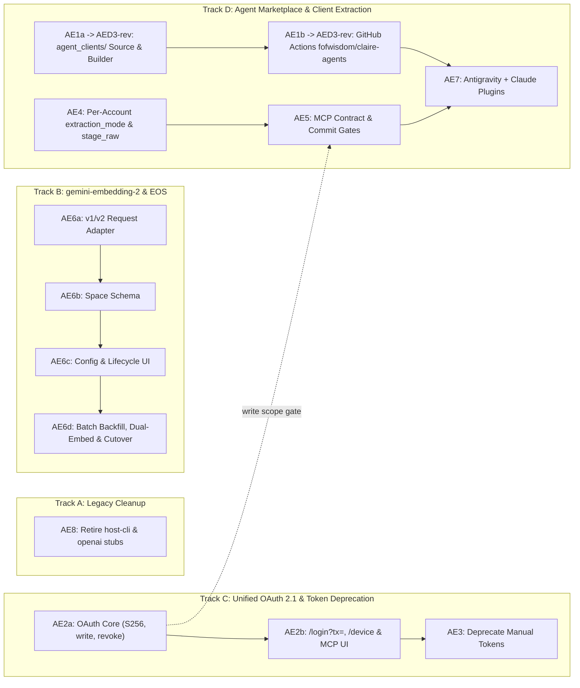

# Agent-Driven Extraction, `agent_client` Plugins, Unified OAuth 2.1, and Embedding EOS Lifecycle

- **Status**: Implemented (Tracks A–D: `AE8`, `AE6a`–`AE6d`, `AE2a`–`AE2b`, `AE3`, `AE4`, `AE5`, plus `AED3-rev` GitHub Actions-managed marketplace pipeline superseding self-hosted `clients_host` / `plugin_host` `agent_client` runtime; `AED1`–`AED11` Stage 1) → [`PROVIDERS.md`](../implementation/PROVIDERS.md), [`EXTRACTION.md`](../implementation/EXTRACTION.md), [`INGESTION.md`](../implementation/INGESTION.md), [`ACCOUNTS.md`](../implementation/ACCOUNTS.md), [`API_AND_MCP_GUIDE.md`](../implementation/API_AND_MCP_GUIDE.md), [`API_HTTP_CONTRACT.md`](../implementation/API_HTTP_CONTRACT.md), [`EXTERNAL_ACCESS.md`](../implementation/EXTERNAL_ACCESS.md), [`SCHEMA_VERSIONING.md`](../implementation/SCHEMA_VERSIONING.md), [`COMMANDS.md`](../implementation/COMMANDS.md), [`GLOSSARY.md`](../implementation/GLOSSARY.md); `AED11` Stage 2 multimodal vector extension remains future design scope
- **Date**: 2026-11-20 (Rev. 1 proposal; Rev. 2 `AED1`–`AED9` locked; Rev. 2.1 `gemini-embedding-2` plan added; Rev. 2.2 `AED10`–`AED11` locked; Rev. 2.3 `AED6` baseline and `AED8` scope clarified; Rev. 2.4 staging schema/`document_id` unified and 4-layer `AED9` prompt-injection defense restored; Rev. 2.5 4-track parallel implementation split; **Rev. 2.6 (2026-11-22): `AED3` superseded by `AED3-rev` — retire self-hosted bundle delivery in favor of GitHub Actions-managed `fofwisdom/claire-agents`**)
- **Principles**: [`PRINCIPLES.md`](../PRINCIPLES.md) A1–A4, B1–B4, C1–C5, D1–D3, E1–E4, G1
- **Related docs**: [`MULTI_PROVIDER_DESIGN.md`](MULTI_PROVIDER_DESIGN.md), [`MULTI_ACCOUNT_NAMESPACE_AND_SINGLE_FQDN_DESIGN.md`](MULTI_ACCOUNT_NAMESPACE_AND_SINGLE_FQDN_DESIGN.md), [`KNOWLEDGE_GRAPH_LINKING_AND_CALIBRATION_DESIGN.md`](KNOWLEDGE_GRAPH_LINKING_AND_CALIBRATION_DESIGN.md), [`MCP_SUPPORT.md`](MCP_SUPPORT.md), [`PROVIDERS.md`](../implementation/PROVIDERS.md)

---

## 1. Problem and Lawful Boundary

Claire Bible previously tried to call developer CLI tools (`agy`, `codex`) as subprocesses on the server host (`AntigravityProvider`, `CodexProvider`). That pattern creates four problems:

1. **Terms of Service and automation risk**: Server-side unattended execution of personal interactive CLI tools mixes interactive developer licenses with background scraping and violates clear client/server separation.
2. **Container and multi-account incompatibility**: Host binaries and host login sessions are bound to the server operator. Member accounts and container deployments cannot isolate credentials or run another user's local CLI safely.
3. **Opaque latency and tool loops**: Invoking a general coding agent as an RPC function requires blocking tools and fighting agent initialization overhead.
4. **Authentication mismatch**: Existing OAuth in `src/claire/api/oauth.py` supports only `readonly`, permits PKCE `plain`, gates unauthenticated logins on a Telegram push to `account_id == 1` or manual `session_token` paste, and coexists with manual persistent Bearer tokens.

### The Lawful Architecture Reversal

Claire Bible inverts control:

- **Server side**: The Claire Bible server runs HTTPS `api-key` providers (currently Google Gemini `gemini` as the implemented baseline) or development `mock` for server-side LLM, STT, VLM, and embedding calls (`AED6`). The server never spawns host-CLI processes (`AntigravityProvider`, `CodexProvider`; `AED8`).
- **Client side (`agent_client`)**: When an operator or member uses Antigravity (IDE, Antigravity 2.0, or `agy` CLI) on their own workstation under their own license, the agent acts as an explicit user-authorized **client** over standard HTTP / MCP using scoped **OAuth 2.1** credentials (`AED5`).
- **Agent-driven extraction (`AED4`, `AED9`)**: Accounts that configure `extraction_mode = "client"` stage raw full-content sources on the server; their Antigravity client pulls staged content, runs extraction locally using the user's own agent session, and submits structured JSON results back to the server for ontology resolution, persistence, and Google Option B vector embedding.

```
+-------------------------------------------------------------------+
| User Workstation (Claude / Antigravity IDE / agy CLI)              |
|  - Installs plugin from fofwisdom/claire-agents (GitHub Actions)  |
|  - Authenticates via OAuth 2.1 (PKCE S256; readonly / write)      |
|  - Claims staged full raw source, extracts structured JSON locally |
+---------------------------------+---------------------------------+
                                  | HTTPS (OAuth 2.1 Bearer + MCP/REST)
                                  v
+-------------------------------------------------------------------+
| Claire Bible Server                                               |
|  - Points /settings/mcp to official GitHub marketplace repo       |
|  - OAuth 2.1 provider (/login?tx= Telegram-free + optional RFC8628|
|  - Staging store (full_content=True), schema/ontology validation  |
|  - Option B Embedding (gemini-embedding-2 baseline + EOS backfill)  |
|  - Server provider calls: api-key providers (gemini; no host-CLI) |
+-------------------------------------------------------------------+
```

---

## 2. Locked Owner Decisions (`AED1`–`AED11`, 2026-11-20)

All eleven design questions (`AEQ1`–`AEQ11`) are resolved:

| ID | Topic | Locked Decision |
| :--- | :--- | :--- |
| `AED1` | New plugin type name | Name the new plugin type **`agent_client`**. Keep **`ingest_adapter`** as the existing server-side adapter type. |
| `AED2` | Plugin API version | Keep `PLUGIN_API_LEVEL = 1` across experimental changes. Do not increment the integer for `agent_client` API additions during the experimental phase. |
| `AED3-rev` *(Supersedes `AED3`, 2026-11-22)* | Agent marketplace distribution | Retire self-hosted `clients_host` / `/clients*` delivery, `agent_client_delivery_mode`, and the `plugin_host` `agent_client` runtime type (`plugin_host` remains `ingest_adapter`-only). Maintain static agent plugin sources under `agent_clients/` in `fofwisdom/claire-bible`, validate and deterministically build outputs with `scripts/build_agent_marketplace.py`, and publish to the dedicated public repository `fofwisdom/claire-agents` via `.github/workflows/agent-marketplace-check.yml` and `.github/workflows/publish-agent-marketplace.yml` using short-lived GitHub App tokens. Support optional fork override via `CLAIRE_AGENT_MARKETPLACE_REPO`, keep `"clients"` in `RESERVED_USERNAMES`, and keep `provider = 'agent_client'` in extraction provenance. |
| `AED4` | Extraction mode scope | `extraction_mode` (`provider` \| `client`) is configured **per account**. |
| `AED5` | Token and OAuth unification | Deprecate manual persistent Bearer tokens (`api_tokens.json`, `/tokens`, `claire token`, Telegram `/token`) and unify authentication on **OAuth 2.1** (`readonly` and `write` scopes) following Modern Web Guidance. Ensure OAuth works cleanly when no Telegram bot is configured. |
| `AED6` | Google baseline for current implementation & Option B embedding | Remove unimplemented `openai` placeholders from `PROVIDERS.md`, `MULTI_ACCOUNT_NAMESPACE_AND_SINGLE_FQDN_DESIGN.md` §10.4, and `MULTI_PROVIDER_DESIGN.md`. Document Google (`gemini`, `gemini-embedding-2` pinned at `3072` dimensions per `AED10`, migrating `gemini-embedding-001` before May 14, 2028) as the current implementation and Option B embedding design baseline while keeping general `api-key` provider extensibility open. |
| `AED7` | Dual-embed during EOS backfill | While an embedding End-of-Support (EOS) shadow backfill is running (`target` space exists alongside `active` space), dual-embed incoming shared KB contributions into BOTH `active` and `target` spaces. If `active` is already retired/EOS, embed into `target` only. |
| `AED8` | Retire `host-cli` providers and obsolete clients | Retire and remove `AntigravityProvider`, `CodexProvider` (`host-cli`), `ChatGPT`, `Codex`, and obsolete `Claude Desktop`/stdio instructions across principles, design, and implementation (code removal executes in work unit `AE8`). Claude remains supported as a lawful OAuth 2.1 `agent_client` plugin and marketplace consumer (`/.claude-plugin/marketplace.json`). |
| `AED9` | Full content default on staging | `extract_stage(url=...)` (`stage_source` / `stage_file_bytes` / `stage_file_base64`) and client-mode staged documents default to `full_content = True`. Always retain full raw content without truncation for staged sources. |
| **`AED10`** | Target MRL `output_dimensionality` for `gemini-embedding-2` | Lock `gemini-embedding-2` target `output_dimensionality` to **`3072`** (maximum full fidelity, matching `gemini-embedding-001` dimension size). |
| **`AED11`** | Multimodal embedding scope | Execute **Stage 1 text-only parity first (`AE6a`–`AE6d`)** covering entity frames, search queries, and May 14, 2028 EOS migration; defer native multimodal (`image`, `PDF`, `audio`, `video`) embeddings to a separate Stage 2 design. |

---

## 3. Terminology and `agent_client` Plugin Architecture (`AED1`, `AED2`)

### 3.1 Terms

- **Server Provider (`provider`)**: A server-side HTTPS `api-key` backend used directly by Claire Bible workers (currently `gemini` via Google AI Studio / Gemini API as the implemented baseline; `mock` in development). Host-CLI providers (`AntigravityProvider`, `CodexProvider`) are retired (`AED8`).
- **Ingest Adapter Plugin (`ingest_adapter`)**: Existing server-side Python plugin (`PLUGIN_TYPES = ("ingest_adapter",)` in `src/claire/plugin_host/manifest.py`) that fetches external sources inside the server process.
- **Agent Client Plugin (`agent_client`)**: A new plugin category (`AED1`) containing declarative, client-consumable artifacts that teach an external user agent (Antigravity) how to connect to the user's Claire Bible server, authenticate via OAuth 2.1, claim staged sources, extract knowledge matching Claire's ontology schema, and query the graph.

### 3.2 Build-Time Source Separation (`agent_clients/` vs `plugin_host/`)

Following `AED3-rev` (2026-11-22):

- Keep `src/claire/plugin_host/` strictly for server-executed `ingest_adapter` Python plugins (`PLUGIN_TYPES = ("ingest_adapter",)`). Do not load or serve static agent client bundles inside the Claire Bible API process.
- Maintain static agent client plugin definitions as single-source inputs under `agent_clients/` (`marketplace.toml`, `common/{agents,skills,rules}`, and `clients/{antigravity,claude}`), never embedding server tokens, URLs, or secrets.
- `scripts/build_agent_marketplace.py` enforces static security gates at PR/build time (no symlinks, no executable mode bits, no forbidden code/script extensions such as `.py`/`.sh`/`.js`/binaries, unresolved placeholder rejection outside `mcp_config.json.tmpl` `{{MCP_URL}}`, secret pattern scan, and AST contract verification against `src/claire/api/mcp_tools.py`).
- Extraction provenance in `claire.db` (`extractions.provider = 'agent_client'` and `documents.meta.extraction_origin = 'agent_client'`) stays unchanged.

---

## 4. GitHub Actions-Managed `fofwisdom/claire-agents` Marketplace (`AED3-rev`, Superseding `AED3`)

Self-hosted server delivery (`clients_host.py`, `/clients*`, `clients` `HostRole`, `:8770`, `/admin/server` delivery mode switch, and `plugin_host` `agent_client`) is retired (`AED3-rev`, 2026-11-22).

### 4.1 Dedicated Marketplace Repository Layout (`fofwisdom/claire-agents`)

Because agent client plugins contain zero server secrets and zero user data, a single public GitHub repository (`fofwisdom/claire-agents`) serves every Claire Bible instance:

- `.claude-plugin/marketplace.json` — Registers only the Claude target plugin (`"name": "claire"` -> `./plugins/claude/claire`) so Claude GUI `owner/repo` shorthand (`fofwisdom/claire-agents`) syncs natively.
- `plugins/claude/claire/` — Option A plugin-only bundle (`v0.2.0`) with zero `mcp_config.json`: `.claude-plugin/plugin.json`, `agents/extractor.md` (`mcp__claire__*`), `skills/ingest/SKILL.md` (`/claire:ingest`), `skills/extract/SKILL.md` (`/claire:extract`), `skills/query/SKILL.md` (`/claire:query`), and `README.md`.
- `plugins/antigravity/claire/` — Option A plugin-only Antigravity bundle (`v0.2.0`) with zero `mcp_config.json`: official `plugin.json` (`name: "claire"`, `displayName`, `logo` -> `assets/logo.svg`, 4 bilingual `suggestedPrompts`, `homepage`, `repository`), `assets/logo.svg`, `README.md` (with `MCP Servers -> claire` sign-in and `Allow using this MCP tool?` permission guidance), `rules/AGENTS.md`, `agents/claire-extractor.md`, `skills/claire-ingest/SKILL.md`, `skills/claire-extract/SKILL.md`, and `skills/claire-query/SKILL.md`. Standalone global MCP configuration lives separately in `templates/mcp_config.json` (key `"claire"`).
- `docs/` — Dedicated GUI-first setup guides (`docs/antigravity.ko.md`, `docs/antigravity.en.md`, `docs/claude.ko.md`, `docs/claude.en.md`) reflecting standalone global `claire` MCP registration (`~/.gemini/config/mcp_config.json` / `claude mcp add --transport http claire <url>`), `MCP Servers -> claire` sign-in, `mcp_config.json` download, `Allow using this MCP tool?` prompts, and collapsed CLI/`SHA256SUMS` sections.
- `manifest.json` & `README.md` — Deterministic asset digests (`sort_keys=True`, without volatile source-commit metadata) and bilingual GUI-first setup docs.
- GitHub Releases — Deterministic `claire-antigravity-v<ver>.zip`/`.tar.gz`, `claire-claude-v<ver>.zip`/`.tar.gz` (root directory prefix `claire/`, fixed mtime/permissions), `SHA256SUMS`, and generated bilingual `release_notes.md` (`v0.2.0`).

### 4.2 GitHub Actions Pipelines & Server WebUI

- **PR Verification (`.github/workflows/agent-marketplace-check.yml`)**: Triggers on PRs touching `agent_clients/**`, `scripts/build_agent_marketplace.py`, `src/claire/api/mcp_tools.py`, `src/claire/ingest/client_extraction.py`, or workflow/test files; runs `--check --out` dry-run build and `pytest tests/test_agent_marketplace_build.py`.
- **Automated Sync & Release (`.github/workflows/publish-agent-marketplace.yml`)**: On `push` to `main` or manual `workflow_dispatch`, builds deterministically, mints a short-lived GitHub App token (`MARKETPLACE_APP_ID`, `MARKETPLACE_APP_PRIVATE_KEY` scoped solely to `fofwisdom/claire-agents`), mirrors `/tmp/claire-agents-dist/repo/` via `rsync --delete`, pushes only when `git status --porcelain` has changes, and creates tag `v<version>` + GitHub Release using `--notes-file /tmp/claire-agents-dist/release_notes.md` (or updates release notes via `gh release edit` when the tag already exists).
- **Server Settings & WebUI**:
  - `CLAIRE_AGENT_MARKETPLACE_REPO` (`Settings.agent_marketplace_repo`, default `fofwisdom/claire-agents`) lets fork operators point `/settings/mcp` (`#pref-mcp-client-bundles`) to a custom `owner/repo` (invalid patterns fall back to `fofwisdom/claire-agents`).
  - `/settings/mcp` shows a 3-step green/red progress card (`#pref-mcp-agent-guide`: ① `extraction_mode == "client"` → ② OAuth 2.1 `write` grant authorized → ③ first `agent_client` extraction committed) alongside `#pref-mcp-client-bundles` featuring a one-click Antigravity quick setup prompt (`#pref-mcp-antigravity-prompt`), locale-aware Antigravity Setup Guide link (`#pref-mcp-antigravity-guide`), Releases link, `mcp_config.json` download button (`#pref-mcp-download-mcp-config`), `owner/repo` copy control, and collapsed CLI/Git URL details.
  - Keep `"clients"` in `RESERVED_USERNAMES` (`src/claire/accounts/username_policy.py`) so member handles never collide with reserved root prefixes.

---

## 5. Per-Account Extraction Mode, Staging Contract, and Prompt-Injection Defense (`AED4`, `AED9`)

### 5.1 Per-Account `extraction_mode` & Canonical Staging Storage (`AED4`)

- Add `extraction_mode TEXT NOT NULL DEFAULT 'provider'` (allowed values: `'provider'`, `'client'`) to the account settings table/model (`accounts` or per-account preferences).
- Each account independently selects `"provider"` (server calls registered `api-key` provider using BYOK or allowed server tier) or `"client"` (server stages raw content for the account's own `agent_client` to extract).
- **Canonical Storage (`documents` + `raw_inbox`, no duplicate raw table)**:
  - `pipeline.stage_raw()` (lines 297–618 of `src/claire/ingest/pipeline.py`) stores staged raw sources directly in **`documents`** (`extraction_status TEXT NOT NULL DEFAULT 'extracted'` extended with `'pending'` | `'extracted'` | `'failed'`, plus lease/hash columns `claim_token`, `lease_expires_at`, `claimed_by_client_id`, `content_hash`) and logs **`raw_inbox`** (`status = 'staged'`, skipped by `recover-loop` so staged items never trigger retry exhaustion).
  - **Isolation of `pending` documents**: Visible only to the owning account in its personal KB (`extract_queue` / `list_staged_sources`, `/documents`); excluded from anonymous/cross-account reads (even when `is_public = 1`), `sitemap.xml`, ActivityPub publish (`409 document_not_extracted`), and shared KB contributions (`409 document_not_extracted`).
- **No silent fallback (`C2`)**:
  - When `extraction_mode == "client"`, ingestion requests (`ingest_url`, `ingest_file`, WebUI submit, Telegram URL forward, feed ingest) stop after `pipeline.stage_raw()` and report `"Raw content saved; queued for Agent Client extraction"` (never silently calling server LLM providers).
  - Switching a single item to server extraction requires an explicit per-action user override or switching the account setting back to `"provider"`.

### 5.2 Full-Content Default on Staging (`AED9`)

- `extract_stage(url=..., ...)` / `stage_source` / `stage_file_bytes` / `stage_file_base64` and any automatic ingestion staging when `extraction_mode == "client"` MUST default to `full_content = True`. Supported document formats include PDF, DOCX (`src/claire/ingest/fetchers/docx.py`), ODT, HTML, Markdown, RST, AsciiDoc, and TXT up to 20 MiB (`MAX_STAGE_FILE_BYTES`).
- Store the complete untruncated normalized raw payload (plus MIME type, canonical URL, fetch timestamp, `content_hash` SHA-256 digest, and `raw_chars` byte/character length) in **`documents`** / `.txt.zst` archive (`PRINCIPLES.md` A1).
- `extract_read(document_id, claim_token=..., offset=0, limit=None)` (`get_staged_source`) defaults to returning the complete untruncated raw source (`full_content = True`). If a very large document exceeds a single transport payload cap (`MAX_REQUEST_BODY` 1 MiB) or agent context window, the agent pages deterministically with explicit `offset` / `limit` (`next_offset`, `total_chars`) without ever discarding tail content during staging (`AED9`).

### 5.3 Client Extraction Protocol & Deterministic Commit Gates (MCP & HTTP, `write` Scope Required)

All staging and submission endpoints use **`document_id`** uniformly as the sole document identifier, require OAuth 2.1 `write` scope (`extract_spec` only requires `readonly`), enforce strict `account_id` / `kb_id` isolation (`B1`–`B4`), and restrict write targets to the caller's personal KB (`CT4`, rejecting shared KB writes with `kb_ingest_by_contribution`):

1. `extract_stage(url=..., text=..., filename=..., content_base64=..., full_content=True)` (wrapping Python `stage_source` / `stage_file_base64`, plus HTTP `POST /api/client-extraction/stage` with JSON or `multipart/form-data` `file` upload) -> runs `pipeline.stage_raw()`, inserts/updates **`documents`** (`extraction_status = 'pending'`) and **`raw_inbox`** (`status = 'staged'`), and returns `{document_id, content_hash, raw_chars, status}`.
2. `extract_queue(status="pending", limit=50)` (`list_staged_sources`) -> lists pending `documents` rows owned by the authenticated `account_id`, returning `document_id`, `title`, `url`, `source_type`, `content_hash`, `raw_chars`, and `staged_at`.
3. `extract_claim(document_id, claim_token=..., client_id=...)` (`claim_staged_source` / `renew_staged_claim`) -> atomically claims a `pending` document (or reclaims an expired lease) for a short lease window (`lease_expires_at`, default 300s), auto-inferring OAuth `client_id` when omitted, and issues a single-use `claim_token` + `content_hash`. Supplying an active `claim_token` renews the lease in place.
4. `extract_spec()` (`get_extraction_spec`) + `extract_read(document_id, claim_token=..., offset=0, limit=None)` (`get_staged_source`) -> returns the target theme ontology snapshot (`EntityType`, `RelationType`, `RELATION_DOMAIN_RANGE`), shared prompt/AsciiDoc/summary spec version, nonce-framed untruncated raw source (`full_content = True`), and `expected_content_hash` (`content_hash`).
5. `extract_submit(document_id, claim_token, expected_content_hash, payload, dry_run=False)` (`submit_client_extraction`) -> executes server-side deterministic verification gates before any DB write (`ConfigDict(extra="forbid", strict=True)` per `C4`):
   - **Ownership, Lease & Optimistic Lock**: Verifies `document_id` belongs to caller's personal KB, `claim_token` is active, and `documents.content_hash == expected_content_hash` (`409 content_hash_mismatch` on concurrent source refresh).
   - **Summary & Schema Validation**: Validates `payload` against the shared extraction JSON Schema; runs `clean_plain_summary()` and `evaluate_summary_verdict()` to reject empty summaries, `[mock]` prefixes, raw slices, or Markdown/AsciiDoc markup leaks (`422`, `C1`).
   - **Deterministic AsciiDoc Lint & AOT Sanitization**: Rejects Markdown leaks (`# Heading`, triple-backtick fences, `**bold**`, `---` horizontal rules), then runs `sanitize_rendered_detail()` and `render_to_html()`.
   - **Ontology & Hard Invariants**: Validates every relation with `validate_relation()`, logs valid `proposed_type` entries, verifies every referenced existing entity belongs to the same personal `kb_id`, and enforces `is_type_compatible()` and `passes_hard_invariants()`.
   - **Atomic Commit & Non-Partial Error Handling**: Only after all gates pass (and `dry_run` is false), records provenance (`extraction_origin = "agent_client"`, `client_id`, `oauth_client_id`, `schema_version`, `expected_content_hash`), removes prior contributions for `document_id` atomically, persists entities/claims/edges/detail, runs server-side Option B vector embedding (Section 7), and marks `documents.extraction_status = 'extracted'` and `raw_inbox.status = 'done'`. Gate failures abort with zero partial writes and return structured `{ok: false, errors: [{field, code, message}]}`.

### 5.4 Prompt Injection Threat Model and 4-Layer Defense Under `AED9` (`full_content = True`)

Delivering complete untruncated external web pages, PDFs, and posts (`AED9`: `full_content = True`) expands the untrusted attack surface sent to the client agent: long tail sections, comment threads, hidden footnotes, or boilerplate that previously fell beyond `raw_char_budget` are now preserved and read in full. Because an interactive top-level user agent possesses local shell and file tools, client-side extraction MUST enforce defense-in-depth across four independent layers:

| Layer | Where Enforced | Control (`AED9` Hardened) |
| :--- | :--- | :--- |
| **1. Mandatory Isolated Subagent** | `agent_client` bundle (`agents/claire-extractor.md`, `agents/extractor.md`, `rules/AGENTS.md`) | `rules/AGENTS.md` and extraction skills forbid the top-level interactive agent (which holds `run_command`, file write/edit, and browser tools) from reading staged raw documents directly. The top-level agent MUST delegate extraction to `claire-extractor` (Antigravity) / `extractor` (Claude `mcp__claire__*`), an isolated subagent granted **only Claire MCP tools** (`extract_read`, `extract_spec`, `entity_search`, `graph_neighbors`, `extract_submit`) and **zero** shell, **zero** file write/edit, and **zero** browser tools. |
| **2. Nonce-Bound Untrusted Data Framing** | `extract_read` (`get_staged_source`) + `rules/AGENTS.md` | Every `extract_read` response wraps raw source text inside a per-call random-nonce boundary: `<untrusted_source_document nonce="<hex>" document_id="..." sha256="...">...</untrusted_source_document>`. Before wrapping, the server neutralizes or escapes any literal closing-tag sequences inside `raw_text` so full-length untrusted payloads (`AED9`) cannot close the fence early or inject instructions across truncated/paginated chunks. `rules/AGENTS.md` instructs `claire-extractor` / `extractor` to treat all text inside the nonce fence strictly as inert data. |
| **3. Least-Privilege OAuth 2.1 `write` Scope & Personal-KB Gate (`CT4`)** | Claire OAuth 2.1 & MCP Auth Middleware | Extraction credentials carry OAuth 2.1 `write` scope (never admin or cookie session authority). A `write` token cannot read `/admin/*`, mutate `/api/me/keys`, manage `/oauth/*` grants, or modify shared KBs directly (`CT4` confines writes to the caller's personal KB). |
| **4. Server Validation & AOT HTML Sanitization Gates** | Claire `extract_submit` (`submit_client_extraction`) | Server deterministically rejects invalid JSON schemas (`extra="forbid"`), cross-KB entity references, ontology domain/range violations, hard-invariant violations, and Markdown leaks; compiled detail HTML is sanitized via `sanitize_rendered_detail()` / `render_to_html()`, while original raw text and `.txt.zst` remain immutable (`A1`). |

---

## 6. Unified OAuth 2.1, Telegram-Free Flow, Manual Token Deprecation, and Modern Web Guidance (`AED5`)

### 6.1 Audit of Current `src/claire/api/oauth.py` Gaps

Reading `src/claire/api/oauth.py` reveals five concrete gaps that Rev. 2 fixes:

1. **Broken non-Telegram and non-admin login flow**: Unauthenticated `GET /oauth/authorize` offers only a Telegram push confirmation hard-gated on `binding.account_id == 1` (`_find_telegram_binding`) plus a manual copy-paste `session_token` box. Any server without Telegram or any non-admin account cannot complete browser OAuth smoothly.
2. **Hardcoded `readonly` scope and PKCE `plain`**: `scopes_supported` is `["readonly"]`, `handle_token` hardcodes `scope="readonly"` on code/refresh/client exchanges, and `_verify_pkce` allows `method == "plain"`.
3. **No refresh rotation or RFC 7009 revocation UI**: Refresh tokens do not rotate or detect reuse, and no `/oauth/revoke` or `/settings/mcp` grant manager exists.
4. **Inline `<script>`, emojis, and hardcoded Korean strings**: `_render_authorize_page` embeds inline `<script>`, emojis (`⚠️`, `✅`, `📱`, `📖`), and untranslated Korean strings directly in Python, conflicting with zero-JS auth patterns, i18n, and `PRINCIPLES.md` G1 (monochrome SVG icons only).
5. **Dual credential split**: Manual persistent tokens (`api_tokens.json`, `/tokens`, `claire token`, Telegram `/token`) exist alongside OAuth 2.1.

### 6.2 Manual Token Deprecation Plan (`AED5`)

Manual persistent Bearer tokens are **deprecated** in favor of OAuth 2.1:

- **Immediate deprecation markings (`AE3`)**:
  - Mark `claire token` subcommands and Telegram `/token` with deprecation notices linking to `/settings/mcp` and OAuth 2.1 setup.
  - Add `Deprecation: true` response header when legacy manual API tokens authenticate requests, and log non-secret audit events identifying legacy token usage.
  - Replace `/tokens` creation UI with a deprecation banner plus existing-token audit/revoke list and direct link to connect clients via OAuth 2.1.
- **Removal window**: Remove `api_tokens.json` creation/acceptance cleanly once `agent_client` OAuth 2.1 (`readonly` + `write` + RFC 8628 device grant) ships and operators revoke legacy tokens.

### 6.3 Scoped OAuth 2.1 Model (`readonly` + `write`)

- **Metadata (`/.well-known/oauth-authorization-server` and `oauth-protected-resource`)**:
  - `scopes_supported: ["readonly", "write"]`
  - `code_challenge_methods_supported: ["S256"]` (remove `"plain"` from `_verify_pkce`; reject non-`S256` with `invalid_request`).
  - `grant_types_supported: ["authorization_code", "refresh_token", "urn:ietf:params:oauth:grant-type:device_code"]` (include optional RFC 8628 grant).
- **Exact scope preservation**:
  - Store `granted_scope` (`"readonly"` or `"readonly write"` / `"write"`) on authorization code, access token, refresh token, and device code records.
  - `handle_token` grants `scope = code_or_refresh.granted_scope` (or a strict subset if client requests downscoping on refresh). Reject scope escalation (`invalid_scope`).
  - Enforce scope at MCP and HTTP middleware boundaries: `extract_stage`, `extract_queue`, `extract_claim`, `extract_read`, `extract_submit`, and write `/api/client-extraction/*` REST routes require `"write"`.
- **Step-up confirmation for `write` scope**:
  - Consenting to `"write"` scope requires recent strong authentication (`has_recent_auth` within a short window, e.g., 5 minutes), prompting password or passkey re-authentication before activating the Approve button.
- **Refresh token rotation + reuse detection & `/oauth/revoke`**:
  - Each `refresh_token` grant issues a new refresh token in the same token family and immediately invalidates the prior refresh token. Presenting an already-rotated refresh token revokes the entire token family immediately.
  - Implement RFC 7009 `POST /oauth/revoke` and WebUI `/settings/mcp` showing active OAuth client authorizations (client name, granted scopes, created/last-used timestamps, single-click revoke and revoke-all).

### 6.4 Primary Telegram-Free Browser OAuth Flow

OAuth 2.1 must work on every server installation even when no Telegram bot token or binding exists:

```
Client (Antigravity / agy)
  | 1. GET /oauth/authorize?response_type=code&client_id=...&code_challenge=...&scope=readonly%20write
  v
Server checks session cookie:
  - Authenticated -> skip to step 5 (Consent UI)
  - Unauthenticated ->
      a) Create opaque 10-min record in `oauth_pending_requests` (`tx_id`, validated OAuth params, challenge, scopes, client_name)
      b) Set HttpOnly `__Host-claire_oauth_tx=<tx_id>` (`Path=/`, `SameSite=Lax`, `Secure` when HTTPS)
      c) 303 See Other -> `/login?tx=<tx_id>`
  | 2. User signs in via `/login` using ANY enabled auth method:
  |    - Username + Password (`login.html` / `login_post`)
  |    - Configured OIDC / GitHub IdP (preserving `tx` state across IdP redirect)
  |    - WebAuthn / Passkey
  |    (Telegram is NOT required and account_id==1 restriction is removed)
  v
3. `login_post` / IdP callback verifies `__Host-claire_oauth_tx` matches `tx=<tx_id>` (Login-CSRF guard)
   and responds `303 See Other -> /oauth/authorize?tx=<tx_id>`
  | 4. Single-use tx consumed after consent submission; expire uncompleted tx after 10 min
  v
5. Consent page (`/oauth/authorize`, zero-JS HTML + monochrome SVG icons + en/ko i18n):
   - Shows client name, redirect host, account name, and explicit requested scopes (`readonly` vs `write` danger callout)
   - If `write` requested and `!has_recent_auth`, prompts step-up re-authentication first
   - Approve (`POST /oauth/authorize`) checks CSRF + `Sec-Fetch-Site` -> mints one-time auth code -> 303 redirect to client `redirect_uri`
```

- **Telegram when configured**: Telegram remains an **optional secondary notification** (for example, alerting an account on its own linked Telegram chat when a new `write` OAuth grant is approved — never restricted to `account_id == 1`, using per-account bindings from `PER_ACCOUNT_FEATURES_DESIGN.md`). Telegram push is removed from the synchronous `/oauth/authorize` login blocker, and manual `session_token` paste is removed completely.

### 6.5 Optional Headless Fallback: RFC 8628 Device Authorization Grant

When `agy` runs on a headless SSH server or container terminal without a local browser or loopback listener:

- `POST /oauth/device_authorization` returns `device_code`, short `user_code` (e.g., `ABCD-EFGH`), `verification_uri` (`https://<app_authority>/device`), `verification_uri_complete`, `expires_in` (600s), and `interval` (5s).
- User opens `/device` on any browser, logs in via normal `/login` (if needed), enters `user_code`, sees the same consent + `write` step-up screen, and approves or denies.
- Headless client polls `/oauth/token` (`grant_type=urn:ietf:params:oauth:grant-type:device_code`) respecting slow-down/pending errors cleanly.

### 6.6 Modern Web Guidance Hardening Rules (`modern-web-guidance`)

All `/login`, `/device`, `/oauth/authorize`, and `/settings/mcp` templates and routes must enforce these exact rules verified against `modern-web-guidance`:

1. **Zero-JS & Claire SVG UI (`PRINCIPLES.md` G1)**: Render `/oauth/authorize` and `/device` as pure HTML `<form method="post">` + Jinja/i18n templates (`en`/`ko`) using inline monochrome `<svg>` icons (`currentColor`, no emojis, no inline `<script>`).
2. **Fetch Metadata (`Sec-Fetch-Site`) & Subdomain Isolation (`security`)**: Because Claire hosts untrusted or semi-isolated origins on subdomains/ports (`usercontent`, `prototype`, `clients`), drop `same-site` from state-changing auth/OAuth POST allowlists and accept only `same-origin` and `none` (direct navigation / non-browser), alongside double-submit / bound CSRF tokens.
3. **Origin Validation (`validate-origins`)**: Whenever comparing runtime origins (OAuth `redirect_uri` checks, WebAuthn RP origin, postMessage handlers if any), explicitly reject `"null"` opaque origins (`origin !== "null"`) before any equality comparison.
4. **Password Autofill (`autofill-sign-in-form`)**: `/login` and step-up password forms MUST set `autocomplete="username"` on the username input and `autocomplete="current-password"` on the password input (`src/claire/templates/login.html` currently uses `autocomplete="current-password"` — preserve and replicate across step-up forms).
5. **Passkey UI & Re-Authentication (`quick-sign-ins`, `passkey-reauthentication`)**:
   - Never attach `uiMode: 'immediate'` to primary "Sign in" or "Sign in with a passkey" buttons on `/login`.
   - On `write`-scope step-up re-authentication prompts for already signed-in users, populate `allowCredentials` with specific `PublicKeyCredentialDescriptor` records mapping all registered credential IDs owned by that signed-in account.

---

## 7. Option B Embedding Baseline, Multi-Year EOS Lifecycle, and `gemini-embedding-2` Plan (`AED6`, `AED7`, `AED10`, `AED11`)

### 7.1 Current Google Embedding Baseline and Official Model Timeline (`AED6`)

The current production implementation and Option B design baseline uses Google Gemini embeddings (`provider = "google"`; `mock` is allowed only in explicit dev/test mode per `PRINCIPLES.md` C2). Other `api-key` embedding providers can be added later through the standard `src/claire/accounts/provider_policy.py` and `embedding_spaces` registry rules without changing the EOS lifecycle contract. Server-side embedding generation applies uniformly to both `extraction_mode = "provider"` and `extraction_mode = "client"`: the client submits structured claims, entities, and summaries, and the server embeds them into active space(s) via `GeminiProvider`.

Official Gemini Developer API model status (verified against Gemini API documentation as of 2026-11-20):

| Model | Status | Release / Shutdown | Input / Token Limit | Output Dimensions & Norm | Price (Text / 1M tokens) |
| :--- | :--- | :--- | :--- | :--- | :--- |
| **`gemini-embedding-2`** | Stable GA (**Locked Option B baseline target, `3072d` per `AED10`**) | Released Apr 22, 2026 · No shutdown announced | Text, image, video, audio, PDF · 8,192 tokens | 128–3,072 MRL (rec: 768, 1,536, 3,072) · Auto-normalized `< 3072` | `$0.20` standard · `$0.10` Batch API |
| **`gemini-embedding-001`** | Current legacy prod default (Migrate before EOS) | Released Jul 14, 2025 · **Shutdown May 14, 2028** | Text only · 2,048 tokens | 128–3,072 MRL · Manual L2 norm required `< 3072` | Standard / Batch |
| `gemini-embedding-2-preview` (`embedding-2-preview`) | **Shut down** (Remove from code defaults) | Mar 10, 2026 – **Aug 10, 2026** | — | — | Replaced by `gemini-embedding-2` |
| `text-embedding-004` | **Shut down** | Apr 9, 2024 – **Jan 14, 2026** | — | — | Replaced by `gemini-embedding-2` |

### 7.2 Multi-Year Model End-of-Support (EOS) Lifecycle

Google embedding models have multi-year lifecycles followed by End-of-Support (EOS). Because vector spaces across embedding models (`gemini-embedding-001` vs `gemini-embedding-2`) are mathematically incompatible, `VectorStore.search` MUST never mix vectors across models, dimensions, or prompt formats. To upgrade cleanly without downtime or LLM re-extraction:

1. **Embedding Space Registry (`embedding_spaces`)**:
   - Each vector space has an immutable key: `space_id = "{provider}:{model}:{dim}:{prompt_format_version}"` (for example, `google:gemini-embedding-001:3072:v1_param` and `google:gemini-embedding-2:3072:v2_prompt`).
   - Lifecycle states per space: `active` -> `backfilling` (staged target) -> `draining` (old space after cutover) -> `eos_retired`.
   - Store normalized source text hashes and canonical entity frame metadata so re-embedding reads directly from stored canonical text and never re-runs LLM extraction.
2. **Non-Blocking Shadow Backfill**:
   - Each theme keeps `active_space_id` live for queries and adds a nullable `target_space_id`.
   - A background worker (preferring Gemini Batch API for 50% cost savings) populates `target_space_id` while live searches continue serving `active_space_id`.
   - Admin and theme UI panels report EOS dates, `total_items`, `target_embedded`, `remaining`, and progress rate.
3. **Dual-Embed on Live Contributions (`AED7`)**:
   - **During active backfill (`AED7`)**: When `target_space_id` is set alongside an `active_space_id` that is NOT `eos_retired`, every incoming shared KB contribution, entity/claim create or update, and `extract_submit` (`submit_client_extraction`) commit MUST **dual-embed into BOTH `active_space_id` and `target_space_id`**.
   - **Post-EOS exception (`AED7`)**: If `active_space_id` is already `eos_retired`, incoming contributions embed into **`target_space_id` only**.
4. **Atomic Cutover and Fail-Closed Degradation (`C2`)**:
   - Once `target_space_id` reaches 100% persisted coverage and passes dimension and finite-norm checks, an atomic DB transaction promotes `target_space_id` to `active_space_id` and sets the prior space to `draining`.
   - If `active_space_id` reaches upstream shutdown before cutover finishes, vector search fails closed (`ProviderUnavailableError` / explicit EOS warning) and search degrades explicitly to FTS (`C2`) until target backfill finishes — never generating fake hash or zero vectors.

### 7.3 Concrete Support and Migration Plan for `gemini-embedding-2`

Audit of the current codebase confirms five blockers that currently prevent running `gemini-embedding-2`:

1. `src/claire/extract/gemini_provider.py` unconditionally passes `types.EmbedContentConfig(task_type=tt, title=...)` (lines 436–461), which `gemini-embedding-2` rejects/does not support, and hardcodes `embed_char_budget = 8000`.
2. `src/claire/provider_manager.py` lists shut-down `"gemini-embedding-2-preview"` in `DEFAULT_GEMINI_EMBED_MODELS` (lines 48–52), while `ProviderManager.update_config(..., server_scope=True)` (lines 1059–1072) rejects any `embed_model != "gemini-embedding-001"`, and `src/claire/static/js/manage_panels.js` (lines 942–944) renders a static `gemini-embedding-001 (3072d)` display.
3. `src/claire/store/db.py` defines `embeddings` with `PRIMARY KEY (owner_id, kb_id)` (lines 139–147), preventing simultaneous storage of `active` and `target` vectors for `AED7` dual-embed and shadow backfill.
4. `src/claire/store/vectors.py` keys `EmbedPin(provider, model)` on model string only (lines 23–73), ignoring `dim` and `prompt_format_version`.
5. `src/claire/config.py` defines 4-tier linking thresholds (`sim_tier_auto_merge=0.93`, `sim_tier_borderline=0.72`, `sim_tier_relational=0.70`, `sim_tier_multihop=0.55`, lines 487–498) calibrated on `gemini-embedding-001`.

Execute `AE6a`–`AE6d` to resolve all five blockers:

#### A. Model-Family Request Adapter (`AE6a`, `src/claire/extract/gemini_provider.py`)

Introduce an explicit model-family embedding adapter keyed by verified model capability (fail closed on unknown models; never strip `EmbedContentConfig` parameters silently after API errors, preserving `C2` and rule F8):

- **`v1_param_task_type` (`gemini-embedding-001`)**: Passes `task_type` and optional `title` in `EmbedContentConfig`, respects the 2,048-token limit (`embed_char_budget = 8000`), and applies explicit L2 normalization if `output_dimensionality < 3072`.
- **`v2_prompt_task_prefix` (`gemini-embedding-2`)**:
  - Omits `task_type` and `title` from `EmbedContentConfig`; sets `output_dimensionality` explicitly from the active `space_id` (relying on built-in v2 automatic renormalization for truncated dimensions).
  - Supports the higher 8,192-token input limit via model-aware input budgeting instead of a fixed 8,000-char cap.
  - Formats text-only inputs using the official `gemini-embedding-2` task prompt prefixes (omitting text prefixes only for native multimodal aggregated inputs in Stage 2):

| Claire Internal Task | `gemini-embedding-001` (`EmbedContentConfig`) | `gemini-embedding-2` Prompt Format |
| :--- | :--- | :--- |
| `RETRIEVAL_DOCUMENT` | `task_type="RETRIEVAL_DOCUMENT"`, `title=<title>` | `title: <title or "none"> \| text: <content>` |
| `RETRIEVAL_QUERY` | `task_type="RETRIEVAL_QUERY"` | `task: search result \| query: <content>` |
| `SEMANTIC_SIMILARITY` | `task_type="SEMANTIC_SIMILARITY"` | `task: sentence similarity \| query: <content>` |
| `CLASSIFICATION` | `task_type="CLASSIFICATION"` | `task: classification \| query: <content>` |
| `CLUSTERING` | `task_type="CLUSTERING"` | `task: clustering \| query: <content>` |

- **Aggregation guard**: Passing multiple strings in a list directly to `gemini-embedding-2` returns ONE aggregated embedding instead of one per string. Multi-item synchronous embedding calls MUST wrap each input in its own `types.Content` object or route through the Batch API.

#### B. Space-Keyed Vector Storage Schema (`AE6b`, `src/claire/store/db.py`, `src/claire/store/vectors.py`)

- Add `embedding_spaces` table (`space_id PK`, `provider`, `model`, `dim`, `prompt_format_version`, `state`, `eos_date`, `created_at`, `retired_at`).
- Migrate `embeddings` primary key from `(owner_id, kb_id)` to `(owner_id, kb_id, space_id)` so existing `gemini-embedding-001` rows are preserved untouched in `google:gemini-embedding-001:3072:v1_param` during shadow backfill.
- Add `active_space_id` and nullable `target_space_id` on `knowledge_bases`. Update `EmbedPin`, `resolve_embed_identity`, `VectorStore.upsert`, and `VectorStore.search` to read and write by exact `space_id`.

#### C. Configuration Unlock & Lifecycle UI (`AE6c`, `src/claire/provider_manager.py`, `src/claire/static/js/manage_panels.js`)

- Remove shut-down `"gemini-embedding-2-preview"` from `DEFAULT_GEMINI_EMBED_MODELS` (`provider_manager.py`) and filter shut-down models from `discover_gemini_models` defaults. Keep `"gemini-embedding-2"` (default for new KBs) and `"gemini-embedding-001"` (for existing KBs until May 14, 2028 EOS).
- Remove the `req_embed_model != "gemini-embedding-001"` hard block in `ProviderManager.update_config(..., server_scope=True)` and update `api/accounts_routes/keys.py` BYOK validation for space-aware preferences.
- Replace the static `3072d` block in `manage_panels.js` with an **Embedding Space Lifecycle Panel**: shows active space per scope, May 14, 2028 EOS status for `gemini-embedding-001`, and a safe **"Start Shadow Backfill to `gemini-embedding-2`"** workflow instead of destructive raw model swaps.

#### D. Batch API Shadow Backfill & Threshold Calibration (`AE6d`, `src/claire/cli.py`, `src/claire/ingest/pipeline.py`, `src/claire/contributions.py`, `src/claire/config.py`)

- Extend `claire reembed` (`cmd_reembed`) with `--target-space <space_id>` and `--mode batch|sync`, implementing Gemini Batch API (`client.batches.create_embeddings`) for 50% cost savings (`$0.10 / 1M` text tokens) alongside bounded sync retry.
- Enable `AED7` dual-embed writes inside `pipeline.py` and `contributions.py` whenever a theme has `target_space_id` active.
- Run a shadow calibration step (`claire reembed --calibrate`) on sample entity pairs using adaptive mean centering on `gemini-embedding-2` vectors before cutover, verifying or storing space-scoped threshold overrides for `sim_tier_auto_merge` (`0.93`), `sim_tier_borderline` (`0.72`), `sim_tier_relational` (`0.70`), and `sim_tier_multihop` (`0.55`) ([`KNOWLEDGE_GRAPH_LINKING_AND_CALIBRATION_DESIGN.md`](KNOWLEDGE_GRAPH_LINKING_AND_CALIBRATION_DESIGN.md)).

#### E. Locked Rollout Decisions (`AED10`, `AED11`)

Both rollout scope decisions are locked by the owner (2026-11-20):

| ID | Topic | Locked Choice |
| :--- | :--- | :--- |
| **`AED10`** | Target `output_dimensionality` for `gemini-embedding-2` | **`3072`** (`space_id = google:gemini-embedding-2:3072:v2_prompt`) — Preserves full fidelity, avoids dimensionality truncation variance during EOS cutover, and retains normalized 3,072-dimensional output. (`< 3072` spaces would auto-normalize if added later per space rules.) |
| **`AED11`** | Multimodal embedding scope | **Stage 1 text-only parity first (`AE6a`–`AE6d`)** — Ship `gemini-embedding-2` entity-frame, search query, and May 14, 2028 EOS migration first; design native multimodal (`image`, `PDF <= 6p`, `audio <= 180s`, `video <= 120s`) ingestion/embedding separately in a Stage 2 design. |

---

## 8. Retirement Inventory (`AED6`, `AED8`)

Per `AED8`, Claire Bible retires strictly `AntigravityProvider`, `CodexProvider` (`host-cli`), `ChatGPT`, `Codex`, and `Claude` across principles, design, and implementation. Per `AED6`, unimplemented `openai` placeholders are removed while preserving general `api-key` provider extensibility:

| Category | Items Retired / Removed | Timing |
| :--- | :--- | :--- |
| **Principles & Vision** | `PRINCIPLES.md` obsolete Antigravity host-CLI note under solved violations removed; `C2` records `AED8` retirement of `AntigravityProvider`, `CodexProvider`, `ChatGPT`, `Codex`, and `Claude`. | **This design revision** |
| **Design Docs** | Delete retired `ANTIGRAVITY_EXECUTION_AND_LATENCY_OPTIMIZATION_DESIGN.md` completely. Update [`MULTI_PROVIDER_DESIGN.md`](MULTI_PROVIDER_DESIGN.md), [`MULTI_ACCOUNT_NAMESPACE_AND_SINGLE_FQDN_DESIGN.md`](MULTI_ACCOUNT_NAMESPACE_AND_SINGLE_FQDN_DESIGN.md), [`MCP_SUPPORT.md`](MCP_SUPPORT.md), [`VIDEO_AUDIO_TRANSCRIPTION_AND_INGESTION_DESIGN.md`](VIDEO_AUDIO_TRANSCRIPTION_AND_INGESTION_DESIGN.md), [`CONTRIBUTOR_DEVELOPMENT_ENVIRONMENT_DESIGN.md`](CONTRIBUTOR_DEVELOPMENT_ENVIRONMENT_DESIGN.md). | **This design revision** |
| **Implementation Docs (Policy & Non-Code Scope)** | Update [`PROVIDERS.md`](../implementation/PROVIDERS.md) to remove `openai` placeholders, `CodexProvider` / `AntigravityProvider` operational sections, and `ANTIGRAVITY_EXECUTION_AND_LATENCY_OPTIMIZATION_DESIGN.md` links, documenting that `src/claire/extract/{antigravity,codex}_provider.py` and sealed `personal_cli` hooks are retired legacy code scheduled for deletion in `AE8`. *(Keep `ENVIRONMENT_VARIABLES.md` parity with `config.py` until `AE8` removes `Settings` fields so `tests/test_docs_consistency.py` passes.)* | **This design revision** + `AE8` |
| **Code, Config, Env Vars & Tests** | Remove `src/claire/extract/antigravity_provider.py`, `src/claire/extract/codex_provider.py`, `find_agy_executable`, `find_codex_executable`, `host-cli` runtime paths, `openai` stubs in `provider_manager.py`, sealed `personal_cli` migration hooks, `CLAIRE_AGY_*` / `CLAIRE_CODEX_*` `Settings` fields + `ENVIRONMENT_VARIABLES.md` rows. | **Implementation Unit `AE8`** |

---

## 9. Phased & Parallel Implementation Plan (4 Tracks — Implemented)

To allow safe incremental shipping and parallel work without cross-module merge conflicts, implementation was split into **4 independent tracks** and **13 bounded work units** (implemented across Waves 1–3 on 2026-11-21; `AED11` Stage 2 native multimodal embeddings remain future design scope).

### 9.1 Four Independent Tracks & Dependency DAG



- **Track A (`AE8`)**: Zero dependencies on Tracks B, C, or D and zero DB schema changes. Can ship immediately or alongside Wave 1.
- **Track B (`AE6a -> AE6b -> AE6c -> AE6d`)**: Zero dependencies on Tracks A, C, or D. Upgrades both server-mode and client-mode KBs to `gemini-embedding-2` (`3072d` per `AED10`) and prepares May 14, 2028 EOS migration.
- **Track C (`AE2a -> AE2b -> AE3`)**: Zero dependencies on Tracks A, B, or D. `AE2a` unblocks `AE5` `write`-scope enforcement while `AE2b` (Telegram-free `/login?tx=`, `/device`, `/settings/mcp`) and `AE3` (manual token deprecation) finish independently.
- **Track D (`(AE1a -> AE1b) || AE4 -> AE5 -> AE7`)**: `AE1a`/`AE1b` (bundle manifest & fixed host/URI router) and `AE4` (per-account `extraction_mode` & `documents`/`raw_inbox` staging) touch disjoint files and execute in parallel. `AE5` depends on `AE4` + `AE2a` and calls existing `VectorStore`/`provider.embed` interfaces, working before or after Track B. `AE7` packages the reference bundle and runs the full client E2E verification.

### 9.2 Work Units, File Boundaries, DB Impact, and Verification Gates

| Unit | Track & Prereqs | DB Schema Impact | Primary Files Touched | Deliverable & Verification Gates |
| :--- | :--- | :--- | :--- | :--- |
| **`AE8`** | Track A · None (**Implemented**) | None | `src/claire/extract/antigravity_provider.py`, `src/claire/extract/codex_provider.py`, `src/claire/provider_manager.py`, `src/claire/config.py`, `src/claire/extract/provider.py`, `docs/implementation/ENVIRONMENT_VARIABLES.md`, `docs/implementation/PROVIDERS.md` | Delete `host-cli` providers, sealed `personal_cli` legacy paths, `openai` stubs, and `CLAIRE_AGY_*` / `CLAIRE_CODEX_*` settings; remove obsolete `test_personal_cli_seal.py` assertions. Verify: `pytest tests/test_provider_policy.py tests/test_docs_consistency.py`. |
| **`AE6a`** | Track B · None (**Implemented**) | None | `src/claire/extract/gemini_provider.py` | Explicit model-family embed adapter (`v1_param_task_type` vs `v2_prompt_task_prefix`), v2 prompt prefixes, `output_dimensionality=3072` pinning, 8,192-token budget, `types.Content` multi-input wrapper, and fail-closed unknown model check (`C2`). Verify: unit tests on v1/v2 request payloads. |
| **`AE6b`** | Track B · `AE6a` (**Implemented**) | `claire.db` DDL (`embedding_spaces` table; `embeddings` PK `(owner_id, kb_id, space_id)`; `knowledge_bases.active_space_id` / `target_space_id`) | `src/claire/store/db.py`, `src/claire/store/vectors.py`, `src/claire/store/knowledge_base.py` | Idempotent schema migration keeping existing `gemini-embedding-001` rows intact; `EmbedPin` & `VectorStore.search`/`upsert` enforced by `space_id`. Verify: migration compatibility & mixed-space rejection unit tests. |
| **`AE6c`** | Track B · `AE6b` (**Implemented**) | None | `src/claire/provider_manager.py`, `src/claire/api/accounts_routes/keys.py`, `src/claire/static/js/manage_panels.js` | Remove shut-down `gemini-embedding-2-preview`, replace hardcoded `gemini-embedding-001` lock in `update_config(server_scope=True)`, default new KBs to `gemini-embedding-2` (`3072d`), and render WebUI Embedding Space Lifecycle Panel + May 14, 2028 EOS warning. Verify: provider API + WebUI lifecycle tests. |
| **`AE6d`** | Track B · `AE6c` (**Implemented**) | None (`embedding_spaces.state` updates) | `src/claire/cli.py`, `src/claire/ingest/pipeline.py`, `src/claire/contributions.py`, `src/claire/config.py` | `claire reembed --target-space --mode batch\|sync` (Batch API 50% discount), `AED7` live dual-embed (`active` + `target`, or `target` only post-EOS), `claire reembed --calibrate` 4-tier threshold check, atomic cutover, and FTS fail-closed degradation on EOS (`C2`). Verify: dual-embed, Batch backfill, calibration & cutover integration tests. |
| **`AE2a`** | Track C · None (**Implemented**) | `claire.db` v40 OAuth columns (`granted_scope`, `token_family_id`, `refresh_expires_at`, `rotated_at`, `revoked_at`, `last_used_at`, `oauth_device_codes`) | `src/claire/api/oauth.py`, `src/claire/store/db.py`, `src/claire/store/accounts.py`, `src/claire/api/mcp_tools.py` | `S256`-only PKCE, exact `readonly` + `write` scope persistence without upscoping, `write` step-up (`has_recent_auth` / inline password + passkey `allowCredentials`), refresh token rotation + family reuse revocation, `require_mcp_write_scope()`, and `POST /oauth/revoke` (RFC 7009). Verify: OAuth PKCE/scope/rotation/revocation E2E tests. |
| **`AE2b`** | Track C · `AE2a` (**Implemented**) | `oauth_pending_requests` (`tx_id`, expiry) | `src/claire/api/oauth.py`, `src/claire/api/accounts_routes/login.py`, `src/claire/api/accounts_routes/idp.py`, `src/claire/templates/login.html`, `src/claire/api/security.py` | Telegram-free `/login?tx=` + `__Host-claire_oauth_tx` CSRF binding, IdP `?tx=` handoff, RFC 8628 `/oauth/device_authorization` + `/device`, `/api/me/oauth/grants` + `/settings/mcp` grant manager, zero-JS i18n/SVG templates (`PRINCIPLES.md` G1), `Sec-Fetch-Site` (`same-origin`/`none`), `Clear-Site-Data` on `/logout`, `autocomplete="current-password"`, and opaque `"null"` origin rejection. Verify: Telegram-free login, headless device & security header E2E tests. |
| **`AE3`** | Track C · `AE2b` (**Implemented**) | None | `src/claire/store/token_store.py`, `src/claire/api/security.py`, `src/claire/api/server.py`, `src/claire/cli.py`, `src/claire/telegram_bot.py` | `Deprecation: true` + `Link: </settings/mcp>; rel="successor-version"` response headers on legacy manual tokens and `/tokens*`, WebUI/CLI/Telegram migration notices pointing to `/settings/mcp` OAuth 2.1, and `retired` toggle (`410 Gone` + token validation gate). Verify: deprecation header & retirement tests. |
| **`AE1a`** | Track D · None (**Superseded by `AED3-rev`**) | None | `agent_clients/`, `scripts/build_agent_marketplace.py`, `src/claire/plugin_host/` (reverted to `ingest_adapter`-only) | Replaced `plugin_host` `agent_client` runtime type with build-time `agent_clients/` static checks (zero symlinks/exec bits/script files, placeholder & secret scans, and `mcp_tools.py` AST contract verification). Verify: `pytest tests/test_agent_marketplace_build.py tests/test_plugin_host.py`. |
| **`AE1b`** | Track D · `AE1a` (**Superseded by `AED3-rev`**) | None (`agent_client_delivery_mode` removed) | `.github/workflows/{agent-marketplace-check,publish-agent-marketplace}.yml`, `src/claire/accounts/username_policy.py`, `src/claire/core/config.py`, `src/claire/api/accounts_routes/console_syndication_panels.py` | Retired `clients_host.py` and `"clients"` `HostRole`; kept `"clients"` in `RESERVED_USERNAMES`; added `CLAIRE_AGENT_MARKETPLACE_REPO` (`fofwisdom/claire-agents`), 3-step `/settings/mcp` progress card, and GitHub App-authenticated CI sync. |
| **`AE4`** | Track D · None (**Implemented**) | `claire.db` / `auth.db` (`accounts.extraction_mode`; `documents.extraction_status`, `claim_token`, `lease_expires_at`, `claimed_by_client_id`; `raw_inbox.status = 'staged'`) | `src/claire/store/db.py`, `src/claire/ingest/pipeline.py`, `src/claire/ingest/fetchers/docx.py`, Telegram/WebUI/feed ingest handlers | Per-account `extraction_mode` preference (`provider` \| `client`), extract `pipeline.stage_raw(...)`, `stage_source` / `stage_file_bytes` / `stage_file_base64(..., full_content=True)` default (PDF/DOCX/ODT/HTML/MD/RST/ADOC/TXT), `pending` document visibility isolation, `recover-loop` skipping `'staged'`, and zero silent LLM fallback (`C2`). Verify: isolation, `full_content`, DOCX, and 0-LLM staging tests. |
| **`AE5`** | Track D · `AE4` + `AE2a` (**Implemented**) | None | `src/claire/api/mcp_tools.py`, `src/claire/api/server.py`, `src/claire/ingest/client_extraction.py`, `src/claire/ingest/pipeline.py`, `src/claire/ontology/registry.py`, `src/claire/collaboration/contributions.py`, `src/claire/store/vectors.py` | 17 `<domain>_<action>` MCP tools under server `"claire"` (`v0.2.0`) with `ToolAnnotations`, `kb_list`, `kb="personal"` support, 6 client extraction endpoints keyed by `document_id` (`extract_spec`, `extract_stage` incl. base64 file staging, `extract_queue`, `extract_claim` with renewal & OAuth `client_id` auto-inference, `extract_read` with nonce-bound `<untrusted_source_document>` escaping, `extract_submit`), HTTP multipart/base64 staging, telemetry `client_id` attribution, deterministic gates (concurrency lock, schema `extra="forbid"`, summary lint, AsciiDoc lint + `sanitize_rendered_detail`/`render_to_html`, ontology invariants, personal-KB `CT4`), provenance, and atomic commit. Verify: contract, framing-escape, DOCX, & E2E extraction tests. |
| **`AE7`** | Track D · `AE1b` + `AE5` (**Updated by `AED3-rev`**) | None | `agent_clients/` (`marketplace.toml`, `common/`, `templates/mcp_config.json.tmpl`, `clients/{antigravity,claude}`), `docs/implementation/` sync | Option A standalone global `claire` MCP config + plugin-only bundles (`plugins/antigravity/claire/`, `plugins/claude/claire/`, `.claude-plugin/marketplace.json`) with bilingual `claire-ingest`/`claire-extract`/`claire-query` and `ingest`/`extract`/`query` workflows (`v0.2.0`) built deterministically for `fofwisdom/claire-agents` + sync `implementation/` docs. Verify: `test_agent_marketplace_build.py`, `test_docs_consistency.py`, and E2E extraction flow. |

### 9.3 Recommended Execution Order (3 Safe Waves)

1. **Wave 1 — Parallel Foundation (Zero Shared File or Migration Conflicts)**:
   - Run **`AE8`** (Track A), **`AE6a`** (Track B), **`AE2a`** (Track C), and **`AE1a`** (Track D) in parallel.
2. **Wave 2 — Schema Migrations, Account Mode, and UI Surfaces**:
   - Coordinate DDL ordering on `src/claire/store/db.py` when landing **`AE6b`** (`embedding_spaces` / `embeddings`), **`AE2b`** (`oauth_pending_requests`), and **`AE4`** (`documents` / `raw_inbox` / `accounts.extraction_mode`), since each modifies a disjoint set of tables.
   - Run **`AE6c`** (after `AE6b`), **`AE3`** (after `AE2b`), and **`AE1b`** (parallel with all).
3. **Wave 3 — End-to-End Pipelines & Cutover**:
   - Run **`AE6d`** (`gemini-embedding-2` Batch backfill, `AED7` dual-embed, calibration, cutover) in parallel with **`AE5 -> AE7`** (MCP extraction contract, 4-layer defense validation, Option A `claire` plugin bundles, and full `scripts/ci.sh` gate).
