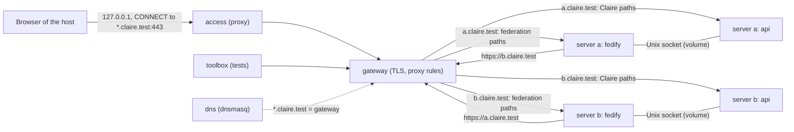

# Common Development Environment for Contributors

- **Document Identifier**: `DESIGN-CONTRIBUTOR-DEVELOPMENT-ENVIRONMENT-20261118`
- **Status**: Planned, not implemented for DE1 to DE6 containers/commands (Rev. 2). Locked decisions: CD1 (Section 2, 2026-11-18) and CD4 (`DQ1: A`, `.test` HTTPS origin and DNS role rules implemented in `security.py` and `host_router.py`, 2026-11-19). All other content is a **proposal**. Open questions: DQ2 to DQ7 (Section 13).
- **Date**: 2026-11-18
- **Base commit**: `33748825`. At the time of the reading, the working tree had changes of other work (the expansion modules, schema version 35). The **[code]** facts come from the files at that time.
- **Related Documents**:
  - [`KNOWLEDGE_FEDERATION_DESIGN.md`](KNOWLEDGE_FEDERATION_DESIGN.md) (decisions KD10 to KD12; readiness checks GF8 to GF17, Section 14.1; acceptance path KA1 to KA5, Section 14.2)
  - [`FEDERATION.md`](../implementation/FEDERATION.md) (contract version §5.4, readiness checks §7.2, deployment of the sidecar §9, reverse proxy rules §10, DrFed test stack §27)
  - [`EXTERNAL_ACCESS.md`](../implementation/EXTERNAL_ACCESS.md) (development and production access, Nginx example)
  - [`COMMANDS.md`](../implementation/COMMANDS.md) §1.1 (development procedure: uv normally, Docker for production-like checks)
  - [`IMPLEMENTATION_STATUS.md`](../implementation/IMPLEMENTATION_STATUS.md) §3 (E2E runs through `scripts/e2e.sh`)
  - [`AGENTS.md`](../../AGENTS.md) (documentation folders), [`LICENSE.md`](../../LICENSE.md)

Evidence tags follow [`PRINCIPLES.md`](../PRINCIPLES.md) F1: **[code]**, **[decision]**, **[proposal]**, **[external]**, **[unverified]**.

---

## 1. Goal and Scope

### 1.1 Goal

1. A contributor clones the repository on a machine with Docker and, with documented commands, gets a running development stack: Claire, the workers, the bot (optional), the Fedify sidecar with the switch `federation` on, and a TLS front. The readiness checks GF1 to GF7 and GF8 to GF17 pass in development.
2. The same environment runs the tests: pytest, the Deno tests of the sidecar, and Playwright through `scripts/e2e.sh`.
3. Two Claire servers with their sidecars run on one host, each with its own name below a development domain, with a private certificate authority and a private DNS. The knowledge federation is exchanged for real between them (acceptance step KA3 of the knowledge federation design).
4. A contributor needs no API key of an LLM provider, no access to production, no file of the owner, and no administrator rights on the host.

### 1.2 Non-Goals

1. Deployment and operation of production. `install`, `update`, `backup`, `restore`, `remote`, and `deploy.sh` stay commands of operators.
2. A change of the daily workflow of the owner: uv on the host, and `./cb-manuscript dev up` on a LAN address for other devices of the owner. Both stay possible.
3. Windows without WSL2.
4. A hosted CI service (DQ5 asks the owner).

---

## 2. Owner Decision (2026-11-18)

| ID | Decision |
| :--- | :--- |
| CD1 | The Docker development stack can be used when it is necessary. It must become a common environment, so that the community can contribute code to the project. |

The same day the owner decided the order of the remaining checks of the knowledge federation (KD10) and the new readiness checks GF8 and later (KD11). Steps KA1 to KA3 of that order use the network of two servers of this design (Section 6).

---

## 3. Facts of the Current Setup [code]

| Part | Fact |
| :--- | :--- |
| uv workflow | COMMANDS.md §1.1: `uv sync --extra dev --extra stealth --extra audio --extra ko`; the server runs with `uv run --env-file .env.dev claire serve-api` and `CLAIRE_INJECT_HOST`, `CLAIRE_INJECT_PORT`, and `CLAIRE_DB_PATH` from the shell. The application reads only the `.env` of the checkout (`src/claire/config.py:402-403`). |
| Docker development stack | `./cb-manuscript dev init`, `up`, `down`, and the other commands: `docker-compose.yml` with `docker-compose.dev.yml`, the env files `.env` and then `.env.dev`, data in `./.dev/data`, a new build at each `up` (`pull_policy: build`), no mount of the source. Host ports on `CB_API_BIND`, which is one IPv4 address. |
| Origin rule | With `CLAIRE_ENVIRONMENT=development` the public URL must be `http://<IPv4>[:port]/`; with `production` it must be `https://<DNS name>/` (`src/claire/api/security.py:915-926`). Thus development has no TLS and no names. |
| Private addresses | The sidecar permits private addresses (`allow_private_addresses`) only in development with `CLAIRE_ALLOW_PRIVATE_NETWORKS` on (FEDERATION.md §27.3). |
| Sidecar | Image `denoland/deno:2.9.8`; the Unix socket `{data}/run/federation.sock`; mounts only `run/`, `fedify/`, and the service key file (FEDERATION.md §9.1; `scripts/ci.sh` and `tests/test_federation_compose.py` examine this). Each answer has the header `X-Claire-Fedify-Server` with the random value of its process (FEDERATION.md §7.2). |
| Certificate trust | The Claire image adds the files of `/extra-certs` (from `./certs`) to the system trust store at the start (`scripts/docker-entrypoint.sh:4-17`), and `SSL_CERT_FILE` names that store (`docker-compose.yml:11-14`, `Dockerfile:46-49`). |
| Test stacks | DrFed (`tests/drfed/`, `tests/drfed_stack.py`) and Garage (`tests/garage_stack.py`): a private certificate authority for each start (`_write_certificates`), a TLS gateway (nginx), a DNS service (dnsmasq) with a wildcard name, the address ranges `172.31.251.0/24` and `172.31.252.0/24`. Gate variables `CB_DRFED_TEST=1` and `CB_GARAGE_TEST=1`. In the DrFed stack, the Claire process runs on the host, and the sidecar container uses the Unix socket in the data folder of that process; the sidecar trusts the authority with `DENO_CERT` (`tests/drfed/docker-compose.yml:71-99`). |
| E2E | `scripts/e2e.sh`: a detached systemd user service with `MemoryMax=2400M` and `RuntimeMaxSec=1200`, and a time limit of 600 seconds for each Playwright process; the results are in `data/e2e-runs/`. Playwright starts its own server on port 8766 (`e2e/playwright.config.js:7`). |
| CI | `scripts/ci.sh`: syntax with Python 3.11, the Compose models, the mounts of the sidecar, `deno task test` when `deno` is installed, `uv lock --check`, and pytest with the extras of the image. The repository has no hosted CI (no `.github/`). |
| Provider | In development, a provider that cannot be used becomes `mock` (`src/claire/config.py:1049-1053`); the default of `CLAIRE_PROVIDER` is `mock` (`config.py:470`). The tests of the knowledge federation use the mock provider (KNOWLEDGE_FEDERATION.md §12.10, §13.9). |

---

## 4. Parts That Are Specific to the Owner or to One Kind of Host

| No. | Where | What | Effect for a contributor | Change (proposal) |
| :--- | :--- | :--- | :--- | :--- |
| F1 | `.env.dev` of the owner (not in Git), lines 14 and 23 to 25 | `CB_API_BIND`, `CLAIRE_FQDN`, and `CLAIRE_USERCONTENT_FQDN` with the LAN IPv4 address of the owner's host | None: the template has `127.0.0.1` (`.env.dev.example:24`, `:38`) | No change. The development network writes its own env files (Section 6.6). |
| F2 | `docker-compose.yml:31-33`, `docker-compose.dev.yml:17-19` | Mounts of host credential directories and `~/.local/bin` (as `/host-bin`; legacy host-CLI provider support retired per `AED8`, compose cleanup in `AE8`) | Docker makes a host folder that does not exist (as root on Linux); on macOS a host binary cannot run in a Linux container; personal credentials go into the containers | The overlay of the development network sets the volume list with `!override`: no such mount. `tests/test_container_mounts.py` examines only the two files above and does not change. |
| F3 | `Dockerfile:45` | `PATH="/app/.venv/bin:/host-bin:$PATH"`: `/host-bin` is before the system folders | A program in `~/.local/bin` of the host with the name of a tool of the image (for example `ffmpeg`, `python3`, or a script with a host interpreter line) hides that tool | DQ7 (a change of the production image) |
| F4 | `ops/cb_manuscript.py:293-330` and `:3660-3700`; `src/claire/config.py:261-384`; `src/claire/presentation/converter.py:36` | Lists of host folders (`/home/*/.local/bin`, `/root/.local/bin`, `/home/linuxbrew/.linuxbrew/bin`) for `asciidoctor` (plus legacy `agy`/`codex` preflight entries awaiting removal in `AE8` per `AED8`) | No effect with the mock provider | No change for the common environment |
| F5 | `scripts/e2e.sh:73-74`, `:99`, `:162-170`, `:194`, `:291` | The systemd user manager (`systemctl --user`, `systemd-run --user`, `MemoryMax`, `ManagedOOMMemoryPressure`) and GNU tools (`timeout` at line 131, `readlink -f` at line 79, `xargs -r` at line 186) | The script does not work on macOS, on WSL2 without systemd, or in a container | Runner back ends (Section 8.3) |
| F6 | `scripts/e2e.sh:13` | Memory limit 2400M, for the memory of the owner's host (about 11 GB) | — | Keep it as the limit of each back end |
| F7 | `scripts/e2e.sh:9`, `e2e/playwright.config.js:7`, `.env.dev.example:25` | The port of the E2E server, 8766, is the port of the development stack | An E2E run and a development stack on the host collide | The Docker back end runs the server of the run in its container (Section 8.3) |
| F8 | `scripts/e2e.sh:60-66`, `e2e/playwright.config.js:12-28` | The interpreter comes from the `.venv` of the checkout or of the main worktree | A Python environment on the host is necessary; on macOS a Linux environment in a container cannot use it | The toolbox has its own environment; the run gets explicit paths (Section 6.1) |
| F9 | `src/claire/config.py:402-403` | `Settings` reads the `.env` of the checkout, and tests make `Settings` objects | A test result can depend on the `.env` of the machine; the `.env` of the owner has production values **[unverified: the number of tests that depend on it]** | The tests do not read the `.env` of the checkout (phase DE1) |
| F10 | `tests/drfed_stack.py:145-158`; `tests/garage_stack.py` (`gateway_ip`) | The test process on the host connects to addresses on a Docker bridge network | Works only with Docker Engine on Linux; Docker Desktop on macOS and Windows has no route from the host to these addresses **[external, unverified]** | These tests run in the toolbox on the network of their stack (Section 8.5) |
| F11 | `tests/drfed/docker-compose.yml:89-91` | The sidecar container uses the Unix socket in a host folder that a host process made | A Unix socket across the file sharing of Docker Desktop **[unverified]** | In the development network, Claire and the sidecar are containers, and the socket folder is a named volume (Section 6.8) |
| F12 | `tests/drfed_stack.py:210-211` | `generate_actors(stack, server_id, size)` uses the name `instance_id`, which does not exist | `NameError` at run time: the helper does not make the actors, and the DrFed stack does not start (an error of the change from "instance" to "server") | Fix in phase DE4: the value is `server_id`; the GraphQL argument of DrFed keeps its name `instance` |
| F13 | `tests/drfed_stack.py:43-44` | Fixed address ranges `172.31.251.0/24` and `172.31.252.0/24` | Can collide with a network of the contributor (two variables select other ranges) | The development network has its ranges in variables with the same rule, written in the documents |
| F14 | `ops/cb_manuscript.py:14`, `:1656` | `fcntl` and `flock` (POSIX only) | Windows only with WSL2 | A requirement of Section 5 |
| F15 | `src/claire/api/security.py:915-920` | Development needs `http` and an IPv4 address | No TLS front and no names in development; development cannot examine the readiness of TLS and of names | DQ1 |
| F16 | `src/claire/accounts/federation_readiness.py:53` | GF7 uses `httpx` with `trust_env=False`, and `httpx` 0.28.1 then trusts only the bundle of `certifi` | GF7 fails behind a private certificate authority: the development network, or a server whose authority is in `certs/` | KNOWLEDGE_FEDERATION_DESIGN.md Section 14.1.1 rule 5 (the system trust store) |
| F17 | `scratch/` (160 files in Git) | Support bundles of a server: configuration, telemetry, inbox records, the detail and the extractions of a tracked document | Each clone gets them | DQ4 |
| F18 | `certs/README.md:11` | The example names the certificate file of the owner; the text is in Korean | Small | A neutral example in the contributor documents (phase DE6) |
| F19 | `.env.example:57-64` | "If omitted or not configured, Claire Bible safely falls back to the mock provider." No explicit `CLAIRE_PROVIDER` | A contributor depends on a silent fallback | The env files of the development network set `CLAIRE_PROVIDER=mock` (Section 6.6) |
| F20 | `COMMANDS.md`, `EXTERNAL_ACCESS.md`, `OPERATIONS.md`, `README.md` | Mostly Korean | A contributor who does not read Korean | DQ6 |

---

## 5. Requirements of the Host [proposal]

| Item | Requirement |
| :--- | :--- |
| Operating system | Linux (x86-64 or arm64) with Docker Engine; macOS 13 or later (Apple silicon or Intel) with Docker Desktop or another engine with Compose; Windows 11 with WSL2, the checkout in the file system of WSL2, and Docker Desktop with the WSL2 back end or Docker Engine in WSL2 |
| Docker | Engine 24 or later; Compose v2.24.4 or later, for the YAML tags `!override` and `!reset` **[external, unverified: the first version with both tags]** |
| Host tools | Git, Bash, and Python 3.11 or later with only its standard library (for `cb-manuscript`) |
| Resources | Memory for Docker: about 6 GiB for one server with the tests, about 8 GiB for two servers; disk: about 15 GiB for the images **[unverified: phases DE2 and DE4 measure the values]** |
| Network | The image and package registries for the first build. The tests of the development network need no network after the build. |
| Not necessary | uv, Deno, Node.js, the browsers of Playwright, an LLM API key, a Telegram token, a provider CLI, administrator rights (no change of the hosts file and of the system trust store) |

---

## 6. Architecture [proposal]

### 6.1 Parts



| Part | Function |
| :--- | :--- |
| Toolbox image (`claire-bible-toolbox`) | Python 3.11 with the extras of the image and `dev`, uv, Deno 2.9.8 with the cached dependencies of the sidecar, Node.js with the Playwright version of `e2e/package-lock.json` and its Chromium, and the Docker CLI with Compose for the model checks of `scripts/ci.sh` (no Docker daemon and no Docker socket in the container **[unverified: `docker compose config` without a daemon]**). Its Python environment and its `node_modules` are in the image; the checkout is mounted at `/src`. It runs with the user ID and group ID of the host user. |
| Core project (`claire-devnet`) | `certs` (a one-shot job: the private certificate authority and the server certificate), `dns` (dnsmasq), `gateway` (nginx: TLS and the reverse proxy rules), `access` (the proxy for the browser of the host, Section 6.7) |
| Server projects (`claire-devnet-a`, `claire-devnet-b`) | The services of `docker-compose.yml` (api, the workers, bot, fedify) with the overlay `compose.server.yml`: named volumes, no host ports, the networks of the development network, the certificate authority, memory limits. Thus the development network uses the same service definitions as production. |
| Networks | `devnet-edge`: internal, with no route out; the gateway, the DNS, the sidecars, the Claire services, and the toolbox for the tests. `devnet-out`: a route to the internet for the Claire services (ingestion of web pages) and for the DNS; never for a sidecar. |
| Files | `ops/dev/toolbox.Dockerfile`, `ops/dev/devnet/compose.core.yml`, `compose.server.yml`, `gateway.conf`, `access.conf`, the server env template, and the fault profiles of the gateway (Section 6.5). The DNS image of `tests/drfed/dns.Dockerfile` can be used again. |

### 6.2 Development Domain and Names

1. The development domain is `claire.test`. `.test` is a special-use name: no public DNS answers it (RFC 6761).
2. Server a: app host `a.claire.test`, site domain `a.claire.test`, role host usercontent `uc.a.claire.test`. Server b: the same with `b`.
3. The DNS service answers `claire.test` and each name below it with the address of the gateway on `devnet-edge` (`--address=/claire.test/<gateway>`, the DrFed pattern), and sends each other name to the resolver of Docker.
4. One server certificate has `claire.test`, `*.claire.test`, `*.a.claire.test`, and `*.b.claire.test`, because a wildcard covers one label only.
5. The servers use port 443 in the network. The known servers keep the domain without a port, and the read of a `/kb` collection uses `https://<domain>/ap/kb` **[code]** (KNOWLEDGE_FEDERATION.md §10.2 and §11.4). Thus a server on another port cannot take part.

### 6.3 Development Origin Rule (DQ1)

**Proposal (DQ1 option A):** in development, the public URL can also be `https://<name>/` when the name is `claire.test`-like: a name below the special-use name `test`. The role hosts of such a server follow the production rules of `HostRoles` (a site domain and its subdomains), with names below `test`. `http://<IPv4>` stays the other development form. The production rules do not change.

Why a name below `test` only:

1. A development server cannot use the name of a real server.
2. Other servers on the internet cannot resolve the name, so a development server cannot exchange with them (Section 9 item 1).

The development network also sets `CLAIRE_ALLOW_PRIVATE_NETWORKS=1`, so that `allow_private_addresses` is true and the sidecars reach each other at private addresses **[code]** (FEDERATION.md §27.3). `secure_cookie` stays a rule of production **[code]**.

### 6.4 TLS Trust

| Party | How it trusts the private certificate authority |
| :--- | :--- |
| Sidecar | `DENO_CERT=/tls/ca.crt`; Deno reads the variable at its start (the DrFed pattern **[code]** `tests/drfed/docker-compose.yml:86-87`). |
| Claire services | The certificate of the authority is in `/extra-certs/`; the entrypoint adds it to the system trust store **[code]**. The `httpx` clients that read `SSL_CERT_FILE` trust it. The readiness requests use the system trust store (KNOWLEDGE_FEDERATION_DESIGN.md Section 14.1.1 rule 5, finding F16). |
| Toolbox | `SSL_CERT_FILE` names a bundle with the public authorities and the private one (the `ca_bundle` pattern of DrFed). |
| Browser of the host | Section 6.7. |

The `certs` job makes the authority at the first `devnet up` and keeps it in the run folder (`.dev/devnet/tls/`, mode 0700) until `devnet down`, so that a browser profile trusts it only one time. The run folder is in `.dev/`, which Git ignores **[code]** (`.gitignore`).

### 6.5 Gateway and How the Servers Find Each Other

1. The gateway is the only end of TLS. Its configuration is the reference of the reverse proxy rules of FEDERATION.md §10: exact `/.well-known/webfinger`, exact `/.well-known/nodeinfo`, prefix `/nodeinfo/`, and prefix `/ap/` go to the sidecar of the server; all other paths go to Claire. `client_max_body_size` is 1 MiB; the `Host` header goes without a change; Claire gets `X-Forwarded-For`, and `CLAIRE_TRUSTED_PROXIES` has the gateway address. The Nginx example of EXTERNAL_ACCESS.md is made from the same file, so that one tested source exists.
2. The services of server a join `devnet-edge` with the aliases `a-api` and `a-fedify`. The gateway resolves the alias at each request (the resolver of Docker, as in `tests/drfed/nginx.conf`), so that the gateway runs also when server b does not run.
3. How the servers find each other: each name goes to the gateway, and the `Host` header selects the server. Server A knows server B after an admin entry or a contribution (KNOWLEDGE_FEDERATION_DESIGN.md Section 6.2); the tests use the admin entry.
4. Fault profiles: other gateway configurations for the tests of unit KF6: no rule for `/ap/`, a changed `Host`, a body limit of 64 KiB, `/nodeinfo/` to Claire, a cache for actor documents, a cache for `/ap/kb`, and `/ns/v1` without the CORS header. A test selects a profile, and the gateway loads it again.

### 6.6 First Setup and Secrets of Each Server

| Item | How it is made | Where |
| :--- | :--- | :--- |
| Env file of the server | `devnet up` writes it from the template: `CLAIRE_ENVIRONMENT=development`, `CLAIRE_PUBLIC_URL=https://a.claire.test/`, the site domain and the role host, `CLAIRE_ALLOW_PRIVATE_NETWORKS=1`, `CLAIRE_PROVIDER=mock`, `CLAIRE_TRUSTED_PROXIES`, `CB_FEDERATION=1`, `CB_UID` and `CB_GID` of the host user. `CB_API_BIND` and `CB_API_PORT` have values only for the interpolation of `docker-compose.yml` (`:?`); the overlay removes the host ports (`ports: !reset []`). | `.dev/devnet/a.env`, mode 0600 |
| Owner token `CLAIRE_INJECT_TOKEN` | Random URL-safe characters, one for each server and each start | The env file |
| Master key | Claire makes `auth/master.key` at its first use **[code]** (`SecretService`); `CLAIRE_SECRET_KEY` stays empty | The data volume of the server |
| Service key of the sidecar | `claire migrate` in a one-shot run before the services **[code]** (FEDERATION.md §5.2); then a one-shot job copies the file into the key volume of the sidecar (Section 6.8) | The data volume and the key volume |
| Admin account with a USERNAME (GF1) | `devnet up` makes a one-time login link with `claire auth --scope owner --json` in the server project; the bootstrap job of the toolbox opens it through the gateway and does the first setup through `/setup`, as an admin does | `auth.db` of the server |
| A shared knowledge base with documents | The bootstrap job ingests the fixture texts of the development network (invented content, Section 9 item 3) with the mock provider and makes a shared knowledge base through the account routes (GF15 and GF16 need one) | `claire.db` of the server |
| Switch `federation` | The bootstrap job reads the readiness report and sets the switch with `POST /api/admin/federation`, with a session that has a recent sign-in | `claire.db` of the server |
| Telegram | No token. The bot is in the Compose profile `bot` of the overlay (option `--bot`); without a registered bot it waits **[code]** (comment in `docker-compose.yml`) | — |
| Credentials of the tests | The bootstrap job writes the admin session of each server | `.dev/devnet/state.json`, mode 0600 |

No secret is in the repository. Each new development network has new secrets. `devnet down` deletes the run folder and the volumes.

### 6.7 Access from the Host (DQ2)

**Proposal (DQ2 option A):** the service `access` is an HTTP proxy (`CONNECT`) on `127.0.0.1:<CB_DEVNET_ACCESS_PORT>`. It permits only names below `claire.test` and only port 443, and it resolves names with the DNS of the development network. The contributor starts a separate browser profile with that proxy and trusts the private authority in that profile only. The gateway has no host port. No hosts file, no administrator rights, and no change of the system trust store are necessary. `devnet info` shows the port, the file of the authority, and the start options of Chromium and Firefox.

### 6.8 Data, Volumes, and Limits

1. Each server has named volumes: `data` (`/app/data`), `vault`, `run` (`/app/data/run` in the Claire services, `/data/run` in the sidecar), `fedify` (`/data/fedify`), and `sidecar-key` (`/data/auth` in the sidecar, read only; the copy job writes `fedify_service.key` with mode 0600 and the user of the services).
2. Why named volumes and not bind mounts: SQLite locks and Unix sockets on the file sharing of Docker Desktop **[unverified]**, and the owner of the files in the checkout. A named volume is in the file system of the Docker engine on each platform.
3. The sidecar keeps the mount rule of FEDERATION.md §9.1: no data folder, no `auth/` folder of Claire, and no `claire.db`. `tests/test_federation_compose.py` and `scripts/ci.sh` also examine the overlay of the development network.
4. Each service has a memory limit (`mem_limit`) **[unverified values; phase DE4 measures them]**: api 1 GiB, each worker 512 MiB, bot 256 MiB, sidecar 256 MiB, gateway, DNS, and access 64 MiB each. The toolbox has 4 GiB for pytest and 2400 MiB for Playwright (Section 8.3). The limits protect a host with little memory, as `scripts/e2e.sh` does on the owner's host.

### 6.9 Readiness in Development

| Check | How it passes on a server of the development network |
| :--- | :--- |
| GF1 | The bootstrap job does the first setup with a USERNAME |
| GF2, GF3, GF4 | The heartbeat through the socket in the `run` volume; `claire migrate` and the copy job; the master key in the data volume |
| GF5 | Applies to production only **[code]**; with KF6 it shows "Does not apply" |
| GF6, GF8, GF9 | The sidecar resolves its name with the DNS of the network, trusts the authority with `DENO_CERT`, and reaches its own origin through the gateway |
| GF7, GF10, GF14 to GF17 | Claire resolves its name with the same DNS and trusts the authority through the system trust store (F16) |
| GF11, GF12, GF13 | The loops of the sidecar, the actor keys in `auth.db`, and the settings; a name below `test` is valid in development |
| GF15, GF16 | The shared knowledge base of the bootstrap job |

---

## 7. Where uv and Docker Fit

The rule of COMMANDS.md §1.1 stays for the owner: daily work with uv on the host, and the Docker development stack for production-like checks. The common environment adds a way that needs only Docker on the host.

| Task | Owner today | Contributor | Note |
| :--- | :--- | :--- | :--- |
| Run one test while code changes | `uv run pytest …` on the host | `./cb-manuscript dev toolbox pytest …`, or uv on the host when Python 3.11 is installed | The toolbox does not change the `.venv` of the checkout |
| Full tests as in CI | `bash scripts/ci.sh` | `./cb-manuscript dev toolbox bash scripts/ci.sh` | Same Python version and extras |
| Tests of the sidecar | `deno task test` on the host | `./cb-manuscript dev toolbox deno task test` | Same Deno version as the image |
| Playwright | `bash scripts/e2e.sh run` (systemd) | `CLAIRE_E2E_RUNNER=docker bash scripts/e2e.sh run` | Section 8.3 |
| Running stack, production-like | `./cb-manuscript dev up` (http on an IPv4 address, also for LAN devices) | `./cb-manuscript dev devnet up` (TLS, names, switch `federation` on) | Both stay (Section 11 CD13) |
| Two servers and the knowledge federation | — | `./cb-manuscript dev devnet up --servers a,b`, then `./cb-manuscript dev devnet test` | Section 8.4 |
| DrFed and Garage | pytest on the host with the gate variable | The same tests in the toolbox on the network of the stack | Section 8.5 |

Commands of the common environment (`ops/cb_manuscript.py`, `dev` prefix). They do not read `.env` and `.env.dev`:

```text
./cb-manuscript dev devnet up [--servers a|a,b] [--bot]
./cb-manuscript dev devnet info                 # names, access port, authority file, browser options
./cb-manuscript dev devnet check                # readiness report of each server (claire server check --federation)
./cb-manuscript dev devnet test [pytest arguments]
./cb-manuscript dev devnet logs <server> [service]
./cb-manuscript dev devnet down                 # containers, networks, volumes, and .dev/devnet/
./cb-manuscript dev toolbox <command>           # for example: pytest -q, bash scripts/ci.sh, deno task test
```

---

## 8. Tests in the Common Environment

### 8.1 pytest

`./cb-manuscript dev toolbox pytest …` runs pytest in the toolbox with Python 3.11 and the extras of the image. `TMPDIR` is in the container, not in `/tmp` of the host. The tests do not read the `.env` of the checkout (F9).

### 8.2 Deno

`./cb-manuscript dev toolbox deno task test` and `deno task check` run in `sidecar/fedify/` with the frozen lock file and the cache of the image.

### 8.3 Playwright Through `scripts/e2e.sh`

1. The script gets two runner back ends: `systemd` (today) and `docker`. `CLAIRE_E2E_RUNNER` selects one. There is no automatic choice: without the variable the script stops with an error that names it (the rule of no fallback defaults). The documents give the value for each kind of host.
2. The Docker back end starts the toolbox detached (`docker run -d --name claire-e2e-<port>`) with `--memory 2400m --memory-swap 2400m`, a limit of processes, the user of the host, and the checkout at `/src`. Its command is `timeout -k 10 <run limit> bash scripts/e2e.sh __worker <run folder> …`, so that the run stops itself at the time limit.
3. Both back ends write the same files in `data/e2e-runs/<id>/` and have the same commands (`run`, `start`, `wait`, `status`, `watch`, `stop`) and exit codes. The Docker back end gets the state from the container: a result file gives `passed` or `failed`; `OOMKilled` gives `oom-kill`; exit code 124 gives `timeout`; `stop` gives `stopped`; a container without a result gives `lost`.
4. The server of the run listens on port 8766 in the container, so a development stack on the host and a run work at the same time (F7).
5. The part of the script that runs on the host uses only Bash 3.2 and POSIX tools, because macOS has them **[unverified: `readlink -f` and `xargs -r` on macOS]**. The GNU tools run in the container.

### 8.4 Tests of the Development Network

1. The tests have the marker `devnet` (registered in `pyproject.toml`) and the gate `CB_DEVNET_TEST=1`, as the DrFed tests have their gate. They are off by default.
2. `./cb-manuscript dev devnet test` runs pytest in a toolbox container on `devnet-edge`, with the state file (read only) and the bundle of authorities.
3. The tests act only through the public routes and the federation paths of the servers: the admin routes with the session of the state file (known servers, `POST /api/admin/themes/judge`, the switches), the account routes (ingestion, contributions, reviews), and the gateway. No test writes a row in a database or calls an internal route. This is the difference from the tests of today, which simulate the sidecars and the network **[code]** (KNOWLEDGE_FEDERATION.md §10.7).
4. One test for the readiness of both servers (steps KA1 and KA2), and one test for each completion criterion of KF1 to KF5 (step KA3).
5. A test waits for a state with a time limit (for example three intervals of the loop), never with a fixed sleep: the loops of the sidecar run each 5 or 60 seconds **[code]**.
6. The tests of unit KF6 use the fault profiles of the gateway (Section 6.5).

### 8.5 DrFed and Garage Stacks

The two stacks stay. Their tests run in the toolbox on the network of the stack, so that no test process on the host connects to a container address (F10). Phase DE4 fixes F12.

---

## 9. Data Protection

1. **Development data never goes to production.** (a) The servers have names below `test`, which no public DNS answers. (b) The sidecars are only on `devnet-edge`, which has no route out. (c) A production server refuses private addresses (`allow_private_addresses` is false in production **[code]**) and cannot resolve a name below `test`, so it cannot get the key of a development actor and refuses its signatures. Thus no exchange occurs in either direction.
2. **No production access.** No template and no command has a production address, token, backup, or data. `deploy.sh`, `cb-manuscript remote`, `install`, and `update` are not commands of the common environment; `cb-manuscript` refuses `remote` in development **[code]**.
3. **No personal data in test fixtures.** Fixtures use invented names and the domains of RFC 2606 and RFC 6761 (`example.com`, names below `test`). A test examines `tests/fixtures/` and `e2e/` for e-mail addresses of other domains **[proposal]**. The fixture texts of the development network are invented.
4. **Support bundles in Git.** `scratch/` has 160 files of support bundles of a server (F17): DQ4.
5. **Secrets.** Each start makes new secrets in `.dev/devnet/` (mode 0700 for the folder, 0600 for the files; Git ignores `.dev/`) and in the volumes. `devnet down` deletes them. `.env` and `.env.dev` stay out of Git **[code]** (`.gitignore`).
6. **Provider credentials.** Host credential folders (such as `~/.gemini`; host-CLI provider support including `~/.codex` is retired under `AED8`) never go into the common environment (F2).
7. **Isolation of tests.** The tests do not read the `.env` of the checkout (F9).

---

## 10. Contributor Documents to Add Later

This design does not write these documents. Phase DE6 writes them.

| Document | Content |
| :--- | :--- |
| `CONTRIBUTING.md` (root of the repository) | A short entry: the start (a link to the next document), the license of contributions (DQ3), the rules below, how to send a change, and the review |
| `docs/implementation/DEVELOPMENT_ENVIRONMENT.md` | The commands of the common environment and what they do now (the folder rule of AGENTS.md: `implementation/` tells what exists). COMMANDS.md §1.1 links to it. |
| `README.md`, `docs/README.md` | Links to the two documents |

Rules that exist now and that the contributor documents state:

1. **Documentation folders** (AGENTS.md): `docs/design/` tells what is intended and why; `docs/implementation/` tells what exists now; `docs/ideas/` keeps ideas without a design.
2. **Agents** (AGENTS.md): an agent must not give instructions to another agent.
3. **Language:** ASD-STE100 simplified technical English for documents and code comments. The CLI output is English in ASD-STE100 and is not localized ([`I18N_DESIGN.md`](I18N_DESIGN.md) ID6).
4. **UI text:** each new text of the web UI and the bot has catalog keys in `src/claire/static/locales/en.json` and `ko.json` from the start (ID5).
5. **No fallback defaults:** a missing or unknown input selects nothing; a path or a necessary parameter selects a target (400 when it is absent).
6. **Tests:** unit tests only for the interfaces between modules, for I/O, and for calls to external libraries; at least one E2E test for each new feature; Playwright only through `scripts/e2e.sh`.
7. **Terms:** a Claire installation is a "server", not an "instance"; federation is the open exchange; relay and server partnership are ideas only.
8. **Clean room** (KNOWLEDGE_FEDERATION_DESIGN.md Section 4.2): no code, template, schema, test, or documentation text of the projects of that list; ForgeFed and the FEPs (CC0) can be followed.
9. **Dependencies:** the latest release; the pins are written in the implementation documents.
10. **Migrations** complete themselves at the start; operators do not manage the database.
11. **Code:** Python 3.11 syntax (the image); no hard wrap of code lines; commit messages in English.

---

## 11. Decisions

| ID | Decision | Tag |
| :--- | :--- | :--- |
| CD1 | The Docker development stack can be used when it is necessary and becomes a common environment for contributions (Section 2) | **[decision]** owner, 2026-11-18 |
| CD2 | The host needs Docker with Compose, Git, Bash, and Python 3.11 with its standard library only; all other tools are in the toolbox image (Section 5) | **[proposal]** |
| CD3 | Development domain `claire.test`; servers `a.claire.test` and `b.claire.test` at port 443 (Section 6.2) | **[proposal]** |
| CD4 | Development origin rule for names below `test` with https (Section 6.3, DQ1: A) | **[decision]** owner, 2026-11-19 |
| CD5 | One private authority for each development network; the sidecar through `DENO_CERT`, Claire through `/extra-certs` and the system trust store, the toolbox through `SSL_CERT_FILE` (Section 6.4) | **[proposal]** |
| CD6 | Each server is a Compose project of `docker-compose.yml` with one overlay; named volumes; no host ports (Sections 6.1, 6.8) | **[proposal]** |
| CD7 | `devnet-edge` is internal; a sidecar is only on it; the Claire services also have `devnet-out` for ingestion (Section 6.1) | **[proposal]** |
| CD8 | The gateway configuration is the one reference of the reverse proxy rules, and it has fault profiles for the tests (Section 6.5) | **[proposal]** |
| CD9 | The browser of the host reaches the network through a loopback proxy that permits only `*.claire.test:443` (Section 6.7) | **[proposal]**, DQ2 |
| CD10 | The toolbox has its own Python environment and `node_modules` and never writes the `.venv` or `e2e/node_modules` of the checkout (Section 6.1) | **[proposal]** |
| CD11 | `scripts/e2e.sh` has the back ends `systemd` and `docker`, an explicit selection, and the same limits, files, and commands (Section 8.3) | **[proposal]** |
| CD12 | Tests of the development network: marker `devnet`, gate `CB_DEVNET_TEST=1`, run in the toolbox on `devnet-edge`, only public routes and federation paths (Section 8.4) | **[proposal]** |
| CD13 | `./cb-manuscript dev up` (http on an IPv4 address) stays next to `./cb-manuscript dev devnet` | **[proposal]** |
| CD14 | The commands are in `cb-manuscript` with the prefix `dev` and do not read `.env` and `.env.dev` (Section 7) | **[proposal]** |
| CD15 | The bootstrap of each server uses the public routes (first setup, switch), as an admin does; the env files set `CLAIRE_PROVIDER=mock` (Section 6.6) | **[proposal]** |

---

## 12. Risks

| ID | Risk | Control |
| :--- | :--- | :--- |
| R1 | A Unix socket or SQLite does not work on the file sharing of Docker Desktop | Named volumes (Section 6.8); phase DE2 runs on macOS and on Windows with WSL2 |
| R2 | A dependency has no arm64 package (for example `kiwipiepy`, `sqlite-vec`, or a library of Chromium) **[unverified]** | Phase DE1 builds the images for arm64 |
| R3 | The toolbox image is large, and the first build takes a long time | The layers follow `uv.lock`, `deno.lock`, and `e2e/package-lock.json`; a change of the source does not build the large layers again |
| R4 | Two servers need more memory than a small host has | The memory limits of Section 6.8; workers and bot are optional on server b |

---

## 13. Open Questions

### DQ1: Development Origin Rule (Section 6.3), Answered (CD4)

| Option | Rule | Effect |
| :--- | :--- | :--- |
| A | Development also accepts `https://<name>/` when the name is below `test`; role hosts with such names follow the production rules of `HostRoles` | TLS and names in development; a development name never resolves on the internet; production does not change |
| B | A third environment value (for example `devnet`) with its own rules | A clear separation, but each check of the environment in the code gets a third value |
| C | The development network runs as `production` with a new switch for private addresses | Production gets a switch that weakens a rule of security; not recommended |

**Answer (owner, 2026-11-19):** A (CD4). Implemented in `src/claire/api/security.py` and `src/claire/api/host_router.py`.

### DQ2: Access from the Host (Section 6.7)

| Option | Method | Effect |
| :--- | :--- | :--- |
| A (proposal) | A loopback proxy for `*.claire.test:443` and a separate browser profile that trusts the authority | No administrator rights; the host does not change |
| B | The gateway on `127.0.0.1:443`, the names in the hosts file, and the authority in the system trust store | Each browser works; needs administrator rights, changes the host, and collides with another service on port 443 |
| C | A and B in the documents | More text; the contributor selects |

**Recommendation:** A.

### DQ3: License of Contributions

`LICENSE.md` is MIT with the copyright line "BlackAn and the Claire Bible Project Contributors" **[code]**. The repository has no rule for incoming contributions.

| Option | Rule | Effect |
| :--- | :--- | :--- |
| A | Each contribution is under the MIT license of the repository; no sign-off | The least work; no record that the author had the right to give the code |
| B (proposal) | A, and each commit has a sign-off line of the Developer Certificate of Origin | A light record of the right of the author; a check of pull requests can examine the line |
| C | A contributor license agreement | The strongest record; more work for contributors and for the owner |

**Recommendation:** B.

### DQ4: Support Bundles in Git (`scratch/`, F17)

| Option | Action | Effect |
| :--- | :--- | :--- |
| A | Delete `scratch/` from the tree and add it to `.gitignore` | New clones of later commits do not have the files; the history keeps them |
| B (proposal) | A, and remove the files from the history before the repository is public | No clone gets them; a rewrite of the history changes the commit IDs and needs a forced push by the owner |
| C | Keep the files | Each contributor gets data of a server |

**Recommendation:** B, before the repository opens to the community; A at once.

### DQ5: CI for Contributions

| Option | Method | Effect |
| :--- | :--- | :--- |
| A (proposal) | A workflow of the hosting service runs `scripts/ci.sh` in the toolbox image for each pull request; the tests of the development network run on request | Each contributor sees the result; a hosted service runs the code of contributors |
| B | The owner runs `scripts/ci.sh` before a merge | No hosted service; the owner does the work |
| C | No CI | Not recommended |

**Recommendation:** A.

### DQ6: Language of the Contributor Documents (F20)

| Option | Rule | Effect |
| :--- | :--- | :--- |
| A (proposal) | The new contributor documents are in English (ASD-STE100); the Korean implementation documents stay and change to English when a later unit changes them | Small work now |
| B | A, and COMMANDS.md §1 and §2 and EXTERNAL_ACCESS.md are translated now | Contributors can read the commands and the proxy rules at once |
| C | Two languages for each contributor document | Two texts to keep the same |

**Recommendation:** A.

### DQ7: Order of `/host-bin` in `PATH` (F3)

| Option | Rule | Effect |
| :--- | :--- | :--- |
| A (proposal) | `/host-bin` goes to the end of `PATH` in `Dockerfile` | A host program can no longer hide a tool of the image (host-CLI binaries `agy` and `codex` are retired under `AED8` and scheduled for cleanup in `AE8`). A change of the production image. |
| B | No change | A program in `~/.local/bin` of a host can hide `ffmpeg`, `python3`, or another tool of the image |

**Recommendation:** A.

---

## 14. Phases

Precondition of DE5: unit KF6 of [`KNOWLEDGE_FEDERATION_DESIGN.md`](KNOWLEDGE_FEDERATION_DESIGN.md).

| Phase | Scope | Completion criteria |
| :--- | :--- | :--- |
| DE1 | Toolbox image; tests independent of the host and of the `.env` of the checkout | The toolbox image builds for linux/amd64 and linux/arm64 from a clean clone. `./cb-manuscript dev toolbox bash scripts/ci.sh` passes on Linux and on macOS with no Python package, Deno, or Node.js on the host. After the run, the `.venv` and `e2e/node_modules` of the checkout did not change (a test). The full pytest gives the same result with a `.env` of the checkout that has wrong values (F9). A test fails when a file in Git outside an allow list has a home folder of a person (`/home/<name>/`, `/Users/<name>/`) |
| DE2 | Development origin rule (DQ1), core project, server a | `security.py` and `host_router.py` accept `https://<name below test>/` in development and refuse another name (tests). The readiness requests use the system trust store (shared with KF6). From a clean clone, `./cb-manuscript dev devnet up` and then `./cb-manuscript dev devnet check` show GF1 to GF7 passed on server a, on Linux, on macOS, and on Windows with WSL2. The WebUI of server a opens in a browser of the host through the access proxy. The sidecar of the overlay mounts no data folder, no `auth/` folder, and no `claire.db` (test and `scripts/ci.sh`). `./cb-manuscript dev devnet down` removes the containers, the networks, the volumes, and `.dev/devnet/` |
| DE3 | E2E runner back ends | With `CLAIRE_E2E_RUNNER=docker`, `bash scripts/e2e.sh run` passes the same spec files as the systemd back end on the owner's host, and it runs on macOS. A spec that uses more memory than the limit ends as `oom-kill`; a run over the time limit ends as `timeout`; `stop` gives `stopped`. A development stack on port 8766 of the host and a Docker run work at the same time. Without the variable the script stops with an error that names it |
| DE4 | Server b and the tests of the development network | `./cb-manuscript dev devnet up --servers a,b` runs. A test with the marker `devnet`: after the admin of A adds `b.claire.test` as a known server, the sidecar of A reads NodeInfo and the server actor of B through the gateway with TLS and the DNS of the network. Without `CB_DEVNET_TEST=1` these tests are skipped. The DrFed and Garage tests run in the toolbox on their networks; F12 is fixed; a DrFed run passes on macOS. The memory of two servers is measured and written in the implementation document |
| DE5 | Readiness GF8 to GF17 and the real exchange (after KF6) | GF1 to GF16 pass on A and B, and GF17 passes. Each fault profile of the gateway makes its check fail (the criteria of KF6). Each completion criterion of KF1 to KF5 passes between A and B with real sidecars (acceptance step KA3) |
| DE6 | Contributor documents and data review | `CONTRIBUTING.md` and `docs/implementation/DEVELOPMENT_ENVIRONMENT.md` have the commands and the rules of Section 10. A person who did not take part in the work follows them on a clean machine to a running development network with GF1 to GF17 passed. The answers to DQ3 to DQ6 are applied |
