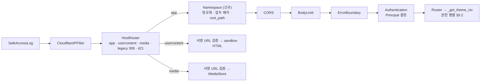

# 멀티 계정 네임스페이스와 단일 FQDN URI 통제 설계

- **상태**: 제안 (미구현) · Rev. 2
- **작성일**: 2026-11-02 · 기준 커밋 `f420b8f`
- **개정 이력**
  - Rev. 1 (2026-11-02): 초안
  - Rev. 2 (2026-11-02): 소유자 결정 D1–D9 반영. 서브도메인 역할 호스트, 테마 컬렉션 경로와 시간 정렬 번호, 초대, 퇴역 USERNAME 정보 초기화, 네트워크 전용 통합 뷰 예약, 미디어 딜리버리 계약을 추가했다. `/t/{slug}` 테마 경로는 `/themes/{번호}`로 바꿨다
  - Rev. 2.1 (2026-11-02): 소유자 결정 N1–N5 반영. 초대는 관리자만 만들고, 상한은 사용 5회·만기 30일이다. 운영 환경의 네트워크 모드는 usercontent 호스트가 필수다
  - Rev. 2.2 (2026-11-02, P1): P1 구현 중 나온 결정과 정정을 반영했다. §8.1-1 저장 형태 정정, §8.1-4 예시 보완, §8.3 `authenticated_at` 필드, §8.5 비밀번호 허용 문자, §16.3 P1 결정. 현재 구현은 [ACCOUNTS.md](../implementation/ACCOUNTS.md)를 본다
- **관련 문서**: [EXTERNAL_IDP_AND_PER_USER_WORKSPACE_DESIGN.md](EXTERNAL_IDP_AND_PER_USER_WORKSPACE_DESIGN.md) (워크스페이스별 DB 분리안을 이 문서가 대체), [THEME_FQDN_REVERSE_PROXY_DESIGN.md](THEME_FQDN_REVERSE_PROXY_DESIGN.md) (테마 전용 FQDN을 이 문서가 대체), [SYNDICATION_ENDPOINT_DESIGN.md](SYNDICATION_ENDPOINT_DESIGN.md), [EXTERNAL_ACCESS.md](../implementation/EXTERNAL_ACCESS.md), [THEMES.md](../implementation/THEMES.md), [PROVIDERS.md](../implementation/PROVIDERS.md), [PRINCIPLES.md](../PRINCIPLES.md)
- **참고 자료**: 소유자 제공 「Mastodon 컬렉션 아키텍처 및 원리 분석」(Gemini 공유 문서, `https://share.gemini.google/ku3QGLNBH0UC`, 2026-11-02). 채택 범위와 보정은 §7.1에 있다.

---

## 1. 배경과 목표

Syndication 프로토타입(`/syndication`)을 본 기능으로 합치려면 계정 경계가 먼저 있어야 한다. "누가, 어느 테마의 연결 계정으로 수집·발행하는가"를 정해야 하기 때문이다. 그런데 지금 시스템에는 사용자 식별이 없고, 자격증명의 권한 범위(scope)만 있다. 또 테마를 별도 FQDN으로 나누는 방식은 호스트가 하나 늘 때마다 쿠키·CORS·CSP·리버스 프록시 규칙도 함께 늘어난다.

이 설계는 다음을 바꾼다.

1. 서버 하나는 등록 도메인 하나와 앱 정본 호스트 하나(`CLAIRE_FQDN`)를 쓴다. 계정과 테마는 URI 경로로 구분한다. 서브도메인은 역할이 정해진 보조 호스트(계정 콘텐츠 격리, 미디어 딜리버리)에만 쓴다.
2. 로컬 계정을 도입한다. 계정은 바꿀 수 없는 USERNAME을 갖는다. 외부 공개 페이지는 `FQDN/@USERNAME`이고, 테마는 `FQDN/@USERNAME/themes/{번호}`다.
3. 싱글 모드와 네트워크 모드를 하나의 코드 경로로 운영한다.
4. 외부 IdP 로그인, 초대 가입, 계정별 LLM 사용 정책을 계정 경계 위에 올린다. CLI 프로바이더는 관리자 전용이고, 계정 API 키는 쓰기 전용이다.

### 1.1 요구사항과 해석

| ID | 요구사항 (원문 정리) | 이 문서의 해석 | 절 |
| :--- | :--- | :--- | :--- |
| R1 | 하나의 서버는 하나의 Top Level Domain을 사용한다. 서브도메인은 허용한다(D1) | 등록 도메인 1개 + 앱 정본 호스트 1개 + 역할 서브도메인. 테마 전용 FQDN은 폐지한다 | §5 |
| R2 | 로컬 계정 관리. 최초 관리자는 WebUI에 접근할 때 USERNAME을 만든다. USERNAME은 불변이다. `admin`처럼 예측하기 쉬운 이름은 금지한다 | 관리자 자격으로 처음 WebUI에 들어오면 `/setup`을 강제한다 | §8.1, §8.4 |
| R3 | `/admin/accounts`에서 로컬 계정 관리 WebUI를 제공한다 | 관리자 전용 화면과 JSON API | §8.6 |
| R4 | 계정의 외부 공개 웹페이지는 `FQDN/@USERNAME`이다 | 접두 `/@{username}`을 미들웨어가 해석한다 | §6 |
| R5 | 싱글 모드(관리자만, USERNAME 비노출)와 네트워크 모드(USERNAME 단위 경로) | 네트워크 모드에서는 관리자 홈도 `/@{admin}/`으로 옮긴다(D2 확정) | §4 |
| R6 | OAuth로 IdP 연동 | OIDC 우선, GitHub은 OAuth 2.0 | §12 |
| R7 | Antigravity·ChatGPT 등 CLI 클라이언트는 서버 관리자만 쓴다 | 서버 호스트에서 실행되는 LLM 프로바이더(`agy`, `codex`)를 관리자 전용으로 고정한다 | §10 |
| R8 | 다른 계정은 고유 API 키를 기입할 수 있다. 기입 후에는 아무도 조회할 수 없다. 키가 없으면 서버 관리자가 정의한 수준만 쓴다 | 쓰기 전용 비밀 저장소와 관리자 정의 "서버 등급"(기본 `none`, D6) | §10.3, §11 |
| R9 | 가입은 초대제다. `/invite` 경로에 8자리 토큰을 쓴다. 생성할 때 사용 횟수와 만기를 정한다. 관리자와 생성자는 언제든 비활성화할 수 있다. 가입 이용 횟수를 계측한다(D9) | Crockford Base32 8자 코드, 원자적 사용 계수, 가입 기록. 생성은 관리자만 한다(N1) | §8.8 |
| R10 | 테마는 `/@USERNAME/themes`에서 계정 단위로 조회하고, `/themes/(숫자)`로 표기한다. 숫자는 참고 자료(Mastodon Collections)의 원리를 따른다 | 시간 정렬 64비트 번호, 2단계 컬렉션과 커서 페이지네이션 | §7 |
| R11 | 퇴역 USERNAME은 관리자가 정보 초기화 기능을 호출한 뒤에만 다시 쓸 수 있다 | 미리보기 → 단계 인증 → 잔여 정보 삭제 → 해제 | §8.9 |
| R12 | (D2 후속) 네트워크 모드에서만 보이는 여러 사용자 통합 뷰·메뉴가 생길 수 있다 | `/explore` 이하를 네트워크 전용으로 예약한다 | §4.4 |
| R13 | (D1 후속) 오브젝트 스토리지 등으로 캐시 미디어를 딜리버리할 수 있다 | media 역할 호스트와 미디어 URL·키·캐시 계약만 지금 정한다 | §5.4 |

### 1.2 비목표 (v1)

- 계정 간 테마 공동 편집. 스키마에 있는 `theme_members`의 활용은 후속 과제다.
- 관리자 2명 이상, 관리자 양도.
- 계정별 서브도메인, 커스텀 도메인.
- 관리자의 멤버 비공개 데이터 접근. 잠정 불가다(D5, §8.6).
- ActivityPub 액터 직접 구현. Syndication 설계에서 철회한 결정을 유지한다.
- SCIM, SAML 직접 지원.

---

## 2. 출발점: 현재 코드의 사실

근거 태그는 [`PROVIDERS.md`](../implementation/PROVIDERS.md)와 같다.

1. **[코드] 호스트.** `HostAuthorityMiddleware`(`src/claire/api/security.py`)는 `CLAIRE_FQDN` 외에 테마에 등록된 FQDN도 받는다(`ThemeManager.has_registered_fqdn`). `_extract_theme_ref`(`src/claire/api/server.py`)는 테마 FQDN으로 들어온 요청을 그 테마로 고정한다. `CORSPolicyMiddleware._is_theme_origin`은 테마 origin을 허용한다.
2. **[코드] 인증.** 주체는 범위 문자열 하나(`owner`, `collaborator`, `readonly`, `anonymous`)다. 누가 요청했는지는 식별하지 않는다. 자격증명은 네 곳에 있다: `data/auth/api_tokens.json`(`TokenStore`), `auth_sessions`, `oauth_tokens`, 환경변수 토큰.
3. **[코드] 라우트 정책.** `ROUTE_POLICY`는 `(method, 정확한 path)`를 키로 하는 평면 표다. 등록되지 않은 경로는 404다. 경로 매개변수는 이미지 경로에만 있고, 이마저도 접두 비교로 예외 처리한다.
4. **[코드] 저장.** 단일 `data/claire.db`(v14)에 모든 테마가 있고 `theme_id`로 나뉜다. 테마 파티션 테이블은 16개다. `themes.id`는 0부터 늘어나는 일련번호다. `users`, `theme_members` 테이블은 스키마에만 있고 코드에서 쓰지 않는다. `users.email`이 `UNIQUE`다.
5. **[코드] 프로바이더.** 설정은 전역 `data/providers.json`이다. `antigravity`·`codex`는 서버 호스트의 바이너리를 그 호스트의 로그인 상태로 실행한다. `IngestServicePool`은 테마별 서비스를 캐시하고 LLM 인스턴스를 공유한다.
6. **[코드] WebUI 경로.** `src/claire/static/js/app.js`는 API를 상대 경로로 부른다(`fetch('graph')`, `fetch('themes')`). 그래서 UI를 `/@alice/`에서 열면 호출이 `/@alice/graph`로 간다. 절대 경로 리터럴은 `reader.js`, `syndication_app.js`, `share.html` 등에 남아 있다(**[실측]** grep 21곳).
7. **[코드] WebUI 테마 ID.** `app.js`는 테마 ID를 `parseInt(themeId, 10)`으로 다룬다(376행 외 5곳). `localStorage`의 `claire_selected_theme`에 내부 ID를 저장한다.
8. **[코드] 테마 목록 응답.** `GET /themes`는 `{"themes": [...], "default_theme_id": …, "multi_theme": …}`를 돌려준다. 페이지네이션은 없다. `/documents`는 `limit=300` 고정이고 커서가 없다.
9. **[코드] 브라우저 경계.** CSP `script-src`에 `'unsafe-inline' 'unsafe-eval'`이 있다(`_build_content_security_policy`). `innerHTML` 대입이 `app.js`에 138곳, `reader.js`에 27곳 있다. 지금은 콘텐츠 주인이 운영자 한 명이라 위험이 작다. 그러나 한 origin을 여러 계정이 나눠 쓰면, 한 계정의 콘텐츠가 다른 계정(관리자 포함)의 세션 권한으로 실행될 수 있다(§15 S1).
10. **[코드] 테마 폴백.** `ThemeManager.get_theme(strict=False)`는 없는 테마를 테마 0으로 바꾼다([`PRINCIPLES.md`](../PRINCIPLES.md) 위반 2). 계정이 생기면 테마 0은 관리자 소유가 되므로, 이 폴백은 계정 간 누출 경로가 된다.

---

## 3. 핵심 결정

| ID | 결정 | 이유 |
| :--- | :--- | :--- |
| K1 | 등록 도메인 하나(`CLAIRE_SITE_DOMAIN`)와 앱 정본 호스트 하나(`CLAIRE_FQDN`)를 쓴다. 서브도메인은 역할 호스트(usercontent, media)와 30일 레거시 리다이렉트에만 쓴다 | R1·D1. 계정·테마 구분이 경로로 모이고, 격리와 딜리버리에 필요한 origin만 따로 둔다 |
| K2 | 계정 경계는 테마 소유권(`themes.account_id`)으로 정한다. 테마 파티션 테이블에는 `account_id`를 넣지 않는다 | v14의 `theme_id` 파티셔닝을 그대로 쓴다. 격리 검사가 "요청 네임스페이스의 계정이 이 테마를 소유하는가" 하나로 모인다 |
| K3 | 접두 `/@{username}`과 `/themes/{번호}/`는 미들웨어가 떼어 내 `root_path`로 옮긴다. 남은 경로에는 기존 `ROUTE_POLICY`와 라우트를 그대로 쓴다 | 라우트를 계정별로 복제하지 않는다. WebUI의 상대 경로 호출이 그대로 동작한다 |
| K4 | 내부 참조는 `accounts.id`만 쓴다. USERNAME은 불변이지만 외래 키로 쓰지 않는다 | 퇴역·정보 초기화·감사 기록에서 이름과 식별자를 섞지 않는다 |
| K5 | 서버 관리자는 콘텐츠 슈퍼유저가 아니다. 다른 계정의 비공개 데이터, 세션, 토큰, API 키에 접근하지 못한다 | R8, D5. 관리자 권한은 인스턴스 설정과 계정 수명주기다 |
| K6 | 계정 비밀은 쓰기 전용이다. 저장한 뒤에는 어떤 API·CLI·번들도 평문을 돌려주지 않는다 | R8 |
| K7 | 네임스페이스·테마·프로바이더 결정에는 폴백이 없다 | PRINCIPLES C1·C2 |
| K8 | 싱글 모드는 네트워크 모드의 특수형이다(계정 1개, 접두 생략). 모드 분기는 네임스페이스 결정과 라우트 `modes` 한 곳에만 둔다 | 두 모드의 코드가 갈라지면 한쪽 테스트만 통과하는 회귀가 생긴다 |
| K9 | 외부 번호와 내부 키를 나눈다. 테마는 내부 `themes.id`를 유지하고, 외부에는 시간 정렬 64비트 번호만 쓴다 | R10. 16개 테이블의 `theme_id` 외래 키를 다시 쓰지 않는다(A3). 일련번호 노출(개수 추측)도 막는다 |
| K10 | 계정이 만든 HTML은 앱 origin에서 실행 가능한 형태로 그리지 않는다 | §15 S1. usercontent origin 분리를 권장한다(D1이 허용) |

---

## 4. 인스턴스 모드

### 4.1 동작 비교

| 항목 | 싱글 모드 | 네트워크 모드 |
| :--- | :--- | :--- |
| 계정 | 관리자 1개 | 관리자 + 멤버 |
| `/` | 관리자 기본 테마 홈 (현재 WebUI) | 공개 계정·테마 목록 (D4) |
| 계정 홈 | `/` | `/@{username}/` |
| 테마 | `/themes`, `/themes/{번호}/` | `/@{username}/themes`, `/@{username}/themes/{번호}/` |
| USERNAME 노출 | 없음. `/@…`은 관리자 이름이어도 404 | 공개 프로필 계정은 노출 |
| 초대·IdP 가입 | 비활성 (`/invite/*` 404) | 초대제 (D9) |
| 통합 뷰 (`/explore/*`) | 404 | 제공 (§4.4) |
| CLI 프로바이더 | 관리자 | 관리자만 (§10) |

### 4.2 저장과 전환

- 모드는 환경변수가 아니라 DB의 `instance_settings`에 둔다. 키는 `mode`, `invite_caps`, `id_salt`다. 관리자가 `/admin/accounts`에서 바꾼다. 프로바이더·적재 한도를 WebUI 관리 파일로 옮긴 것과 같은 방향이다.
- **싱글 → 네트워크**: 준비 검사 G1–G9(§17.2)를 모두 통과하고 관리자가 단계 인증(§8.5)을 해야 한다. 하나라도 실패하면 거부하고 실패 항목을 보여 준다.
- **네트워크 → 싱글**: `invited`·`active`·`suspended` 상태의 멤버가 없어야 한다. 있으면 그 목록과 함께 거부한다. 전환 뒤 `/@{admin}/…`은 `/…`로 308 리다이렉트한다. 확인 화면에는 이미 공개된 관리자 USERNAME을 되돌릴 수 없다고 적는다.
- 네트워크 모드는 `CLAIRE_MULTI_THEME=1`을 전제로 한다. 꺼져 있으면 전환을 거부한다(C1).

### 4.3 네트워크 모드 전환 시 이동 (D2 확정)

1. 관리자 홈이 `/@{admin_username}/`으로 옮겨 가고, 관리자 USERNAME이 공개된다.
2. 싱글 모드에서 쓰던 콘텐츠 URL(`/?doc=…`, `/themes/{번호}/…`)은 관리자 네임스페이스로 308 리다이렉트한다. 북마크와 검색엔진 색인이 끊기지 않는다.
3. 공유 링크(`/p?s=…`)는 토큰이 테마를 정하므로 경로를 바꾸지 않는다.
4. 관리자 USERNAME 설정(§8.4)을 마치기 전에는 네트워크 모드를 켤 수 없다(G7).

### 4.4 네트워크 전용 통합 뷰 예약 (R12)

- `/explore` 이하 시스템 경로를 네트워크 전용(`modes={"network"}`)으로 예약한다. 싱글 모드에서는 404다.
- 첫 소비자는 D4의 공개 계정·테마 목록이다. 네트워크 모드의 `/`는 이 목록을 그리고, 데이터는 `GET /explore/accounts` 컬렉션(§7.4)에서 받는다.
  - 대상은 `profile_public=1`이고 `active`인 계정이다.
  - 계정마다 표시 이름, `@username`, 공개 테마 목록(번호 URL과 문서 수)을 보여 준다.
- 이후의 여러 사용자 통합 뷰(통합 검색, 최근 공개 문서, 통합 신디케이션 피드 등)도 이 아래에 둔다.
- 통합 뷰는 공개 프로필 계정의 공개 테마만 읽는다. 다른 계정의 `_get_theme_ctx`를 거치지 않고, 전용 공개 색인 질의 계층(`store/public_index.py`)만 쓴다. LLM은 호출하지 않는다(검색은 FTS).
- WebUI 메뉴: `/whoami`가 `instance.mode`를 돌려준다. 네트워크 전용 메뉴 항목은 `data-mode="network"`로 표시하고, 싱글 모드에서는 그리지 않는다.

---

## 5. 호스트와 도메인

### 5.1 호스트 역할 (D1)

| 역할 | 설정 | 예시 | 내용 | 쿠키 |
| :--- | :--- | :--- | :--- | :--- |
| app | `CLAIRE_FQDN` (필수) | `claire.example.com` | WebUI, API, MCP, 계정 경로 | 세션 쿠키 |
| usercontent | `CLAIRE_USERCONTENT_FQDN` (선택. 네트워크 모드 운영 환경에서는 필수, N5) | `usercontent.example.com` | 계정이 만든 HTML: 문서 상세, 원문, 프레젠테이션, 신디케이션 본문, 공유 본문 | 없음 |
| media | `CLAIRE_MEDIA_FQDN` (선택) | `media.example.com` | 캐시 미디어: 이미지, 영상 캐시, 프레젠테이션 이미지, 첨부. 오브젝트 스토리지·CDN의 앞단 | 없음 |
| legacy | `legacy_hosts` (이관이 자동 등록) | `ai.example.com` | 308 리다이렉트만. 30일 뒤 421 (D3) | 없음 |

- `CLAIRE_SITE_DOMAIN`에는 등록 도메인을 명시한다(예: `example.com`). 모든 역할 호스트는 이 값과 같거나 그 서브도메인이어야 한다. 공개 접미사 목록(PSL)으로 등록 도메인을 추정하지 않는다(C1). app 외의 역할 호스트를 두지 않는 설치에서는 설정하지 않아도 된다.
- 역할 호스트는 서로 달라야 한다. 또 app 호스트의 상위 도메인이면 안 된다.
- 계정별 서브도메인은 만들지 않는다. 계정 공개 페이지는 R4대로 `/@USERNAME`이다.
- development에서는 같은 IPv4의 다른 포트로 origin을 나눈다(예: app `:8766`, usercontent `:8767`).
- 호스트 판정은 `HostRouter`가 맡는다. 역할마다 별도 ASGI 하위 앱과 라우트 표를 둔다. usercontent 호스트로 `/admin/accounts`를 요청하면, 그 호스트의 라우트 표에 없으므로 404다.

### 5.2 쿠키와 origin 경계

서브도메인은 같은 site(same-site)이지만 다른 origin이다. 그래서 다음을 지킨다.

- 운영 환경 세션 쿠키 이름을 `__Host-claire_session`(Secure, `Path=/`, `Domain` 없음)으로 바꾼다. 서브도메인이 상위 도메인 쿠키를 심는 쿠키 토싱(cookie tossing)을 막는다.
  - development(HTTP)에서는 `__Host-`를 쓸 수 없으므로 지금 이름을 유지한다.
  - 전환할 때 옛 쿠키를 받으면 새 이름으로 다시 발급하고 옛 쿠키를 지운다.
- SameSite는 같은 site 안의 서브도메인 요청을 막지 못한다. 쓰기 요청 방어는 기존 Origin 판정(cross-origin + 쿠키 → 403)에 맡긴다. usercontent·media origin은 CORS 허용 목록에 넣지 않는다.
- usercontent·media 응답에는 `Set-Cookie`를 붙이지 않고, 들어온 `Cookie` 헤더는 무시한다.
- 상단 보호장치의 HSTS에는 `includeSubDomains`를 권장한다.
- CSP 연결
  - app 응답: `frame-src https://{usercontent}`, `img-src`·`media-src`에 `https://{media}` 추가
  - usercontent 응답은 두 프로필로 나눈다.
    - `static`(문서 상세, 원문, 공유 본문, 신디케이션 본문): `default-src 'none'; img-src https://{media} data:; style-src 'unsafe-inline'; frame-ancestors https://{app}; sandbox allow-popups allow-popups-to-escape-sandbox`. 스크립트는 허용하지 않는다.
    - `deck`(`/p/presentation`): reveal.js가 스크립트를 실행해야 한다. CSP는 `script-src https://{usercontent}`(인라인 스크립트는 nonce로)이고, app 쪽 iframe은 `sandbox="allow-scripts allow-popups"`로 연다. `allow-same-origin`을 주지 않으므로 덱은 불투명(opaque) origin에서 돌고, app의 DOM과 세션에 닿지 못한다. postMessage는 targetOrigin을 명시하고, 받을 때 origin을 검사한다.
    - 근거: P0 렌더링 경계 조사. 프레젠테이션은 스크립트가 꼭 필요한 유일한 표면이다.
- usercontent에는 세션이 없다. 비공개 콘텐츠는 app이 발급한 짧은 만료 서명 URL(`exp`, `sig`, 문서·테마에 묶임, 5분)로만 연다. 공개 콘텐츠는 서명 없이 연다.

### 5.3 테마 FQDN 이관 (D3: 30일)

- v16 이관이 `themes.fqdn` 값을 `legacy_hosts`로 옮긴다. `sunset_at`은 이관 시각 + 30일이다.
- `HostRouter`의 레거시 호스트 처리는 다음과 같다.
  - `sunset_at` 전의 `GET`·`HEAD`: 정본 호스트의 테마 경로에 원래 path와 query를 붙여 308 리다이렉트한다. 테마 경로는 싱글 모드면 `/themes/{번호}/`, 네트워크 모드면 `/@{owner}/themes/{번호}/`다.
  - 그 밖의 메서드, 그리고 `sunset_at` 이후: 421.
  - 미등록 호스트: 지금처럼 421.
- 레거시 호스트 응답에는 `Set-Cookie`와 CORS 헤더를 붙이지 않는다. `CORSPolicyMiddleware`의 테마 origin 허용은 없앤다.
- 테마별 GA4 측정 ID는 유지한다. CSP에 넣을 ID를 Host 대신 고정 테마(`pinned_theme_id`)로 고른다.
- WebUI 테마 편집에서 FQDN 입력란을 없앤다. 대신 레거시 리다이렉트의 남은 기간을 보여 준다.

### 5.4 미디어 딜리버리 계약 (R13)

이 설계는 URL, 객체 키, 캐시 규칙만 정한다. 오브젝트 스토리지 구현은 P7이다.

- 모든 미디어 URL은 함수 하나(`media_url(ref, viewer)`)로 만든다. 지금은 app 호스트의 기존 경로(`/image`, `/images/*`, `/p/images/*`)를 돌려준다. media 호스트를 켜면 그 호스트의 URL을 돌려준다.
- 저장된 HTML에 미디어 절대 URL을 박지 않는다. `detail_html`은 미리 컴파일해 저장하므로, 그 안의 미디어 참조는 렌더 단계에서 `media_url`로 바꾼다. 기존 `detail_html`의 `/images/…` 참조도 렌더할 때 바꾸는 대상이다.
- 객체 키는 `HMAC(키 파생, account_id ‖ sha256(내용))`에 확장자를 붙인 불투명 값이다.
  - USERNAME, 테마 번호, 문서 ID를 키에 넣지 않는다. 싱글 모드의 USERNAME 비노출을 지키고, 다른 계정이 같은 파일을 갖고 있는지 추측할 수 없게 한다.
  - 계정 간 중복 제거는 하지 않는다.
- 캐시 규칙
  - 공개 테마의 미디어: 서명 없는 URL, `Cache-Control: public, max-age=31536000, immutable`. 내용으로 주소를 정하므로 불변성이 성립한다.
  - 비공개 미디어: 짧은 만료 서명 URL, `Cache-Control: private, no-store`.
  - 테마가 비공개로 바뀌거나 문서가 purge되면, 그 키를 CDN에서 무효화하고 키를 새로 만든다. 불변 캐시된 공개 URL은 무효화하기 전까지 남아 있기 때문이다.
- `MediaStore` 인터페이스는 `put`, `get`, `delete`, `presign`, `invalidate`다. 구현은 로컬 파일(현행 `data/` 아래)과 S3 호환(P7) 두 가지다.

---

## 6. URI 네임스페이스

### 6.1 문법

```text
request-path  = system-path / root-pin / account-path
account-path  = "/@" username [ theme-pin ] inner-path
root-pin      = theme-pin inner-path                     ; 싱글 모드: 관리자 테마, 네트워크 모드: 해석기(§6.3 N2')
theme-pin     = "/themes/" theme-number
theme-number  = 1*19DIGIT                                 ; 64비트 시간 정렬 번호 (§7.2)
username      = LOWER 2*29( LOWER / DIGIT / "_" )        ; 세부 규칙 §8.1
inner-path    = "/" [ 기존 라우트 경로 ]                   ; "/", "/graph", "/documents", "/themes", ...
```

- `@` 기호가 계정 경로와 시스템 경로를 문법 수준에서 나눈다. 시스템 라우트를 새로 추가해도 USERNAME 예약 목록을 고칠 필요가 없다.
- `/themes`(정확히 일치)는 테마 컬렉션 라우트다. `/themes/` 뒤에 숫자가 오면 테마 고정 접두다. `/themes/` 뒤에 숫자가 아닌 값이 오면 404다.

### 6.2 경로 표

| 경로 | 싱글 모드 | 네트워크 모드 |
| :--- | :--- | :--- |
| `/` | 관리자 기본 테마 홈 | 공개 계정·테마 목록 (D4). 기존 SPA 상태 쿼리(`doc`, `node`, `theme` 등)가 있으면 `/@{admin}/?…`로 308 |
| `/themes` | 관리자 테마 컬렉션 | 자격증명 계정의 컬렉션(N3). 익명은 404 |
| `/themes/{번호}/…` | 관리자 테마 (고정) | 해석기: 요청자가 볼 수 있으면 `/@{owner}/themes/{번호}/…`로 308, 아니면 404 |
| `/@{u}/…` | 404 (관리자 이름이어도) | 계정 네임스페이스. `/@{u}/`는 기본 테마 홈 |
| `/@{u}/themes` | 404 | 계정 테마 컬렉션 (§7.4) |
| `/@{u}/themes/{번호}/…` | 404 | 계정 테마 (고정) |
| `/explore/…` | 404 | 네트워크 전용 통합 뷰 (§4.4) |
| `/invite/{code}` | 404 | 초대 가입 (§8.8) |
| `/p?s=…`, `/p/presentation` | 공유 문서 | 공유 문서 (토큰이 테마·계정을 정함) |
| `/setup` | 관리자 설정 전에만 열림 | 같음 |
| `/login`, `/logout`, `/auth/oidc/{id}/…` | 로컬·IdP 로그인 | 같음 |
| `/admin/accounts`, `/api/admin/…` | 관리자 (그 외 404) | 같음 |
| `/me`, `/api/me/…` | 관리자 본인 | 로그인 계정 본인 |
| `/api/invites` | 404 | 관리자 (§8.8) |
| `/mcp`, `/oauth/*`, `/.well-known/*` | 시스템 | 시스템. 계정은 토큰이 정한다 |
| `/health`, `/robots.txt`, 정적 자원 | 시스템 | 시스템 |

- 테마 번호는 인스턴스 전체에서 유일하다. 그래서 `/themes/{번호}`는 네트워크 모드에서 소유자 경로를 찾아 주는 영구 링크로도 쓸 수 있다. 비공개 테마는 권한이 없는 요청자에게 404다.
- 기본 테마는 계정 홈(`/@{u}/`)과 `/@{u}/themes/{번호}/` 두 경로로 열린다. canonical 링크는 계정 홈이다.
- MCP는 `/mcp` 하나만 둔다. 경로별 보호 자원 메타데이터(RFC 9728의 경로 접미 문서)를 늘리지 않기 위해서다. 도구의 `theme` 인자는 토큰 계정의 테마 안에서만 해석한다.

### 6.3 네임스페이스 결정 규칙

| ID | 규칙 |
| :--- | :--- |
| N1 | 경로가 `/@`로 시작하면 USERNAME을 해석한다. 다음 경우는 모두 같은 404다: 싱글 모드, 계정 없음, 계정이 `active`가 아님, 익명 요청인데 공개 프로필이 아님. 예외로, 공개 프로필이었다가 삭제된 계정은 410이다(§8.9) |
| N2 | 접두(`/@{u}`와 뒤따르는 `/themes/{번호}`)를 떼어 `scope["root_path"]`에 붙인다. 남은 경로(비어 있으면 `/`)를 `scope["path"]`로 바꾼다. 요청 상태에는 `namespace_account_id`와 `pinned_theme_id`(내부 ID)를 기록한다. 번호가 그 계정의 테마가 아니면 404다 |
| N2' | 루트의 `/themes/{번호}/`는 싱글 모드에서 관리자 테마 고정이다. 네트워크 모드에서는 소유자 경로로 308 보내는 해석기다 |
| N3 | 접두가 없으면 다음과 같다. 싱글 모드는 관리자 네임스페이스다. 네트워크 모드의 `namespaced` 경로는 자격증명의 계정을 쓰고, 익명이면 404다. 브라우저 확장·단축어처럼 토큰으로 `POST /ingest`를 부르는 기존 클라이언트는 그대로 동작한다 |
| N4 | 접두와 다른 계정의 자격증명이 함께 오면, 네임스페이스는 접두가 정하고 권한은 §9.2 행렬로 판정한다. 네임스페이스를 자격증명 계정으로 바꾸지 않는다 |
| N5 | 표면(`surface`)이 `system`인 라우트를 접두 아래에서 부르면 404다. 라우트의 `modes`에 현재 모드가 없어도 404다 (§9.1) |
| N6 | 정해진 네임스페이스는 요청이 끝날 때까지 바뀌지 않는다. 라우트 코드가 `?theme=` 등으로 다른 계정을 가리킬 방법은 없다 |

테마 참조 규칙
- 경로로 테마를 고정한 요청에서 `?theme=`·본문 `theme`·`X-Claire-Theme`가 **다른** 테마를 가리키면 400이다. 같은 테마면 통과한다. 현재의 FQDN 고정은 이런 값을 무시하지만, 이 설계는 모호한 입력을 실패로 처리한다(C1).
- 고정되지 않은 네임스페이스에서 테마 참조는 그 계정의 테마 안에서만 엄격하게 조회한다. 다른 계정의 테마면 404다. 레이블은 정확히 일치할 때만 받고, 부분 일치는 폐지한다(D7).

### 6.4 경로 정규화와 거부

정책 조회 전에 처리한다.

- `/@Alice/…`는 `/@alice/…`로 308. 문법에 맞지 않는 이름은 404.
- `raw_path` 기준으로 인코딩된 슬래시(`%2F`), `.`·`..` 세그먼트, 빈 세그먼트(`//`)가 있으면 400이다. `/@alice/../admin/accounts` 같은 경로 혼동을 막는다.
- `%40alice`는 디코딩된 `path`가 `@alice`이므로 같은 규칙을 탄다.
- `/@alice`, `/@alice/themes/{번호}`처럼 끝 슬래시가 없으면 슬래시를 붙여 308. 상대 경로 호출이 올바른 접두를 쓰게 하려는 것이다. 단, `/@alice/themes`(컬렉션)는 슬래시 없이 쓴다.
- 테마 번호의 앞자리 0(`/themes/0123…`)은 404다. 표기는 하나만 허용한다.

### 6.5 응답 형식 협상

`/themes`(`/@{u}/themes` 포함)는 화면과 JSON 컬렉션을 같은 경로로 제공한다. 판정은 결정론적이다.

- 다음 중 하나면 HTML(테마 목록 화면)이다.
  - `GET`이고 `Sec-Fetch-Dest: document`
  - `Sec-Fetch-Dest`가 없고 `Accept`의 첫 항목이 `text/html`
- 그 밖에는 JSON이다.
- 응답에 `Vary: Sec-Fetch-Dest, Accept`를 붙인다.
- 다른 경로에는 협상을 두지 않는다. 경로 하나는 형식 하나다.

### 6.6 링크 생성

- 서버가 만드는 절대 링크는 `public_origin + root_path + 내부 경로`다. sitemap, canonical, OG 태그, 공유 페이지 링크, 컬렉션의 `id`·`first`·`next`·`prev`가 여기에 해당한다. 문서 링크의 접두는 문서의 테마 → 계정에서 만든다.
- `claire auth` 매직 링크는 지금처럼 `/?t=…`다. 세션을 교환한 뒤 네트워크 모드면 `/@{admin}/`으로 보낸다.
- 공유 페이지는 네트워크 모드에서만 작성자 계정 링크를 싣는다.
- `sitemap.xml`: 싱글 모드는 현재와 같다. 네트워크 모드는 공개 프로필 계정의 공개 테마 문서를 네임스페이스 URL로 싣는다.

### 6.7 미들웨어 순서



- Namespace는 호스트 판정 뒤, 인증 전에 둔다. 인증은 접두를 뗀 경로로 `ROUTE_POLICY`를 찾는다.
- 계정과 테마 번호 조회는 메모리 캐시로 하고, 변경되면 무효화한다(`TokenStore`의 mtime 재적재와 같은 방식).
- `SafeAccessLog`는 원래 경로를 기록한다. 네트워크 모드에서 USERNAME은 공개값이다.

---

## 7. 테마 번호와 컬렉션 (R10)

### 7.1 참고 자료의 채택 범위

참고 자료에서 다음을 채택한다.
1. 시간 정렬 64비트 ID
2. 루트와 페이지로 나눈 2단계 컬렉션
3. `max_id`·`min_id`·`since_id` 커서
4. `next`·`prev` 절대 URL(HATEOAS)
5. `totalItems` 카운트를 매 요청 `COUNT(*)`와 분리

다음 세 가지는 보정한다.
- **(a) 불변 캐시.** 참고 자료는 과거 페이지에 `immutable` 캐시를 권한다. 그러나 테마는 공개 여부가 바뀌고 삭제되므로 그 전제가 성립하지 않는다. 비공개로 바꾼 테마가 프록시나 CDN 캐시에 남으면 안 된다(§7.5).
- **(b) `totalItems`.** 보는 사람이 볼 수 있는 범위로 센다. 비공개 테마의 개수를 드러내지 않기 위해서다(§7.6).
- **(c) 정밀도.** JavaScript `Number`는 2^53을 넘는 정수를 정확히 다루지 못한다. 그래서 JSON에서는 번호를 문자열로 주고받는다.

### 7.2 번호 구성

```text
number = (unix_ms << 16) | low16
low16  = (HMAC-SHA256(id_salt, "<table>:<unix_ms>")[0:2] + seq) & 0xFFFF
```

- 상위 48비트는 밀리초, 하위 16비트는 비밀 해시와 시퀀스다. Mastodon의 `timestamp_id`와 같은 구성이다. 기본 키 순서가 곧 생성 순서이므로, `created_at` 정렬 없이 인덱스만으로 커서 페이지네이션이 된다.
- `id_salt`는 v15 이관이 만드는 32바이트 무작위 값이다(`instance_settings`). 하위 비트를 예측하기 어렵게 해서, 번호 하나로 이웃 번호를 계산하지 못하게 한다. 기밀 비밀은 아니다.
- 같은 밀리초의 충돌은 UNIQUE 제약으로 잡고, `seq`를 올려 다시 넣는다. 8번 실패하면 오류로 처리한다(C1). 여러 프로세스(API, 봇, 워커)가 동시에 만들어도 UNIQUE 제약이 정합성을 지킨다.
- 범위: SQLite의 부호 있는 64비트 INTEGER에 들어간다. 밀리초 값이 2^47을 넘는 것은 서기 6400년대다. 현재 시각의 번호는 2^56보다 크다.
- 번호에서 생성 시각(밀리초)이 드러난다. 공개 테마라면 공개 정보로 본다. 비공개 테마의 번호는 권한 있는 사람에게만 보인다.
- 표기는 10진 문자열이다. 예: `/@alice/themes/116412345678901234/`
- 기존 테마의 번호
  - `created_at`에서 밀리초를 얻는다.
  - 하위 비트는 `HMAC(id_salt, "themes:<내부 id>")`로 정한다. 다시 실행해도 같은 값이 나온다(A3).
  - NULL인 행만 채운다.
- 같은 생성기(`claire/ids.py`의 `timestamp_id(table)`)를 계정(`accounts.public_id`)과 초대(`invitations.public_id`)에도 쓴다. 모든 컬렉션 커서가 같은 규칙으로 동작한다.

### 7.3 내부 ID와의 관계와 호환

- `themes.id`(작은 정수)는 내부 키로 남는다. 테마 파티션 테이블의 `theme_id` 외래 키는 다시 쓰지 않는다(K9).
- 외부에는 번호만 쓴다. 경로, 새 API 필드 `number`(문자열), 컬렉션 커서가 여기에 해당한다.
- 입력 호환: `?theme=`, 본문 `theme`, `X-Claire-Theme`, MCP `theme`은 번호(문자열 또는 정수)와 기존 내부 ID를 모두 받는다.
  - 내부 ID는 2^31보다 작고 번호는 2^56보다 크다. 범위가 겹치지 않으므로 판정이 모호하지 않다.
  - 내부 ID로 들어온 요청에는 `Deprecation` 응답 헤더를 붙인다. 받기를 언제 끝낼지는 N4다.
- 응답의 내부 `id`는 호환 기간 동안 네임스페이스 소유자에게 가는 응답에만 남긴다.
- WebUI: 테마 식별자를 문자열로 다룬다. `parseInt(themeId, 10)`을 모두 없앤다. `localStorage`에 남은 옛 내부 ID는 첫 로드 때 `/themes` 응답을 보고 번호로 바꾼다.

### 7.4 컬렉션 계약

**루트** — `GET {base}/themes` (브라우저 탐색이 아닌 요청)

```json
{
  "id": "https://claire.example.com/@alice/themes",
  "type": "OrderedCollection",
  "totalItems": 3,
  "first": "https://claire.example.com/@alice/themes?page=true"
}
```

**페이지** — `?page=true`에 `max_id`, `min_id`, `since_id` 중 하나와 `limit`을 선택해 붙인다

```json
{
  "id": "https://claire.example.com/@alice/themes?page=true",
  "type": "OrderedCollectionPage",
  "partOf": "https://claire.example.com/@alice/themes",
  "orderedItems": [
    {
      "number": "116412345678901234",
      "url": "https://claire.example.com/@alice/themes/116412345678901234/",
      "label": "…",
      "is_default": false,
      "is_public": true,
      "stats": {"documents": 0, "entities": 0, "relations": 0}
    }
  ],
  "next": "https://claire.example.com/@alice/themes?page=true&max_id=116412345678901234"
}
```

- 순서는 번호 내림차순(최신 우선)이다. 화면에서 어떻게 정렬할지는 클라이언트가 정한다.
- 커서의 의미

| 매개변수 | 의미 | 쿼리 |
| :--- | :--- | :--- |
| `max_id` | 이보다 작은 항목 | `WHERE number < :max_id ORDER BY number DESC LIMIT :limit` |
| `min_id` | 바로 위 구간 | `WHERE number > :min_id ORDER BY number ASC LIMIT :limit`. 결과를 내림차순으로 뒤집는다 |
| `since_id` | 이보다 큰 항목 (동기화용) | `WHERE number > :since_id ORDER BY number DESC LIMIT :limit` |

- 커서 매개변수를 둘 이상 주면 400이다(C1). `limit`은 기본 20, 최대 80이다.
- `next`는 결과가 `limit`만큼 찼을 때만 싣는다. `prev`는 첫 페이지가 아닐 때만 싣는다. 모든 링크는 절대 URL이다(§6.6).
- 응답 형식은 `application/json`이다. ActivityStreams 2.0 어휘(`OrderedCollection` 등)를 빌렸지만 연합 엔드포인트가 아니다. 연합 노출로 오인되지 않도록 `@context`는 싣지 않는다.
- 호환: P2부터 P3 끝까지는 루트 응답에 기존 `themes` 배열, `default_theme_id`, `multi_theme`을 함께 싣고 `default_theme_number`를 추가한다. P3가 끝나면 이 필드들을 제거하며, 이 일정을 문서에 미리 적는다.
- 기존 쓰기 라우트(`POST`·`PATCH`·`DELETE /themes`)는 그대로 둔다. 대상 지정은 `number`로 하고, 호환 기간 동안 `id`도 받는다.

### 7.5 캐시 규칙

- 공개 여부 변경과 삭제가 페이지 내용을 바꾸므로 `immutable`은 쓰지 않는다.
- 익명 응답: `Cache-Control: public, max-age=60`과 `ETag`(보이는 항목의 번호와 갱신 시각의 해시). 조건부 요청에는 304로 답한다.
- 인증 응답: `Cache-Control: private, no-cache`와 `ETag`.
- `Vary: Cookie, Authorization, Sec-Fetch-Dest, Accept`.
- 불변 캐시는 내용이 바뀌지 않는다는 것이 보장된 곳에만 쓴다. 내용 주소 미디어(§5.4)가 그런 예다.

### 7.6 `totalItems`

- 보는 사람이 볼 수 있는 항목만 센다. 익명에게 보여 주는 `alice`의 테마 수는 공개 테마 수다.
- 테마는 계정당 수가 적으므로 요청 때 바로 센다.
- 디렉터리(`/explore/accounts`)는 계정 수가 늘 수 있다. 그래서 계정·테마의 공개 상태가 바뀔 때 공개 집계 카운터를 갱신하고, 요청 때는 그 값을 읽는다.

### 7.7 적용 대상

- 지금 적용: `/@{u}/themes`, `/explore/accounts`, `/api/invites`(관리자의 초대 목록)
- 후속 후보: `/documents`(지금은 `limit=300` 고정, 커서 없음), Syndication `items` 스트림. 문서 ID 형식은 이 설계에서 바꾸지 않는다.

---

## 8. 계정

### 8.1 USERNAME 규칙

1. **문법**: `^[a-z][a-z0-9_]{2,29}$` (3–30자, 소문자로 시작). `_` 연속과 `_`로 끝나는 이름은 거부한다. ASCII만 허용해 혼동 문자(homoglyph) 사칭을 막는다. 입력은 소문자로 바꿔 검사하고, 소문자로 정규화한 값을 저장한다. 비ASCII는 소문자 변환 전에 거부한다(Rev. 2.2 정정. 예: `"\u212a".lower() == "k"`처럼 비ASCII가 ASCII로 접히는 것을 막는다).
2. **예약 이름** (정확히 일치)
   - 운영·권한: `admin`, `administrator`, `root`, `sysadmin`, `superuser`, `owner`, `operator`, `system`, `sysop`, `moderator`, `mod`, `staff`, `official`, `team`
   - 지원·연락: `support`, `help`, `info`, `contact`, `security`, `abuse`, `postmaster`, `hostmaster`, `webmaster`, `noc`, `billing`
   - 일반: `user`, `users`, `guest`, `anonymous`, `nobody`, `everyone`, `all`, `public`, `private`, `me`, `self`, `null`, `undefined`, `test`, `demo`
   - 서비스: `claire`, `api`, `www`, `mail`, `mcp`, `bot`, `media`, `usercontent`, `explore`, `invite`
3. **예약 조각**: 이름을 `_`와 숫자로 나눈 조각 중 하나가 예약 이름이거나 `admin`으로 시작하면 거부한다. 예를 들어 `admin1`, `admin_kim`, `kim_admin`, `administrator2`는 막히고 `badminton`은 통과한다.
4. **인스턴스 예약**: `CLAIRE_SITE_DOMAIN`과 각 역할 호스트의 모든 라벨(예: `claire.example.com`이면 `claire`, `example`, `com`), 그리고 관리자가 추가한 목록. (Rev. 2.2: 예시에 `com`을 더했다. 최상위 라벨도 예약된다)
5. **퇴역 이름**: 삭제된 계정의 USERNAME은 `username_tombstones`에 남는다. 관리자가 정보 초기화(§8.9)를 하기 전에는 다시 쓸 수 없다.
6. **불변**: 설정한 뒤에는 바꿀 수 없다. 앱 검사와 DB 트리거(§13)를 함께 둔다. 표시 이름(`display_name`)은 바꿀 수 있다.
7. **거부 사유**: `syntax`, `reserved`, `retired`, `taken` 중 하나를 가입·설정 화면에만 보여 준다. 익명으로 이름 사용 가능 여부를 조회하는 API는 두지 않는다.

> 예측하기 어려운 이름은 보조 수단일 뿐이다. 네트워크 모드에서는 관리자 USERNAME이 `/@{admin}`으로 공개된다. 계정 보호의 본체는 로그인 강화(§8.5)다.

### 8.2 역할과 상태

- **인스턴스 역할**: `admin`(v1에서 1명, `accounts.id = 1`)과 `member`.
- **자격증명 범위**: `owner`, `collaborator`, `readonly`. 자기 네임스페이스 안에서만 의미가 있다. 기존 4단계 RBAC는 "계정 안에서의 위임"으로 남는다.
- **상태 전이**

```text
setup_required ──/setup──▶ active                         (관리자만)
(초대 가입) ──────────────▶ active ──정지──▶ suspended ──재개──▶ active
                             │                      │
                          삭제 요청                  삭제
                             ▼                      ▼
                    deleting (7일 유예, 취소 가능) ──▶ purged
                                                      │
                                         USERNAME 퇴역 (정보 초기화 전까지 재사용 불가)
```

- 정지하거나 삭제를 시작하면, 그 계정의 세션·API 토큰·OAuth 토큰을 즉시 모두 끊는다.

### 8.3 Principal

```python
@dataclass(frozen=True, slots=True)
class Principal:
    account_id: int | None                  # None = 익명
    instance_role: Literal["admin", "member"] | None
    scope: Literal["owner", "collaborator", "readonly", "anonymous"]
    channel: Literal["cookie", "bearer", "x-session", "none"]
    credential_id: str | None               # 감사 기록용 식별자. 토큰 값이 아니다
    authenticated_at: float | None = None   # Rev. 2.2 추가: 사람이 마지막으로 인증한 시각 (cookie·x-session만)
```

- Rev. 2.2: 단계 인증(§8.5)을 라우트가 DB를 다시 읽지 않고 판정하도록 `authenticated_at` 필드를 더했다. bearer와 익명에서는 항상 `None`이다.

- 모든 자격증명 저장소가 `account_id`를 갖는다: 환경변수 토큰, `api_tokens.json`, `auth_sessions`, `oauth_tokens`, 텔레그램 세션. v15 이전에 만든 자격증명은 관리자(1)의 것으로 본다.
- `request_auth_scope`는 호환용으로 남기고, 새 코드는 `request_principal`을 쓴다.

### 8.4 최초 관리자 설정 (`/setup`)

1. v15 마이그레이션이 `accounts`에 `id=1, role=admin, status=setup_required, username=NULL` 행을 만들고, 기존 테마 전부를 `account_id=1`로 묶는다. 기존 API·MCP·텔레그램·익명 공개 읽기는 중단 없이 동작한다(E1).
2. 관리자 자격(account 1의 `owner` 범위)으로 WebUI(`GET /`)에 들어오면, 상태가 `setup_required`인 동안은 `/setup`으로 보낸다.
3. `/setup`은 그 자격으로만 열리고, 미인증 요청에는 404다. 따라서 미인증 최초 접속자가 관리자 자리를 차지하는 경쟁(setup race)이 생기지 않는다. 새 설치는 기존 절차(`./cb-manuscript app auth --scope owner`의 1회용 링크)로 첫 세션을 얻는다.
4. 입력 항목은 USERNAME(실시간 규칙 검사), 표시 이름, 로컬 비밀번호다. 확정 화면에는 "USERNAME은 바꿀 수 없다", "네트워크 모드에서는 `/@{username}`으로 공개된다"를 적는다.
5. 확정하면 username을 기록하고 상태를 `active`로 바꾼다. 세션 토큰을 새로 발급하고(세션 고정 방지) 감사 기록을 남긴다.
6. USERNAME을 정하는 CLI는 두지 않는다. R2가 WebUI 절차를 요구하기 때문이다.

### 8.5 로컬 로그인

- `/login`은 USERNAME과 비밀번호를 받는다.
- 해시는 표준 라이브러리 `hashlib.scrypt`(n=2¹⁵, r=8, p=1, 솔트 16바이트)로 만든다. 새 의존성이 없다. 매개변수를 행에 함께 저장해 두므로 나중에 비용을 올릴 수 있다.
- 비밀번호는 12자 이상이어야 하고 USERNAME을 포함하면 안 된다.
- 비밀번호에는 영문 대소문자·숫자·ASCII 표준 특수문자(0x21–0x7E)만 쓸 수 있다. 공백·비ASCII는 거부한다(Rev. 2.2, §16.3 (b)).
- 실패 제한
  - `(username, IP)`와 `(IP)` 두 키로 지수 백오프한다.
  - 고정 잠금은 두지 않는다. 공격자가 관리자 계정을 잠가 버리는 것을 막기 위해서다.
  - 응답은 계정이 있든 없든 같다.
- 관리자 복구 수단: 텔레그램 승인(`/web`)과 호스트 CLI 매직 링크는 그대로 둔다.
- 단계 인증: `/admin`의 변경 동작(모드 전환, 정지·삭제, 정보 초기화, IdP 설정, 비밀번호 재설정 링크)은 최근 15분 안에 인증했어야 한다(`auth_sessions.authenticated_at`).
- 후속 과제: TOTP, 패스키.

### 8.6 `/admin/accounts`

| Method | Path | 접근 | 목적 |
| :--- | :--- | :--- | :--- |
| `GET` | `/admin/accounts` | admin (그 외 404) | 관리 화면: 계정, 초대, 퇴역 이름, 인스턴스 모드 |
| `GET` | `/api/admin/accounts` | admin | 목록: 번호, username, 상태, 역할, 생성·활성 시각, 테마 수, 저장 용량, 월 사용량, 키 등록 여부(값 아님), 가입에 쓴 초대 |
| `PATCH` | `/api/admin/accounts` | admin + 단계 인증 | 정지, 재개, 삭제 예약·취소, 비밀번호 재설정 링크 |
| `GET` | `/api/admin/usernames/retired` | admin | 퇴역 USERNAME 목록 |
| `POST` | `/api/admin/usernames/release` | admin + 단계 인증 | 정보 초기화. 기본은 미리보기, `apply=true`로 실행 (§8.9) |
| `GET`, `PATCH` | `/api/admin/instance` | admin (`PATCH`는 단계 인증) | 모드, 초대 정책, 준비 검사 결과 |

- 초대 관리는 §8.8의 `/api/invites`를 쓴다.
- 싱글 모드 화면에는 관리자 계정 카드, 모드 전환 카드(준비 검사 포함), IdP 연결만 보인다.
- 관리자가 **할 수 없는** 것(K5, D5 잠정 불가)
  - 다른 계정의 비공개 콘텐츠 열람
  - 다른 계정으로 로그인(가장)
  - 다른 계정의 세션·토큰 발급
  - API 키 열람
- 비밀번호 재설정 권한은 재설정 링크를 만드는 데까지다. 링크를 쓰면 그 계정의 세션과 토큰을 모두 끊고, 이 사실을 감사 기록에 남긴다.
- D5 후속: 적재할 때 민감 정보를 자동 판정하고 익명화 보기를 두어, 관리자 접근을 부분적으로 허용하는 방안을 별도로 설계한다. 그 전까지는 관리자 경로에 문서 본문을 읽는 API를 두지 않는다.

### 8.7 `/me` (계정 본인 설정)

다음을 다룬다.
- 비밀번호
- 로그인 수단 연결·해제(마지막 수단은 해제할 수 없다)
- API 키(§11)
- API·MCP 토큰
- 공개 프로필 여부
- 내보내기·삭제 요청

### 8.8 초대 (R9, D9)

**경로** (네트워크 모드 전용, 싱글 모드에서는 404)

| Method | Path | 접근 | 목적 |
| :--- | :--- | :--- | :--- |
| `GET` | `/invite/{code}` | public | 가입 화면. 인스턴스 이름, 만기, 가입 방법(로컬·IdP)을 보여 준다 |
| `POST` | `/invite/{code}` | public | 로컬 가입 제출 (USERNAME, 표시 이름, 비밀번호) |
| `GET` | `/auth/oidc/{id}/start?invite={code}` | public | IdP 가입 시작. OIDC state에 초대를 묶는다 (§12) |
| `GET` | `/api/invites` | admin (그 외 404) | 컬렉션(§7.4) |
| `POST` | `/api/invites` | admin | 생성 |
| `PATCH` | `/api/invites` | admin | 비활성화 |

**코드**
- 8자 Crockford Base32다. 숫자 `0-9`와 대문자 `A-Z` 가운데 `I L O U`를 뺀 32자를 쓰며, 엔트로피는 40비트다.
- 입력은 대소문자를 무시하고 `O→0`, `I·L→1`로 정규화한다. 표시는 대문자다. 링크 예: `https://claire.example.com/invite/7KQ2M9XA`
- 숫자 8자리(약 27비트)는 추측에 약하므로 쓰지 않는다.

**생성 시 설정**
- 사용 횟수 `max_uses`(1–5)와 만기 `expires_in`(30분–30일)은 필수다. 메모는 선택이다.
- `max_uses=1`일 때만 USERNAME을 예약할 수 있다.
- 무제한·무기한 초대는 없다. 8자 코드의 추측 내성을 유한한 수명으로 보완하기 위해서다. 상한은 사용 5회, 만기 30일이다(N3). 관리자가 `instance_settings.invite_caps`로 더 낮출 수 있다.

**생성 권한**
- 관리자만 만든다(N1). 멤버의 초대 생성은 이후 과제로 둔다.
- `created_by`를 기록해 둔다. 나중에 멤버 생성을 허용하면, "생성자도 비활성화할 수 있다"는 규칙을 스키마 변경 없이 붙일 수 있다.

**비활성화**
- 관리자는 언제든 비활성화할 수 있다. 지금은 생성자가 곧 관리자다(N1).
- 즉시 적용된다. 가입 화면을 열어 둔 사람도 제출할 때 거부된다.
- 이미 만들어진 계정에는 영향이 없다.

**계측**
- 가입에 성공할 때마다 `invitation_redemptions`에 행을 남기고 `uses_count`를 올린다.
- 관리자 목록에는 초대마다 다음을 보여 준다: 상태(활성·만료·소진·비활성), `uses_count / max_uses`, 가입한 계정, 생성자, 생성·만기·비활성화 시각.
- 가입 화면 열람 수와 실패 수는 텔레메트리 저장소에 따로 센다(A4).

**원자적 사용**
1. `auth.db` 트랜잭션에서 조건부로 증가시키고, 영향받은 행이 1개인지 확인한다. 이어서 `invitation_redemptions(status='pending')`을 기록한다.
   ```sql
   UPDATE invitations SET uses_count = uses_count + 1
   WHERE id = :id AND revoked_at IS NULL AND expires_at > :now AND uses_count < max_uses;
   ```
2. `claire.db`에 계정과 기본 테마를 만든다.
3. `invitation_redemptions`를 `completed`로 바꾸고 `account_id`를 기록한다.
- 2단계가 실패하면 `uses_count`를 되돌리고 `failed`로 표시한다. 서비스가 기동할 때 10분이 넘은 `pending`도 같은 방식으로 정리한다.
- 마지막 1회를 두 명이 동시에 쓰려 해도 조건부 `UPDATE`가 한 명만 통과시킨다.

**저장**
- 조회용 색인은 `HMAC(마스터 키 파생, 정규화 코드)`다. DB만 유출되어서는 40비트 코드를 오프라인으로 대입해 볼 수 없다.
- 코드를 다시 보여 줄 수 있도록 비밀 서비스(§11.1)로 암호화한 사본을 따로 둔다. 관리자는 활성 초대의 링크를 다시 복사할 수 있다.

**오용 방지**
- 틀린 코드 조회가 IP당 분당 10회를 넘으면 지연시킨다. 인스턴스 전체에서 시간당 1,000회를 넘으면 지연시키고 관리자에게 텔레그램으로 알린다.
- 없는 코드는 404다. 만료·소진·비활성 코드는 410과 사유를 돌려준다.

**가입 단계**
- USERNAME(§8.1), 표시 이름, 비밀번호(또는 IdP 연결)를 받는다.
- 성공하면 계정을 `active`로 만들고, 기본 테마를 만들고, 세션을 발급한다.
- 기본 `profile_public`은 0이다. 디렉터리에 나타나려면 본인이 켜야 한다.

### 8.9 퇴역 USERNAME 정보 초기화 (R11)

- 계정이 `purged`가 되어도 USERNAME은 퇴역 목록에 남는다. `/@{name}`은 공개 프로필이었던 계정이면 410(삭제된 계정 안내), 아니면 404다.
- 관리자가 `/admin/accounts`의 퇴역 목록에서 "정보 초기화"를 호출해야만 그 USERNAME을 다시 쓸 수 있다.
- **미리보기(기본)**: 지울 잔여 항목을 보여 준다.
  - 410 안내 표식
  - 옛 계정이 USERNAME 예약(`reserved_username`)으로 잡혀 있던 초대 기록
  - 공개 색인·디렉터리 카운터·발행 사본의 잔여
  - 미디어 객체와 CDN 무효화 대상
  - OAuth 클라이언트·토큰의 잔여
- **실행**: 단계 인증을 거친 뒤 잔여 항목을 지우고 `released_at`, `released_by`를 기록한다. 감사 기록은 `account_id`로만 남아 있으므로(K4) 고치지 않는다.
- 그 이름으로 다시 가입한 사람은 새 `account_id`와 새 `public_id`를 받는다. 옛 데이터가 새 계정에 붙지 않는다.
- 확인 화면에는 "외부에 남은 `/@{name}` 링크와 언급이 새 소유자를 가리키게 된다"를 적는다.
- CLI `claire account release-username <name>`은 dry-run이 기본이고 `--apply`로 실행한다(PRINCIPLES D2·D3).

---

## 9. 권한

### 9.1 라우트 규칙 확장

```python
@dataclass(frozen=True, slots=True)
class RouteRule:
    access: Literal["public", "read", "collaborator", "owner", "admin"]
    surface: Literal["system", "namespaced", "any"]
    modes: frozenset[Literal["single", "network"]] = frozenset({"single", "network"})
```

- `surface`
  - `system`: 루트에서만 받는다. 접두 아래에서는 404다.
  - `namespaced`: 네임스페이스가 필요하다(N1–N3).
  - `any`: 네임스페이스와 무관하다. 접두가 있어도 받고 접두는 무시한다. WebUI가 상대 경로로 부르는 인스턴스·본인 설정 경로가 여기에 해당한다.
- `modes`: 현재 모드가 목록에 없으면 404다.
- 경로 매개변수 키(예: `("GET", "/invite/{code}")`)는 Starlette의 `compile_path`로 컴파일해 정확한 키 다음에 조회한다. 지금의 이미지 접두 예외도 이 방식으로 옮긴다. 라우트 계약 시험은 마운트된 라우트 하나에 정책 항목이 정확히 하나 있는지 확인한다.

| 표면 | 경로 (현재 키 기준) |
| :--- | :--- |
| `system` | `/health`, `/robots.txt`, `/sitemap.xml`, 파비콘·폰트·아이콘, `/p`, `/p/presentation`, `/p/images/*`, `/images/*`, `/reference`, `/openapi.yaml`, `/.well-known/*`, `/oauth/*`, `/mcp`, `/support/bundle`, `/graph/bundle`, (신규) `/setup`, `/login`, `/logout`, `/auth/oidc/*`, `/admin/*`, `/api/admin/*` |
| `system`, 네트워크 전용 | (신규) `/invite/{code}`, `/explore/*` |
| `namespaced` | `/`, `/whoami`, `/stats`, `/graph`, `/node`, `/documents`, `/document*`, `/themes`, `/ingest*`, `/reingest*`, `/regenerate*`, `/search`, `/share`, `/synthesize`, `/research`, `/dedup/*`, `/entity/primary-label`, `/resolution/*`, `/ingest/active`, `/tokens`, `/syndication*`, `/api/syndication/*` |
| `any` | `/providers`, `/providers/test`, `/limits`, `/ingest-limits`, (신규) `/me`, `/api/me/*`, `/api/invites`(네트워크 전용) |
| 접근 수준을 `admin`으로 | `/providers`, `/providers/test`, `/limits`, `/ingest-limits`, `POST /support/bundle`, `POST /graph/bundle`, (신규) `/api/invites` |

- `/whoami`는 주체 정보, `instance.mode`, 그리고 네임스페이스와의 관계(`owner`·`delegate`·`visitor`)를 돌려준다. WebUI는 이것으로 편집 도구와 네트워크 전용 메뉴를 보일지 정한다.
- `/tokens`는 자기 계정의 토큰만 다룬다.

### 9.2 권한 행렬 (네임스페이스 계정 N)

| 주체 | 공개 테마 읽기 | 비공개 테마 읽기 | collaborator 쓰기 | owner 쓰기 | admin 경로 |
| :--- | :---: | :---: | :---: | :---: | :---: |
| 익명 | 허용 (검색은 FTS) | 404 | 404 | 404 | 404 |
| N의 owner (세션·owner 토큰) | 허용 | 허용 | 허용 | 허용 | N이 관리자면 허용 |
| N의 collaborator 토큰 | 허용 | `is_public` 또는 `is_collaborator_accessible` | 허용 (기본 테마 제외, 현행 규칙) | 403 | 404 |
| N의 readonly 토큰 | 허용 | 허용 | 403 | 403 | 404 |
| 다른 계정 (관리자 포함) | 허용 (검색은 FTS) | 404 | 404 | 404 | 관리자면 허용 |

- 계정 간 요청에는 존재를 숨기는 404를 준다.
- 다른 계정의 공개 테마 검색은 FTS 전용이다. 질의 임베딩 비용을 남의 계정에 물리지 않기 위해서다.
- 행렬은 `_get_theme_ctx` 한 곳에서 판정한다. 라우트마다 따로 검사하지 않는다.

---

## 10. LLM 프로바이더 정책

### 10.1 분류

| 분류 | 프로바이더 | 실행 방식 | 쓸 수 있는 계정 |
| :--- | :--- | :--- | :--- |
| `host-cli` | `antigravity`(agy), `codex`(ChatGPT Codex CLI) | 서버 호스트의 바이너리, 호스트 로그인 | 관리자만 |
| `api-key` | `gemini` (`openai`는 구현 후) | HTTPS API와 키 | 관리자: `providers.json`의 키 / 멤버: 자기 키 또는 서버 등급 |
| `mock` | `mock` | 개발용 | 개발 환경 |

- 분류표에 없는 새 프로바이더는 `host-cli`로 본다(fail-closed).
- `openai`는 아직 구현이 없다([`PROVIDERS.md`](../implementation/PROVIDERS.md) §6). 그래서 멤버 키 등록 화면에도 내놓지 않는다.
- `research`(`allow_tools=True`), Jev 평가, 텔레그램 봇 경로는 관리자 전용이다.

### 10.2 ProviderContext

작업마다 테마 → 계정 → 컨텍스트 순서로 프로바이더를 정한다.

1. **관리자**: 지금과 같다(`providers.json`).
2. **멤버, 자기 키 있음**: 그 키의 프로바이더를 쓴다. 모델과 effort는 멤버 설정이고, 상한은 서버 등급의 `byok_caps`다.
3. **멤버, 자기 키 없음**: 서버 등급(§10.3)을 쓴다. 등급 프로바이더로는 `api-key` 분류만 고를 수 있다.
4. **서버 등급이 `none`(D6 기본값)**: LLM 단계가 실패한다. 원문 저장과 FTS는 동작한다. 원문은 보존되고(A1) `raw_inbox`에 오류로 남으므로, 키를 등록한 뒤 다시 적재할 수 있다.

적용 지점은 다음과 같다. 하나라도 빠지면 멤버가 관리자의 구독을 쓰게 된다.
- `get_provider`, `get_transcript_provider`, `get_vision_provider`
- `get_lowest_effort_provider`: 멤버 컨텍스트에서는 `codex`·`antigravity` 후보를 만들지 않는다
- `IngestServicePool`: 테마별 서비스가 계정 컨텍스트의 프로바이더를 쓰도록 캐시 키를 바꾼다
- recover·refresh·expand 루프: 테마를 소유한 계정의 컨텍스트로 실행한다. 정지·삭제 중인 계정의 테마는 건너뛴다

**폴백 없음**: 멤버 키가 거부되거나 할당량이 소진되면 실패한다. 서버 등급이나 CLI로 바꾸지 않는다(C2). 화면에는 원인과 복구 방법을 보여 준다.

### 10.3 서버 등급 (관리자가 정의하는 수준)

| 항목 | 의미 | 기본값 |
| :--- | :--- | :--- |
| `provider`, `model` | 키 없는 멤버가 쓰는 프로바이더(`api-key` 분류만) 또는 `none` | `none` (D6) |
| `monthly_tokens` | 월 LLM 토큰 상한 | 0 |
| `daily_ingests` | 하루 적재 건수 | 20 |
| `max_effort` | 허용하는 최대 effort | `low` |
| `features` | `expand`, `stt`, `vlm`, `presentation`, `synthesize`를 하나씩 허용 | 모두 끔 |
| `storage_mb`, `max_themes`, `max_documents` | 서버 자원 한도. 자기 키가 있어도 적용한다 | 2048, 5, 5000 |
| `byok_caps` | 자기 키를 쓸 때의 서버 자원 상한(동시 작업 수 등) | 동시 1 |

- 사용량은 계정별 월 원장(`account_usage`)에 합산한다.
- MCP 도구와 조회는 LLM을 쓰지 않으므로 예산과 관계없이 동작한다.

### 10.4 임베딩

- 임베딩 공간은 테마마다 고정한다. `embeddings.model` 열이 이미 있으므로, 테마에 임베딩 프로바이더와 모델을 기록하고 다른 모델의 벡터를 섞지 않는다.
- 키나 프로바이더를 바꾸면 화면에 re-embed가 필요하다고 표시한다.
- 검색 질의 임베딩은 네임스페이스 소유자의 요청에서만 만든다. 그 밖의 요청은 FTS다(§9.2).

---

## 11. 계정 API 키 (쓰기 전용 비밀)

### 11.1 비밀 서비스

- 마스터 키는 `CLAIRE_SECRET_KEY` 또는 `data/auth/master.key`(0600, 최초 기동 때 생성)에 둔다. `key_version`으로 키 교체를 지원한다.
- 암호화는 AES-256-GCM이다. 값마다 무작위 nonce를 쓰고, AAD에 소유 범위를 넣는다. 키는 `account_id|provider|key_id`, 초대 코드는 `invitation|id`, Syndication 토큰은 `theme_id|account_row_id`다. DB를 직접 고쳐 암호문을 다른 행으로 옮겨도 복호화가 실패한다.
- 조회용 색인과 fingerprint는 마스터 키에서 용도별로 파생한 HMAC 키로 만든다.
- 의존성 `cryptography`를 추가한다. OIDC ID 토큰 서명 검증(RS256·ES256)에도 필요하므로 한 번 들여서 함께 쓴다.

### 11.2 API

| Method | Path | 동작 |
| :--- | :--- | :--- |
| `PUT` | `/api/me/keys` | 등록·교체. 저장하기 전에 시험 호출로 검증한다 |
| `GET` | `/api/me/keys` | 메타데이터만 돌려준다 |
| `POST` | `/api/me/keys/verify` | 다시 검증한다 |
| `DELETE` | `/api/me/keys` | 삭제한다 |

- 응답 필드는 `provider`, `fingerprint`, `status`, `created_at`, `last_verified_at`, `last_used_at`이다. `fingerprint`는 파생 HMAC의 앞 8자리이고, 키의 일부 문자(끝 4자리 등)는 보여 주지 않는다(D8).
- 보기·복사 기능은 없다. 관리자 목록에는 등록 여부만 나온다.

### 11.3 누출 경로 차단

| 경로 | 조치 |
| :--- | :--- |
| 로그·예외 메시지 | 프로바이더 오류 문자열에 키가 섞일 수 있으므로 기록 전에 지운다 |
| support bundle, graph bundle | `data/auth/`와 마스터 키를 넣지 않는다 |
| 백업 | 암호문은 넣어도 된다. 마스터 키는 별도로 보관하도록 안내한다 |
| 텔레메트리 | 키와 fingerprint 모두 넣지 않는다 |
| CLI | `claire`에 키를 출력하는 명령을 두지 않는다 |
| 하위 프로세스 | 멤버 키는 `host-cli`에 쓰이지 않으므로 환경변수로 넘길 일이 없다. 이 성질을 테스트로 고정한다 |

### 11.4 위협 모델

이 설계가 막는 것은 **애플리케이션 경로**로 키를 읽는 일이다. 관리자를 포함한 모든 계정이 대상이다. 호스트 root 권한자(프로세스 메모리, 마스터 키 파일 접근)는 막지 못한다. 서버가 키로 API를 호출하려면 복호화할 수밖에 없기 때문이다. 키 등록 화면에 이 한계를 적는다.

---

## 12. 외부 IdP 연동

[EXTERNAL_IDP_AND_PER_USER_WORKSPACE_DESIGN.md](EXTERNAL_IDP_AND_PER_USER_WORKSPACE_DESIGN.md) §3의 다음 규칙을 그대로 쓴다.
- PKCE S256, state·nonce·code_verifier의 서버 측 저장(10분)
- `(iss, sub)` 식별, 이메일 기반 자동 병합 금지
- client secret은 환경변수나 비밀 파일로만 받는다

바뀌는 점은 다음과 같다.

1. 결과물은 워크스페이스가 아니라 계정이다. `account_identities(iss, sub)`가 `account_id`를 가리킨다.
2. app 호스트가 하나이므로 리디렉트 URI도 `https://{CLAIRE_FQDN}/auth/oidc/{id}/callback` 하나다.
3. 가입은 초대로만 한다(D9). `/invite/{code}`에서 IdP 버튼을 누르면 `oidc_states.purpose='signup'`에 초대 ID를 묶는다. 콜백에서 초대를 원자적으로 사용하고(§8.8) USERNAME 선택 단계로 넘어간다.
4. IdP 클레임(`preferred_username` 등)으로 USERNAME을 자동으로 정하지 않는다.
5. 초대 없이 IdP로 로그인하는 것은 이미 연결된 계정에만 허용한다. 연결되지 않은 `(iss, sub)`는 가입 화면이 아니라 "초대가 필요하다"는 안내로 보낸다.
6. IdP 클레임으로 관리자를 만들거나 승격할 수 없다.
7. 싱글 모드에서는 관리자 계정에 로그인 수단을 추가하는 연결만 된다.
8. 공급자 도입 순서는 범용 OIDC·Google → Entra ID·Keycloak·Authentik → GitHub(OAuth 2.0, `GET /user`의 숫자 `id`)다.

---

## 13. 데이터 모델

### 13.1 `data/claire.db` v15 (P1)

```sql
CREATE TABLE IF NOT EXISTS accounts (
    id INTEGER PRIMARY KEY AUTOINCREMENT,     -- 내부 키. 재사용 안 함
    public_id INTEGER UNIQUE NOT NULL,        -- 시간 정렬 번호 (§7.2). 컬렉션 커서, JSON은 문자열
    username TEXT UNIQUE,                     -- NULL = 관리자 설정 전. 설정 후 불변
    role TEXT NOT NULL CHECK (role IN ('admin', 'member')),
    status TEXT NOT NULL,                     -- setup_required | active | suspended | deleting | purged
    display_name TEXT NOT NULL DEFAULT '',
    profile_public INTEGER NOT NULL DEFAULT 0,
    created_at REAL NOT NULL,
    activated_at REAL,
    delete_after REAL,
    updated_at REAL NOT NULL
);
CREATE UNIQUE INDEX IF NOT EXISTS idx_accounts_single_admin ON accounts(role) WHERE role = 'admin';
CREATE TRIGGER IF NOT EXISTS accounts_username_immutable
BEFORE UPDATE OF username ON accounts
WHEN OLD.username IS NOT NULL AND NEW.username IS NOT OLD.username
BEGIN SELECT RAISE(ABORT, 'username is immutable'); END;

CREATE TABLE IF NOT EXISTS username_tombstones (
    username TEXT PRIMARY KEY,
    account_id INTEGER NOT NULL,
    was_public INTEGER NOT NULL DEFAULT 0,    -- 1이면 /@{name}이 410
    retired_at REAL NOT NULL,
    released_at REAL,                         -- 정보 초기화 시각. NULL이면 재사용 불가
    released_by INTEGER
);
CREATE TABLE IF NOT EXISTS instance_settings (
    key TEXT PRIMARY KEY,                     -- mode, invite_caps, id_salt
    value TEXT NOT NULL,
    updated_at REAL NOT NULL,
    updated_by INTEGER
);

-- 기존 테이블 확장 (_ensure_column, 멱등)
-- themes:          account_id INTEGER REFERENCES accounts(id)
-- auth_sessions:   account_id INTEGER, authenticated_at REAL
-- oauth_codes, oauth_tokens, oauth_auth_requests: account_id INTEGER
CREATE UNIQUE INDEX IF NOT EXISTS idx_themes_account_default ON themes(account_id) WHERE is_default = 1;
```

- **v15 이관(멱등)**
  - `id_salt`가 없으면 만든다.
  - 관리자 행(id 1)이 없으면 만든다.
  - `account_id`가 NULL인 테마와 자격증명을 1로 채운다.
- `data/themes.json` 사본에서 `account_id`가 없는 항목은 v15 이전의 관리자 테마로 보고 1을 채운다. 새로 쓰는 항목은 항상 `account_id`를 갖는다.
- v14의 `users` 테이블은 쓰지 않는다. `email UNIQUE`가 "이메일은 식별자가 아니다" 규칙과 맞지 않기 때문이다. 퇴역한 자리표시 테이블로 문서에 남긴다. `theme_members.user_id`를 `account_id` 기준으로 바꾸는 일은 공동 편집 과제에서 다룬다.
- `data/auth/api_tokens.json`: 각 항목에 `account_id`를 추가한다. 없으면 1로 본다.

### 13.2 `data/claire.db` v16 (P2)

```sql
-- themes: number INTEGER (시간 정렬 번호 §7.2)
CREATE UNIQUE INDEX IF NOT EXISTS idx_themes_number ON themes(number);
CREATE INDEX IF NOT EXISTS idx_themes_account_number ON themes(account_id, number DESC);

CREATE TABLE IF NOT EXISTS legacy_hosts (
    host TEXT PRIMARY KEY,
    theme_id INTEGER NOT NULL REFERENCES themes(id) ON DELETE CASCADE,
    created_at REAL NOT NULL,
    sunset_at REAL NOT NULL                   -- created_at + 30일 (D3)
);
CREATE TABLE IF NOT EXISTS public_directory_counters (
    account_id INTEGER PRIMARY KEY,
    public_themes INTEGER NOT NULL,
    public_documents INTEGER NOT NULL,
    updated_at REAL NOT NULL
);
```

- **v16 이관(멱등)**
  - `number`가 NULL인 테마에 번호를 채운다(§7.2의 결정론적 규칙).
  - `themes.fqdn`을 `legacy_hosts`로 복사한다. 원래 `fqdn` 열은 지우지 않는다(A3).

### 13.3 `data/auth/auth.db` (자격 비밀·제어 평면)

지식 DB와 분리하는 이유는 두 가지다. 첫째, graph bundle·support bundle·내보내기에 비밀이 섞일 여지를 없앤다. 둘째, 지식 DB 장애가 로그인으로 번지지 않게 한다. 자체 `meta.schema_version`을 1부터 둔다.

```sql
CREATE TABLE account_passwords (
    account_id INTEGER PRIMARY KEY,
    algo TEXT NOT NULL, params TEXT NOT NULL,
    salt BLOB NOT NULL, hash BLOB NOT NULL,
    updated_at REAL NOT NULL
);
CREATE TABLE account_identities (
    iss TEXT NOT NULL, sub TEXT NOT NULL,
    account_id INTEGER NOT NULL, provider_id TEXT NOT NULL,
    linked_at REAL NOT NULL, last_login_at REAL,
    PRIMARY KEY (iss, sub)
);
CREATE TABLE account_provider_keys (
    id TEXT PRIMARY KEY, account_id INTEGER NOT NULL, provider TEXT NOT NULL,
    ciphertext BLOB NOT NULL, nonce BLOB NOT NULL, key_version INTEGER NOT NULL,
    fingerprint TEXT NOT NULL, status TEXT NOT NULL,
    created_at REAL NOT NULL, last_verified_at REAL, last_used_at REAL,
    UNIQUE (account_id, provider)
);
CREATE TABLE invitations (
    id INTEGER PRIMARY KEY AUTOINCREMENT,
    public_id INTEGER UNIQUE NOT NULL,        -- 컬렉션 커서
    code_hmac TEXT UNIQUE NOT NULL,           -- 정규화 코드의 HMAC (조회 색인)
    code_ciphertext BLOB NOT NULL, code_nonce BLOB NOT NULL, key_version INTEGER NOT NULL,
    created_by INTEGER NOT NULL,              -- account_id (지금은 관리자만, N1)
    created_at REAL NOT NULL,
    expires_at REAL NOT NULL,                 -- created_at + 30일 이내 (N3)
    max_uses INTEGER NOT NULL CHECK (max_uses BETWEEN 1 AND 5),
    uses_count INTEGER NOT NULL DEFAULT 0,
    reserved_username TEXT,                   -- max_uses = 1일 때만
    note TEXT NOT NULL DEFAULT '',
    revoked_at REAL, revoked_by INTEGER,
    CHECK (uses_count <= max_uses),
    CHECK (reserved_username IS NULL OR max_uses = 1)
);
CREATE TABLE invitation_redemptions (
    id INTEGER PRIMARY KEY AUTOINCREMENT,
    invitation_id INTEGER NOT NULL REFERENCES invitations(id),
    account_id INTEGER,                       -- completed일 때
    method TEXT NOT NULL,                     -- local | oidc:<provider_id>
    status TEXT NOT NULL,                     -- pending | completed | failed
    started_at REAL NOT NULL, finished_at REAL
);
CREATE INDEX idx_redemptions_invitation ON invitation_redemptions(invitation_id, status);
CREATE TABLE oidc_states (
    key TEXT PRIMARY KEY, provider_id TEXT NOT NULL,
    state TEXT NOT NULL, nonce TEXT NOT NULL, code_verifier TEXT NOT NULL,
    purpose TEXT NOT NULL,                    -- login | link | signup
    invitation_id INTEGER,                    -- purpose = signup
    expires_at REAL NOT NULL
);
CREATE TABLE login_throttle (
    key TEXT PRIMARY KEY, failures INTEGER NOT NULL,
    window_start REAL NOT NULL, retry_after REAL
);
CREATE TABLE account_usage (
    account_id INTEGER NOT NULL, period TEXT NOT NULL,   -- 'YYYY-MM'
    tokens_in INTEGER NOT NULL DEFAULT 0, tokens_out INTEGER NOT NULL DEFAULT 0,
    ingests INTEGER NOT NULL DEFAULT 0,
    PRIMARY KEY (account_id, period)
);
CREATE TABLE admin_audit (
    id INTEGER PRIMARY KEY AUTOINCREMENT, at REAL NOT NULL,
    actor_account_id INTEGER NOT NULL, action TEXT NOT NULL,
    target_account_id INTEGER, detail_json TEXT   -- USERNAME 문자열을 넣지 않는다 (K4)
);
```

- 계정 생성은 두 DB에 걸친다. 순서와 보정은 §8.8의 원자적 사용 절차를 따른다.
- 후속 과제: 기존 `auth_sessions.session_token`은 평문으로 저장되어 있다. 해시로 저장하도록 바꾸는 것을 검토한다.

---

## 14. Syndication 병합 기반

이 설계가 Syndication 본 구현에 넘기는 것은 다음과 같다.

1. **경로**: `/syndication`은 `namespaced` 경로가 된다. 네트워크 모드에서는 `/@{u}/syndication`, 테마를 고정하면 `/@{u}/themes/{번호}/syndication`이다. 1단계 시각 검토용 `public` 규칙은 네트워크 모드 전에 해제한다(G8).
2. **주체**: 발행·수집 요청에 `Principal.account_id`가 있다. `syndication_dispatches`에 `dispatched_by_account_id`를 추가하고, 기존 `dispatched_by_user_id`는 남긴다(A3).
3. **연결 계정**: `syndication_accounts`는 테마에 묶여 있으므로, 테마 → 계정 경로로 소유자가 정해진다. "테마는 다른 테마의 연결 계정을 쓰지 못한다"는 기존 불변식이 그대로 계정 경계까지 넓어진다.
4. **토큰 암호화**: `syndication_accounts.token_enc`는 §11.1의 비밀 서비스를 쓴다.
5. **본문 렌더링**: 연합 게시물과 다른 계정의 발행 본문은 usercontent origin에서 그린다(K10).
6. **미디어**: 첨부와 미리보기 이미지는 `media_url`(§5.4)로 만든다.
7. **스트림**: `items` 스트림은 컬렉션 계약(§7.4)을 적용할 첫 후속 후보다. 항목 ID를 시간 정렬 번호로 바꿀지는 Syndication 2단계에서 정한다.
8. **사용자 간 발행 본문**: 단일 DB가 되었으므로, 기존 설계의 별도 `data/shared/publications.db` 대신 `claire.db`의 `publications` 테이블(`account_id` 포함)로 둘 수 있다. 그 목록은 `/explore` 통합 뷰(§4.4)의 후보다. 결정은 Syndication 2단계에서 한다.
9. **프로토타입 패널 교체**: `/syndication/preferences?tab=idp`와 `?tab=userdb`의 제안 패널은 실제 `/admin/accounts`, `/me`로 연결한다.
10. **명명 규칙**: `/@username`은 Mastodon 프로필 URL 관례와 같다. `acct:username@FQDN` 형식은 예약만 해 두고 WebFinger는 구현하지 않는다(철회 결정 유지).

---

## 15. 보안 위험과 대응

| ID | 위험 | 대응 | 시점 |
| :--- | :--- | :--- | :--- |
| S1 | **같은 origin을 쓰는 계정 간 XSS.** CSP가 `'unsafe-inline' 'unsafe-eval'`을 허용하고 `innerHTML` 대입이 많다. `detail_html`은 외부 원문으로 만든 LLM 출력이라 공격자가 내용을 조종할 수 있다 | 네트워크 모드 전에 계정이 만든 HTML을 usercontent origin의 sandbox iframe으로 옮긴다(K10, §5.2). 이어서 app의 `script-src`를 nonce 기반으로 바꿔 `unsafe-inline`·`unsafe-eval`을 없앤다. usercontent 호스트를 둘 수 없는 개발 환경에서는 허용 목록 sanitizer와 nonce CSP로 대신한다 | P3 (G4) |
| S2 | 테마 0 폴백이 관리자 테마로 새는 경로가 된다 | PRINCIPLES 위반 2를 해결한다. HTTP·서비스 풀·MCP·텔레그램을 엄격 조회로 바꾸고, 없거나 접근할 수 없는 테마는 404로 처리한다 | P0 (G1) |
| S3 | `dbm.*`의 `theme_id` 기본값 0이 빠뜨린 인자를 관리자 테마로 보낸다 | 요청 경로가 `theme_id`를 명시하는지 검사하는 AST 테스트를 둔다 | P0 (G2) |
| S4 | 공용 파일 상태: `data/jobs/*.json`, 텔레메트리, `/images/*` 파일 디렉터리 | 응답에 내보낼 때 계정·테마 권한으로 거른다. `_visible_active_jobs`를 계정 행렬로 확장한다 | P3 (G6) |
| S5 | USERNAME 사칭과 선점 | ASCII 전용, 예약 이름·조각, 퇴역 이름 재사용 금지 | P1 |
| S6 | 로그인 추측 | scrypt, 두 키 지수 백오프, 계정 유무와 무관한 같은 응답, 관리자 단계 인증 | P1 |
| S7 | 경로 혼동 (`..`, `%2F`, `//`, 대소문자, 번호 앞자리 0) | §6.4 정규화를 정책 조회 전에 적용한다 | P2 |
| S8 | 정지한 뒤에도 남는 세션 | 상태 전이와 동시에 그 계정의 세션·토큰을 끊는다 | P3 |
| S9 | 싱글 모드에서 USERNAME 누출 | 익명으로 모든 `public`·`read` 경로를 순회해, 응답 본문과 헤더에 관리자 USERNAME이 없는지 확인하는 테스트 | P2 |
| S10 | 멤버가 관리자 비용을 쓴다 | §10.2 적용 지점 전부에 대한 테스트. 서버 등급 기본값 `none` | P4 (G5) |
| S11 | 같은 site 서브도메인의 쿠키 토싱과 SameSite 우회 | `__Host-` 세션 쿠키, Origin 판정 유지, 역할 호스트를 CORS에서 제외 | P2 (G9) |
| S12 | 초대 코드 추측 | 40비트 코드, 유한한 사용 횟수와 만기, 조회 지연, HMAC 색인 저장 | P3 |
| S13 | JavaScript에서 테마 번호 정밀도 손실 | JSON에서 문자열로 주고받는다. WebUI의 `parseInt` 제거 | P2 |
| S14 | 프록시·CDN 캐시에 비공개로 바뀐 테마나 미디어가 남는다 | 컬렉션에는 `immutable`을 쓰지 않고 짧은 `max-age`와 ETag만 쓴다. 인증 응답은 `private`. 미디어는 공개 상태가 바뀔 때 키를 새로 만들고 CDN을 무효화한다 | P2, P7 |
| S15 | 정보 초기화 뒤 재사용한 USERNAME이 옛 링크를 가로챈다 | 관리자의 명시적 실행만 허용, 미리보기와 경고, 새 `account_id` | P3 |
| S16 | 미디어 URL로 다른 계정의 파일 보유 여부를 추측한다 | 계정별 키로 만든 불투명 객체 키, 계정 간 중복 제거 안 함 | P7 |

---

## 16. 결정 기록과 남은 질문

### 16.1 소유자 결정 (2026-11-02)

| ID | 질문 | 결정 | 반영 |
| :--- | :--- | :--- | :--- |
| D1 | "Top Level Domain"의 범위 | 서브도메인 허용. 오브젝트 스토리지 등을 통한 캐시 미디어 딜리버리를 고려 | K1, K10, §5 |
| D2 | 네트워크 모드 전환 시 관리자 홈 | 옮긴다. 나중에 네트워크 모드 전용 통합 뷰·메뉴가 생길 수 있음 | §4.3, §4.4 |
| D3 | 레거시 테마 FQDN 리다이렉트 기간 | 30일 | §5.3 |
| D4 | 네트워크 모드 `/` | 공개 계정과 테마 목록 | §4.4 |
| D5 | 관리자의 멤버 비공개 데이터 접근 | 잠정 불가. 후속으로 익명화와 적재 시 민감 정보 자동 판정을 통한 부분 통제 | K5, §8.6 |
| D6 | 서버 등급 미지정 시 | `none` | §10.3 |
| D7 | 테마 레이블 부분 일치 | 권장안: 네임스페이스 경로에서 폐지 | §6.3 |
| D8 | 키 일부 표시 | 권장안: 표시하지 않고 HMAC fingerprint만 | §11.2 |
| D9 | 가입 정책 | invite. `/invite`에 8자리 토큰. 사용 횟수·만기 설정, 관리자·생성자의 상시 비활성화, 가입 이용 횟수 계측 | §8.8, §12 |
| — | 테마 경로 | `/@USERNAME/themes`에서 계정 단위로 조회하고 `/themes/(숫자)`로 표기. 숫자는 Mastodon Collections 원리를 따름 | K9, §7 |
| — | 퇴역 USERNAME | 관리자가 정보 초기화 기능을 호출한 뒤에 다시 쓸 수 있음 | §8.9 |

### 16.2 추가 결정 (2026-11-02)

| ID | 질문 | 결정 | 반영 |
| :--- | :--- | :--- | :--- |
| N1 | 멤버도 초대를 만들 수 있게 할지 | 기능에 집중한다. 관리자만 만든다 | §8.8 |
| N2 | 역할 호스트 이름 | `usercontent.{site}`, `media.{site}`. 둘 다 환경변수로 명시 | §5.1 |
| N3 | 초대 상한 | 사용 5회, 만기 30일 | §8.8, §13.3 |
| N4 | 기존 내부 테마 ID 입력을 언제까지 받을지 | P3 종료 후 한 릴리스 동안 `Deprecation` 헤더를 붙이고, 그다음 제거 | §7.3 |
| N5 | 운영 환경 네트워크 모드에서 usercontent 호스트를 필수로 할지 | 필수. G4를 sanitizer만으로는 통과할 수 없음 | §5.1, §17.2 |

### 16.3 P1 결정 (2026-11-02)

| ID | 질문 | 결정 | 반영 |
| :--- | :--- | :--- | :--- |
| (a) | 예약 조각 규칙(§8.1-3)을 유지할지 | 유지한다. 목적은 관리자 사칭 피싱 방지이며, 관리자는 언제든 그런 이름을 쓸 수 있다 | §8.1-3 |
| (b) | 비밀번호 허용 문자 | 영문 대소문자·숫자·ASCII 표준 특수문자(0x21–0x7E)만. 공백·비ASCII는 거부한다 | §8.5 |
| (c) | 관리자 행 `public_id`의 밀리초 | 고정 상수 `ADMIN_LEGACY_PUBLIC_ID_UNIX_MS`(2026-11-02T00:00Z). 이관을 다시 실행해도 같은 번호가 나온다 | §7.2, §13.1 |
| (d) | `/setup` 확인 문구(§8.4-4)를 별도 확정 화면으로 둘지 | 같은 화면의 필수 확인 체크박스로 둔다. 비밀번호를 브라우저로 되돌려 보내지 않기 위해서다 | §8.4 |
| (e) | public 라우트에서 자격증명을 검증할지 | 검증하지 않고 익명 주체를 둔다 | §8.3 |

---

## 17. 단계별 구현 계획

### 17.1 페이즈

| 페이즈 | 범위 | 완료 기준 |
| :--- | :--- | :--- |
| **P0** 선행 정리 | 위반 2 해결(엄격 테마 조회, D7). `theme_id` 명시 AST 테스트. 계정 콘텐츠 렌더링 경계 조사 보고(S1 계획). `/.agent-work/`를 `.gitignore`에 추가 | 기존 테스트와 새 테스트 통과. S1 조치 계획 확정 |
| **P1** 계정 코어 (싱글 모드) | v15 스키마와 이관, `claire/ids.py`(시간 정렬 번호 생성기), `AccountStore`, USERNAME 정책, `auth.db`와 scrypt, `Principal`, 기존 자격증명의 관리자 매핑, `/setup`, `/login`·`/logout`, 단계 인증, `/admin/accounts`(싱글 화면), `/me` 최소판 | 업그레이드 뒤 기존 API·MCP·텔레그램 무중단. 설정 흐름 E2E. USERNAME 불변 트리거 테스트 |
| **P2** URI 네임스페이스와 호스트 | `HostRouter`와 역할 호스트 검증(`CLAIRE_SITE_DOMAIN`), `__Host-` 쿠키, 레거시 호스트 308(30일), CORS 테마 origin 제거, Namespace 미들웨어, `RouteRule.surface`·`modes`·경로 매개변수 키, 경로 정규화, v16 테마 번호, `/themes` 컬렉션과 응답 형식 협상, `/themes/{번호}` 고정과 해석기, `root_path` 링크 생성, WebUI 기준 경로와 문자열 ID, 모드 설정과 전환 화면 | 싱글 모드 동작이 현재와 같음. USERNAME 비노출 테스트(S9). 네임스페이스·번호·컬렉션 계약 테스트 |
| **P3** 네트워크 모드 계정 | 비밀 서비스(`cryptography`, 마스터 키). 초대(§8.8). 계정 수명주기와 퇴역 정보 초기화(§8.9). 계정별 기본 테마와 테마 CRUD 범위. 권한 행렬. 계정별 토큰·OAuth·MCP 바인딩. 백그라운드 루프와 서비스 풀의 계정 컨텍스트. 공용 파일 상태 필터. `/explore/accounts`와 네트워크 모드 `/`(D4). usercontent origin과 nonce CSP(S1) | ROUTE_POLICY에서 생성한 계정 격리 행렬 테스트 통과. 초대 동시성 테스트 통과 |
| **P4** 프로바이더 정책과 BYOK | 프로바이더 분류, `ProviderContext`, 적용 지점 전부, 서버 등급 화면과 원장, `/me/keys`, 테마별 임베딩 고정 | 멤버가 어떤 경로로도 `host-cli`에 닿지 않음. 카나리아 키가 응답·로그·번들 어디에도 없음 |
| **P5** 외부 IdP | OIDC 코어(discovery, JWKS, PKCE, ID 토큰 검증), 초대에 묶인 가입, 계정 연결, `/admin/idp`, GitHub 어댑터 | 가짜 IdP로 로그인·연결·초대 가입 시나리오 통과 |
| **P6** Syndication 병합 기반 | `/syndication` 네임스페이스화와 인증, dispatch 계정 귀속, 연결 계정 토큰 암호화, 본문의 usercontent 렌더링, 프로토타입 패널 교체 | Syndication 2단계 설계를 이 경계 위에서 시작할 수 있음 |
| **P7** 미디어 딜리버리 (후속, 선택) | `MediaStore` S3 호환 구현, media 호스트, 서명 URL, 렌더 단계 미디어 URL 변환, CDN 무효화 훅 | 공개·비공개 미디어 캐시 규칙 테스트 통과(§5.4) |

의존 관계는 `P0 → P1 → P2 → P3 → (P4 ∥ P5 ∥ P7) → P6`이다. P4(프로바이더), P5(인증), P7(미디어)은 파일이 겹치지 않으므로 병렬로 진행할 수 있다. P6는 P4와 P5가 끝난 뒤에 한다. P7은 P6과 독립이다.

### 17.2 네트워크 모드 준비 검사 (G1–G9)

`claire instance check --network --json`(호스트에서는 `./cb-manuscript app instance check --network --json`)과 모드 전환 화면은 같은 검사를 쓴다. 하나라도 실패하면 전환을 거부한다.

| ID | 검사 |
| :--- | :--- |
| G1 | 모든 진입점에서 테마 조회가 엄격하다 (S2) |
| G2 | `theme_id` 명시 AST 테스트가 통과한다 (S3) |
| G3 | 계정 격리 행렬 테스트가 통과한다 |
| G4 | S1 조치가 끝났다. 운영 환경에서는 usercontent 호스트가 설정되어 있다 (N5) |
| G5 | 프로바이더 정책 적용 지점이 모두 강제되고, 서버 등급이 정해져 있다 (`none` 포함) |
| G6 | 공용 파일 상태를 계정으로 거른다 |
| G7 | 관리자 USERNAME과 로컬 비밀번호(또는 IdP 연결)가 설정되어 있다 |
| G8 | `/syndication`의 `public` 규칙이 해제되었다 |
| G9 | 역할 호스트가 하나라도 있으면 운영 환경 세션 쿠키가 `__Host-`다 |

G1–G3과 G6은 코드의 성질이므로 CI 게이트로 지킨다. 이 항목들이 모두 들어간 릴리스부터 전환 기능을 켠다(코드 상수 `NETWORK_MODE_AVAILABLE`). 실행 중 검사는 이 상수와 함께 G4(설정), G5(서버 등급), G7(관리자 상태), G8(`ROUTE_POLICY` 항목), G9(쿠키 설정)를 확인한다.

### 17.3 페이즈별 문서 갱신 (F1·F2)

- P1: 새 `docs/implementation/ACCOUNTS.md`, `SCHEMA_VERSIONING.md`(v15), `API_HTTP_CONTRACT.md`, `openapi.yaml`
- P2: `EXTERNAL_ACCESS.md`(테마 FQDN 절을 호스트 역할과 레거시 리다이렉트로 교체), `THEMES.md`(번호, 경로 고정, 컬렉션), `SCHEMA_VERSIONING.md`(v16), `ENVIRONMENT_VARIABLES.md`(`CLAIRE_SITE_DOMAIN`, `CLAIRE_USERCONTENT_FQDN`, `CLAIRE_MEDIA_FQDN`), `openapi.yaml`(컬렉션 스키마)
- P3: `ACCOUNTS.md`(초대, 정보 초기화), `THEMES.md`(소유권), `API_AND_MCP_GUIDE.md`, `ENVIRONMENT_VARIABLES.md`(`CLAIRE_SECRET_KEY`)
- P4: `PROVIDERS.md`
- P5: `ENVIRONMENT_VARIABLES.md`(OIDC 변수), `ACCOUNTS.md`
- P7: `EXTERNAL_ACCESS.md`(media 호스트와 CDN)
- 원칙 추가 제안(소유자 승인 후): "B5 계정 경계는 폴백 없이 정한다", "B6 계정 비밀은 쓰기 전용이다", "B7 계정이 만든 HTML은 앱 origin에서 실행 가능한 형태로 그리지 않는다"

---

## 18. 멀티 서브에이전트 작업 흐름

### 18.1 역할

| 역할 | 에이전트 | 하는 일 | 하지 않는 일 |
| :--- | :--- | :--- | :--- |
| 오케스트레이터 | 메인 세션 | 페이즈 계획, 계약 스텁 작성, 레인 배정, 결과 통합, 게이트 실행, 소유자 질의, 승인 후 커밋 | 큰 파일 전체 읽기, 레인 구현 |
| 지도 작성 | `Explore` (읽기 전용) | 페이즈가 건드릴 파일·기호·호출 지점·위험을 60줄 이내로 보고 | 수정 |
| 구현 | `general-purpose` (병렬이면 `isolation: worktree`) | 소유 파일 안에서 구현하고 테스트 작성 | 소유 범위 밖 파일 수정, 커밋, 운영 서버 접근(E4) |
| 검증 | `general-purpose` | `scripts/ci.sh`, 페이즈 테스트, `security-review` 또는 `code-review`, 개발 모드 실행 확인 | 수정 (발견만 보고) |
| 문서 | `general-purpose` | §17.3 문서 갱신, 기준 커밋 기록, `tests/test_docs_consistency.py` 실행 | 코드 수정 |

### 18.2 컨텍스트 보호 규칙

1. 서브에이전트 지시에는 이 문서의 절 번호, 계약 파일 경로, 소유 파일 목록, 완료 기준만 넣는다. 대화 기록은 넘기지 않는다.
2. 보고는 40줄 이내로 받는다. 항목은 바꾼 파일, 추가한 테스트, pytest 마지막 10줄, 계약 변경 요청, 남은 질문이다. 오케스트레이터는 diff 전체 대신 `git diff --stat`과 계약 파일만 본다.
3. `api/server.py`(4084줄)와 `api/security.py`(1683줄) 같은 핫스팟은 한 페이즈에서 한 레인만 소유한다. 새 기능은 되도록 새 모듈에 두고, 핫스팟에는 연결 코드만 넣는다. 새 모듈: `api/namespace.py`, `api/host_router.py`, `api/accounts_routes.py`, `api/collections.py`, `store/accounts.py`, `store/auth_db.py`, `store/secrets.py`, `store/public_index.py`, `accounts/username_policy.py`, `accounts/invites.py`, `ids.py`
4. 병렬 레인은 오케스트레이터가 먼저 커밋한 **계약 스텁**(데이터클래스, 함수 시그니처, 예외 타입)에 맞춰 작업한다. 계약을 바꿔야 하면 구현하지 말고 요청으로 보고한다.
5. 페이즈가 끝나면 `/.agent-work/multiuser/P{n}.md`(git 추적 안 함)에 핸드오프 노트를 쓴다. 다음 페이즈는 이 노트와 이 문서만으로 시작할 수 있어야 한다. 대화가 길어지면 다음 페이즈는 새 세션에서 노트를 보고 시작한다.

### 18.3 페이즈별 레인

| 페이즈 | 레인 | 소유 파일 | 병렬 | 선행 |
| :--- | :--- | :--- | :---: | :--- |
| P0 | L0-a 엄격 테마 조회 | `store/theme.py`, `server.py`의 `_get_theme_ctx`, `ingest/service.py`, `api/mcp_tools.py`, `telegram_bot.py`의 테마 선택 | — | — |
| P0 | L0-b `theme_id` 명시 AST 테스트와 요청 경로 수정 | `tests/test_theme_id_explicit.py`, 테스트가 지적한 호출 지점 | — | L0-a |
| P0 | L0-c 렌더링 경계 조사 (읽기 전용 보고) | 없음 | L0-a와 병렬 | — |
| P1 | 계약 스텁 | `ids.py`, `store/accounts.py`, `store/auth_db.py`, `accounts/username_policy.py`, `api/principal.py` (시그니처만) | — | P0 |
| P1 | L1-a v15 스키마·이관·`AccountStore`·`ids.py` | `store/db.py`(v15 블록), `store/accounts.py`, `ids.py`, `tests/test_schema_v15.py`, `tests/test_ids.py` | ○ | 스텁 |
| P1 | L1-b USERNAME 정책 | `accounts/username_policy.py`, `tests/test_username_policy.py` | ○ | 스텁 |
| P1 | L1-c `auth.db`, scrypt, 실패 제한, 감사 기록 | `store/auth_db.py`, `tests/test_auth_db.py` | ○ | 스텁 |
| P1 | L1-d `Principal`과 자격증명 매핑 | `api/security.py`, `store/token_store.py`, `tests/test_principal.py` | ○ | 스텁 |
| P1 | L1-e `/setup`, `/login`, `/admin/accounts`, `/me` | `api/accounts_routes.py`, 새 템플릿, `server.py` 연결부 | — | L1-a~d |
| P2 | L2-a `HostRouter`, 역할 호스트, `__Host-` 쿠키, 레거시 308, CORS 정리 | `api/host_router.py`, `api/security.py`(`HostAuthority`, `CORS`, 쿠키) | — | P1 |
| P2 | L2-b Namespace 미들웨어, 정규화, `surface`·`modes`·경로 매개변수 키 | `api/namespace.py`, `api/security.py`(`RouteRule`, 정책 조회, `wrap_web_app`) | — | L2-a |
| P2 | L2-c v16 테마 번호, 고정·해석기, 네임스페이스 내 엄격 조회 | `store/db.py`(v16 블록), `store/theme.py`, `server.py`의 `_extract_theme_ref` | ○ | L2-b 계약 |
| P2 | L2-d 컬렉션 계약과 `/themes` 협상 | `api/collections.py`, `server.py`의 `themes_list_route`, `tests/test_collection_contract.py` | ○ | L2-c 계약 |
| P2 | L2-e WebUI 기준 경로와 문자열 ID | `static/js/*.js`, `templates/*.html`, `e2e/` | ○ | L2-b 계약 |
| P2 | L2-f 모드 설정, 전환 화면, S9 테스트 | `api/accounts_routes.py`, `tests/test_single_mode_no_username_leak.py` | ○ | L2-b |
| P3 | L3-a 비밀 서비스 | `store/secrets.py`, `pyproject.toml`, `tests/test_secrets.py` | — | P2 |
| P3 | L3-b 초대 | `accounts/invites.py`, `store/auth_db.py`, `api/accounts_routes.py`의 초대 부분, `tests/test_invite_flow.py` | ○ | L3-a |
| P3 | L3-c 계정 수명주기와 정보 초기화 | `store/accounts.py`, `api/accounts_routes.py`의 관리자 부분, `tests/test_username_release.py` | ○ | L3-a |
| P3 | L3-d 권한 행렬과 계정별 테마 | `server.py`(`_get_theme_ctx`, 테마 라우트), `tests/test_account_isolation_matrix.py` | ○ | P2 |
| P3 | L3-e 토큰·OAuth·MCP 바인딩 | `store/token_store.py`, `api/oauth.py`, `api/mcp_tools.py` | ○ | P2 |
| P3 | L3-f 루프·서비스 풀 계정 컨텍스트, 공용 파일 필터 | `ingest/service.py`, `ingest/active.py`, `cli.py`의 루프 | ○ | P2 |
| P3 | L3-g 공개 디렉터리 (`/explore/accounts`, 네트워크 모드 `/`) | `store/public_index.py`, 새 템플릿 | ○ | L2-d |
| P3 | L3-h S1 조치 (usercontent, nonce CSP) | `api/host_router.py`의 usercontent 앱, `api/security.py`(CSP), `static/js/*`, `templates/*` | — | L0-c, L3-g |
| P4 | L4-a 분류와 `ProviderContext` | `config.py`, `extract/provider.py`, `extract/classifier.py`, `transcript/factory.py`, `vision/factory.py` | ○ | P3 |
| P4 | L4-b `/me/keys` | `api/accounts_routes.py`의 키 부분, `store/auth_db.py` | ○ | P3 |
| P4 | L4-c 서버 등급과 원장 | `provider_manager.py`, `ingest_limit_manager.py` | ○ | L4-a 계약 |
| P5 | L5-a OIDC 코어 | 새 `api/oidc.py`, `tests/test_oidc_flow.py` | P4·P7과 병렬 | P3 |
| P5 | L5-b 계정 연결, 초대 가입, `/admin/idp` | `api/accounts_routes.py`의 IdP 부분, `store/auth_db.py` | — | L5-a |
| P6 | L6-a~c Syndication 경계 연결 | `server.py`의 syndication 라우트, `store/db.py`, `static/js/syndication_*` | 레인 간 직렬 | P4, P5 |
| P7 | L7-a `MediaStore`와 media 앱 | 새 `store/media.py`, `api/host_router.py`의 media 앱 | P4·P5와 병렬 | P3 |
| P7 | L7-b 렌더 단계 미디어 URL 변환 | `render/`, `presentation/` | — | L7-a |

P3·P4·P5에서 `api/accounts_routes.py`를 여러 레인이 고친다. 레인끼리 충돌하지 않도록, 계약 스텁 단계에서 이 파일을 부분별 하위 모듈(`accounts_routes/invites.py` 등)로 나눠 둔다.

### 18.4 서브에이전트 지시 견본

```text
[역할] P3 L3-b 구현 담당 (초대)
[읽을 것] docs/design/MULTI_ACCOUNT_NAMESPACE_AND_SINGLE_FQDN_DESIGN.md §8.8, §13.3, §7.4
          계약 스텁 src/claire/accounts/invites.py, src/claire/store/secrets.py(완료됨)
[소유 파일] src/claire/accounts/invites.py, src/claire/api/accounts_routes/invites.py,
            store/auth_db.py의 invitations·invitation_redemptions 부분, tests/test_invite_flow.py
            — 이 밖의 파일은 고치지 않는다
[완료 기준] 스텁 시그니처 유지. `uv run pytest tests/test_invite_flow.py` 통과.
            마지막 1회 동시 사용에서 한 명만 성공한다. 싱글 모드에서는 404를 돌려준다
[보고] 40줄 이내: 바꾼 파일, 추가한 테스트, pytest 마지막 10줄, 계약 변경 요청, 남은 질문
[금지] 운영 서버 접근·배포(E4), 커밋, 다른 레인 파일 수정
```

### 18.5 페이즈 게이트

1. 검증 에이전트: `scripts/ci.sh` 전체와 페이즈 신규 테스트가 통과한다.
2. P1–P5, P7: `security-review`에서 확인된 항목을 모두 해결한다.
3. 개발 모드 실행 확인: `CLAIRE_ENVIRONMENT=development ./cb-manuscript up`을 실행하고 해당 흐름을 브라우저로 확인한다. 역할 호스트는 포트로 나눈다(§5.1). 운영 서버는 건드리지 않는다(E4).
4. 문서 에이전트: §17.3의 문서를 갱신하고 `tests/test_docs_consistency.py`를 통과시킨다.
5. 오케스트레이터: 핸드오프 노트를 쓰고 소유자 승인을 받은 뒤 커밋한다.

### 18.6 추가할 결정론 테스트 (A2)

| 파일 | 검증 |
| :--- | :--- |
| `tests/test_ids.py` | 단조 증가, 같은 밀리초 충돌 재시도, 8회 실패 시 오류, 이관 번호의 결정성, 2^56 하한 |
| `tests/test_username_policy.py` | 문법, 예약 이름·조각, 인스턴스 예약, 퇴역 이름 |
| `tests/test_schema_v15.py` | 이관 멱등, 관리자 행, 테마 귀속, 불변 트리거, 관리자 1명 인덱스 |
| `tests/test_setup_flow.py` | 미인증 404, 관리자 자격 리다이렉트, 세션 교체, 재설정 불가 |
| `tests/test_namespace_routing.py` | 접두 해석, 정규화 400·308, 싱글 모드 404, `root_path`, `modes` 404 |
| `tests/test_theme_number_routing.py` | 테마 고정, 다른 계정 번호 404, 루트 해석기 308, 고정과 다른 `?theme=` 400, 내부 ID `Deprecation` 헤더 |
| `tests/test_collection_contract.py` | 루트·페이지 형식, 커서 의미, 커서 둘 이상 400, 절대 링크, 가시 범위 `totalItems`, 캐시·`Vary` 헤더, HTML 협상 |
| `tests/test_route_surface_contract.py` | 모든 `ROUTE_POLICY` 키의 `surface`·`modes`, 경로 매개변수 키, 마운트 라우트와 1:1 |
| `tests/test_single_mode_no_username_leak.py` | S9 |
| `tests/test_host_roles.py` | 역할 판정, 등록 도메인 검증, usercontent·media 무쿠키, 서명 URL, `__Host-` 전환, 레거시 308·421·30일 |
| `tests/test_account_isolation_matrix.py` | `ROUTE_POLICY`에서 생성한 경로 × 주체 행렬(§9.2). 새 라우트가 자동으로 포함된다 |
| `tests/test_invite_flow.py` | 코드 형식·정규화, 상한(5회·30일), 관리자 비활성화, 관리자 외 생성·비활성화 404, 동시 사용, 계측 수치, 404·410, 싱글 모드 404, 보정 절차 |
| `tests/test_username_release.py` | 정보 초기화 전 재사용 거부, 미리보기 기본, 단계 인증, 새 `account_id`, 410 표식 제거 |
| `tests/test_provider_policy.py` | 멤버 컨텍스트의 팩토리·분류기·research·루프 어디서도 `host-cli`가 나오지 않음, 폴백 없음 |
| `tests/test_secret_write_only.py` | 카나리아 키가 모든 응답·로그·번들에 없음, AAD 교차 복호화 실패 |
| `tests/test_oidc_flow.py` | 가짜 IdP로 state·nonce·PKCE·서명 검증, 초대 가입, 미연결 신원 안내 |

기존 `tests/test_theme_fqdn.py`는 레거시 리다이렉트 테스트로 바뀐다. `tests/test_api_security.py`의 라우트 계약에는 `surface`와 `modes`가 추가된다.
