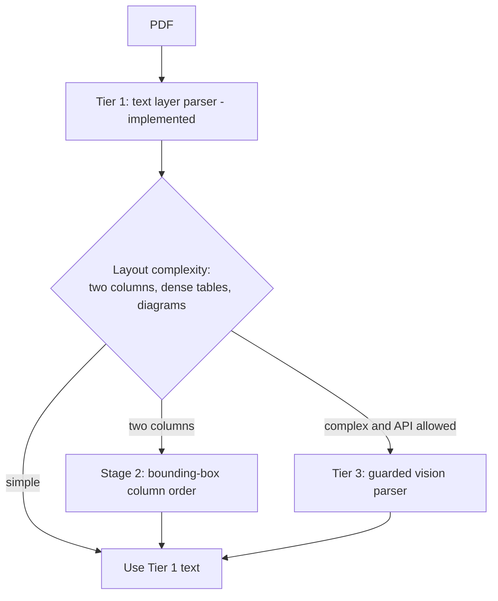
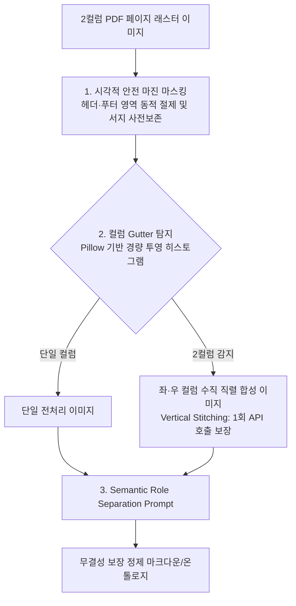

# PDF Layout Order and Guarded Vision Parsing

- **Status**: Planned, not implemented (layout-order correction and the guarded vision tier). Tier 1, the fast text parser with a fallback parser and encoding flaw detection, is implemented: [`INGESTION.md`](../implementation/INGESTION.md) §5; its principles: [`PDF_INGESTION_AND_ADAPTIVE_EFFORT_DESIGN.md`](PDF_INGESTION_AND_ADAPTIVE_EFFORT_DESIGN.md). The former Tier 2 (Docling worker) is rejected: the Docling dependency is removed and preflight refuses `CLAIRE_PDF_PARSER=docling`.
- **Date**: 2026-09-05 · status corrected 2026-11-16
- **Related**: [`INGESTION_INTEGRITY_AND_POLLUTION_CONTROL_RESEARCH.md`](INGESTION_INTEGRITY_AND_POLLUTION_CONTROL_RESEARCH.md)

---

## 1. Problem

Two-column papers, reports, and specifications give two kinds of damage when only the text layer is read:

- **Structure damage**: lines of the left and right columns interleave, and tables collapse into loose text.
- **Visual contamination**: watermarks, running headers and footers, page numbers, and chart tick labels enter the body text and become false entities ("ontology poisoning").

The implemented Tier 1 parser reads the text layer fast and finds encoding flaws, but it does not correct reading order and does not remove visual noise.

## 2. Planned tiers



### 2.1 Stage 2: light column-order correction

Read the text boxes with their coordinates, find the central gutter of the page, and read the left column before the right column. No deep-learning model and no large dependency. Expected to fix most standard two-column papers.

### 2.2 Tier 3: guarded vision parser (`gemini-vision`)

* **역할**: 인터넷 API가 허용된 환경에서 로컬 GPU/CPU 부하 없이 클라우드 멀티모달 VLM을 통해 고난도 시각 문서 해석.
* **특징**: E2E VLM의 시각적 노이즈 유입 문제를 해결하기 위해 후술할 **3대 안전 가드레일**을 필수로 통과.

---

## 3. 시각(視覺) 오염 방지 3대 가드레일 (Safety Guardrails)

순수 Vision LLM에 PDF 이미지를 무방비로 투입할 경우, 배경 워터마크(arXiv, IEEE, CONFIDENTIAL)와 러닝 헤더/푸터가 본문에 스며들거나, 차트 축 눈금(`0.01`, `0.05`)이 독립 엔티티로 오추출되는 **'온톨로지 독화(Ontology Poisoning)'**가 발생한다. 이를 차단하기 위해 3대 가드레일을 적용한다.



### 3.1 가드레일 1: 시각적 안전 마진 마스킹 (Safe Visual Margin Masking)
* **기제**:
  * 일괄적 8% 절단으로 인한 콤팩트 문서 제목/초록 유실(Amputation)을 방지하기 위해, **상단 서지 영역 선행 스캔 후 동적 안전 마진(Dynamic Safe Margin)** 적용.
  * 러닝 헤더/저널명 영역 및 하단 페이지 번호/저작권/DOI 영역을 물리적으로 화이트아웃(White-out) 또는 Bounding Box 절제.
* **차단 효과**: 페이지 번호, 저널명, 볼륨 정보가 본문 문장 중간에 토큰으로 유입되는 현상 기하학적 차단.

### 3.2 가드레일 2: Pillow 기반 초경량 Gutter 탐지 및 수직 합성 (Vertical Stitching)
* **초경량 의존성 보장 (OpenCV/PyMuPDF 배제)**:
  * 컨테이너 180MB 다이어트 목표를 훼손하지 않기 위해 무거운 `opencv-python-headless`(50MB+)나 `fitz`를 일체 쓰지 않고, 이미 설치된 **`Pillow (PIL)`와 순수 Python 픽셀 바이트 연산**만으로 중앙 수직 투영 히스토그램(Vertical Projection Histogram)을 계산.
* **수직 직렬 합성(Vertical Stitching)을 통한 API 비용 최적화**:
  * 2컬럼 이미지를 2개의 별도 이미지로 분할 호출하면 API 호출 수와 과금이 2배(30페이지 = 60회)로 폭증하여 Rate Limit 위험 발생.
  * 대신 **좌측 컬럼 이미지 바로 아래에 우측 컬럼 이미지를 수직으로 이어붙인(Vertical Stitching) 단일 1컬럼 합성 이미지**를 생성하여 Gemini Vision에 1회 호출로 주입.
  * **차단 효과**: 시각적 읽기 순서 붕괴(Reading Order Collapse)를 완벽히 차단하면서도 **API 호출 수와 비용을 정확히 50% 절감**.

### 3.3 가드레일 3: 의미적 역할 분리 네거티브 프롬프트 (Semantic Role Separation)
* **기제**: Gemini 프롬프트에 엄격한 배제 조건(Negative Constraints) 부여:
```text
[STRICT EXTRACTION CONSTRAINTS]
1. DO NOT extract running headers, footers, page numbers, or publication metadata into the body.
2. DO NOT transcribe background watermarks (e.g., 'arXiv', 'IEEE', 'DRAFT', 'CONFIDENTIAL').
3. For Charts, Graphs, and Diagrams: Extract ONLY the high-level semantic summary and caption. DO NOT parse individual axis tick labels, numbers, or fragmented legend abbreviations into standalone entities.
4. Mathematical Formulas: Transcribe into standard LaTeX syntax ($...$ or $$...$$). Do not break operators across lines.
```

---

## 4. Planned interface

```python
class PdfParser(Protocol):
    def extract(self, stream: BinaryIO, url: str | None = None) -> PdfExtractResult: ...

class GuardedGeminiVisionParser:
    """Tier 3: margin masking, Pillow gutter detection with vertical stitching, prompt guard."""
    def __init__(self, client, model: str): ...
    def extract(self, stream: BinaryIO, url: str | None = None) -> PdfExtractResult: ...
```

The result must record which parser ran (`parser_used`) and any fallback, as Tier 1 does now.

## 5. Rejected alternatives

| Alternative | Reason |
|---|---|
| Tier 2: Docling (LayoutLMv3 + TableFormer) sidecar worker | Model download of about 1.5 GB and slow CPU inference. The dependency is removed from the project. |
| Marker (Nougat + Surya) | Needs PyTorch and a GPU. |
| PyMuPDF or OpenCV for gutter detection | Large dependencies or license limits; Pillow and pure Python are enough for a projection histogram. |
| Split two columns into two vision calls | Doubles calls and cost; vertical stitching gives one call per page. |
