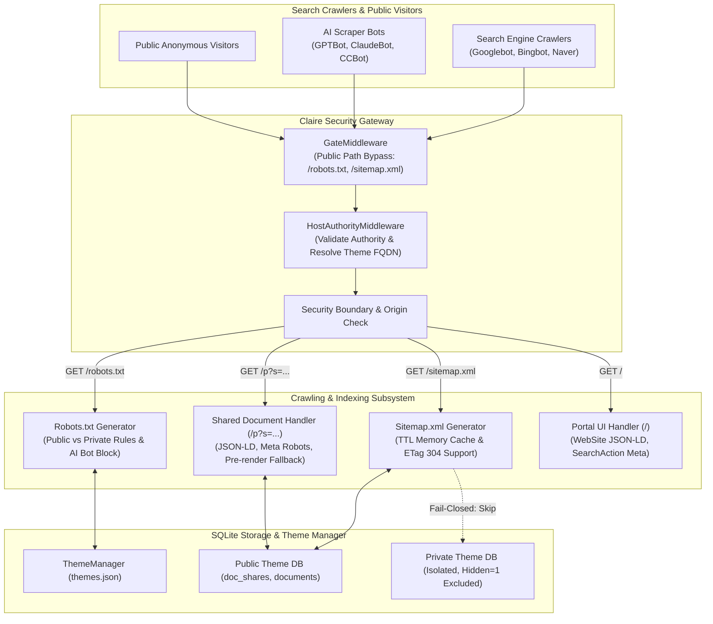

# Public Site Crawling Control and Page Indexing Architecture Specification

**Document Identifier:** DESIGN-SEO-CRAWL-20261015-01  
**Author:** Claire Bible Architecture Team  
**Status:** Implemented & Verified  
**Related Documents:**  
- [`docs/origin/design/THEME_FQDN_REVERSE_PROXY_DESIGN.md`](THEME_FQDN_REVERSE_PROXY_DESIGN.md)  
- [`docs/origin/design/MULTI_THEME_ARCHITECTURE_DESIGN.md`](MULTI_THEME_ARCHITECTURE_DESIGN.md)  
- [`docs/origin/design/DATABASE_PRESENTATION_TOGGLE_DESIGN.md`](DATABASE_PRESENTATION_TOGGLE_DESIGN.md)  
- [`API_HTTP_CONTRACT.md`](../implementation/API_HTTP_CONTRACT.md)  

---

## 1. Background and Problem Statement

### 1.1 Background
Claire Bible operates as a personal knowledge base and ontology knowledge graph engine.
With dedicated FQDN reverse proxy routing (`CLAIRE_FQDN`, `ThemeInfo.fqdn`) and anonymous read access (`CLAIRE_ANONYMOUS_READONLY=1`), administrators can expose specific knowledge themes or shared documents to the public internet as a public knowledge portal.

When an instance connects to the public internet:
1. Search engine crawlers (Googlebot, Bingbot, Naver Yeti, DuckDuckBot) crawl pages to index knowledge.
2. Artificial intelligence (AI) crawlers (GPTBot, ClaudeBot, Bytespider, CCBot, PerplexityBot) collect training and indexing data.
3. Vulnerability scanners and malicious bots search for open endpoints.

### 1.2 Current Limitations
1. **Absence of Robots Exclusion Protocol (`/robots.txt`)**:
   - The Starlette router and security gateway (`ROUTE_POLICY`) do not register `/robots.txt`.
   - Requests to `/robots.txt` fail closed with HTTP 404 (or HTTP 403).
   - Crawlers find no path constraints. Crawlers request expensive FTS5 search queries (`/search`), mutate endpoints (`/ingest`), and authorization endpoints (`/oauth/*`). This causes Denial of Service (DoS) and resource exhaustion.
2. **Absence of Search Engine Sitemap (`/sitemap.xml`)**:
   - Crawlers cannot discover new or updated public documents systematically.
   - Shared documents (`/p?s=<token>`) remain unindexed unless an external website links to them.
3. **Absence of Standard Indexing Directives and Structured Data**:
   - The HTML reader (`share.html`) contains Open Graph tags, but lacks `<meta name="robots">` directives, canonical tags (`<link rel="canonical">`), and Schema.org JSON-LD structured data (`Article`, `WebSite`).
   - The client-side rendering design requires JavaScript execution to construct the Document Object Model (DOM). Search crawlers without JavaScript execution cannot index document text.
4. **Multi-Theme and Privacy Boundary Risks**:
   - Private themes (`ThemeInfo.is_public = False`) and hidden documents (`documents.hidden = 1`) must never leak into search engine indexes.
   - Dedicated theme domains require domain-scoped robots and sitemap definitions.

---

## 2. Core Architecture and Principles



### 2.1 Invariants
1. **Fail-Closed Stealth Invariant**:
   - Private themes (`is_public = False`) and hidden documents (`hidden = 1`) must never appear in `sitemap.xml`.
   - When a client requests `/robots.txt` on a private theme domain or when `CLAIRE_ANONYMOUS_READONLY=0`, the response must be `User-agent: *\nDisallow: /`.
   - All private or administrative endpoints must output `X-Robots-Tag: noindex, nofollow, noarchive`.
2. **Zero-Resource-Spike Invariant**:
   - Crawlers must not execute expensive FTS5 full-text queries or vector similarity searches. `/robots.txt` must explicitly contain `Disallow: /search`.
   - Write operations (`/ingest`, `/reingest`, `/regenerate`) and LLM authoring pipelines (`/document/presentation/generate`, `/compose`, `/compile`) must be disallowed.
3. **Full Public Indexing with Presentation Exclusion**:
   - Every non-hidden document (`hidden = 0`) in public themes is fully indexed by automatically ensuring persistent share tokens in `doc_shares`.
   - Presentation slides (`/p/presentation?s=...`) are excluded from `sitemap.xml` to keep the search index focused on primary knowledge articles.
   - AI model training crawlers (GPTBot, ClaudeBot, Bytespider, CCBot, etc.) are blocked by default via `CLAIRE_BLOCK_AI_CRAWLERS=1`.
4. **Domain-Pinned Multi-Theme Scoping**:
   - When a request specifies a dedicated theme FQDN, `/robots.txt` and `/sitemap.xml` generate content scoped exclusively to that theme.
   - When a request specifies the primary FQDN, `/sitemap.xml` aggregates all public themes or serves a sitemap index.
5. **Deterministic In-Memory Caching**:
   - `/sitemap.xml` queries must not lock SQLite databases on every crawler hit.
   - Responses must be cached in memory with a configurable TTL (default: 15 minutes) and return `HTTP 304 Not Modified` when the `ETag` matches.

---

## 3. Detailed Specification

### 3.1 Configuration Settings (`src/claire/config.py`)

Add the following configuration fields to `Settings`:

```python
# Crawling and Search Engine Optimization (SEO)
robots_policy: str = Field(
    default="public",
    alias="CLAIRE_ROBOTS_POLICY",
    description="Robots exclusion policy: 'public' or 'disallow_all'",
)
block_ai_crawlers: bool = Field(
    default=True,
    alias="CLAIRE_BLOCK_AI_CRAWLERS",
    description="Explicitly block AI model scrapers (GPTBot, ClaudeBot, CCBot, etc.) in robots.txt",
)
sitemap_enabled: bool = Field(
    default=True,
    alias="CLAIRE_SITEMAP_ENABLED",
    description="Enable dynamic XML sitemap generation at /sitemap.xml",
)
sitemap_cache_ttl: int = Field(
    default=900,
    alias="CLAIRE_SITEMAP_CACHE_TTL",
    description="In-memory cache TTL for sitemap XML in seconds (default 15 minutes)",
)
site_name: str = Field(
    default="Claire Bible",
    alias="CLAIRE_SITE_NAME",
    description="Brand name used for Schema.org publisher and title tags",
)
site_description: str = Field(
    default="Personal Knowledge Base and Ontology Knowledge Graph Engine",
    alias="CLAIRE_SITE_DESCRIPTION",
    description="Default description used for site root metadata",
)
```

### 3.2 Security Gateway Policy (`src/claire/api/security.py`)

1. Register public paths in `ROUTE_POLICY`:
```python
("GET", "/robots.txt"): _rule("public"),
("HEAD", "/robots.txt"): _rule("public"),
("GET", "/sitemap.xml"): _rule("public"),
("HEAD", "/sitemap.xml"): _rule("public"),
```

2. Register public paths in `PUBLIC_PATHS` within `src/claire/api/server.py`:
```python
PUBLIC_PATHS: tuple[str, ...] = (
    "/static/",
    "/images/",
    "/p/images/",
    "/robots.txt",
    "/sitemap.xml",
)
```

3. Response Header Injection:
   - For all private routes, non-public themes, and API endpoints, inject:
     `X-Robots-Tag: noindex, nofollow, noarchive`

---

### 3.3 Dynamic Robots Engine (`/robots.txt`)

The handler generates plain text conforming to the Robots Exclusion Standard:

#### Case A: Private System or Private Theme
If `settings.anonymous_readonly is False`, or `settings.robots_policy == "disallow_all"`, or the resolved theme has `is_public is False`:
```text
User-agent: *
Disallow: /
```

#### Case B: Public Knowledge Portal
If the system and theme allow public indexing:
```text
User-agent: *
Allow: /$
Allow: /p?
Allow: /p/presentation?
Allow: /static/
Allow: /images/
Allow: /p/images/
Allow: /fonts/
Allow: /favicon.*
Disallow: /search
Disallow: /ingest
Disallow: /reingest
Disallow: /regenerate
Disallow: /document/regenerate
Disallow: /document/presentation/generate
Disallow: /document/presentation/compose
Disallow: /document/presentation/compile
Disallow: /document/seen
Disallow: /document/pin
Disallow: /document/hide
Disallow: /document/title
Disallow: /document/purge
Disallow: /document/matrix/purge
Disallow: /purge
Disallow: /synthesize
Disallow: /research
Disallow: /dedup/
Disallow: /entity/
Disallow: /resolution/
Disallow: /oauth/
Disallow: /.well-known/oauth*
Disallow: /mcp
Disallow: /support/bundle
Disallow: /whoami
Disallow: /stats
Disallow: /limits
Disallow: /ingest-limits
Disallow: /providers
Disallow: /themes

# AI Model Scrapers (if CLAIRE_BLOCK_AI_CRAWLERS=1)
User-agent: GPTBot
User-agent: ChatGPT-User
User-agent: ClaudeBot
User-agent: anthropic-ai
User-agent: CCBot
User-agent: Bytespider
User-agent: PerplexityBot
User-agent: Cohere-ai
User-agent: Diffbot
User-agent: FacebookBot
Disallow: /

Sitemap: https://{authority}/sitemap.xml
```

---

### 3.4 Dynamic Sitemap Engine (`/sitemap.xml`)

#### 3.4.1 Sitemap XML Structure
The XML response conforms to the Sitemaps XML protocol 0.9 (`http://www.sitemaps.org/schemas/sitemap/0.9`):

```xml
<?xml version="1.0" encoding="UTF-8"?>
<urlset xmlns="http://www.sitemaps.org/schemas/sitemap/0.9">
  <url>
    <loc>https://claire.example.com/</loc>
    <changefreq>daily</changefreq>
    <priority>1.0</priority>
  </url>
  <url>
    <loc>https://claire.example.com/p?s=ab12cd34ef56</loc>
    <lastmod>2026-10-15T14:30:00Z</lastmod>
    <changefreq>weekly</changefreq>
    <priority>0.8</priority>
  </url>
</urlset>
```

#### 3.4.2 Query and Filtering Rules
1. Retrieve active share tokens from `doc_shares` for all non-hidden documents:
   ```sql
   SELECT id, fetched_at, published_at FROM documents WHERE hidden = 0 ORDER BY fetched_at DESC
   ```
   If a non-hidden document does not yet have an active share token, generate one automatically (`create_doc_share(conn, doc_id, reuse_existing=True)`) to guarantee full indexing of all public knowledge.
2. For each document:
   - Primary document entry: `https://{authority}/p?s={token}`
   - Presentation slides (`/p/presentation?s=...`) are excluded from `sitemap.xml`.
3. Format `<lastmod>` using the ISO 8601 UTC timestamp of `fetched_at` (or `published_at`).

#### 3.4.3 In-Memory Cache and Conditional GET
- Store cached entries in a dictionary: `_sitemap_cache[authority] = (timestamp, etag, xml_bytes)`.
- If `time.time() - timestamp < settings.sitemap_cache_ttl`, serve from memory.
- Compute `ETag` using MD5 hash of `(document_count, latest_fetched_at)`.
- If client sends `If-None-Match` matching `ETag`, return `304 Not Modified`.

---

### 3.5 HTML Metadata and Semantic Fallback (`src/claire/graphview.py` & `share.html`)

#### 3.5.1 Search Engine Metadata Tags
In `render_open_graph_tags()`:
```html
<meta name="robots" content="index, follow, max-snippet:-1, max-image-preview:large, max-video-preview:-1"/>
<link rel="canonical" href="{canonical_url}"/>
```

#### 3.5.2 Schema.org JSON-LD Structured Data
Inject structured JSON-LD into `share.html`:
```html
<script type="application/ld+json">
{
  "@context": "https://schema.org",
  "@type": "TechArticle",
  "headline": "{title}",
  "description": "{description}",
  "datePublished": "{published_at_iso}",
  "dateModified": "{fetched_at_iso}",
  "author": {
    "@type": "Person",
    "name": "{author}"
  },
  "publisher": {
    "@type": "Organization",
    "name": "{site_name}",
    "logo": {
      "@type": "ImageObject",
      "url": "{base_url}/favicon.svg"
    }
  },
  "mainEntityOfPage": {
    "@type": "WebPage",
    "@id": "{canonical_url}"
  },
  "keywords": ["{tag1}", "{tag2}"]
}
</script>
```

#### 3.5.3 Non-JavaScript Semantic Fallback (`<noscript>` & Pre-rendering)
To support crawlers that do not execute JavaScript:
- Pre-render document title, metadata, executive summary, and formatted markdown HTML inside a `<noscript>` block and an initial semantic container:
```html
<noscript>
  <article class="cb-semantic-content">
    <h1>__TITLE__</h1>
    <p class="cb-semantic-summary">__SUMMARY__</p>
    <div class="cb-semantic-body">__PRERENDERED_HTML__</div>
  </article>
</noscript>
```

---

## 4. Multi-Theme and FQDN Reverse Proxy Integration

1. **Theme Resolution via Host Header**:
   - `HostAuthorityMiddleware` determines the active theme from the request `Host` header.
2. **Dedicated Theme Domain**:
   - When a request targets `ai.example.com` (Theme ID 1):
     - Check `theme.is_public`.
     - If `False`: `/robots.txt` outputs `Disallow: /`, and `/sitemap.xml` returns `404 Not Found`.
     - If `True`: `/sitemap.xml` generates URLs prefixed with `https://ai.example.com/` containing documents from Theme 1 only.
3. **Primary Portal Domain**:
   - When a request targets the primary domain `claire.example.com`:
     - Scan all registered themes with `is_public=True` (including default Theme 0).
     - Merge document share tokens into a unified `/sitemap.xml`.
     - If the total URL count exceeds 50,000, serve a `<sitemapindex>` that points to theme-specific sitemaps.

---

## 5. Security and Operational Invariants

| Guardrail Area | Threat Model | Mitigation Strategy |
| :--- | :--- | :--- |
| **Data Privacy** | Hidden or private documents indexed by search engines | `hidden = 1` and `is_public = False` filter checks are applied unconditionally in database queries before XML generation. |
| **Compute DoS** | Bots flood `/search` or `/document/presentation/generate` | `robots.txt` blocks high-cost endpoints. IP rate-limiting protects edge paths. |
| **Database Lock** | Frequent sitemap crawls cause SQLite read contention | 15-minute in-memory caching and `ETag`/`304 Not Modified` eliminate repeated queries. |
| **Information Leak** | Host spoofing reveals internal theme names | `HostAuthorityMiddleware` blocks unregistered hosts with HTTP 421 before the sitemap handler executes. |

---

## 6. Verification and Testing Plan

### 6.1 Unit Tests (`tests/test_crawling_and_sitemap.py`)
1. **Robots Engine Tests**:
   - Verify `/robots.txt` output when `robots_policy="public"`.
   - Verify `/robots.txt` output when `robots_policy="disallow_all"` or `anonymous_readonly=False`.
   - Verify AI bot blocks appear when `block_ai_crawlers=True` and disappear when `False`.
   - Verify theme domain scoping for public vs private themes.
2. **Sitemap Engine Tests**:
   - Verify XML well-formedness and schema namespace.
   - Verify `hidden=1` documents are excluded from the sitemap.
   - Verify expired share tokens are excluded from the sitemap.
   - Verify in-memory cache hit and `If-None-Match` returns HTTP 304.
3. **Metadata and Structured Data Tests**:
   - Verify `<meta name="robots">` and `<link rel="canonical">` in `shared_html`.
   - Verify Schema.org JSON-LD structured data syntax and required fields.
   - Verify `<noscript>` semantic fallback content.

### 6.2 End-to-End Test (`e2e/test_crawling_e2e.py`)
1. Ingest a sample document and issue a public share token.
2. Send request to `GET /robots.txt`. Validate status 200, Content-Type `text/plain`, and the presence of `Sitemap:` directive.
3. Send request to `GET /sitemap.xml`. Validate status 200, Content-Type `application/xml`, and verify the document share URL appears.
4. Send request to `GET /p?s={token}`. Validate `<meta name="robots">`, JSON-LD script, and canonical URL.
5. Hide the document (`POST /document/hide`).
6. Request `/sitemap.xml` after cache expiry (or invalidate cache). Verify the hidden document URL is removed.
