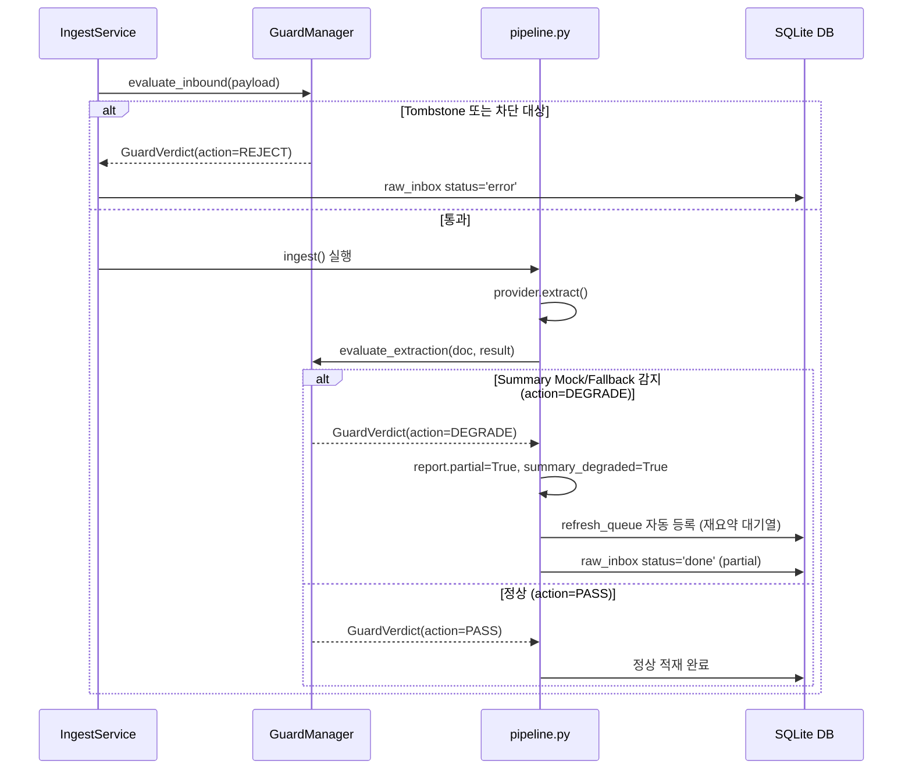

# Quality Verification Guardrails, Summary Integrity & Observability Design

- **Status**: Partly implemented. Step 1 (no mock fallback in production) is implemented: [PRINCIPLES.md](../PRINCIPLES.md) C2 and [`PROVIDERS.md`](../implementation/PROVIDERS.md). Step 2 is partly implemented: the ingest report marks an empty summary, and the Antigravity provider records a summary verdict in the separate telemetry database ([`EXTRACTION.md`](../implementation/EXTRACTION.md) §7). Planned, not implemented: the guard component package, the `extraction_mode` and `error_reason` fields, the degrade-and-requeue action, the guard settings, and the guard section in `health` (§2 Step 3, §4, §5 below).
- **Date**: 2026-09-08 (first commit) · restructured 2026-11-16
- **Related**: [INGESTION_INTEGRITY_AND_POLLUTION_CONTROL_RESEARCH.md](./INGESTION_INTEGRITY_AND_POLLUTION_CONTROL_RESEARCH.md), [PDF_PARSER_AND_VISION_GUARDRAILS_DESIGN.md](./PDF_PARSER_AND_VISION_GUARDRAILS_DESIGN.md), [MULTI_PROVIDER_DESIGN.md](./MULTI_PROVIDER_DESIGN.md)

---

## 1. Problem

In production, the LLM summary was often missing, and a mock summary replaced it without a signal. The cause was hard to find from the server logs and the ingest report. At the time of writing, the analysis found five causes:

1. The provider selection fell back to mock without a log line when a binary or a key was missing.
2. The ingest pipeline and the Telegram bot wrote almost no log lines around the model calls.
3. The CLI providers hid their errors: after a failed call, a slice of the first 200 characters or a list of entity names became the summary.
4. The `extractions` table recorded `provider=mock` but not the reason, and `raw_inbox` recorded `done`, so the recover loop did not retry.
5. The ingest report had no flag for a mock or fallback summary, so the user saw a normal success.

The existing guardrails (web content guard, deduplication and tombstones, table preservation, ontology checks, the one-hop gate, and the markup check of summaries) protect against outside noise and broken syntax. None of them checked that a summary has real content. Current behavior of these checks: [`EXTRACTION.md`](../implementation/EXTRACTION.md) §3, §7 and [`ONEHOP_MERGE.md`](../implementation/ONEHOP_MERGE.md) §3; the web content guard, deduplication, and tombstones: [`INGESTION.md`](../implementation/INGESTION.md).

---

## 2. Roadmap

### Step 1: Fail fast in production (implemented)
In production, a configured provider that cannot run makes the call fail. It does not fall back to mock. See PRINCIPLES C2.

### Step 2: Observability (partly implemented)
Implemented: the report flag for an empty summary, the summary verdict in telemetry (Antigravity only). Not implemented: a log line with the reason of the provider selection; start, end, duration, model, and summary state logs in the pipeline; `extraction_mode` (`llm` | `fallback` | `mock`) and `error_reason` in `extractions` and in the ingest report.

### Step 3: Summary quality guard and automatic recovery (planned)
A summary quality guard detects a mock prefix, a slice of the first 200 characters, a template summary, and a very short summary. On failure, the document is marked partial and goes to the refresh queue, so the summary is made again when the provider works again.

---

## 3. Open question

The summary verdict exists in telemetry, but no code acts on it. It is not decided whether Step 3 stays as the separate guard package below, or becomes an action on the existing verdict.

---

## 4. 품질 검증 가드레일 런타임 컴포넌트화 설계 (New Architecture Design)

흩어져 있는 가드 로직들을 서비스 런타임이 통제하는 **단일 일급 컴포넌트 패키지(`src/claire/guards/`)**로 구조화한다.

```text
src/claire/guards/
├── __init__.py          # GuardVerdict, GuardAction, GuardManager 공개 API
├── base.py              # GuardBase, GuardVerdict, GuardAction 추상 규격
├── manager.py           # GuardManager (런타임 오케스트레이터, 메트릭 집계)
├── inbound.py           # Phase 1: TombstoneGuard, DedupGuard, AttachmentGuard
├── content.py           # Phase 2: WebContentGuard, PdfStructureGuard, TableGuard
├── extraction.py        # Phase 3: SummaryQualityGuard (신규), SummarySyntaxGuard, RelationOntologyGuard
└── expansion.py         # Phase 4: ExpansionGateGuard, ResearchGateGuard
```

### 4.1 표준 판정 규격 (`GuardVerdict` & `GuardAction`)

```python
from dataclasses import dataclass, field
from enum import Enum
from typing import Any

class GuardAction(str, Enum):
    PASS = "pass"          # 검증 통과 (정상 진행)
    WARN = "warn"          # 통과하되 경고 로그 및 리포트에 주의 기록
    DEGRADE = "degrade"    # 부분 적재(partial) 처리 + 복구 큐(refresh) 등록
    REJECT = "reject"      # 즉시 거부 (인제스트 중단, raw_inbox=error)

@dataclass
class GuardVerdict:
    guard_name: str
    passed: bool
    action: GuardAction
    reason: str
    code: str              # 표준화된 코드 (예: "GUARD_MOCK_SUMMARY", "GUARD_BOT_CHALLENGE")
    details: dict[str, Any] = field(default_factory=dict)
```

### 4.2 신규 핵심 컴포넌트: `SummaryQualityGuard`
요약 생성 누락 및 Mock 동작을 정밀 탐지하는 검증기이다.

```python
class SummaryQualityGuard:
    """요약의 실체성, 완성도, Mock 여부를 검증하는 일급 가드레일."""

    def __init__(self, strict: bool = False, min_chars: int = 40):
        self.strict = strict
        self.min_chars = min_chars

    def evaluate(
        self,
        summary: str | None,
        raw_text: str | None,
        provider_name: str,
    ) -> GuardVerdict:
        # 1. 완전 누락 검증
        if not summary or not summary.strip():
            return GuardVerdict(
                guard_name="SummaryQualityGuard",
                passed=False,
                action=GuardAction.REJECT if self.strict else GuardAction.DEGRADE,
                reason="요약 내용이 완전히 비어있음 (Empty summary)",
                code="GUARD_EMPTY_SUMMARY",
            )

        s = summary.strip()

        # 2. Mock 동작 감지 (접두사 또는 mock 프로바이더)
        if s.startswith("[mock]") or provider_name == "mock":
            return GuardVerdict(
                guard_name="SummaryQualityGuard",
                passed=False,
                action=GuardAction.REJECT if self.strict else GuardAction.DEGRADE,
                reason="Mock 프로바이더 동작 또는 mock 요약 접두사 감지",
                code="GUARD_MOCK_SUMMARY",
                details={"provider": provider_name, "preview": s[:50]},
            )

        # 3. 본문 앞부분 단순 슬라이스(200자 잘라내기 fallback) 감지
        if raw_text and len(raw_text) > 50:
            clean_s = s.rstrip("…").strip()
            clean_raw = raw_text.strip()
            if clean_raw.startswith(clean_s) and len(clean_s) <= 210:
                return GuardVerdict(
                    guard_name="SummaryQualityGuard",
                    passed=False,
                    action=GuardAction.DEGRADE,
                    reason="LLM 요약 부재로 인한 본문 앞부분 단순 절단 fallback 감지",
                    code="GUARD_FALLBACK_SLICE_SUMMARY",
                    details={"sliced_length": len(clean_s)},
                )

        # 4. 엔티티 나열형 단순 템플릿 요약 감지
        if s.endswith("등에 관한 자료이다.") and len(s) < 100:
            return GuardVerdict(
                guard_name="SummaryQualityGuard",
                passed=False,
                action=GuardAction.DEGRADE,
                reason="요약 실패로 인한 엔티티 나열형 템플릿 fallback 감지",
                code="GUARD_FALLBACK_TEMPLATE_SUMMARY",
            )

        # 5. 분량 빈약 경고
        if len(s) < self.min_chars:
            return GuardVerdict(
                guard_name="SummaryQualityGuard",
                passed=True,
                action=GuardAction.WARN,
                reason=f"요약 분량 극단적 빈약 ({len(s)}자 < {self.min_chars}자)",
                code="GUARD_THIN_SUMMARY",
            )

        return GuardVerdict(
            guard_name="SummaryQualityGuard",
            passed=True,
            action=GuardAction.PASS,
            reason="정상 LLM 요약 확인",
            code="GUARD_OK",
        )
```

### 4.3 서비스 런타임 연계: `GuardManager`
`IngestService`가 생성 시점에 주입받아 보유하는 런타임 컴포넌트이다.



### 4.4 시스템 헬스체크 및 관측성 연동 (`health.py`)
`claire health` 및 `claire doctor` 실행 시 가드레일의 동작 상태와 최근 차단 통계가 출력된다.

```json
{
  "ok": true,
  "provider": "antigravity",
  "guards": {
    "status": "active",
    "strict_mode": false,
    "summary_guard": "enabled",
    "recent_degraded_count": 2,
    "recent_rejected_count": 0,
    "last_violation": {
      "guard": "SummaryQualityGuard",
      "code": "GUARD_MOCK_SUMMARY",
      "time": 1773098120.5
    }
  }
}
```

---

## 5. 구현 사양 및 환경변수 정의 (Implementation Specification)

### 5.1 환경변수 추가 ([`ENVIRONMENT_VARIABLES.md`](../implementation/ENVIRONMENT_VARIABLES.md))

| 환경변수명 | 기본값 | 설명 |
|:---|:---:|:---|
| `CLAIRE_GUARDS_ENABLED` | `true` | 품질 검증 가드레일 서브시스템 전체 활성화 여부 |
| `CLAIRE_GUARDS_STRICT` | `false` | 엄격 모드. True 시 요약 Mock/누락 발생 시 degrade 대신 즉시 적재 거부(REJECT) |
| `CLAIRE_SUMMARY_MIN_CHARS` | `40` | 요약 최소 유효 글자 수 (이하일 경우 WARN/DEGRADE 판정) |

### 5.2 검증 및 테스트 계획 (Verification Plan)
1. **단위 테스트 (`tests/test_guards.py`)**:
   - `SummaryQualityGuard`: 빈 문자열, `[mock]`, 본문 200자 슬라이스, 템플릿 요약, 정상 요약별 판정 검증.
   - `WebContentGuard`: Soft 404, CAPTCHA, 봇 차단 화면 판정 검증.
2. **인제스트 통합 테스트 (`tests/test_pipeline_guards.py`)**:
   - `MockProvider` 동작 시 `strict=False` 환경에서 `partial=True` 마킹 및 `refresh_queue` 인큐 확인.
   - `strict=True` 환경에서 `raw_inbox.status='error'` 기록 및 즉시 예외 발생 확인.
3. **진단 커맨드 테스트**:
   - `claire health` 실행 시 guards 메타데이터 정상 출력 검증.
