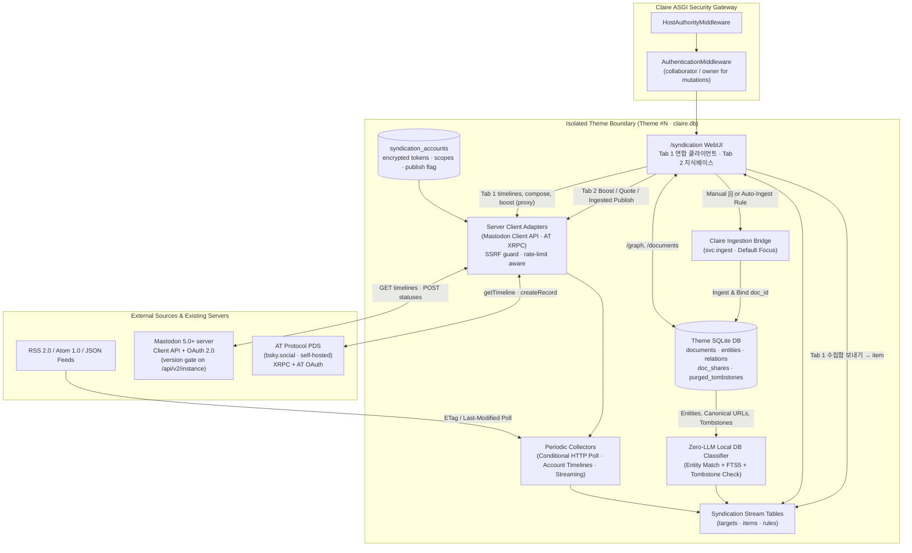

# Syndication Endpoint Architecture and Clean-Room UI Specification

**Document Identifier:** DESIGN-SYNDICATION-20261028-01 (Rev. 2026-10-29: 서버 접속형 ActivityPub · AT, 작업 공간 탭, 4종 목록 스타일 · Rev. 2026-10-30: ActivityPub 지원 기준 Mastodon 5.0+, 목록 스타일 i18n)  
**Author:** Claire Bible Architecture & UI/UX Team  
**Status:** Phase 1 Implemented (Public Visual Prototype at `/syndication` — Tab 1 연합 클라이언트 · Tab 2 지식베이스) · Phase 2 Specified (Backend Collectors, Schema, Connected-Account Server Adapters)  
**Related Documents:**  
- [`MULTI_THEME_ARCHITECTURE_DESIGN.md`](MULTI_THEME_ARCHITECTURE_DESIGN.md)  
- [`THEME_FQDN_REVERSE_PROXY_DESIGN.md`](THEME_FQDN_REVERSE_PROXY_DESIGN.md)  
- [`PUBLIC_SITE_CRAWLING_AND_INDEXING_DESIGN.md`](PUBLIC_SITE_CRAWLING_AND_INDEXING_DESIGN.md)  
- [`DATA_LIFECYCLE_AND_PURGE_DESIGN.md`](DATA_LIFECYCLE_AND_PURGE_DESIGN.md)  
- [`API_HTTP_CONTRACT.md`](../implementation/API_HTTP_CONTRACT.md)  
- [`EXTERNAL_ACCESS.md`](../implementation/EXTERNAL_ACCESS.md)  
- [`GLOSSARY.md`](../implementation/GLOSSARY.md)  

---

## 1. Background, Problem Statement, and Design Goals

### 1.1 Background
Claire Bible ingests web pages, documents, videos, and social threads into isolated per-theme SQLite databases (`data/claire.db` and `data/themes/{seq}/claire.db`), where each source becomes a normalized document linked to ontology entities and relations. Before this specification, ingestion required an operator or collaborator to push individual URLs or files manually through the WebUI, CLI (`./cb-manuscript app ingest`), Telegram bot, or REST API (`POST /ingest`).

Operators and collaborators need a unified workspace to register external information streams, collect updates periodically, classify incoming items against the existing knowledge graph of each theme, forward selected items to the Claire ingestion pipeline, and publish curated outputs to federated networks.

### 1.2 Revision 2026-10-29: Server-Mediated ActivityPub · AT
The first revision of this document had Claire **implement federation directly**: a per-theme ActivityPub Actor with key pairs, a signed `POST /ap/inbox`, `/ap/outbox`, WebFinger, follower delivery, and direct AT PDS polling. That design is withdrawn.

ActivityPub and AT Protocol are now consumed **as a client of an existing server account** (서버에 접속하여 사용하는 형태):

| Concern | Withdrawn (direct implementation) | Adopted (connected server account) |
| :--- | :--- | :--- |
| Identity | Claire-hosted Actor `@theme@fqdn`, RSA key pair in `syndication_actors` | Existing account on a Mastodon 5.0+ server or AT PDS, bound per theme in `syndication_accounts` |
| Inbound | Signed `POST /ap/inbox`, HTTP Signature verification, follower table | Account timelines via Mastodon Client API (`/api/v1/timelines/*`, streaming) and AT XRPC (`app.bsky.feed.*`) |
| Outbound | Self-signed `Create` / `Announce` delivered to follower inboxes | `POST /api/v1/statuses`, `/reblog`, `quoted_status_id`; `com.atproto.repo.createRecord` (`app.bsky.feed.post` / `repost` / `like`) |
| Delivery, moderation, blocks, retries | Claire's responsibility | The home server's responsibility |
| Public routes | `/.well-known/webfinger`, `/ap/actor`, `/ap/inbox`, `/ap/outbox` | None. All remote calls go out through the authenticated Claire server proxy |

Rationale: running a federating server means owning key custody, signature verification, delivery queues, remote-instance moderation, and abuse handling. A client connection reuses a server the operator already trusts, keeps Claire's public attack surface unchanged, and lets each theme choose its own home server (including a self-hosted Mastodon instance or a self-hosted PDS).

### 1.3 ActivityPub Support Baseline: Mastodon 5.0+
ActivityPub client features are specified and tested against **Mastodon 5.0 or later** as the connected server.
- **Gate**: before app registration, Claire reads `GET /api/v2/instance` and parses `version`. Connection is refused when the version is below `5.0.0`, cannot be parsed, or only claims API compatibility (`"x.y.z (compatible; …)"`, as reported by Pleroma/Akkoma-family servers). Non-Mastodon software that reports its own version (for example GoToSocial `0.x`) fails the same check. Mastodon forks with a SemVer suffix (`5.0.0+glitch`) pass.
- **Re-check**: the version is stored in `syndication_accounts.server_version` and re-read on each token refresh. A server that later reports a version below the baseline is marked `unsupported`, and its write actions are disabled until it is upgraded.
- **Scope of the baseline**: it applies only to the server Claire connects to. Posts authored on any ActivityPub software still arrive through the connected Mastodon server and can be read, boosted, quoted, and sent to the knowledge base.
- **Consequence for features**: one API surface is targeted, so the client relies on Mastodon behaviour directly (native quote posts via `quoted_status_id`, the `user` streaming channel, `Idempotency-Key`) instead of carrying per-software fallbacks. The only quote fallback left is when the quoted author's quote policy does not permit the quote, in which case the URL is posted instead.

### 1.4 Design Goals
1. **Clean-Room Spiritual Inheritance of Tiny Tiny RSS (TT-RSS)**:
   - Inherit the dense TT-RSS ergonomics: left tree, center headline stream, right reader, viewport-aware action popovers (`Select...`, `Adaptive`, `Sort`, `☰`, `⋯`), and keyboard-first navigation.
   - Offer **four list styles** shared by both workspace tabs (Section 3.4).
   - Provide a dedicated sub-route Preferences page at **`/syndication/preferences`**.
2. **Two Workspace Tabs Below the Top Bar (작업 공간 탭)**:
   - **Tab 1 — 연합 클라이언트 (ActivityPub · AT)**: a TT-RSS-style client for the theme's connected server accounts (Section 3.5).
   - **Tab 2 — 지식베이스 (수집 · 적재 · 발행)**: the existing collection, ingestion and publishing workspace.
3. **Unified Content View (`수집 원문` ⇄ `적재 본문`)**:
   - A single collected item can hold both its Collected Original and its Claire Ingested Body and switch between them inside one view.
4. **Entities Are Created Upon Ingestion (`엔티티는 적재 시 생성`)**:
   - RSS/Atom `<category>`, ActivityPub `Hashtag`, and AT `app.bsky.richtext.facet#tag` are raw external tags (`#Tag`). They become ontology entities (`[[Entity]]`) only when the item is ingested. This holds in both tabs: a timeline post's hashtags stay `#Tag` until the post is sent to the knowledge base and ingested.
5. **Dual Outbound Publishing Through Connected Accounts**:
   - **Boost / Quote Publish** and **Ingested Body Publish** for RSS/Atom, ActivityPub, and AT items, executed through the theme's connected accounts. Cross-posting to an ActivityPub account and an AT account in one action is supported.
6. **Public Visual Prototype Access (Phase 1) & Role-Scoped Backend Mutations (Phase 2)**:
   - `GET/HEAD /syndication` and `GET/HEAD /syndication/preferences` stay under `_rule("public")` during Phase 1. Phase 2 mutation endpoints require `collaborator` or `owner` (Section 4.5). Search engine indexing is disallowed via `/robots.txt` (`Disallow: /syndication`) and `<meta name="robots">`.

---

## 2. System Architecture and Security Invariants

### 2.1 Multi-Theme Architecture Context



### 2.2 Security and Operational Invariants
1. **Public Prototype Inspection & Private Theme Protection**:
   - `ROUTE_POLICY` registers `("GET", "/syndication")`, `("HEAD", "/syndication")`, and the same pair for `/syndication/preferences` under `_rule("public")`.
   - In multi-theme mode (`CLAIRE_MULTI_THEME=1`), unauthenticated requests never expose private theme metadata (`is_public = False`).
2. **Tokens Never Reach the Browser**:
   - OAuth access/refresh tokens, AT DPoP keys, and (compatibility mode) AT session JWTs are stored encrypted in the theme's `syndication_accounts` row (key material under `data/auth/`). The WebUI receives only account metadata (handle, server, software, scopes, publish flag, status).
   - `SafeAccessLogMiddleware` keeps `default-src 'self'`, so the browser cannot call remote servers directly. Every timeline read and every write goes through the authenticated Claire server proxy (Section 4.5).
3. **Least Privilege per Theme**:
   - Mastodon accounts request `read` plus only the needed `write:statuses`, `write:favourites`, `write:bookmarks`, `write:follows`. AT accounts prefer AT OAuth (PAR + PKCE + DPoP, scope `atproto transition:generic`); app passwords are a compatibility mode flagged with a warning status.
   - Private themes may bind accounts with `read` scope only. `publish_enabled` is forced to `0`, and the UI disables reply, boost, favourite, quote, and compose.
   - Accounts are theme-scoped. A theme can never read or write through another theme's account.
4. **Revocation and Server Etiquette**:
   - Disconnecting an account revokes its token (`POST /oauth/revoke` on Mastodon; AT OAuth token revocation or `com.atproto.server.deleteSession`) before the row is deleted.
   - Adapters honour server rate-limit response headers, back off exponentially on `429`/`5xx`, and mark the account `degraded` after consecutive failures.
5. **Collaborator Default-Theme Write Guard**:
   - Collaborators cannot ingest into or mutate the default theme (`id=0`, `seq=0`), matching the RBAC rule enforced by `POST /ingest` (`HTTP 403`).
6. **Crawler Exclusion**:
   - `/robots.txt` outputs `Disallow: /syndication` in public portal mode and `Disallow: /` in private mode; both HTML bundles embed `<meta name="robots" content="noindex, nofollow, noarchive"/>`.
7. **Tombstone Shield and SSRF Protection**:
   - Items whose normalized URL or content hash matches `purged_tombstones` are never auto-ingested.
   - User-supplied server addresses and handles pass the same outbound URL validation and SSRF guards as feed URLs before any socket is opened (including WebFinger-free handle → DID → PDS resolution for AT).

---

## 3. Phase 1 Specification: Implemented Route and Interactive Visual Prototype

### 3.1 Implemented Code Modules

| Module | Symbol / File | Responsibility |
| :--- | :--- | :--- |
| Security Policy | [`src/claire/api/security.py`](../../src/claire/api/security.py) | Registers `GET/HEAD /syndication` and `GET/HEAD /syndication/preferences` with `_rule("public")`. |
| ASGI Server | [`src/claire/api/server.py`](../../src/claire/api/server.py) | `syndication_ui_route`, `syndication_preferences_ui_route`, `Disallow: /syndication` in `robots_txt_route`. |
| HTML Bundle Renderer | [`src/claire/graphview.py`](../../src/claire/graphview.py) | Builds standalone `SYNDICATION_HTML` by inlining `theme.css`, `syndication.css`, and (in order) `syndication_data.js`, `syndication_client.js`, `syndication_app.js`. |
| Shell & Tab 2 Controller | [`src/claire/templates/syndication.html`](../../src/claire/templates/syndication.html), [`src/claire/static/css/syndication.css`](../../src/claire/static/css/syndication.css), [`src/claire/static/js/syndication_app.js`](../../src/claire/static/js/syndication_app.js) | Top bar, tab menu bar, list styles, pane layouts, knowledge-base tree/stream/reader, unified `수집 원문` ⇄ `적재 본문` view, connected-account publish dialog, and the deterministic server request builder (`buildServerRequest`). |
| Tab 1 Controller | [`src/claire/static/js/syndication_client.js`](../../src/claire/static/js/syndication_client.js) | `CLAIRE_SYND_CLIENT_FACTORY`: account/timeline tree, timeline stream, thread reader, compose/reply/quote dialog, connect-account dialog, and the knowledge-base bridge (send to inbox, send and ingest, register timeline as collection target). |
| Seed Data | [`src/claire/static/js/syndication_data.js`](../../src/claire/static/js/syndication_data.js) | Per-theme `accounts`, `posts`, `feeds`, `items`, `existingEntities`, and the shared preference defaults. |
| Preferences Subpage | [`src/claire/templates/syndication_preferences.html`](../../src/claire/templates/syndication_preferences.html) | Default tab and list style, connected accounts and token policy, feed targets with via-account, tag-to-entity policy, organize rules, outbound defaults per protocol, OPML. |

### 3.2 Browser Entry Flow
- Any browser can open `/syndication` (or `/syndication?theme=<id>&tab=client|kb`) without a token (`200 OK`).
- When `CLAIRE_ANONYMOUS_READONLY=1` or a session cookie is present, the prototype fetches `/graph` and `/documents` to merge live entities and documents of the active theme.

### 3.3 Screen Structure

```text
┌ Top bar ─ Claire · Theme ▾ · stream title ─────── [tab-specific controls] [목록 스타일 ▾] [◫ 분할] [⚙️] [🌙] [☰] ┐
├ Tab menu bar ─ [🌐 연합 클라이언트 ActivityPub·AT (n) 1] [📚 지식베이스 수집·적재·발행 (n) 2] ─── ● social.example.com ● bsky.social ┤
├ Tree ──────────┬ Stream (list style) ──────────┬ Reader ─────────────────────────────────────────────────┤
│                │                               │                                                         │
└ Footer ─ activity ticker / keyboard hints ─────────────────────────────────── theme · accounts · counts ┘
```

1. **Top Bar** keeps the global controls (theme selector, list style, pane layout, preferences, light/dark, hamburger). Tab-specific controls are tagged `data-tab-scope="client|kb"` and hidden for the inactive tab:
   - Tab 1: post search, `🔌 계정 연결`, `✎ 새 글`.
   - Tab 2: selection count, `Select...`, `Adaptive`, `Sort`, article search, `✓ 읽음 처리`, `+ 구독`.
2. **Tab Menu Bar** (`<nav class="tt-tabbar">`, `role="tablist"`) sits directly below the top bar. Each tab shows an unread counter and its shortcut (`1`, `2`). Arrow keys, `Home`, and `End` move between tabs. The right side lists the theme's connected accounts with a status dot (`ok`, `warn` for app-password mode, `error`); clicking one opens that account in Tab 1.
3. **Tab state** is persisted in `prefs.appTab`, reflected on `<body data-app-tab>`, and overridable with `?tab=client|kb`. The default is `client` (Tab 1).
4. **Pane Layout** (`m`): `three-panel` (tree | stream | reader) or `two-panel` (tree | stream over reader). It applies to both tabs.

### 3.4 List Styles (목록 스타일, `l`)

| Value | Label `ko` / `en` | Tab 2 knowledge base | Tab 1 client |
| :--- | :--- | :--- | :--- |
| `list` | 목록 / List | 34px single-line TT-RSS row; optional inline excerpt (`showExcerpt`) | Single line: author, handle, text excerpt, counts, time |
| `compact` | 조밀하게 / Compact | Card meta, title, tags, quick actions; **no summary** | Header and post text clamped to 2 lines; no link card summary, no entity-match line |
| `card` | 일반 / Card | Formerly `상세 카드`; summary clamped to 2 lines | Post text clamped to 5 lines; link card with description clamped to 2 lines |
| `roomy` | 넓게 / Roomy | **Full summary**; ingested items also show the full Claire 적재 요약 | Full post text, full link card description, labelled actions |

- The top bar button opens a radio-style popover; `l` cycles `list → compact → card → roomy`.
- Stored as `prefs.listStyle` and mirrored on `<body data-list-style>`. Legacy values migrate on load (`flat → list`, `cards → card`).
- The UI shows only the localized name (Korean UI: `목록`, `조밀하게`, `일반`, `넓게`). Display names and descriptions live in an i18n table (`LIST_STYLE_META[style].label.{ko,en}`, selected by `<html lang>`); the English names double as the stored values.

### 3.5 Tab 1 Proposal: 연합 클라이언트 (ActivityPub · AT)

#### 3.5.1 Principles (prototype philosophy carried into the client)
1. **Server-mediated, never self-federated.** Every read and write is a call on a connected account's server API. Claire hosts no actor, inbox, or key.
2. **Collection is not ingestion (수집 ≠ 적재).** A timeline is a place to read and react. Knowledge enters the theme only through explicit triage: `수집함 보내기 (s)` creates an unlinked item in Tab 2, and `보내고 적재 (i)` additionally runs ingestion.
3. **Entities only on ingestion.** Hashtags and facet tags render as `#Tag` chips. If a tag's normalized name equals an existing theme entity, the UI shows an `[일치]` hint; it never shows `[[Entity]]` for content that has not been ingested.
4. **Zero-LLM, deterministic hints.** The affinity hint for a post is `50 + 15 × (hashtags matching theme entities) + 10 if a link card exists`, capped at 99. Duplicate detection uses the post URL, the link card URL, and the AP object URI or AT URI against knowledge-base items.
5. **Theme isolation.** Accounts belong to one theme. Switching the theme switches the account tree, timelines, and publish targets.
6. **TT-RSS ergonomics.** Same pane layouts, same list styles, `j/k` navigation, single-key actions, and an API-call ticker in the footer for every action.

#### 3.5.2 Information Architecture
- **Tree (left)**
  - *연결 서버 계정*: one folder per account (`🟣` ActivityPub, `🔵` AT) with software, auth mode, read-only flag, and status dot.
  - Timelines per account. ActivityPub: 홈, 알림, 로컬, followed hashtags, lists, 북마크. AT: Following, 알림, custom feeds, lists. Each shows an unread count and its API in the tooltip.
  - *지식베이스 연계*: `📥 수집함으로 보낸 게시물` (virtual timeline of posts already sent to Tab 2).
  - `+ 연결` opens the connect-account dialog.
- **Stream head**: timeline name, the exact proxied call (for example `GET social.example.com/api/v1/timelines/home`), `↻ 새로 고침` (cursor/`since_id` aware), and `⇢ 지식베이스 수집 대상 등록` for collectable timelines (home/following, hashtag, list, custom feed).
- **Stream (center)**: posts rendered in the active list style, with notification lines (mention, boost, favourite, follow), a knowledge-base badge (`📥 수집함` or `🔗 적재`), and actions.
- **Reader (right)**: thread view built from ancestors, the focused post, and replies (`GET /api/v1/statuses/:id/context` or `app.bsky.feed.getPostThread`). It shows the AP object URI and server status id, or the AT URI and CID, the full action bar, and the **지식베이스 연계 panel**:
  - Not in the knowledge base: tag chips with `[일치]` hints, affinity hint, `📥 수집함 보내기 (s)`, `⚡ 보내고 바로 적재 (i)`.
  - In the inbox (unlinked): item id, tags still as `#Tag`, `⚡ 지금 적재`, `📚 지식베이스 탭에서 열기`.
  - Ingested: `doc_id`, the `[[Entity]]` chips created on ingestion, and a jump to Tab 2. If the match came from an identical canonical URL collected by RSS, the panel says so and does not create a duplicate.
- Tab 2's reader shows `🌐 연합 클라이언트에서 스레드 보기` for any item with a matching post, giving a two-way link between the knowledge base and the fediverse discussion.

#### 3.5.3 Actions and Server API Mapping

| Action (key) | Mastodon 5.0+ account | AT Protocol account |
| :--- | :--- | :--- |
| Read timeline | `GET /api/v1/timelines/home`, `/timelines/tag/:tag`, `/timelines/list/:id`, `/notifications`, `/bookmarks`; streaming `GET /api/v1/streaming` (`user`) | `app.bsky.feed.getTimeline`, `getFeed`, `getListFeed`, `app.bsky.notification.listNotifications` |
| Thread | `GET /api/v1/statuses/:id/context` | `app.bsky.feed.getPostThread` |
| New post (`n`) | `POST /api/v1/statuses` (`status`, `visibility`, `spoiler_text`, `language`, `Idempotency-Key`) | `com.atproto.repo.createRecord` → `app.bsky.feed.post` with UTF-8 byte-offset tag facets |
| Reply (`r`) | `in_reply_to_id`; same account only | `reply.root` / `reply.parent` (`uri`, `cid`); same account only |
| Boost (`b`) | `POST /api/v1/statuses/:id/reblog` (`/unreblog`) | `app.bsky.feed.repost` (`deleteRecord` to undo) |
| Favourite (`f`) | `POST /api/v1/statuses/:id/favourite` | `app.bsky.feed.like` |
| Bookmark | `POST /api/v1/statuses/:id/bookmark` | Not used; send to the knowledge-base inbox instead |
| Quote (`q`) | `quoted_status_id` for ActivityPub items; the URL is appended for RSS/AT items or when the quoted author's quote policy refuses | `app.bsky.embed.record` on the same protocol; otherwise `app.bsky.embed.external` |
| 수집함 보내기 (`s`) | Local: creates a Tab 2 item (`proto`, `viaAccount`, `apObjectUri`, `remoteId`, `sourceTags` = hashtags) | Local: same, with `atUri` and `atCid` |
| 보내고 적재 (`i`) | `s` followed by the ingestion bridge | Same |
| Register timeline as target | Adds a Tab 2 feed with `via` = account and first-collects current posts | Same |

- Compose validates per account: ActivityPub uses the server's `max_characters` (from `GET /api/v2/instance`); AT counts graphemes against 300. Over-limit disables submit. A helper inserts theme entities as hashtags (`[[KV Cache]] → #KVCache`), following `tagPolicy.attachEntityHashtagsOnPublish`.
- When a target item lives on another protocol, the publish dialog states that a boost is impossible and substitutes a link quote for that account.

#### 3.5.4 Connecting an Account
- **Mastodon (5.0+)**: `GET /api/v2/instance` (version gate from Section 1.3, character limit, streaming URL) → `POST /api/v1/apps` (client name, redirect URI `/syndication/accounts/callback`, scopes) → `GET /oauth/authorize` with PKCE → `POST /oauth/token` → `GET /api/v1/accounts/verify_credentials`. The prototype's connect dialog includes a simulated server `version` selector that demonstrates acceptance (`5.0.0`, `5.0.0+glitch`) and refusal (`4.5.2`, `(compatible; …)`, `0.19.0`).
- **AT Protocol (preferred)**: handle → DID (`/.well-known/atproto-did` or DNS `_atproto`) → DID document → PDS → `/.well-known/oauth-protected-resource` → authorization server metadata → PAR + PKCE + DPoP with `client_id = https://<claire-host>/syndication/oauth/client-metadata.json` → `app.bsky.actor.getProfile`.
- **AT Protocol (compatibility)**: app password entered only in the server-side account form, exchanged through `com.atproto.server.createSession`, refreshed with `refreshSession`. The prototype never collects a password.
- Private themes request read-only scopes and cannot enable publishing.

#### 3.5.5 Keyboard Map

| Scope | Keys |
| :--- | :--- |
| Global | `1` / `2` tab, `l` list style, `m` pane layout |
| Tab 1 | `j/k` move, `n` new post, `r` reply, `q` quote, `b` boost, `f` favourite, `s` send to inbox, `i` send and ingest |
| Tab 2 | `j/k` move, `v` 원문 ⇄ 적재, `i` ingest, `p` publish, `f` star, `u` unread |

### 3.6 Tab 2: 지식베이스 (existing workspace)
1. **Left tree**: virtual streams (전체, 안읽음, 별표, 발행·부스트됨, 프로젝트 적재 연동), category folders of collection targets with protocol dots and, for AP/AT targets, `via <server>`; live theme entities from `GET /graph`.
2. **Center stream**: list styles from Section 3.4, linkage filters (`Adaptive`), protocol filter, sort (newest, oldest, entity affinity), keyword/entity search, persistent `🔗 적재` badge.
3. **Right reader**: unified `수집 원문` ⇄ `적재 본문` view, focus input and `프로젝트 적재 전달`, feed tag bar (`#Tag`) before ingestion and entity bar (`[[Entity]]`) after ingestion, and the publish dialog.
4. **Subscribe dialog (`+ 구독`)**: RSS/Atom URLs are polled directly. ActivityPub and AT targets require a via account and a source kind: account posts (`/api/v1/accounts/:id/statuses`), hashtag, list; AT author feed, custom feed, list, tag search (`app.bsky.feed.searchPosts?tag=`).
5. **Publish dialog (`p`)**: choose one or more publish-enabled accounts (cross-post), choose `🔁 부스트`, `💬 부스트 / 인용 발행`, or `📡 적재 발행`, and preview the exact proxied request per account. Ingested publish uses the Claire summary, the `/p?s=<token>` share link (ActivityPub: in text; AT: `app.bsky.embed.external` card), and entity hashtags.

### 3.7 Rendering Performance & Dialog Ergonomics
- Each pane (`.synd-column`) uses `content-visibility: auto` and `contain-intrinsic-size`, with a `contain: layout style paint` fallback.
- Dialogs (`#modal-subscribe`, `#modal-publish`, `#modal-compose`, `#modal-connect`) use native `<dialog closedby="any">` with a backdrop-click fallback. Text inputs update previews in place instead of re-rendering the dialog, so focus and pending clicks are preserved.

---

## 4. Phase 2 Specification: Backend Persistence, Collectors, and Server Adapters

### 4.1 Per-Theme SQLite Schema Extensions (`claire.db`)
All tables live inside each theme's `claire.db` (additive migrations per [`SCHEMA_VERSIONING.md`](../implementation/SCHEMA_VERSIONING.md)). The withdrawn `syndication_actors` and `syndication_followers` tables are replaced by `syndication_accounts`.

```sql
CREATE TABLE IF NOT EXISTS syndication_accounts (
    id TEXT PRIMARY KEY,
    protocol TEXT NOT NULL,              -- 'activitypub' | 'atproto'
    server_url TEXT NOT NULL,            -- 'https://social.example.com' or PDS URL
    software TEXT,                       -- 'mastodon' or PDS implementation (describeServer)
    server_version TEXT,                 -- Mastodon version from /api/v2/instance; must be >= 5.0.0 (NULL for AT)
    handle TEXT NOT NULL,                -- '@user@server' or 'name.bsky.social'
    remote_account_id TEXT,              -- Mastodon account id or AT DID
    auth_kind TEXT NOT NULL,             -- 'oauth' | 'atproto_oauth' | 'app_password'
    scopes TEXT NOT NULL,                -- space-separated granted scopes
    token_enc BLOB NOT NULL,             -- encrypted access/refresh tokens (+ DPoP key for AT OAuth)
    client_registration_json TEXT,       -- Mastodon app client_id/secret (encrypted) or AT client metadata ref
    publish_enabled INTEGER DEFAULT 0,   -- forced 0 on private themes
    max_chars INTEGER,                   -- 500 default (AP), 300 graphemes (AT)
    streaming_url TEXT,
    health_status TEXT DEFAULT 'ok',     -- 'ok' | 'warn' | 'degraded' | 'unsupported' | 'revoked'
    consecutive_failures INTEGER DEFAULT 0,
    created_at REAL NOT NULL,
    updated_at REAL NOT NULL,
    UNIQUE(protocol, server_url, remote_account_id)
);

CREATE TABLE IF NOT EXISTS syndication_targets (
    id TEXT PRIMARY KEY,
    protocol TEXT NOT NULL,              -- 'rss' | 'atom' | 'jsonfeed' | 'activitypub' | 'atproto'
    account_id TEXT REFERENCES syndication_accounts(id) ON DELETE CASCADE, -- required for activitypub/atproto
    source_kind TEXT NOT NULL,           -- 'feed_url' | 'account' | 'hashtag' | 'list' | 'home' | 'author' | 'custom_feed' | 'tag_search'
    source_ref TEXT NOT NULL,            -- feed URL, account id, hashtag, list id, feed generator at-uri
    title TEXT NOT NULL,
    folder TEXT DEFAULT '',
    poll_interval_sec INTEGER DEFAULT 900, -- 0 = streaming
    auto_ingest_threshold INTEGER,
    default_focus TEXT DEFAULT '',
    etag TEXT,
    last_modified TEXT,
    cursor TEXT,                         -- Mastodon since_id/min_id or AT cursor
    health_status TEXT DEFAULT 'ok',
    consecutive_failures INTEGER DEFAULT 0,
    last_polled_at REAL,
    created_at REAL NOT NULL,
    updated_at REAL NOT NULL,
    UNIQUE(protocol, account_id, source_kind, source_ref)
);

CREATE TABLE IF NOT EXISTS syndication_items (
    id TEXT PRIMARY KEY,
    target_id TEXT REFERENCES syndication_targets(id) ON DELETE SET NULL, -- NULL for manual sends from Tab 1
    via_account_id TEXT REFERENCES syndication_accounts(id) ON DELETE SET NULL,
    protocol TEXT NOT NULL,
    external_id TEXT NOT NULL,           -- RSS guid, AP object URI, or AT URI
    remote_status_id TEXT,               -- status id on the connected AP server
    at_cid TEXT,                         -- AT record CID
    canonical_url TEXT,
    title TEXT,
    author TEXT,
    raw_content TEXT,
    source_tags_json TEXT DEFAULT '[]',  -- raw #tags; entities are created only on ingestion
    content_hash TEXT,
    published_at TEXT,
    collected_at REAL NOT NULL,
    unread INTEGER DEFAULT 1,
    starred INTEGER DEFAULT 0,
    affinity_score REAL DEFAULT 0.0,
    ingest_state TEXT DEFAULT 'unlinked', -- 'unlinked' | 'ingesting' | 'linked' | 'failed' | 'tombstoned'
    linked_doc_id TEXT,
    outbound_state TEXT DEFAULT 'none',   -- 'none' | 'boosted' | 'quoted' | 'published'
    UNIQUE(protocol, external_id)
);

CREATE INDEX IF NOT EXISTS idx_synd_items_collected ON syndication_items(collected_at DESC);
CREATE INDEX IF NOT EXISTS idx_synd_items_canon ON syndication_items(canonical_url);
CREATE INDEX IF NOT EXISTS idx_synd_items_doc ON syndication_items(linked_doc_id);

CREATE TABLE IF NOT EXISTS syndication_outbound (
    id TEXT PRIMARY KEY,
    item_id TEXT REFERENCES syndication_items(id) ON DELETE SET NULL,
    account_id TEXT NOT NULL REFERENCES syndication_accounts(id) ON DELETE CASCADE,
    mode TEXT NOT NULL,                  -- 'boost' | 'quote' | 'ingested_publish' | 'post' | 'reply'
    remote_ref TEXT,                     -- created status id or AT record URI (for undo/delete)
    request_digest TEXT NOT NULL,        -- idempotency key
    created_at REAL NOT NULL
);

CREATE TABLE IF NOT EXISTS syndication_rules (
    id TEXT PRIMARY KEY,
    name TEXT NOT NULL,
    enabled INTEGER DEFAULT 1,
    target_id TEXT,
    protocol TEXT,
    entity_ids_json TEXT DEFAULT '[]',
    query_pattern TEXT DEFAULT '',
    score_delta REAL DEFAULT 0.0,
    mark_starred INTEGER DEFAULT 0,
    auto_ingest INTEGER DEFAULT 0,
    created_at REAL NOT NULL
);
```

Tab 1 timelines are **not persisted**; they are read live through the proxy and cached in memory per session. Only posts the user sends to the knowledge base, or posts collected from registered targets, become `syndication_items` rows.

### 4.2 Collectors and Server Adapters
1. **RSS 2.0 / Atom 1.0 / JSON Feed Poller**: conditional `GET` with `If-None-Match` / `If-Modified-Since`, HTML sanitization, canonical URL extraction, exponential backoff on `429`/`5xx`.
2. **Mastodon Adapter** (Mastodon 5.0+ only; see Section 1.3):
   - Targets: `account` → `GET /api/v1/accounts/:id/statuses`; `hashtag` → `GET /api/v1/timelines/tag/:tag`; `list` → `GET /api/v1/timelines/list/:id`; `home` → `GET /api/v1/timelines/home`.
   - Pagination via `Link` headers (`min_id` / `max_id`), cursor stored in `syndication_targets.cursor`. When `streaming_url` is available, one `user` stream per account replaces polling for home and list targets.
   - Remote objects not yet known to the server are resolved with `GET /api/v2/search?q=<uri>&resolve=true&type=statuses` before boost or quote.
3. **AT Protocol Adapter**:
   - Requests go to the account's PDS (`/xrpc/...`); `app.bsky.*` reads are proxied by the PDS to the AppView.
   - Targets: `author` → `app.bsky.feed.getAuthorFeed`; `custom_feed` → `app.bsky.feed.getFeed`; `list` → `app.bsky.feed.getListFeed`; `tag_search` → `app.bsky.feed.searchPosts` with `tag`; `home` → `app.bsky.feed.getTimeline`.
   - Writes use `com.atproto.repo.createRecord` / `deleteRecord`; tag facets are computed on UTF-8 byte offsets.

### 4.3 Deterministic Local Database Organization & Ingestion Bridge
1. **Zero-LLM Classification Pipeline**:
   - Tombstone check first (`purged_tombstones` → `ingest_state = 'tombstoned'`).
   - Then `documents(canonical_url, content_hash)`: an existing match binds `ingest_state = 'linked'` and `linked_doc_id` without re-ingesting. The same rule deduplicates a Tab 1 post whose link card points to an already collected or ingested URL.
   - Then entity/tag matching against `entities(name, norm_name, aliases)` and `entities_fts` to compute `affinity_score`.
2. **Ingestion Bridge**: manual (`POST /syndication/ingest`), Tab 1 `보내고 적재`, or automatic when `affinity_score >= auto_ingest_threshold` or a rule with `auto_ingest = 1` matches. On completion, `ingest_state = 'linked'` and `linked_doc_id = report.document_id`; raw `source_tags_json` are passed to the `[태그]` ingestion policy, which creates or resolves entities.

### 4.4 Outbound Publishing Contract (Connected Accounts)
`POST /syndication/publish` takes `item_id`, `mode`, `account_ids[]`, and an optional comment. For each account:
1. **Boost** (`mode = "boost"`): allowed only when `item.protocol` equals the account protocol. ActivityPub: `POST /api/v1/statuses/:remote_status_id/reblog` (resolving the id first if needed). AT: `createRecord` `app.bsky.feed.repost` with `subject = {uri, cid}`. A cross-protocol boost is rejected with `409` and the UI offers quote instead.
2. **Quote** (`mode = "quote"`): ActivityPub `POST /api/v1/statuses` with `quoted_status_id` for ActivityPub items; the item URL in the text for RSS/AT items or when the quoted author's quote policy refuses the quote. AT `app.bsky.feed.post` with `app.bsky.embed.record` (same protocol) or `app.bsky.embed.external`.
3. **Ingested Body Publish** (`mode = "ingested_publish"`): requires `linked_doc_id`. Ensures a `doc_shares` token, then posts the Claire summary, the `/p?s=<token>` link, and entity hashtags within the account's character limit (AT carries the link as an external embed).
4. Every request carries an idempotency key (`Idempotency-Key` header for Mastodon), is recorded in `syndication_outbound`, and is refused when the account lacks `publish_enabled` or the theme is private.

### 4.5 Planned Phase 2 REST Routes

| Method | Path | Access Policy | Purpose |
| :--- | :--- | :--- | :--- |
| `GET`, `HEAD` | `/syndication`, `/syndication/preferences` | `public` (Phase 1) | Render the prototype (**implemented**). |
| `GET` | `/syndication/accounts` | `collaborator` | List the theme's connected accounts (metadata only, never tokens). |
| `POST` | `/syndication/accounts/oauth/start` | `owner` | Register the client app (Mastodon) or build PAR (AT) and return the authorization redirect. |
| `GET` | `/syndication/accounts/callback` | `owner` (state-bound) | Exchange the code (PKCE, DPoP for AT), verify the account, store encrypted tokens. |
| `GET` | `/syndication/oauth/client-metadata.json` | `public` | AT OAuth client metadata document. |
| `PATCH`, `DELETE` | `/syndication/accounts` | `owner` | Change publish flag or disconnect (revokes token first). |
| `GET` | `/syndication/client/timeline` | `collaborator` | Proxy a timeline read (`account_id`, `timeline`, cursor). |
| `GET` | `/syndication/client/thread` | `collaborator` | Proxy a thread read. |
| `POST` | `/syndication/client/status` | `owner` | Proxy new post, reply, or quote through one or more accounts. |
| `POST` | `/syndication/client/action` | `owner` | Proxy boost, favourite, bookmark, and their undo. |
| `POST` | `/syndication/client/send` | `collaborator` | Send a timeline post to the knowledge base (optionally ingest). |
| `GET`, `POST`, `PATCH`, `DELETE` | `/syndication/targets` | `collaborator` | Manage collection targets (AP/AT targets require `account_id`). |
| `GET` | `/syndication/items` | `collaborator` | Query stream items. |
| `POST` | `/syndication/items/state` | `collaborator` | Toggle `unread` / `starred`. |
| `POST` | `/syndication/ingest` | `collaborator` | Forward an item to `svc.ingest` and bind `linked_doc_id`. |
| `POST` | `/syndication/publish` | `owner` | Boost, quote, or ingested publish through connected accounts. |
| `GET`, `POST` | `/syndication/rules` | `owner` | Manage organization and auto-ingest rules. |

The withdrawn federation routes (`/.well-known/webfinger`, `/ap/actor`, `/ap/inbox`, `/ap/outbox`) are not planned.

---

## 5. Verification Strategy

1. **Route & Security Matrix Contract Tests** ([`tests/test_api_security.py`](../../tests/test_api_security.py)): `security.ROUTE_POLICY` matches the mounted routes for `/syndication` and `/syndication/preferences`.
2. **Route I/O Tests** ([`tests/test_syndication_route.py`](../../tests/test_syndication_route.py)): `200 OK` for `GET`/`HEAD`; the bundle contains the tab menu bar (`data-app-tab="client"`, `#app-tablist`, `#panel-client`, `#panel-kb`), the client factory, all four `data-set-list-style` options, and connected-account request builders (`/api/v1/statuses`, `com.atproto.repo.createRecord`); the preferences page contains the default-tab, list-style, and connected-account controls.
3. **End-to-End Tests** ([`e2e/test_syndication_e2e.py`](../../e2e/test_syndication_e2e.py)): full ASGI lifecycle, tab markup, `/documents` and `/graph` synchronization, `/robots.txt` exclusion.
4. **Phase 2 adapter tests** (planned): recorded fixtures for the Mastodon 5.0 Client API and AT XRPC; the version gate (accept `5.0.0` and `5.0.0+glitch`, refuse `4.5.x`, `(compatible; …)`, unparsable and non-Mastodon versions, downgrade to `unsupported`); cross-protocol boost rejection; private-theme publish refusal; token revocation on disconnect; and UTF-8 facet offsets for Korean hashtags.
