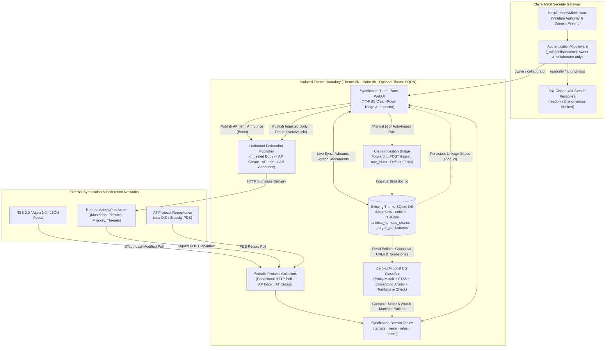

# Syndication Endpoint Architecture and Clean-Room UI Specification

**Document Identifier:** DESIGN-SYNDICATION-20261028-01  
**Author:** Claire Bible Architecture & UI/UX Team  
**Status:** Phase 1 Implemented (Access-Controlled Route & Interactive Visual Prototype at `/syndication`) · Phase 2 Specified (Backend Collectors, Schema & Federation Engine)  
**Related Documents:**  
- [`MULTI_THEME_ARCHITECTURE_DESIGN.md`](MULTI_THEME_ARCHITECTURE_DESIGN.md)  
- [`THEME_FQDN_REVERSE_PROXY_DESIGN.md`](THEME_FQDN_REVERSE_PROXY_DESIGN.md)  
- [`PUBLIC_SITE_CRAWLING_AND_INDEXING_DESIGN.md`](PUBLIC_SITE_CRAWLING_AND_INDEXING_DESIGN.md)  
- [`DATA_LIFECYCLE_AND_PURGE_DESIGN.md`](DATA_LIFECYCLE_AND_PURGE_DESIGN.md)  
- [`API_HTTP_CONTRACT.md`](../implementation/API_HTTP_CONTRACT.md)  
- [`EXTERNAL_ACCESS.md`](../implementation/EXTERNAL_ACCESS.md)  
- [`GLOSSARY.md`](../implementation/GLOSSARY.md)  

---

## 1. Background, Problem Statement, and Design Goals

### 1.1 Background
Claire Bible ingests web pages, documents, videos, and social threads into isolated per-theme SQLite databases (`data/claire.db` and `data/themes/{seq}/claire.db`), where each source becomes a normalized document linked to ontology entities and relations. Before this specification, ingestion required an operator or collaborator to push individual URLs or files manually through the WebUI, CLI (`./cb-manuscript app ingest`), Telegram bot, or REST API (`POST /ingest`).

Operators and collaborators need a unified workspace to register external information streams, collect updates periodically, classify incoming items against the existing knowledge graph of each theme, forward selected items to the Claire ingestion pipeline, and publish curated outputs to federated networks.

### 1.2 Design Goals
1. **Clean-Room Spiritual Inheritance of Tiny Tiny RSS (TT-RSS) with Single-Line `FlatList` Mode**:
   - Inherit both the crisp single-line **`FlatList` mode** (checkbox, star, outbound publish state, ingestion link badge, bold unread title, author, inline excerpt, colored feed pill, compact timestamp, original link, and protocol badge in one horizontal row with inline article expansion) and the **Three-Panel mode** (left tree, center stream, right dedicated reader), plus viewport-aware action popovers (`Select...`, `Adaptive`, `Sort`, `☰` hamburger menu, and `⋯` article menu).
   - Provide a faithful full-featured Article Reader (`.doc-content` typography, Sans/Serif toggle, adjustable font size, tables, code blocks, blockquotes, and figures).
   - Provide a dedicated sub-route Preferences page at **`/syndication/preferences`** for feed targets, tag-to-entity policies, organize rules, outbound federation defaults, and OPML import/export.
2. **Unified Content View (`수집 원문` ⇄ `적재 본문`)**:
   - Allow a single collected item to hold **both** its Collected Original (`수집 원문`) and its Claire Ingested Body (`적재 본문`), and switch seamlessly between them inside the **single unified content view**.
3. **Tag-to-Entity Equivalence (`태그는 곧 엔티티`)**:
   - Process tags from RSS/Atom (`<category>`), ActivityPub (`Hashtag`), and AT Protocol (`facets`) identically to Claire Bible's `[태그]` ingestion policy: every tag in Claire Bible resolves directly to an ontology **Entity (`entities` node)** in the active theme database.
4. **Dual Outbound Publishing Across All Protocols (`부스트/인용 발행` & `적재 발행`)**:
   - Support **both** **Boost / Quote Publish** (ActivityPub `Announce` for AP objects or FEP-044f Quote/Link `Create` for RSS/Atom/AT items) and **Ingested Body Publish** (ActivityPub `Create` emitting the Claire `적재 본문`, entity hashtags, and `/p?s=<token>` share URL) for RSS/Atom, ActivityPub, and AT Protocol items alike.
5. **Public Visual Prototype Access (Phase 1) & Role-Scoped Backend Mutations (Phase 2)**:
   - Expose `GET/HEAD /syndication` and `GET/HEAD /syndication/preferences` under `_rule("public")` during Phase 1 so reviewers can inspect both routes directly without token friction.
   - Enforce `collaborator` and `owner` scopes on Phase 2 mutation endpoints (`/syndication/targets`, `/syndication/ingest`, `/syndication/publish`, `/syndication/rules`), and disallow search engine indexing via `/robots.txt` (`Disallow: /syndication`) and `<meta name="robots">`.

---

## 2. System Architecture and Security Invariants

### 2.1 Multi-Theme Architecture Context



### 2.2 Security and Operational Invariants
1. **Public Prototype Inspection & Private Theme Protection**:
   - `ROUTE_POLICY` registers `("GET", "/syndication"): _rule("public")` and `("HEAD", "/syndication"): _rule("public")` so the Phase 1 visual prototype is immediately reachable at `/syndication` without token authentication.
   - In multi-theme mode (`CLAIRE_MULTI_THEME=1`), unauthenticated requests (`public` or `anonymous` scope) never expose private theme metadata (`is_public = False`).
2. **Collaborator Default-Theme Write Guard**:
   - Collaborators can inspect streams on accessible themes, but cannot ingest into or mutate the default theme (`id=0`, `seq=0`), preserving the baseline RBAC rule enforced by `POST /ingest` (`HTTP 403 Forbidden`).
3. **Crawler Exclusion and Indexing Guard**:
   - `/robots.txt` explicitly outputs `Disallow: /syndication` in public portal mode (`User-agent: *`) and `Disallow: /` in private mode.
   - `syndication.html` embeds `<meta name="robots" content="noindex, nofollow, noarchive"/>`.
4. **Strict Content-Security-Policy (CSP) Compliance**:
   - `SafeAccessLogMiddleware` enforces `default-src 'self'; script-src 'self' 'unsafe-inline' 'unsafe-eval' https://unpkg.com; style-src 'self' 'unsafe-inline' https://fonts.googleapis.com https://unpkg.com`.
   - `/syndication` uses zero external CSS/JS CDNs. All layout and component styles compile directly from `src/claire/static/css/theme.css` into `SYNDICATION_HTML`.
5. **Tombstone Shield and SSRF Protection**:
   - Stream items whose normalized URL or content hash matches `purged_tombstones` in the active theme database are suppressed from auto-ingestion so purged content never resurrects automatically.
   - Periodic collectors reuse Claire Bible's outbound URL validation and SSRF network guards before opening remote sockets.

---

## 3. Phase 1 Specification: Implemented Route and Interactive Visual Prototype

Phase 1 mounts the interactive clean-room visual prototype at `/syndication` so administrators and collaborators can validate the UX workflow against live theme databases prior to Phase 2 backend persistence implementation.

### 3.1 Implemented Code Modules

| Module | Symbol / File | Responsibility |
| :--- | :--- | :--- |
| Security Policy | [`src/claire/api/security.py`](../../src/claire/api/security.py) | Registers `GET/HEAD /syndication` and `GET/HEAD /syndication/preferences` with `_rule("public")` for frictionless visual prototype access. |
| ASGI Server | [`src/claire/api/server.py`](../../src/claire/api/server.py) | Implements `syndication_ui_route` and `syndication_preferences_ui_route`, resolves multi-theme context via `_get_theme_ctx(request)`, appends `Disallow: /syndication` to `robots_txt_route`, and mounts `/syndication` and `/syndication/preferences`. |
| HTML Bundle Renderer | [`src/claire/graphview.py`](../../src/claire/graphview.py) | Builds standalone `SYNDICATION_HTML` and `SYNDICATION_PREFERENCES_HTML` bundles and provides `render_syndication_html(...)` and `render_syndication_preferences_html(...)`. |
| Reader & List Assets | [`src/claire/templates/syndication.html`](../../src/claire/templates/syndication.html), [`src/claire/static/css/syndication.css`](../../src/claire/static/css/syndication.css), [`src/claire/static/js/syndication_app.js`](../../src/claire/static/js/syndication_app.js) | Implements orthogonal controls for List Style (`flat` 한 줄 FlatList ⇄ `cards` 상세 카드) and Pane Layout (`three-panel` 3단 분할 ⇄ `two-panel` 2단 상하 분할), faithful `.doc-content` reader, unified `수집 원문` ⇄ `적재 본문` view switcher, entity-tag bar (feed `#Tag` vs ingested `[[Entity]]`), and dual Boost/Quote + Ingested Publish modal. |
| Preferences Subpage | [`src/claire/templates/syndication_preferences.html`](../../src/claire/templates/syndication_preferences.html) | Implements `/syndication/preferences` with persistent controls for FlatList/Reader typography, feed targets, Tag = Entity ingestion policy, organize rules, outbound federation formats, and OPML 2.0 import/export. |

### 3.2 Browser Entry Flow
- Any browser or HTTP client can open `/syndication` (or `/syndication?theme=<id>`) directly without a token or session cookie (`200 OK`).
- When `CLAIRE_ANONYMOUS_READONLY=1` (or when an active session cookie is present), the prototype automatically fetches `/whoami`, `/graph`, and `/documents` to synchronize live entities and documents from the active theme SQLite database.

### 3.3 Three-Pane Clean-Room UI Layout and Live DB Synchronization
1. **Top Control Bar**:
   - **Theme Selector**: Switches between isolated theme databases (`?theme=<id>`) and updates the active ActivityPub Actor identity badge (`@actor@theme-fqdn`).
   - **Ingestion Mode Switch**: Toggles between **Prototype Simulation** (deterministic UI state transition) and **Live `POST /ingest`** (sends real ingestion payloads to the active Claire Bible server).
   - **Quick Actions**: Opens the **Register Collection Target** modal (`+ 수집 대상 지정`), opens the **Organize & Auto-Ingest Rules** modal (`⚡ 오거나이즈 규칙`), and toggles Light/Dark theme (`claireTheme`).
2. **Pane 1 — Left Navigation & Ontology Filter Tree**:
   - **Virtual Streams**: All Collected Items (`전체 수집 스트림`), Unread (`읽지 않음`), Unlinked (`미적재 후보`), Ingested & Linked (`🔗 프로젝트 적재 연동됨`), Starred (`중요 표시`), and Published/Boosted (`발행 · 부스트 완료`).
   - **Periodic Collection Targets**: Grouped by organize folder with protocol badges (`🟠 RSS/ATOM`, `🟣 ActivityPub`, `🔵 AT Proto`), polling interval indicators (`5m`, `15m`, `1h`, `push`), and unread counters.
   - **Live Theme Ontology Cloud**: Synchronizes with `GET /graph` on the active theme database to filter stream headlines by real knowledge graph entities (`[[Entity]]`).
3. **Pane 2 — Center Organized Headline Stream (Orthogonal List Style)**:
   - **List Style Toggle (`l`)**: Toggles between **`한 줄 플랫 (FlatList)`** (TT-RSS classic 34px single-line dense table rows) and **`상세 카드 (Detailed Cards)`** (initial prototype multi-line cards with headline, body excerpt snippet, score pill, feed `#Tag` / ingested `[[Entity]]` chips, and quick ingest/publish buttons).
   - **Pane Layout Toggle (`m`)**: Toggles between **`3단 분할 뷰 (Three-Panel)`** (Left Tree | Center Stream | Right Reader) and **`2단 상하 분할 뷰 (Two-Panel)`** (Left Tree | Top Stream / Bottom Reader). Both layouts independently support FlatList and Card list styles.
   - Dual segmented filters for linkage status (`전체` / `안읽음` / `미적재` / `🔗 적재연동`) and collection protocol (`모든 프로토콜` / `RSS/ATOM` / `ActivityPub` / `AT Proto`), plus keyword/entity search and relevance sorting.
   - Persistent **`🔗 적재 연동`** badge when matched against `GET /documents` (by `canonical_url` or `url`) or ingested during the session.
4. **Pane 3 — Right Inspector, Ingestion Bridge & Outbound Publisher**:
   - **Linkage Banner (`적재 연동 배너`)**:
     - When unlinked: provides an optional Focus (`관점`) input defaulting to `theme.default_focus` and a primary **`프로젝트 적재 전달 (i)`** action.
     - When linked: displays the persistent `🔗 프로젝트 적재 연동됨` card with `doc_id`, extracted entity/relation counts, share link (`/p?s=...`), Claire structured summary/detail tabs, and a direct link to open the document in the main Knowledge Graph workspace.
   - **Deterministic Outbound Publish Action (`발행`, key `p`)**:
     - Opens `<dialog id="modal-publish" closedby="any">` pre-configured with the exact protocol payload:
       - **Ingested Document Body (`적재 본문`)** -> ActivityPub `Create` (`Note` / `Article`) with summary/detail composer, visibility selector, hashtags derived from linked entities, and canonical Claire share URL.
       - **ActivityPub Stream Item (`ActivityPub 원문`)** -> ActivityPub `Announce` (Boost) targeting the remote ActivityPub object URI, with an optional switch to publish the Claire ingested commentary as `Create` when the item is also linked in `documents`.
5. **Rendering Performance & Dialog Ergonomics**:
   - Each workspace pane (`.synd-column`) isolates layout and paint calculations using `content-visibility: auto` and `contain-intrinsic-size`, with `@supports not (content-visibility: auto)` falling back to `contain: layout style paint`.
   - All modals (`#modal-subscribe`, `#modal-publish`, `#modal-rules`) use native `<dialog closedby="any">` with backdrop click fallback for light-dismiss accessibility.

---

## 4. Phase 2 Specification: Full Backend Persistence, Collectors, and Federation Engine

After review of the Phase 1 prototype at `/syndication`, Phase 2 implements persistent storage, background periodic collection workers, deterministic classification, and signed ActivityPub federation.

### 4.1 Per-Theme SQLite Schema Extensions (`claire.db`)
All tables reside inside each theme's `claire.db` (adhering to additive migration rules in [`SCHEMA_VERSIONING.md`](../implementation/SCHEMA_VERSIONING.md)) so theme backups, snapshots, and physical isolation remain self-contained:

```sql
CREATE TABLE IF NOT EXISTS syndication_targets (
    id TEXT PRIMARY KEY,
    protocol TEXT NOT NULL,              -- 'rss' | 'atom' | 'jsonfeed' | 'activitypub' | 'atproto'
    uri TEXT NOT NULL UNIQUE,            -- Feed URL, AP Actor URI, or at:// DID URI
    handle TEXT,                         -- '@user@domain' or 'at://did:plc:...'
    title TEXT NOT NULL,
    folder TEXT DEFAULT '',
    poll_interval_sec INTEGER DEFAULT 900,
    auto_ingest_threshold INTEGER,       -- NULL = manual only; e.g. 80 = auto-forward when score >= 80
    default_focus TEXT DEFAULT '',
    etag TEXT,
    last_modified TEXT,
    cursor TEXT,                         -- AT Protocol / pagination cursor
    health_status TEXT DEFAULT 'ok',     -- 'ok' | 'degraded' | 'paused'
    consecutive_failures INTEGER DEFAULT 0,
    last_polled_at REAL,
    created_at REAL NOT NULL,
    updated_at REAL NOT NULL
);

CREATE TABLE IF NOT EXISTS syndication_items (
    id TEXT PRIMARY KEY,
    target_id TEXT NOT NULL REFERENCES syndication_targets(id) ON DELETE CASCADE,
    protocol TEXT NOT NULL,
    external_id TEXT NOT NULL,           -- RSS guid, AP Object ID/URI, or AT URI (at://.../app.bsky.feed.post/...)
    canonical_url TEXT,
    title TEXT,
    author TEXT,
    raw_content TEXT,
    content_hash TEXT,
    published_at TEXT,
    collected_at REAL NOT NULL,
    unread INTEGER DEFAULT 1,
    starred INTEGER DEFAULT 0,
    affinity_score REAL DEFAULT 0.0,
    matched_entities_json TEXT DEFAULT '[]',
    ingest_state TEXT DEFAULT 'unlinked', -- 'unlinked' | 'ingesting' | 'linked' | 'failed' | 'tombstoned'
    linked_doc_id TEXT,                   -- References documents(id) when ingested
    outbound_state TEXT DEFAULT 'none',   -- 'none' | 'created' | 'announced'
    outbound_activity_id TEXT,
    UNIQUE(target_id, external_id)
);

CREATE INDEX IF NOT EXISTS idx_synd_items_collected ON syndication_items(collected_at DESC);
CREATE INDEX IF NOT EXISTS idx_synd_items_canon ON syndication_items(canonical_url);
CREATE INDEX IF NOT EXISTS idx_synd_items_doc ON syndication_items(linked_doc_id);

CREATE TABLE IF NOT EXISTS syndication_rules (
    id TEXT PRIMARY KEY,
    name TEXT NOT NULL,
    enabled INTEGER DEFAULT 1,
    target_id TEXT,                      -- Optional scope to a single target
    protocol TEXT,                       -- Optional scope to protocol
    entity_ids_json TEXT DEFAULT '[]',   -- Match against theme entities
    query_pattern TEXT DEFAULT '',       -- FTS / keyword match
    score_delta REAL DEFAULT 0.0,
    mark_starred INTEGER DEFAULT 0,
    auto_ingest INTEGER DEFAULT 0,
    created_at REAL NOT NULL
);

CREATE TABLE IF NOT EXISTS syndication_actors (
    theme_id INTEGER PRIMARY KEY,
    actor_username TEXT NOT NULL,
    public_key_pem TEXT NOT NULL,
    private_key_pem_enc TEXT NOT NULL,   -- Encrypted at rest or stored in data/auth/
    created_at REAL NOT NULL
);

CREATE TABLE IF NOT EXISTS syndication_followers (
    id TEXT PRIMARY KEY,
    follower_actor_uri TEXT NOT NULL UNIQUE,
    inbox_uri TEXT NOT NULL,
    shared_inbox_uri TEXT,
    accepted INTEGER DEFAULT 1,
    created_at REAL NOT NULL
);
```

### 4.2 Periodic Collection Workers and Protocol Adapters
1. **RSS 2.0 / Atom 1.0 / JSON Feed Poller**:
   - Executes scheduled conditional HTTP `GET` requests sending `If-None-Match` (`etag`) and `If-Modified-Since` (`last_modified`).
   - Normalizes entries into `syndication_items`, sanitizes HTML fragments, extracts canonical URLs, and applies exponential backoff on HTTP `429` or `5xx` responses.
2. **ActivityPub Federation Adapter**:
   - **Discovery**: Resolves `@user@domain` via `GET /.well-known/webfinger?resource=acct:user@domain`, fetches the remote Actor JSON-LD document, and sends a signed `Follow` activity from the Theme Actor.
   - **Inbound Inbox (`POST /ap/inbox`)**: Verifies HTTP Signatures (RFC 9421 / draft-cavage) against the sender's public key, processes `Accept`, `Create`, `Update`, `Delete`, and `Announce` activities, and writes verified objects into `syndication_items`.
3. **AT Protocol (`at://`) Collector**:
   - Resolves `did:plc` or `did:web` handles to their Personal Data Server (PDS) endpoint and polls `com.atproto.repo.listRecords` (`collection=app.bsky.feed.post`) or public AppView `app.bsky.feed.getAuthorFeed` using stored `cursor` checkpoints.

### 4.3 Deterministic Local Database Organization & Ingestion Bridge
1. **Zero-LLM Classification Pipeline**:
   - On item arrival, the classifier checks `purged_tombstones` first; if matched, `ingest_state` becomes `'tombstoned'` and auto-ingestion is skipped.
   - Next, it checks `documents(canonical_url, content_hash)`: if the URL or content already exists in the theme's `documents` table (for example, previously ingested via Telegram or CLI), `ingest_state` immediately binds to `'linked'` and sets `linked_doc_id = documents.id`.
   - Next, it matches item title and text against `entities(name, norm_name, aliases)` and `entities_fts`, computing `affinity_score` and recording `matched_entities_json`.
2. **Forwarding to Claire Ingestion (`IngestBridge`)**:
   - Triggered manually (`POST /syndication/ingest`) or automatically when `affinity_score >= auto_ingest_threshold` or a rule with `auto_ingest = 1` matches.
   - Enqueues the item into `raw_inbox` / `svc.ingest(payload, source="syndication", focus=resolved_focus)`.
   - Upon completion, updates `syndication_items.ingest_state = 'linked'` and `syndication_items.linked_doc_id = report.document_id`.

### 4.4 Deterministic Outbound Publishing Contract
When an authorized user invokes `POST /syndication/publish`:
1. **Publishing Claire Ingested Body (`mode = "create"`)**:
   - Requires `linked_doc_id` pointing to a valid row in `documents`.
   - Ensures a public share token exists in `doc_shares` (`/p?s=<token>`).
   - Constructs an ActivityStreams 2.0 `Create` activity wrapping a `Note` (summary + entity hashtags + canonical `/p?s=<token>` link) or `Article` (structured `detail_html`), signs the request with the Theme Actor's private key, and delivers asynchronously to `syndication_followers` shared inboxes.
2. **Boosting ActivityPub Item (`mode = "announce"`)**:
   - Requires `syndication_items.protocol == "activitypub"` and a valid remote ActivityPub object URI in `external_id`.
   - Constructs an ActivityStreams 2.0 `Announce` activity (`object: external_id`), signs it with the Theme Actor's key, and delivers it to `syndication_followers` and the original author's inbox.

### 4.5 Planned Phase 2 REST & Federation Routes

| Method | Path | Access Policy | Purpose |
| :--- | :--- | :--- | :--- |
| `GET`, `HEAD` | `/syndication` | `public` (Phase 1 Prototype) | Render three-pane Syndication WebUI (**Implemented in Phase 1**). |
| `GET` | `/syndication/targets` | `collaborator` | List periodic collection targets and health metrics for active theme. |
| `POST` | `/syndication/targets` | `collaborator` | Register a new RSS/Atom, ActivityPub, or AT Protocol target. |
| `PATCH`, `DELETE` | `/syndication/targets` | `collaborator` | Update polling interval/folder/threshold or remove target. |
| `GET` | `/syndication/items` | `collaborator` | Query organized stream items by virtual stream, protocol, entity, or linkage status. |
| `POST` | `/syndication/items/state` | `collaborator` | Toggle `unread` or `starred` flags in batch or single item. |
| `POST` | `/syndication/ingest` | `collaborator` | Forward a collected `syndication_items` row to `svc.ingest` and bind `linked_doc_id`. |
| `POST` | `/syndication/publish` | `owner` | Publish Claire ingested body (`Create`) or boost ActivityPub item (`Announce`). |
| `GET`, `POST` | `/syndication/rules` | `owner` | Manage per-theme deterministic organization and auto-ingest rules. |
| `GET` | `/.well-known/webfinger` | `public` | Resolve Theme ActivityPub Actor handle on public/FQDN themes. |
| `GET` | `/ap/actor` | `public` | Serve ActivityStreams 2.0 Actor JSON-LD document and public key. |
| `POST` | `/ap/inbox` | `public` (HTTP Sig) | Receive signed federated `Follow`, `Accept`, `Create`, and `Announce` activities. |
| `GET` | `/ap/outbox` | `public` | Serve public ActivityStreams 2.0 `OrderedCollection` of published/boosted items. |

---

## 5. Verification Strategy

1. **Route & Security Matrix Contract Tests** ([`tests/test_api_security.py`](../../tests/test_api_security.py), [`tests/test_api_server.py`](../../tests/test_api_server.py)):
   - Verify exact alignment between Starlette `routes` and `security.ROUTE_POLICY` for `("GET", "/syndication")` and `("HEAD", "/syndication")` under `_rule("collaborator")`.
2. **Module Boundary & HTTP I/O Unit Tests** ([`tests/test_syndication_route.py`](../../tests/test_syndication_route.py)):
   - Verify `404 Not Found` stealth responses for `anonymous` and `readonly` callers.
   - Verify `200 OK` HTML rendering and `authScope` injection for `collaborator` and `owner` callers, `HEAD /syndication`, and `Disallow: /syndication` in `/robots.txt`.
3. **End-to-End Workflow Tests** ([`e2e/test_syndication_e2e.py`](../../e2e/test_syndication_e2e.py)):
   - Verify full ASGI server lifecycle, one-time session bootstrap (`GET /syndication?t=<collab_session_token>`), rejection of `readonly` session bootstrap on `/syndication`, and live synchronization with `/documents` and `/graph` endpoints.
