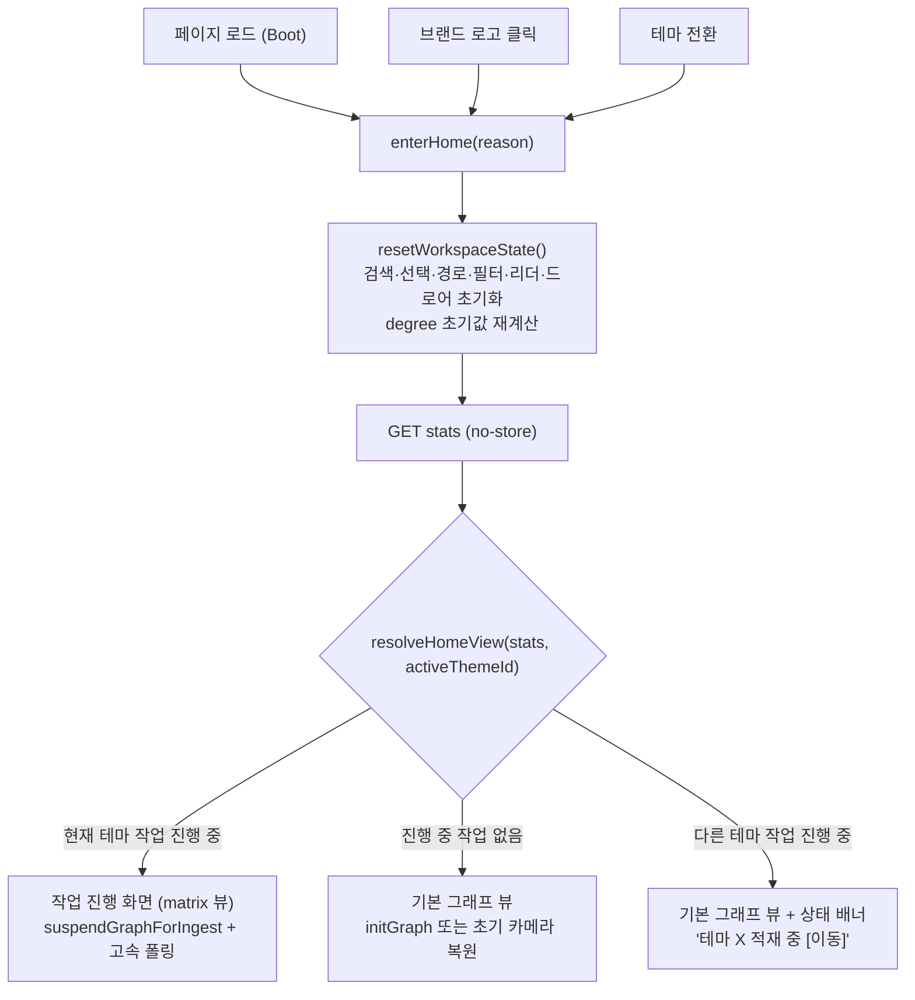
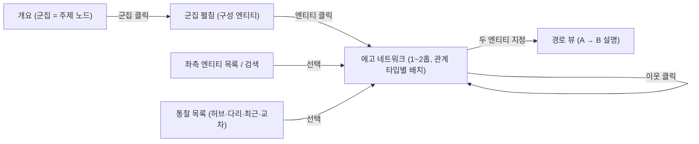

# WebUI 개편: 홈 진입 일원화 · 작업 상태 복원 · 엔티티 내비게이션 · 그래프 탐색 재설계

작성일: 2026-10-26 · 상태: **Proposed** · 기준: [GOALS.md](../GOALS.md) UI·UX 고도화 · 관련 문서: [DECISION_STREAM_AND_HEATMAP_MATRIX_DESIGN.md](DECISION_STREAM_AND_HEATMAP_MATRIX_DESIGN.md), [VIEW_CONTEXTUAL_UNIFIED_SEARCH_DESIGN.md](VIEW_CONTEXTUAL_UNIFIED_SEARCH_DESIGN.md), [GRAPHVIEW_MODULARIZATION_AND_STATIC_ASSET_DESIGN.md](GRAPHVIEW_MODULARIZATION_AND_STATIC_ASSET_DESIGN.md), [KNOWLEDGE_GRAPH_LINKING_AND_CALIBRATION_DESIGN.md](KNOWLEDGE_GRAPH_LINKING_AND_CALIBRATION_DESIGN.md)

이 문서는 두 부분으로 구성된다.

- **1부 (설계)**: 확정 요구사항. 구현 대상.
  - 1.1 브랜드 로고 클릭 = 프로젝트 첫 접속 화면.
  - 1.2 적재/재적재 진행 중 접속 시 진행 상태 화면 복원.
- **2부 (제언)**: 선택 사항. 사용자 결정이 필요하다.
  - 2.1 그래프 뷰의 좌측 사이드바 = 엔티티 목록.
  - 2.2 그래프 뷰 효용성 개선.

---

# 1부. 설계

## 1. 현행 분석

### 1.1 첫 접속(Boot) 흐름

[app.js L1565-1594](../../src/claire/static/js/app.js#L1565-L1594)는 다음 순서로 첫 화면을 정한다.

1. `GET stats`를 호출한다.
2. `ingesting` 또는 `active_ingest.active`가 참이면: 그래프를 정지하고(`suspendGraphForIngest`), 중앙 뷰를 `matrix`로 바꾸고, 1.5초 고속 폴링을 시작한다.
3. 그 외: `initGraph()`로 전체 그래프를 표시한다. 초기 최소 연결 수(degree)는 노드 수에 따라 0/1/2/5로 정한다([L1246-L1256](../../src/claire/static/js/app.js#L1246-L1256)).

### 1.2 브랜드 로고 클릭 흐름

[index.html L81](../../src/claire/templates/index.html#L81)의 `.brand`는 `resetHome()`을 호출한다. [`resetHome`](../../src/claire/static/js/app.js#L4018-L4068)은 Boot 흐름과 **다른 별도 코드**이다. 차이는 다음과 같다.

| 항목 | 첫 접속 (Boot) | 브랜드 클릭 (`resetHome`) |
| :--- | :--- | :--- |
| 작업 상태 확인 | `GET stats` 호출 | **호출 안 함** |
| 적재 중일 때 | `matrix` 뷰 | **`setCenterView('graph')` 강제** → `resumeGraphAfterIngest()`가 매트릭스를 그래프로 덮어씀 |
| 최소 연결 수 | 노드 수 기준 초기값 | **이전 값 유지** |
| 관계 필터·타입 필터 | 초기 상태 | **이전 값 유지** |
| 문서 제목(`document.title`) | `Claire Bible — 의사결정 스트림` (템플릿) | `Claire Bible — 지식 그래프` |
| History | 항목 없음 | `revealWorkspace()`가 `pushState` 실행 가능 |
| GA | 페이지 로드 1회 | **가상 `page_view` (`/`) 별도 전송** ([L4060-L4067](../../src/claire/static/js/app.js#L4060-L4067)) |

결론: 브랜드 클릭은 "첫 접속 화면"이 아니라 "전체 그래프 보기"라는 **별도 화면**을 호출한다. 사용자가 관찰한 "특정 웹페이지 호출"은 이 별도 경로(가상 `page_view` `/` 전송, 제목 변경, 그래프 강제)와 일치한다.

`switchKnowledgeTheme()`도 `resetHome()`을 호출한다([L403](../../src/claire/static/js/app.js#L403)). 따라서 테마 전환 직후의 화면도 첫 접속 화면과 다르다.

### 1.3 적재 상태 공유 흐름

서버 상태 파일은 `data/active_ingest.json` 하나이다([active.py](../../src/claire/ingest/active.py)). 결함은 다음과 같다.

| # | 결함 | 근거 | 결과 |
| :--- | :--- | :--- | :--- |
| D1 | 상태 파일을 `pipeline.ingest()`만 기록한다. | `set_active_ingest` 호출처는 [pipeline.py L255](../../src/claire/ingest/pipeline.py#L255) 하나뿐이다. | 기존 문서 **재적재**(`/reingest`, `/reingest-stream` → `regenerate_components(refetch=True)`)와 **재생성**(`/regenerate-stream`)은 상태를 기록하지 않는다. 다른 탭·새로고침·다른 기기에서 진행 상태가 보이지 않는다. 작업을 시작한 탭만 클라이언트 단독으로 매트릭스를 표시한다([L2389-L2399](../../src/claire/static/js/app.js#L2389-L2399)). |
| D2 | 브랜드 클릭이 적재 상태를 무시한다. | 1.2절 표 | 진행 화면이 그래프로 바뀐다. |
| D3 | 상태 파일에 테마 구분이 없다. | `pipeline.ingest()`가 `theme_id`, `theme_label`을 전달하지 않는다(기본값 0). `data_dir`는 테마별로 분리되지 않는다(`get_settings_for_theme`는 `db_path`만 바꾼다). | 테마 B 적재가 테마 A 접속 화면에 매트릭스로 나타날 수 있다. |
| D4 | 상태 슬롯이 1개이다. | `_MAX_EXPENSIVE_JOBS = 4` ([server.py L88](../../src/claire/api/server.py#L88)) | 동시 작업(웹 + 텔레그램 등)이 서로의 상태를 덮어쓴다. |
| D5 | 매트릭스가 도착하기 전 단계를 표현하지 못한다. | `heatmap_matrix`는 해소 단계에서만 생긴다. | 원문 수집·STT·추출 단계(수 분)에는 "준비 중" 문구만 보인다. 해소 단계가 없는 재생성은 매트릭스가 영구히 비어 있다. |

---

## 2. 설계 1.1 — 홈 진입 일원화 (`enterHome`)

### 2.1 원칙

- 홈 화면을 결정하는 코드는 **하나**이다. Boot, 브랜드 클릭, 테마 전환이 같은 함수를 호출한다.
- 홈 화면은 **서버의 현재 작업 상태**로 결정한다. 클라이언트 캐시로 결정하지 않는다.

### 2.2 구조



### 2.3 함수 명세 (`app.js`)

| 함수 | 책임 | 비고 |
| :--- | :--- | :--- |
| `resetWorkspaceState()` | 현행 `resetHome()`의 상태 초기화 부분만 분리한다. 추가 초기화: `curMinDeg`(노드 수 기준 초기값), `relFilter`, 범례 타입 off 상태, 리더(`curReaderDoc`), 그래프 자료 선택기. `synthSet`(종합 수집)은 보존한다. | 부수 효과 = DOM·전역 변수만. 네트워크 호출 없음. |
| `resolveHomeView(stats, themeId)` | 순수 함수. `'job' \| 'graph' \| 'graph+banner'`를 반환한다. | 판정 규칙은 2.4절. |
| `async enterHome({reason})` | `resetWorkspaceState()` → `GET stats` → `resolveHomeView()` → 화면 적용 → History·제목·GA 정리. | `reason ∈ {'boot','brand','theme'}` |

### 2.4 판정 규칙

1. `stats.active_job`이 있고 `active === true`이고 `theme_id === activeThemeId`이면 `'job'`.
2. `stats.active_job`이 있고 `active === true`이고 테마가 다르면 `'graph+banner'`.
3. 그 외 `'graph'`.
4. `stats` 호출이 실패하면 `'graph'`. 이후 정규 폴링이 상태를 다시 확인한다.

### 2.5 부수 정리 항목

- **History**: `enterHome`은 `replaceState(home snapshot)`를 사용한다. `pushState`를 사용하지 않는다. 브랜드를 여러 번 눌러도 뒤로 가기 스택이 쌓이지 않는다.
- **URL**: `?theme=N`만 남긴다. 다른 질의 문자열과 해시는 제거한다.
- **제목**: 상수 `HOME_TITLE` 하나를 사용한다. 템플릿 `<title>`과 `enterHome`이 같은 값을 쓴다. (값 결정은 열린 결정 Q1.)
- **GA**: Boot에서만 `page_view`를 보낸다. 브랜드 클릭은 `event('home_navigate')`를 보낸다. 가상 `page_view` `/` 중복 전송을 없앤다.
- **마크업**: `.brand`를 `<a href="./">`로 바꾼다. 일반 클릭은 `preventDefault()` 후 `enterHome({reason:'brand'})`를 호출한다. 가운데 클릭·Ctrl+클릭은 브라우저 기본 동작(새 탭 = 새 Boot)을 유지한다. `role="button"`과 인라인 `onkeydown`을 제거한다(네이티브 링크가 키보드를 처리한다). `?theme=N`은 렌더 시 `href`에 반영한다.
- **호환**: `resetHome`은 `enterHome({reason:'brand'})`를 호출하는 얇은 별칭으로 남긴다. `window.claireDebug`와 기존 E2E가 이 이름을 쓴다.

### 2.6 대안 (채택 안 함)

| 대안 | 장점 | 단점 |
| :--- | :--- | :--- |
| 브랜드 = 전체 페이지 새로고침 (`location.href = './'`) | Boot와 동일성이 구조적으로 보장된다. | CDN 스크립트·폰트·그래프 재요청 비용. 화면 깜빡임. `synthSet` 등 메모리 상태 손실. |

`enterHome`은 Boot 경로 자체를 공유한다. 따라서 동일성은 SPA 방식에서도 보장된다. 새 탭 열기는 `<a href>`로 새로고침 방식의 이점을 그대로 제공한다.

---

## 3. 설계 1.2 — 작업 상태 복원 (Active Job)

### 3.1 원칙

- 서버에서 실행되는 **모든 지식 변경 작업**(적재, 재적재, 재생성)은 같은 상태 기록 경로를 통과한다.
- 접속 시 화면은 서버 상태 파일만으로 복원한다. 작업을 시작한 탭인지 여부와 무관하다.
- 매트릭스가 아직 없거나 생기지 않는 작업도 진행 화면을 표시한다.

### 3.2 서버: 상태 스키마 확장 (하위 호환)

파일 이름 `active_ingest.json`과 `/stats`의 `active_ingest` 키는 유지한다. 새 필드를 추가한다. 기존 클라이언트는 새 필드를 무시한다.

```json
{
  "active": true,
  "job_id": "j_7f3a…",
  "kind": "reingest",
  "theme_id": 2,
  "theme_label": "VMware",
  "doc_id": "d_91c2…",
  "title": "vSphere 8.0 U3 Release Notes",
  "stage": "extract",
  "stages": ["fetch", "extract", "resolve", "detail", "done"],
  "msg": "엔티티 추출 중…",
  "heatmap_matrix": null,
  "started_at": 1793001000.1,
  "updated_at": 1793001042.7,
  "completed_at": null,
  "result": null
}
```

| 필드 | 값 | 기록 주체 |
| :--- | :--- | :--- |
| `kind` | `ingest` \| `reingest` \| `regenerate` | 컨텍스트 관리자 진입 시 |
| `job_id` | 작업마다 고유 | 컨텍스트 관리자 |
| `theme_id`, `theme_label` | 작업 대상 테마 | **D3 수정**: 서비스가 자기 테마 정보를 전달 |
| `doc_id` | 재적재·재생성 대상 문서 | 진입 시 / 수집 후 |
| `stages`, `stage` | 단계 목록과 현재 단계 | 진행 훅 |

### 3.3 서버: 공통 컨텍스트 관리자

`claire/ingest/active.py`에 `active_job()`를 추가한다.

```python
@contextmanager
def active_job(data_dir, *, kind: str, payload: str, theme_id: int, theme_label: str, doc_id: str | None = None, focus: str | None = None, title: str | None = None) -> Iterator[JobHandle]:
    """작업 시작 시 상태를 기록하고, 진행 콜백을 연결하고, 종료 시 결과/오류를 기록한다. 같은 스레드에서 중첩 진입하면 바깥 작업의 상태를 덮어쓰지 않는다."""
```

- **재진입**: 재적재는 내부에서 `regenerate_components()`를 호출하고, 문서 미일치 시 `ingest()`를 호출한다. 스레드 로컬 깊이 카운터로 중첩을 감지한다. 바깥 작업 1개만 상태 파일을 소유한다. 안쪽 호출은 진행 메시지만 갱신한다.
- **적용 위치**:
  - `pipeline.ingest()`: 현행 `set_active_ingest` / `_active_progress_hook` / `clear_active_ingest` 블록을 `active_job(kind='ingest')`로 교체한다.
  - `IngestService.regenerate_components()`: `force=True`(실제 쓰기)일 때만 `active_job(kind='regenerate' 또는 refetch 시 'reingest')`로 감싼다. dry-run은 상태를 기록하지 않는다.
- **진행 연결**: `regenerate_components()`의 `on_progress(stage, detail)`와 `emit_progress()`를 같은 훅으로 연결한다. 해소 단계가 `heatmap_matrix` 이벤트를 내면 상태 파일에 그대로 반영된다.

### 3.4 서버: 테마 격리와 동시 작업 (D3, D4)

- **1단계 (본 설계 범위)**: `theme_id`를 정확히 기록한다(D3 해소). `/stats`는 상태를 그대로 반환하고, 클라이언트가 2.4절 규칙으로 테마를 구분한다.
- **2단계 (선택)**: 단일 파일을 `data/active_jobs/<job_id>.json` 디렉터리로 바꾼다(D4 해소). `/stats`는 `active_jobs: [...]` 배열을 반환한다. `active_ingest` 키는 현재 테마의 가장 최근 작업으로 계속 채운다(하위 호환). 진행 화면 상단에 "작업 2건 진행 중" 전환 칩을 표시한다.

### 3.5 클라이언트: 작업 진행 화면 (D5)

`#matrixwrap`을 "작업 진행 화면"으로 확장한다. 매트릭스는 이 화면의 한 구성 요소가 된다.

```text
┌ 작업 진행 ─────────────────────────────────────────────┐
│ 🔄 재적재 중 · vSphere 8.0 U3 Release Notes · 테마: VMware │
│ ● 수집 ─ ● 추출 ─ ◐ 해소 ─ ○ 상세 ─ ○ 완료      02:41 경과 │
│ 메시지: 엔티티 해소 중 (38 / 112)                          │
├────────────────────────────────────────────────────────┤
│ [히트맵 매트릭스]  (matrix 수신 전: 대기 파동 플레이스홀더) │
└────────────────────────────────────────────────────────┘
```

- **단계 표시줄(Stepper)**: `stages`와 `stage`로 그린다. 서버가 `stages`를 보내지 않는 구버전이면 표시줄을 숨긴다.
- **작업 종류 표기**: `kind`에 따라 `적재 중` / `재적재 중` / `재생성 중`.
- **경과 시간**: `started_at` 기준. 새로고침 후에도 정확하다.
- **매트릭스 영역**: `heatmap_matrix`가 없으면 현행 대기 파동(`triggerMatrixWave`)을 표시한다. 해소 단계가 없는 작업은 "이 작업은 대조 단계가 없습니다" 문구로 바꾼다.
- **완료 처리**: 현행 [`handleActiveIngestCompleted`](../../src/claire/static/js/app.js#L3105-L3131) 흐름을 유지한다. 완료 후 30초 보존 규칙(`_COMPLETED_RETENTION_SEC`)도 유지한다.
- **이탈 허용**: 진행 화면에서 그래프·본문 탭으로 이동할 수 있다. 상단 바에 작은 진행 칩(`🔄 재적재 중 41%`)을 남긴다. 칩을 누르면 진행 화면으로 돌아온다. 브랜드 클릭은 2.4절 규칙에 따라 진행 화면으로 돌아온다.

### 3.6 폴링 정책

- Boot와 `enterHome`은 즉시 `GET stats`를 호출한다(현행 정규 폴링의 첫 주기 25초를 기다리지 않는다).
- 작업 진행 중: 1.5초(현행 유지).
- 작업 없음: 25초(현행 유지). `document.visibilityState === 'visible'`로 돌아오면 즉시 1회 호출한다. 백그라운드 탭에서 시작된 작업을 놓치지 않는다.

---

## 4. 1부 테스트 계획

전역 규칙에 따라 단위 테스트는 모듈 간 인터페이스·I/O·외부 라이브러리 호출에만 작성한다. 신규 기능마다 E2E를 최소 1건 작성한다.

| 종류 | 대상 | 검증 내용 |
| :--- | :--- | :--- |
| 단위 (I/O) | `active_job()` | 시작·진행·완료·오류 기록. 중첩 진입 시 바깥 상태 유지. `theme_id`·`kind` 기록. |
| 단위 (모듈 인터페이스) | `regenerate_components(force=True)` ↔ `active_job` | 재생성 중 상태 파일 `active=true`, `kind='regenerate'`. dry-run은 기록 없음. |
| 단위 (API I/O) | `GET /stats` | `active_ingest`에 새 필드 포함. 기존 필드 유지. |
| E2E (Playwright, `e2e/workspace.spec.js`) | 브랜드 클릭 = Boot | 필터·검색·리더 상태를 바꾼 뒤 브랜드 클릭 → Boot 직후 DOM 상태(`data-center-view`, degree 값, 제목, URL)와 일치. |
| E2E | 재적재 중 접속 | `seed_db.py`로 `active_ingest.json`(`kind='reingest'`, 현재 테마) 기록 → 새 페이지 로드 → `data-center-view="matrix"`와 단계 표시줄 확인 → 브랜드 클릭 후에도 `matrix` 유지. |
| E2E | 다른 테마 작업 | 다른 `theme_id` 상태 기록 → 그래프 뷰 + 배너 표시. |

---

# 2부. 제언

## 5. 제언 2.1 — 그래프 뷰의 좌측 사이드바 = 엔티티 목록

### 5.1 목표

그래프 뷰에서 좌측 사이드바는 **그래프의 색인(Index)** 이 된다. 캔버스는 "어디에 있는가"를 보여준다. 목록은 "무엇이 있는가"를 보여준다. 둘은 같은 선택 상태를 공유한다.

- `centerView === 'graph'`: 좌측 = 엔티티 목록.
- 그 외 뷰: 좌측 = 본문 목록(현행).
- 모바일: `📑 본문 목록` 버튼이 그래프 뷰에서 `🏷️ 엔티티 목록`으로 바뀐다.

### 5.2 화면 구성

```text
┌ 엔티티 512 · 그래프 표시 140 ───────────┐
│ 묶기: [타입▾]  정렬: [연결 수▾]  [⋯]     │  ← 툴바 (설정은 localStorage 보존)
│ 문서 필터: "vSphere 8 Release…" ✕       │  ← activeDoc 있을 때만
├─────────────────────────────────────────┤
│ ⭐ 고정 (3)                              │
│ ▾ ● Tool (128)                           │
│    ● vSphere            42  📄9          │  ← 타입색 · 이름 · 연결 수 · 출처 문서 수
│    ● ESXi               31  📄7          │
│    ◌ Tanzu Mission…      2  📄1  임시    │  ← provisional 표시
│    … 필터로 숨김 54 ▸                    │  ← 그래프에서 숨겨진 항목은 접힌 하위 묶음
│ ▸ ● Concept (96)                         │
│ ▸ ● Org (41)                             │
│ ▸ 고립 엔티티 (연결 0) 87                │  ← 캔버스에서 빼낸 노드의 자리 (6.3절 P5)
└─────────────────────────────────────────┘
```

### 5.3 묶기(Grouping) 방식

| 방식 | 설명 | 권장 용도 |
| :--- | :--- | :--- |
| **타입별 (기본값)** | 온톨로지 타입(Tool, Concept, Org …)으로 묶는다. 묶음 순서 = 묶음 크기 내림차순. 범례 색과 일치한다. | 일반 탐색. 범례 타입 필터와 동기화. |
| 커뮤니티별 | 6.3절 P2의 군집 결과로 묶는다. 묶음 이름 = 군집 대표 엔티티 상위 3개. | 주제 단위 탐색. |
| 출처 문서별 | 엔티티를 출처 문서 아래에 나열한다. 다중 출처 엔티티는 여러 문서 아래에 반복한다. | "이 문서가 그래프에 무엇을 더했나". |
| 평면 | 묶지 않는다. | 정렬 결과를 한 줄로 보기. |

### 5.4 정렬(Sort) 방식

| 정렬 | 기준 | 의미 |
| :--- | :--- | :--- |
| **연결 수 (기본값)** | `degree` 내림차순 | 허브(중심 개념) 우선. 그래프 노드 크기와 일치. |
| 출처 문서 수 | `sources.length` 내림차순 | 여러 문서를 **잇는** 지식 우선. 지식 베이스의 고유 가치가 가장 큰 항목. |
| 최근 갱신 | `updated_at` 내림차순 | 최근 적재로 바뀐 지식 확인. |
| 이름 | 로캘 비교(`Intl.Collator('ko')`) | 알려진 이름 찾기. 가나다 → ABC 순. |

이름 정렬일 때 묶음 안에 초성/알파벳 색인 머리글(ㄱ, ㄴ … A, B …)을 넣는다.

### 5.5 행(Row) 표시 규칙

- 한 줄 표시를 기본값으로 한다: 타입색 점 · 이름 · 연결 수 · 출처 문서 수.
- 본문 목록의 `제목만 / 요약 표시` 설정(`desclines`)을 재사용한다. `요약 표시`이면 둘째 줄에 첫 관찰문(`obs`)을 1줄 말줄임으로 표시한다.
- 검색어가 별칭(alias)과 일치하면 이름 옆에 `= 별칭` 칩을 표시한다.
- `provisional` 엔티티는 빈 점(◌)과 `임시` 표기로 구분한다.
- 그래프에서 숨겨진 항목(최소 연결 수·관계 필터)은 목록에서 삭제하지 않는다. 묶음 끝의 접힌 하위 묶음 "필터로 숨김 N"에 넣는다. 목록은 **전체 색인**이고, 캔버스는 **필터된 뷰**이다.

### 5.6 상호작용

| 동작 | 결과 |
| :--- | :--- |
| 행 hover | 캔버스에서 해당 노드와 1홉 이웃을 강조한다(`applyHoverHighlight` 재사용). 카메라는 움직이지 않는다. |
| 행 클릭 | `focusNode(id)`: 선택, 카메라 이동, 우측 상세 패널. 숨김 노드이면 일시 표시 후 이동한다. |
| 행 더블클릭 | 에고 네트워크 모드(6.3절 P1)로 진입한다. |
| Ctrl/⌘+클릭 | 종합 수집(`toggleSynth`). owner만. |
| ↑ ↓ / Enter | 키보드 탐색. `role="listbox"` + `aria-activedescendant`. |
| 캔버스에서 노드 선택 | 목록이 해당 행으로 스크롤하고 강조한다(양방향 동기화). |
| 상단 검색(`#q`) 입력 | 목록과 캔버스를 같은 검색어로 동시에 필터한다. |

### 5.7 데이터와 성능

- 목록은 이미 메모리에 있는 `/graph` 응답(`allNodes`)으로 그린다. 새 API가 필요 없다.
- `graph_json()` 노드에 다음 필드만 추가한다: `updated_at`, `provisional`, `alias_count`. 별칭 일치 표시가 필요하면 `aliases`(최대 5개)를 추가한다. 페이로드 증가는 노드당 수십 바이트이다.
- 1,000행을 넘으면 묶음 단위 지연 렌더링을 적용한다. 접힌 묶음은 DOM을 만들지 않는다. 펼친 묶음은 `content-visibility: auto`로 화면 밖 행의 렌더링 비용을 줄인다.
- 고정(⭐) 엔티티: owner는 서버에 저장(문서 즐겨찾기와 같은 방식), 익명은 `localStorage`에 저장한다.

---

## 6. 제언 2.2 — 그래프 뷰 효용성 개선

### 6.1 진단

현행 그래프 뷰([knowledge-graph-overview.png](../screenshots/knowledge-graph-overview.png))는 "많은 엔티티가 얽혀 있다"는 사실만 전달한다. 원인은 다음과 같다.

1. **기본 화면이 전체 원시 노드이다.** 수백 개 노드를 한 화면에 그리면 Hairball이 된다. 최소 연결 수 필터는 노드를 줄이지만 구조를 보여주지 않는다.
2. **위치에 의미가 없다.** 힘 기반 배치(forceAtlas2)의 좌표는 매번 달라지고, 축이나 영역에 의미가 없다. 사용자가 "지도"를 기억할 수 없다.
3. **관계가 보이지 않는다.** 엣지 라벨은 확대 1.2 이상에서만 보인다. 확대·드래그 중에는 엣지 자체를 숨긴다(`hideEdgesOnZoom`, `hideEdgesOnDrag`). 엣지 색은 관계 타입과 무관하다. 지식 그래프의 핵심 정보(관계의 종류)가 시각적으로 사라진다.
4. **고립 노드가 화면을 차지한다.** 연결 0 노드를 바깥 원에 배치한다. 이 노드들은 그래프 정보가 아니라 목록 정보이다.
5. **질문에 답하지 않는다.** 사용자의 실제 질문은 "핵심 주제는?", "X는 무엇과 왜 연결되는가?", "A와 B는 어떻게 이어지는가?", "최근에 무엇이 추가되었나?"이다. 현행 기본 화면은 이 질문 중 어느 것에도 직접 답하지 않는다.
6. **데이터 밀도 문제일 가능성.** 연결 0 비율이 높으면 시각화 이전에 관계 추출이 희소한 것이다. 이 경우 어떤 시각화도 효용이 낮다. 운영 DB에서 다음 지표를 먼저 측정할 것을 권장한다: 고립 비율, 평균 연결 수, 최대 연결 요소 비율, `related_to` 비율.

### 6.2 방향

> 기본 화면을 "전체 원시 노드"에서 "**요약된 개요 + 국소 탐색**"으로 바꾼다. 전체 노드는 개요에서 시작해 필요한 만큼만 펼친다.



### 6.3 제언 항목 (우선순위 순)

| 우선 | ID | 제언 | 답하는 질문 | 구현 난이도 |
| :--- | :--- | :--- | :--- | :--- |
| ★★★ | **P1** | **에고 네트워크 모드를 1급 모드로 승격** | X는 무엇과 왜 연결되는가? | 중 |
| ★★★ | **P5** | **고립 노드·소음 제거, 라벨 LOD** | (가독성 전제 조건) | 하 |
| ★★★ | **P3** | **관계 타입의 시각 부호화** | 어떤 종류의 연결인가? | 하 |
| ★★☆ | **P2** | **군집 개요 (Community Overview)** | 핵심 주제는? | 중 |
| ★★☆ | **P6** | **통찰 목록 (Graph Insights)** | 무엇이 중요한가? 무엇을 정리해야 하나? | 중 |
| ★☆☆ | **P4** | **의미 있는 배치 (시간축·위계)** | 최근 무엇이 추가되었나? 무엇이 무엇의 일부인가? | 중 |
| ★☆☆ | **P7** | **안정 좌표와 렌더러 확장성** | (지도 기억, 대규모 성능) | 상 |

#### P1. 에고 네트워크 모드

- 엔티티 1개를 중심에 놓고 1홉 이웃만 표시한다. "2홉 펼치기" 단추로 확장한다.
- **방사형 배치 + 관계 타입별 부채꼴**: 이웃을 관계 타입(`uses`, `part_of`, `competes_with` …)별 부채꼴 영역에 모은다. 방향(out/in)은 안쪽/바깥쪽 고리로 구분한다. 위치 자체가 관계 의미를 전달한다.
- 이 모드에서는 엣지 라벨을 항상 표시한다(노드 수가 작다).
- 이웃 클릭 = 중심 이동. 상단에 탐색 경로(Breadcrumb: `vSphere › ESXi › vMotion`)를 표시하고 되돌아갈 수 있다.
- 데이터: 기존 `node_detail()`이 이웃·관계 타입·방향을 이미 반환한다. 서버 변경이 필요 없다.
- 기존 `isolatedNodeId`(고립 보기) 기능을 이 모드로 흡수한다.

#### P5. 소음 제거와 라벨 LOD

- 연결 0 노드를 캔버스에서 제외한다. 좌측 목록의 "고립 엔티티" 묶음으로 옮긴다(5.2절). 2노드 쌍(dyad)도 기본 숨김으로 한다.
- 라벨 LOD(Level of Detail): 현재 확대 수준에서 화면에 보이는 노드 중 연결 수 상위 N개(예: 30)만 라벨을 그린다. hover·선택·검색 일치 노드는 항상 라벨을 그린다.
- `hideEdgesOnZoom`을 끈다. 대신 비강조 엣지를 낮은 불투명도로 그린다.

#### P3. 관계 타입 시각 부호화

- 관계 타입마다 색을 지정한다. 범례의 관계 칩과 같은 색을 쓴다.
- `related_to`(의미가 약한 일반 관계)는 기본값으로 흐린 점선 또는 숨김으로 한다. 구체 관계(`part_of`, `uses`, `implements` …)가 시각적으로 앞에 나온다.
- `provisional` 관계는 현행대로 점선을 유지한다.
- 선택한 노드의 엣지만 라벨을 표시한다(확대 수준과 무관).

#### P2. 군집 개요

- 커뮤니티 탐지(Louvain 또는 Label Propagation)로 엔티티를 군집으로 나눈다.
- 개요 화면은 군집 1개를 노드 1개로 그린다. 크기 = 구성 엔티티 수. 이름 = 군집 내 연결 수 상위 3개 엔티티 이름(예: `vSphere · ESXi · vCenter`). 군집 간 엣지 굵기 = 군집 간 관계 수.
- 군집 클릭 = 그 군집만 펼친다(vis-network `cluster`/`openCluster` API. 현행 `clusterMatches`가 이미 `cl_` 접두 군집을 사용한다).
- 계산 위치: 서버 `graph_json()`에서 계산하고 노드에 `community` 필드를 싣는다. 결과를 그래프 변경 시점(엔티티·관계 수 서명)까지 캐시한다. 의존성 추가 없이 Label Propagation을 순수 Python으로 구현할 수 있다. Louvain이 필요하면 `networkx` 도입 여부를 결정한다(열린 결정 Q4).
- 선택 확장: 군집 이름을 LLM으로 생성(예: "VMware 가상화 플랫폼")할 수 있다. 비용이 발생하므로 owner가 수동 실행한다.

#### P6. 통찰 목록

그래프 뷰 우측 상세 패널의 기본 화면(선택 없음 상태)을 다음 목록으로 바꾼다. 각 항목 클릭 = 에고 네트워크 진입.

| 목록 | 계산 | 가치 |
| :--- | :--- | :--- |
| 허브 Top 10 | 연결 수 | 지식 베이스의 중심 개념 |
| 다리(Bridge) Top 10 | 매개 중심성(Betweenness) 근사 또는 "서로 다른 군집 이웃 수" | 주제와 주제를 잇는 개념. 그래프만 줄 수 있는 정보. |
| 교차 출현 Top 10 | 출처 문서 수 | 여러 문서가 공유하는 지식 |
| 최근 추가 | `created_at` 최근 7일 | 최근 적재의 효과 |
| 정리 후보 (owner) | 이름 유사 + 같은 타입 + 연결 0 | 병합·삭제 후보. 결정 스트림·롤백과 연결. |

#### P4. 의미 있는 배치

배치 선택 메뉴를 추가한다. 기본값은 힘 기반을 유지한다.

- **시간축 배치**: x = 엔티티 최초 등장일(`created_at`), y = 타입 레인. "언제 무엇이 들어왔나"를 보여준다.
- **위계 배치**: `part_of`, `derived_from`, `implements` 엣지만으로 계층 배치(vis-network `hierarchical`)를 한다. 제품·구성요소 구조를 보여준다.
- **문서-엔티티 이분 배치**: 선택 문서들과 그 엔티티만 2열로 배치한다. 문서 2개를 고르면 공유 엔티티가 가운데 열에 모인다(문서 비교).

#### P7. 안정 좌표와 렌더러 확장성

- **안정 좌표**: 레이아웃 계산 결과(노드 좌표)를 서버에 캐시하고 재사용한다. 새 노드만 이웃 근처에 배치한다. 접속할 때마다 지도가 바뀌지 않는다.
- **렌더러**: vis-network(Canvas 2D)는 노드 수천 개에서 물리 계산과 그리기가 느려진다. 대규모 테마가 생기면 WebGL 렌더러(sigma.js + graphology: ForceAtlas2 Web Worker, Louvain 내장)로 전환을 검토한다. P1(에고)·P2(군집 개요)를 먼저 적용하면 화면의 노드 수가 줄어 전환 필요성이 낮아진다.

### 6.4 권장 단계

| 단계 | 내용 | 효과 |
| :--- | :--- | :--- |
| 1 | P5 + P3 (소음 제거, 관계 색, 라벨 LOD) + 2.1 엔티티 목록 | 서버 변경 거의 없음. 즉시 가독성 개선. |
| 2 | P1 에고 네트워크 + 목록·검색 연동 | 그래프가 "질문에 답하는 도구"가 된다. |
| 3 | P2 군집 개요 + P6 통찰 목록 | 기본 화면이 Hairball에서 주제 지도로 바뀐다. |
| 4 | P4, P7 | 필요 시. |

---

## 7. 열린 결정 사항

| ID | 질문 | 제안 |
| :--- | :--- | :--- |
| Q1 | 홈 화면 제목(`HOME_TITLE`)은? 현재 템플릿은 "의사결정 스트림", `resetHome`은 "지식 그래프"이다. | `Claire Bible — 지식 그래프` (실제 기본 뷰와 일치) |
| Q2 | 브랜드 클릭 시 `synthSet`(종합 수집 칩)을 초기화하는가? | 보존 (사용자가 모은 작업물) |
| Q3 | 동시 작업 다중 슬롯(3.4절 2단계)을 1부 범위에 넣는가? | 1부는 D3까지. D4는 후속. |
| Q4 | 군집 탐지에 `networkx` 의존성을 추가하는가? | 우선 순수 Python Label Propagation. 품질 부족 시 재검토. |
| Q5 | 그래프 기본 화면을 P2 군집 개요로 바꾸는가, 현행 전체 그래프를 유지하고 토글로 제공하는가? | 3단계에서 군집 개요를 기본값으로 전환. 전환 전 운영 DB 지표(6.1절 6항) 확인. |
