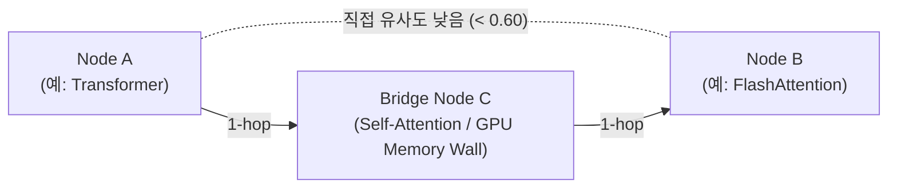

# Ideas: Missing Links Over Two Hops

- **Status**: Ideas only. They have no design for implementation. Do not implement from this document. A design starts only after an owner decision.
- **Date**: 2026-11-20
- **Source**: Taken out of [`KNOWLEDGE_GRAPH_LINKING_AND_CALIBRATION_DESIGN.md`](../design/KNOWLEDGE_GRAPH_LINKING_AND_CALIBRATION_DESIGN.md) (section "Planned work: Phase 3") on 2026-11-20 (owner). The design document keeps the principles of the implemented part.

---

The multi-hop band is collected by the resolver, but no code makes edges from it.

서로 직접적인 코사인 유사도가 낮은(예: `< 0.60`) 두 노드 $A$와 $B$ 사이에 존재하는 숨겨진 연결 고리를 탐색하고 실증한다.

### 핵심 가설 (Hypotheses)
1. **삼각 폐쇄 가설 (Triadic Closure Hypothesis)**:
   - 두 노드 $A$와 $B$가 공통으로 높은 유사도를 갖거나 기존 엣지로 연결된 매개 노드 $C$(Bridge Node)가 존재할 경우, $A-B$ 간의 잠재적 관계 성립 확률은 기저 확률보다 유의미하게 높다.
2. **잠재 브릿지 노드 역생성 (Latent Bridge Node Hypothesis)**:
   - Tier 4(`[0.55, 0.70)`) 후보군 쌍에 대해 LLM에게 두 개념의 기술적 교집합(Missing Link)을 유추하게 하면, 지식베이스에 아직 수집되지 않은 새로운 핵심 연구/개념 $C$를 역으로 도출하여 능동적 수집(Active Ingestion) 대상으로 지정할 수 있다.

### 미구현 구성 요소
- Adamic-Adar 기반 위상적 삼각 폐쇄 점수 산출기($S_{TC}$).
- 중간 벡터 프로브($\mathbf{q}_{bridge} = \frac{\mathbf{e}_u + \mathbf{e}_v}{\|\mathbf{e}_u + \mathbf{e}_v\|_2}$) 및 LLM 브릿지 개념 역추론 모듈.
- 온톨로지 2-Hop 규칙 전이(Rule-based Transitivity) 엔진.
- 50쌍 골든 데이터셋 및 Leave-bridge-out 벤치마크 측정 도구.

### 실증(Empirical Verification) 벤치마크 설계
- **검증 데이터셋**:
  - 이미 학술적으로 정립된 2-hop 기술 관계 체계 (예: `LoRA` $\rightarrow$ `PEFT` $\rightarrow$ `QLoRA`, `DDPM` $\rightarrow$ `Score-based SDE` $\rightarrow$ `Classifier-Free Guidance`).
- **평가 지표**:
  1. **Link Prediction Hit@K & MRR**: 의도적으로 1개 중간 엣지를 가렸을 때, 미싱링크 탐색 알고리즘이 해당 엣지를 상위 $K$개 내에 복원하는 비율.
  2. **그래프 고립 컴포넌트(Isolated Component) 감소율**: 단절되어 있던 서브그래프들이 유효한 관계를 통해 메인 클러스터로 편입되는 비율.
  3. **거짓 양성 노이즈(False Positive) 비율**: 전문가 평가 또는 온톨로지 유효성 검증을 통과하지 못한 무의미한 엣지의 비율 (목표: < 5%).
