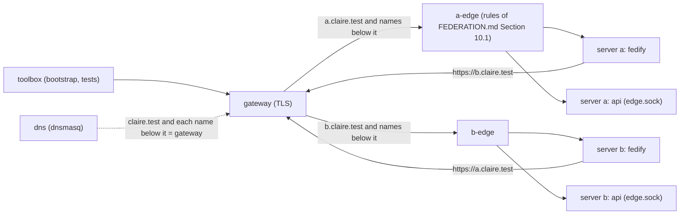

# Development Network (Implemented Part)

- **Date**: 2026-11-26
- **Design**: [`CONTRIBUTOR_DEVELOPMENT_ENVIRONMENT_DESIGN.md`](../design/CONTRIBUTOR_DEVELOPMENT_ENVIRONMENT_DESIGN.md) Sections 6 and 8.4 (phases DE2 and DE4), and the acceptance steps KA1 to KA3 of [`KNOWLEDGE_FEDERATION_DESIGN.md`](../design/KNOWLEDGE_FEDERATION_DESIGN.md) Section 14.2.
- **Readers**: agents and contributors who run two Claire servers with real sidecars, real TLS, real DNS, and the reverse proxy of production.

This document tells what exists now. Section 5 lists the parts of the design that are not implemented and the differences from the design.

---

## 1. Parts



| Part | Files | Function |
| :--- | :--- | :--- |
| Core project `claire-devnet` | `ops/dev/devnet/compose.core.yml` | `certs` (a one-shot job: `certs.sh` with the `openssl` of the Claire image, as the user of the host), `dns` (`dns.Dockerfile`: dnsmasq on the edge base image), `gateway` (`nginx:1.30.7-alpine`, `gateway.conf`) |
| Server projects `claire-devnet-a`, `claire-devnet-b` | `docker-compose.yml` with the overlay `ops/dev/devnet/compose.server.yml` | The services of production with the edge service. The overlay changes only the networks, the DNS, the host ports (none), the trust of the private authority, the limits, and the profile of `bot` |
| Toolbox `claire-devnet-toolbox:devnet` | `ops/dev/devnet/toolbox.Dockerfile` | The Claire image of the network with the extra `dev` of `uv.lock` (pytest). It runs the bootstrap and the tests on the network `claire-devnet-edge` |
| Bootstrap | `ops/dev/devnet/bootstrap.py` | The first setup of one server through the gateway: it opens the one-time login link (`claire auth --scope owner --json`), completes `/setup` with the USERNAME `keeper` and a random password, and writes the state file |
| Command | `ops/devnet.py` (called by `ops/cb_manuscript.py` for `dev devnet`) | `up`, `check`, `test`, `info`, `down`. Only the standard library of the host Python |
| Tests | `tests/test_devnet.py` (marker `devnet`, registered in `pyproject.toml`; gate `CB_DEVNET_TEST=1`) | KA1 and KA2, phase DE4, and one test for each completion criterion of KF1 to KF5 (KA3) |
| Model test | `tests/test_federation_compose.py` (`test_compose_model_of_the_development_network_…`) | `docker compose config` of the overlay with the environment of the command: the mount rule of the sidecar, no route out for the sidecar, no host port |

## 2. Rules of the Network

1. **Names.** Server a is `https://a.claire.test`, server b is `https://b.claire.test` (`CLAIRE_FQDN`, `CLAIRE_ENVIRONMENT=development`; decision CD4 gives the https origin). The DNS answers `claire.test` and each name below it with the address of the gateway (`172.31.250.2`, constant `EDGE_PREFIX` in `ops/devnet.py`) and sends each other name to the resolver of Docker.
2. **TLS.** The `certs` job makes one private authority (EC P-256, 365 days) at the first `up` and a server certificate for `claire.test`, `*.claire.test`, `*.a.claire.test`, and `*.b.claire.test` at each `up`. The run folder `.dev/devnet/tls/` has `ca/ca.crt` (the parties trust it), `server/` (the gateway), and `private/` (the key of the authority, mode 0600). The Claire services get `ca/` as `CB_CERTS_DIR` (the entrypoint adds it to the system trust store); the sidecar gets `ca/ca.crt` with `DENO_CERT`; the toolbox gets `ca/` as `/extra-certs`.
3. **Gateway.** The gateway is the only end of TLS, as the external reverse proxy of a production server: it sends each request of a name of server a to `a-edge:8080` (and b to `b-edge:8080`) with the `Host` as it came, `X-Forwarded-For`, and `X-Forwarded-Proto: https`. It has no path rule: the edge service of each server has the rules of `ops/edge/claire/routes.conf`. A name of no server gets 421. The gateway resolves the alias at each request, so it runs also when a server does not run.
4. **Networks.** `claire-devnet-edge` (internal, `172.31.250.0/24`): the gateway, the DNS, the edge services, the Claire services, the sidecars, and the toolbox. `claire-devnet-out`: the route to the internet of the Claire services and the DNS. The network of each server project is internal. Thus a sidecar has no route out.
5. **Data.** Each server has a run subfolder `.dev/devnet/{server}/` with `data/` (bind mount, as production) and `plugins/`; `CB_BIN_DIR` is an empty folder, so no host tool goes into the containers. The env file `.dev/devnet/{server}.env` (mode 0600) has `CLAIRE_FQDN`, `CLAIRE_PROVIDER=mock`, `CLAIRE_ALLOW_PRIVATE_NETWORKS=1`, `CLAIRE_TRUSTED_PROXIES` (the gateway), and a new `CLAIRE_INJECT_TOKEN` at each `up`. `claire migrate` runs in a one-shot container before the services start, and it makes the service key of the sidecar.
6. **Images.** Tag `devnet` (`claire-bible:devnet`, `claire-bible-fedify:devnet`, `claire-bible-edge:devnet`, `claire-devnet-toolbox:devnet`, `claire-devnet-dns:1`), so the images of another stack on the host do not change. `up` builds them each time (layer cache).
7. **State file.** `.dev/devnet/state.json` (mode 0600) has the origin, the USERNAME, the password, and the first session of the admin of each server. The tests sign in again with the password (a recent sign-in for the step-up routes). No secret is in the repository; `down` deletes the run folder.

## 3. Commands

```bash
./cb-manuscript dev devnet up --servers a,b      # build, start the core and the servers, first setup of each server (about 40 s with a warm cache)
./cb-manuscript dev devnet check                 # claire server check --federation of each running server; exit 1 when a required check fails
./cb-manuscript dev devnet test                  # pytest -m devnet tests/test_devnet.py in the toolbox; other pytest arguments replace the file
./cb-manuscript dev devnet info                  # the running servers, the authority file, the state file
./cb-manuscript dev devnet down                  # remove the containers, the networks, the volumes, and .dev/devnet
```

Options of `up`: `--servers a` or `--servers a,b` (necessary; the first server is a), `--bot` (starts the Telegram bot runner).

## 4. Tests of the Network (KA1 to KA3)

The tests act only through the public routes and the federation paths, through the gateway: the admin routes with the admin of the state file, the account routes, WebFinger, and the federation of the sidecars. No test writes a row in a database or calls an internal route. Each run makes new names (a random suffix), so the tests can run again on the same network. A wait has a time limit of 200 seconds and polls each second.

| Test | Step | What it shows |
| :--- | :--- | :--- |
| `test_ka1_ka2_readiness_of_both_servers` | KA1, KA2 | On a and b each required check of GF1 to GF16 passes, GF15 applies (each server gets a shared knowledge base), and GF17 passes |
| `test_de4_a_reads_the_server_of_b_through_the_gateway` | DE4 | After the admin of A adds `b.claire.test`, the sidecar of A reads NodeInfo and the server actor of B (`software_name` `claire-bible`, no error) |
| `test_ka3_kf2_…` | KF2 | A shared knowledge base of B is in a theme of A after the judgement run of A, with its server and its origin link, and the root page of A (network mode) links to it |
| `test_ka3_kf4_…` | KF4 | `Offer` through the theme; the reviewer of B approves; `Accept` with `result` on the submission page of A; `Grant`; a direct contribution is accepted without a reviewer (`with_grant`); `Revoke`; a direct choice gets 403 `grant_required` on A; an offer through the theme waits, and `Reject` with `off_subject` reaches A |
| `test_ka3_kf3_…` | KF3 | A curates a document of B (the documents collection, the document with its extraction); `Follow` and `Accept`; B fetches its web page again with a new content, and `Update` gives the copy on A the new version without approval; a removal on B sends `Delete`, and the copy on A is hidden in the review queue with the reason `spam` |
| `test_ka3_kf5_…` | KF5 | With `kb_auto_contribution` on both servers and a rule of the account of A, a new shared knowledge base of B gets the matching web documents of A as pending contributions with the origin `auto` (not the document of another subject); an approval on B reaches the list of A |
| `test_ka3_kf1_…` | KF1 | B knows A after the contributions; the root of B (single mode) gives 302 to `/@keeper/`; when B blocks A, the next read of the `/kb` collection of B by A fails (`collection_unavailable`: the sidecar of A does not keep the status 404), and after the block the read works again |

How the tests make their data through public routes:

1. **Documents with chosen entities.** The tests use the path of the agent client: `POST /api/v1/extraction/stage`, `…/claim`, and `…/submit` with an extraction of the test (`schema_version` `agent-extract-v1`, entity type `Concept`). The summary must not be a slice of the text (lint `summary_raw_slice_200`).
2. **Shared knowledge bases** take documents only by contribution (`kb_ingest_by_contribution`): the founder contributes documents of its personal knowledge base. Six documents with three entities each give a knowledge base a signature.
3. **Web pages.** A test serves pages from the toolbox container (`_Page`, a thread of `http.server` on the network); the servers fetch them (`CLAIRE_ALLOW_PRIVATE_NETWORKS=1`). The fetcher refuses a thin body ("본문 빈약", about 220 characters), so each page has twelve paragraphs. The automatic contribution never sends a pasted text (design Section 9.9 rule 2), so the documents of KF5 are web pages.
4. **Accounts.** The admin of each server is the actor of the tests (the contributor on A, the founder and the reviewer on B). A member of a server has no mock provider: the server tier accepts only `none` and `gemini`. The admin uses the provider of the server (`mock`).
5. **A new read of the `/kb` collection of B.** The read of a known server is daily. The admin of A removes B as a known server and adds it again (`DELETE` and `POST /api/admin/federation/known-servers`); a new known server is read at once.

Results on 2026-11-26 (Linux, Docker 29.10.0, the host of the owner): a run from nothing (`down`, `up --servers a,b`, `check`, `test`) passed all 7 tests in 344 seconds, and a second `test` on the same network passed in 292 seconds. No container had an OOM kill or a restart. `check` shows only the warning GF19 (`no_inbound`) before the first exchange.

**A defect that the network found.** The first run from nothing failed on server b: GF12 `actor_keys_decrypt_failed` and GF11 `loop_stalled`, and then each exchange of B. `claire migrate` does not make `data/auth/master.key`; the api and the three workers start at the same time, and `SecretService` made the file with a check and a write that were not atomic, so two processes could each write their own key. The fix (2026-11-26, `src/claire/store/secrets.py`, test `tests/test_secrets.py::test_processes_that_start_together_make_one_master_key`) puts the new key at the path with a hard link only when no file is there ([`OPERATIONS.md`](OPERATIONS.md), table of the files). A server that lost this race before the fix still has actor keys that its master key cannot decrypt: GF12 shows it.

Memory (`docker stats`): idle, each server about 450 MiB (api about 115 MiB, each worker about 64 MiB, sidecar about 125 MiB, edge about 14 MiB); after the tests, api about 470 to 500 MiB of its 1 GiB limit and the sidecar about 135 MiB of its 256 MiB limit; the gateway and the DNS less than 10 MiB each. The two servers used about 1.9 GiB after the tests.

## 5. Not Implemented, and Differences from the Design

| Item | State |
| :--- | :--- |
| `access` proxy for a browser of the host (Section 6.7, open question DQ2) | Not implemented. `devnet info` says so. The WebUI of a server of the network cannot be opened from the host now |
| Named volumes (Section 6.8 rule 1) | Not taken: the data folders are bind mounts in `.dev/devnet/`, as in production, so the overlay does not replace the mounts of `docker-compose.yml`. The reason of the design (Docker Desktop) is not verified here: only Linux ran |
| Copy job of the service key (Section 6.6) | Not needed with bind mounts: the sidecar mounts `data/auth/fedify_service.key` as in production |
| Gateway path rules and the Nginx example of EXTERNAL_ACCESS.md from one file (Section 6.5 rule 1) | The edge service (unit GL3) has the rules in production now; the gateway has only TLS and the server selection. EXTERNAL_ACCESS.md is not made from `gateway.conf` |
| Fault profiles of the gateway (Section 6.5 rule 4, phase DE5) | Not implemented |
| Full toolbox of phase DE1 (Deno, Node.js, Playwright, multi-architecture builds, `scripts/ci.sh` in the toolbox) and phase DE3 | Not implemented. The toolbox of the network has Python and pytest only |
| macOS and Windows with WSL2 (criteria of DE2 and DE4), DrFed in the toolbox, finding F12 | Not done |
| Bootstrap: a shared knowledge base with fixture texts, and the switch `federation` (Section 6.6) | The switch was removed by decision GD4. The readiness test makes a shared knowledge base when a server has none |
| Contributor documents (phase DE6) | Not written |
