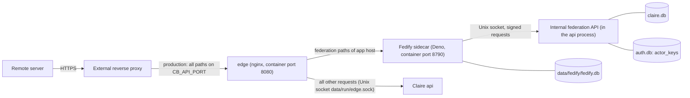
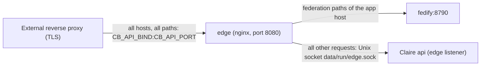

# Federation Implementation Reference

Basis: 2026-11-22 (phases FP1 to FP4, units GL1 to GL3, owner decisions GD2 revised and GD4 to GD8, and contract 1.15; base sections examined from commit `d15ae8e0`). Readers: agents and operators who change or operate the Fedify sidecar federation.

Design principles: [`ACCOUNT_IDP_AND_FEDIFY_SIDECAR_INTEGRATION_DESIGN.md`](../design/ACCOUNT_IDP_AND_FEDIFY_SIDECAR_INTEGRATION_DESIGN.md) (phases FP1 to FP3), [`FEDERATION_REMOTE_READING_DESIGN.md`](../design/FEDERATION_REMOTE_READING_DESIGN.md) (phase FP4 and the work that waits), and [`FEDERATION_GO_LIVE_DESIGN.md`](../design/FEDERATION_GO_LIVE_DESIGN.md) (units GL1 to GL4 and owner decisions GD1 to GD8). This document tells what the code does now. Section 13 lists choices that the code made in phases FP1 to FP3.

## 1. Scope and State

Phases FP1 to FP3 and all units of phase FP4 are implemented. A remote server can resolve the handle `@username@{host}` to an actor document, get the public keys of the actor, and follow the actor. An account owner can publish documents of a public personal knowledge base to followers, follow remote actors, read their posts, and reply, favourite, boost, and quote (for every federation actor). The admin can block domains.

| Function | State |
| :--- | :--- |
| WebFinger, NodeInfo, actor document (`discoverable` from `profile_public`, contract 1.15), server actor | Implemented (Sections 3 and 4.1) |
| Internal federation API: `config`, `heartbeat`, `actors`, `keys` | Implemented |
| Actor keys in `auth.db` | Implemented |
| Edge service: one upstream for the external reverse proxy, always active in production with the rules of Section 10 in the repository (no `CB_EDGE` switch) | Implemented (unit GL3, revised GD2 2026-11-22). Section 10.1 |
| Federation without a switch (owner decision GD4, 2026-11-22): no server setting `federation`, no container switch `CB_FEDERATION`; the sidecar is a service of each installation | Implemented. Section 7.1 |
| Readiness checks GF1 to GF20 (a report of the state, not a gate) | Implemented (API, CLI, and the console section `/admin/federation`). Answer attribution, path record, and traffic counters: Section 7.2 (units GL1 and GL2, 2026-11-22) |
| Alternate link on the profile page; `PATCH /api/me` changes `profile_public` with no step-up confirmation (Section 8.1, decision GD6) | Implemented |
| `claire.db` version 17: followers, tombstones, domain blocks (Section 5.6) | Implemented (FP2-1) |
| Internal federation API: `inbox-events`, `followers`, `domain-blocks` (Section 5.3) | Implemented (FP2-2). The sidecar uses them for the inboxes and the followers collection (FP2-3). |
| Public inboxes, `Accept(Follow)`, public followers collection, blocked domains in the sidecar (Section 4.3) | Implemented (FP2-3) |
| Management of followers and domain blocks: API and console sections `/account/federation` and `/admin/federation` (Section 7.5) | Implemented (FP2-4) |
| `claire.db` version 18: published objects and the outbox; routes `POST /api/federation/publish` and `POST /api/federation/retract` (Section 7.6) | Implemented (FP3-1). `publish` requires an active actor and a public personal KB (decision GD8: `profile_public` is not a gate). |
| Internal federation API: `outbox-tasks`, task acknowledgement, `objects`, `actors/{public_id}/outbox` (Section 5.8) | Implemented in Claire, with client functions in the sidecar (FP3-2) |
| Sidecar task poller, delivery of `Create`, `Update`, and `Delete` of an `Article` to followers, public object path and outbox collection (Section 4.4) | Implemented (FP3-3) |
| Lifecycle tasks (`Update(Person)`, purge with `Delete(Person)` and the skip option) and privacy triggers (private KB, purged document, deleted KB) (Section 8.5) | Implemented (FP3-4). `update_profile_public` enqueues `update_actor` (decision GD7). |
| Native actor as a target in the dialog of `/syndication` (Section 7.7), recovery command `claire federation requeue` (Section 7.4) | Implemented (FP3-5) |
| Account feeds: `claire.db` version 21, poller, OPML import and export, routes `/api/feeds*`, command `claire feeds poll` (Section 15). They need no actor and work in single mode. | Implemented (FP4-F1, FP4-F2) |
| Feed view in `/syndication`: tree of folders and feeds, list, reader in the sandbox frame, link share, star, read state, feed discovery, ingest of one item, merge by URL with the timeline (Section 23). It works in single mode. | Implemented (FP4-F3) |
| Inbound posts: `client.db` version 2 (`federation_timeline_items`), internal endpoints `timeline-events` and `timeline-interest`, fan-out, the timeline rule, and the parent chain (Section 18) | Implemented (FP4-4) |
| Federation client: timeline routes, render route with the `remote` token, ingest of one item, stage bar and client view in `/syndication`, context menu with the Markdown export, console fields of the reading settings (Section 19) | Implemented (FP4-5). Reply, favourite, and boost: Section 25. |
| Media storage backends: local default, S3-compatible object storage (reference server: Garage), console section `/admin/storage` with its routes and the connection test, read fallback to local storage, command `claire media migrate` (Section 20) | Implemented (FP4-1) |
| Media proxy: `client.db` version 3 (`federation_media_cache`), route `/media/remote/{url_hash}` with the media token, fetch rules, media in the body of an item, cleanup of entries, command `claire federation prune` (Section 21) | Implemented (FP4-7) |
| Inbound interactions with the account: `client.db` version 4 (`federation_object_reactions`, `federation_auto_replies`), contract 1.4, mentions and replies of actors that are not followed, counters of `Like` and `Announce` on published documents, mention rate limit, automatic notice for a non-public message (Section 22) | Implemented (FP4-8) |
| Thread fetch: route `POST /api/federation/timeline/{item_id}/context`, task `fetch_context` of the client outbox, internal endpoints `context-tasks` and `context-objects`, contract 1.5, sidecar fetch with `@fedify/backfill` (Section 24) | Implemented (FP4-6) |
| Outbound interactions: `client.db` version 5 (`federation_notes`), contract 1.6, reply, new note, edit, delete (410), content warning, language, hashtags, favourite and boost with their undo, counters of own notes, compose controls of the client (Section 25) | Implemented (FP4-9). Works for every federation actor regardless of `profile_public` (decisions GD7 and GD8). |
| Quotes (FEP-044f): `client.db` version 6 (quote columns of `federation_notes`, `federation_quote_authorizations`), contract 1.7 (the quote policy of a published document of `claire.db` version 24 does not exist since version 49: a published document is always quotable, Section 26.4 rule 3), outbound `QuoteRequest` with the quote states, inbound requests with the quote policy, the authorization path `/ap/quote-authorizations/{id}` with 410 after a revoke, quote controls of the client (Section 26) | Implemented (FP4-9Q). Quote requests, approvals, refusals, and revocations for both own notes and published KB documents work for every federation actor regardless of `profile_public` (decision GD8). |
| End-to-end with a remote server and retention: the DrFed 0.1.0 test stack in Docker with scenarios of a real Claire process and its sidecar, the development switch `allow_private_addresses` (contract 1.8), the retention run of the timeline items in the daily cleanup and in `claire federation prune` | Unit FP4-10 complete. See Section 27. |
| Collections of an own object (phase E6 of [`DOCUMENT_RENDITIONS_AND_PUBLICATION_DESIGN.md`](../design/DOCUMENT_RENDITIONS_AND_PUBLICATION_DESIGN.md), contract 1.19, `client.db` version 10): `replies`, `likes`, and `shares` on each published document and own note, and the paths `/ap/objects/{id}/replies`, `/likes`, `/shares` | Implemented (Section 4.5) |
| Rendition objects (phase E4b of [`DOCUMENT_RENDITIONS_AND_PUBLICATION_DESIGN.md`](../design/DOCUMENT_RENDITIONS_AND_PUBLICATION_DESIGN.md), contract 1.20, `claire.db` version 52): one object for each published rendition that is not the 대표 정리본, the `claire:` fields of each object at its ID, the collection `claire:renditions`, and the signed body path `/ap/objects/{id}/body` | Implemented (Section 4.6) |

The sidecar makes these outbound requests: the public self-check to the public origin of this server (Section 7.2), signed fetches of remote actor documents and keys for the signature check of an inbox activity, deliveries of `Accept` and `Reject` for a `Follow` (Section 4.3), deliveries of published objects to the inboxes of followers (Section 4.4), deliveries of own notes, favourites, and boosts with the fetches of the actors that get them (Section 25), and deliveries of the quote activities with the fetch of the authorization of an `Accept` (Section 26).

## 2. Architecture



- Claire is canonical. The sidecar reads account data through the internal API for each request. The sidecar stores no account data.
- Control goes in one direction: the sidecar calls Claire. Claire does not call the sidecar.
- Claire does not register the federation paths. A federation path that gets to the Claire public listener returns 404, because it is not in `ROUTE_POLICY`.
- The sidecar returns 404 for all paths that are not federation paths, without a call to Claire.

| File | Function |
| :--- | :--- |
| `src/claire/api/federation_internal.py` | Unix socket listener, `ListenerRouter`, service key, `SignedRequestMiddleware`, `sign_request` |
| `src/claire/api/federation_routes.py` | Route table and sealed models of the internal API, `CONTRACT_VERSION`, `read_heartbeat` |
| `src/claire/store/actor_keys.py` | Key generation, encrypted storage, `ensure_actor_keys`, `load_actor_keys` |
| `src/claire/accounts/federation_readiness.py` | Readiness checks GF1 to GF20, answer attribution |
| `src/claire/api/accounts_routes/federation.py` | `GET /api/admin/federation` |
| `sidecar/fedify/src/internal_api.ts` | Signed client of the internal API with sealed response shapes |
| `sidecar/fedify/src/sidecar.ts` | WebFinger, NodeInfo, actor documents, server actor, public self-check, knowledge self-check (`/ap/self-check`), loop states |
| `sidecar/fedify/src/probes.ts` | Answer attribution of a self-check request, path record of the public host, traffic counters |
| `ops/edge/`, `src/claire/api/edge_listener.py` | Edge service (always active in production, Section 10.1): the image with the reverse proxy rules and the edge listener of Claire |
| `sidecar/fedify/src/main.ts` | Entry point: database, Unix socket client, heartbeat, HTTP listener |

## 3. Actor Rule

An account is a federation actor only when all these conditions are true:

1. The account status is `active`.
2. The account has a USERNAME.

`profile_public` is not a condition of the actor ([`FEDERATION_GO_LIVE_DESIGN.md`](../design/FEDERATION_GO_LIVE_DESIGN.md) decisions GD5, GD7, and GD8, 2026-11-22). Every `active` account with a USERNAME is a federation actor (`_is_actor`), and existence-hiding rule `N1` is withdrawn (decision GD8): `/@{username}/...` resolves in network mode for every `active` account with a USERNAME regardless of `profile_public`, and active entries in `username_tombstones` always return `410 Gone`. Following Mastodon and Fedify defaults (decision GD7), `Person.discoverable` is `bool(accounts.profile_public)` and `manuallyApprovesFollowers` stays `false` (FD9). Under decision GD8, `profile_public` controls ONLY discovery (`Person.discoverable` and `/directory` directory inclusion) and search engine indexing (`noindex, nofollow` and `/sitemap.xml` exclusion); personal KB visibility (`knowledge_bases.is_public`), KB document publishing, notes, favourites, boosts, quotes, and Knowledge Federation participation work for every active actor regardless of `profile_public` (Section 3.1).

The server has no condition: federation has no switch (Section 7.1), and the rule is the same in the two server modes (`KNOWLEDGE_FEDERATION_DESIGN.md` Section 15 rule 5, KD2).

All other states give the same 404 on the internal API (`{"error": "not_found"}`) and on the public paths of the sidecar (`Not Found`, `text/plain`). This includes an unknown account, an account without a USERNAME, a suspended account, an account in deletion, a purged account that was never an actor, and a public ID that is not a positive decimal number of 19 digits or less without a leading zero. An account that was an actor at its purge gives 410 (Section 8.5).

### 3.1 Private-Profile Behaviour (`profile_public`)

Under owner decision GD8 (2026-11-22, Model 1), `profile_public` controls only discovery and search indexing: `Person.discoverable`, inclusion in the public directory (`/directory`), `noindex, nofollow` robots directives on `/@{username}/` HTML pages, and exclusion from `/sitemap.xml`. It does not gate ActivityPub actors, personal KB visibility (`knowledge_bases.is_public`), KB document publishing, quotes, or Knowledge Federation participation. The actor rule (`_is_actor` in `src/claire/api/federation_routes.py` and `actor_state` in `src/claire/api/accounts_routes/console_federation_panels.py`) and `knowledge_bases.is_public` apply independently.

| Function | Account with a private profile (`profile_public` 0) |
| :--- | :--- |
| **Discovery and search indexing (`profile_public` 0)** | |
| `Person.discoverable` and `GET /api/federation/status` (`discoverable`) | `false` (`true` when `profile_public` is 1); toggling `profile_public` enqueues `update_actor` (`Update(Person)`) without step-up authentication |
| Public directory (`/directory`) | Omitted (`GET /directory` lists only `active` accounts with `profile_public` 1, [`ACCOUNTS.md`](ACCOUNTS.md)) |
| Search engine indexing under `/@{username}/` and `/sitemap.xml` | In network mode, HTML responses under `/@{username}/` (`GET`/`HEAD /@{username}/` and HTML `GET /@{username}/kb`) emit `<meta name="robots" content="noindex, nofollow"/>` and `X-Robots-Tag: noindex, nofollow`, and `/sitemap.xml` excludes that account's personal KB |
| **Identity, personal KB visibility, and ActivityPub federation (independent of `profile_public`)** | |
| Identity resolution at `/@{username}/...` and username tombstones (`username_tombstones`) | `/@{username}/...` resolves in network mode for every `active` account with a USERNAME regardless of `profile_public` (rule `N1` withdrawn); active `username_tombstones` return `410 Gone` regardless of `profile_public` |
| Personal KB workspace at `/@{username}/` and `/kb/{number}/` | Gated solely by `knowledge_bases.is_public`: when `is_public` is 1 (or the caller is the owner), Claire renders the workspace (with `noindex, nofollow` when `profile_public` is 0 in network mode); when `is_public` is 0 and the caller is not the owner, `GET`/`HEAD /@{username}/` returns the HTTP 200 User Home profile page (`src/claire/api/templates/private_profile.html`) with `rel="alternate"`, `Link` header, `Cache-Control: no-store`, actor `summary`, public `Note` timeline, and always-public KB summary (`label`, counts, last ingestion date), while personal KB subpaths (`/@{username}/graph`, `/@{username}/documents`, and other subpaths) and `/kb/{number}/` return 404 |
| WebFinger, actor document (`Person` with `discoverable: false`, `manuallyApprovesFollowers: false`), keys, inbox, followers collection, following collection | Same as with `profile_public` 1 (only `discoverable` changes) |
| Inbound `Follow` from another server, follow of a remote actor, remote timeline, mentions, notifications, thread fetch, automatic notice for a non-public message | Same as with `profile_public` 1 (auto-accepted `Accept(Follow)`) |
| `Update(Person)` after a change of display name, USERNAME, or `profile_public` (`discoverable`), and `Delete(Person)` at a purge | Enqueued and sent |
| Own `Note`s (`POST`, `PATCH`, `DELETE /api/federation/notes*`), favourites (`Like`/`Undo`), boosts (`Announce`/`Undo`), own `Note`s at `/ap/objects/{id}` and `outbox`, inbound reactions and quotes on own `Note`s | Same as with `profile_public` 1 (`409 not_actor` only; `lease_interaction_tasks` leases all `INTERACTION_KINDS`) |
| Published KB documents (`POST /api/federation/publish`, `POST /api/federation/retract`, `Article` at `/ap/objects/{id}` and `outbox`, `create`/`update`/`delete` outbox tasks, inbound `Like`/`Announce`/`Undo`/`QuoteRequest`, `PATCH /api/federation/quotes/{quote_id}`) | Same as with `profile_public` 1 — gated only by active actor status and KB `knowledge_bases.is_public` + `not document.hidden` (`profile_public` is not a gate) |
| Shared KB member views (`/kb/{kb}/members`, `/kb/{kb}/membership`, `/kb/{kb}/members/{account}`), contributor credit (`attributedTo`), network-mode root-page recent activity (`recent.py`), Knowledge Federation `Offer` (`offers.send`, `auto_contribution.remote_state`, `/api/auto-rule/dry-run`) | Same as with `profile_public` 1 — active accounts with a USERNAME include `username`, credit, and remote offers regardless of `profile_public` ([`KNOWLEDGE_FEDERATION.md`](KNOWLEDGE_FEDERATION.md) Sections 12.2, 13.4, 15.4, and 16.1) |

- Toggling `profile_public` enqueues `update_actor` (`Update(Person)` with the updated `discoverable` boolean); it sends no `Delete` for published KB `Article`s and holds no KB outbox tasks (personal KB privacy triggers follow `knowledge_bases.is_public`, Section 8.5).
- The actor document has `url` `{origin}/@{username}/`. In network mode, `/@{username}/` resolves for every `active` account with a USERNAME regardless of `profile_public`: if the personal KB has `is_public` 1 (or the caller is the owner), Claire renders the workspace (adding `noindex, nofollow` when `profile_public` is 0); if `is_public` is 0 and the caller is not the owner, `GET`/`HEAD /@{username}/` returns the HTTP 200 basic profile card (`src/claire/api/templates/private_profile.html`) with `rel="alternate"` and the `Link` header while personal KB subpaths return 404 (Section 8.2). Active entries in `username_tombstones` return `410 Gone` regardless of `profile_public`.

The actor ID contains `accounts.public_id`, not the USERNAME: `{origin}/ap/actors/{public_id}`. `{origin}` is the canonical origin that Claire supplies in `config` (`WebRuntimeConfig.public_origin`). The sidecar does not read the request `Host` header to make a URL.

## 4. Public Paths of the Sidecar

The paths are the same in the two server modes. No server state makes them 404.

| Method | Path | Answer |
| :--- | :--- | :--- |
| `GET` | `/.well-known/webfinger?resource=acct:{username}@{handle_host}` | JRD. Lookup ignores ASCII letter case on `{username}`. `subject` is the requested `acct:` URI, the `self` link (type `application/activity+json`) is `{origin}/ap/actors/{public_id}`, and `http://webfinger.net/rel/profile-page` uses the stored display case `{origin}/@{accounts.username}/`. |
| `GET` | `/.well-known/nodeinfo` | Link to `{origin}/nodeinfo/2.1` |
| `GET` | `/nodeinfo/2.1` | `software.name` `claire-bible`, `software.version`, `protocols` `["activitypub"]`, `openRegistrations` `false`, `usage.users.total` = number of federation actors, `localPosts` 0, `localComments` 0 |
| `GET` | `/ap/actors/{public_id}` | Actor document of type `Person` |
| `GET` | `/ap/actors/server` | Server actor of type `Application` |
| `POST` | `/ap/actors/{public_id}/inbox` | Personal inbox (Section 4.3) |
| `POST` | `/ap/inbox` | Shared inbox (Section 4.3) |
| `GET` | `/ap/actors/{public_id}/followers` | `OrderedCollection` with `totalItems` and no follower |
| `GET` | `/ap/actors/{public_id}/following` | `OrderedCollection` with `totalItems` only (Section 17) |
| `GET` | `/ap/actors/{public_id}/outbox` | `OrderedCollection` of public objects (published KB `Article`s whose personal KB is public and own `Note`s, for all actors regardless of `profile_public`), in pages (Section 4.4) |
| `GET` | `/ap/objects/{object_public_id}` | Published KB object of type `Article` (while the personal KB is public and the document is not hidden) or own `Note` (for all actors), or 410 with a `Tombstone` (Section 4.4, Section 25) |
| `GET` | `/ap/quote-authorizations/{id}` | Quote authorization, or 410 after a revoke (Section 26) |
| `GET` | `/ap/kb`, `/ap/themes` | Collections of shared knowledge for a request that a server actor signed; 404 for each other request ([`KNOWLEDGE_FEDERATION.md`](KNOWLEDGE_FEDERATION.md) Sections 10.6 and 11.2) |
| `POST` | `/ap/kb/{number}/inbox` | Inbox of a knowledge base actor: only an activity of the knowledge federation ([`KNOWLEDGE_FEDERATION.md`](KNOWLEDGE_FEDERATION.md) Section 10.6) |

Rules of the sidecar (`sidecar/fedify/src/sidecar.ts`):

- The sidecar accepts only these paths: exact `/.well-known/webfinger`, exact `/.well-known/nodeinfo`, exact `/nodeinfo/2.1`, and paths below `/ap/`. `/nodeinfo/2.0` returns 404.
- The sidecar removes these request headers before Fedify gets the request: `Cookie`, `Authorization`, `Forwarded`, `X-Forwarded-For`, `X-Forwarded-Host`, `X-Forwarded-Proto`, `X-Forwarded-Port`. A response has no `Set-Cookie` header.
- An actor request with an `Accept` header that does not permit an ActivityPub format gets 406.
- If the internal API is not available, the answer is 503 with `Retry-After: 5`. The sidecar does not give a 404 or an old answer in this condition.
- The sidecar caches the `config` answer for 5 seconds. Thus a change of the mode has an effect on NodeInfo after 5 seconds at most. An actor path stops immediately, because Claire refuses the actor record.

### 4.1 Actor Document (`Person`)

| Property | Value |
| :--- | :--- |
| `id` | `{origin}/ap/actors/{public_id}` |
| `type` | `Person` |
| `preferredUsername` | `accounts.username` (preserves stored display case) |
| `name` | `accounts.display_name` |
| `summary` | Escaped `accounts.summary` wrapped in `<p>...</p>` when non-empty (plain text, max 500 characters; omitted when empty, contract 1.16) |
| `url` | `{origin}/@{accounts.username}/` |
| `inbox` | `{origin}/ap/actors/{public_id}/inbox` |
| `endpoints.sharedInbox` | `{origin}/ap/inbox` |
| `publicKey` | RSA 2048 public key. The key ID is `{actor ID}#main-key`. |
| `assertionMethod` | Multikey entries for the keys of the actor, with the Ed25519 key |
| `published` | `accounts.activated_at`. The sidecar sets no value when the account has no activation time. |
| `discoverable` | `bool(accounts.profile_public)` (`true` when `profile_public` is 1, `false` when 0; Mastodon default, decision GD7, contract 1.15) |
| `manuallyApprovesFollowers` | `false` |

- `outbox` is `{actor ID}/outbox`, `followers` is `{actor ID}/followers`, and `following` is `{actor ID}/following` (`Sidecar.#person` in `sidecar/fedify/src/sidecar.ts`).
- The document has no `icon` property; `summary` is emitted only when `accounts.summary` is non-empty.
- The document has no email address, no external identity value, no server role, and no internal `accounts.id`.

### 4.2 Server Actor

- Path `/ap/actors/server`, type `Application`, `preferredUsername` `claire`, `name` = the handle host, `manuallyApprovesFollowers` `true`.
- The WebFinger handle is `acct:claire@{handle_host}` (WebFinger lookup is case-insensitive). `claire` is in `RESERVED_USERNAMES`, so no account can have this USERNAME.
- The server actor has its own key pairs (`actor_keys.account_id` 0).
- Claire has no actor record for `server`: `GET /internal/federation/v1/actors/server` returns 404. The sidecar makes the document from `config` and the keys.

### 4.3 Inboxes and the Followers Collection (Unit FP2-3)

Answer of an inbox path, in this sequence:

| Condition | Answer |
| :--- | :--- |
| The method is not `POST` | 405 with `Allow: POST` |
| The internal API is not available | 503 with `Retry-After: 5` |
| The body is larger than `limits.inbox_body_bytes` of `config` (1048576) | 413. The sidecar stops the read at the limit. |
| The account of a personal inbox is not an actor | 404 |
| Fedify cannot verify the signature | 401 |
| The host of the `actor` of the activity is a blocked domain | 403. This answer comes only after a valid signature. |
| All other conditions | 202 |

- Fedify verifies the activity (HTTP Signatures, Linked Data Signatures, or Object Integrity Proofs) and fetches the key of the remote actor. That fetch is signed: with the key of the recipient for a personal inbox, and with the key of the server actor for the shared inbox.
- With the queue of `data/fedify/fedify.db`, Fedify gives 202 and then runs the listener from the inbox queue. If the listener fails (for example, the internal API is not available), Fedify tries again. The sidecar never accepts an activity on behalf of Claire.
- One listener gets all activity types. It makes the event of Section 5.7 and sends it to `POST /inbox-events`. Claire decides: the sidecar has no list of the v1 types.
- Event fields: `object_type` has a value only for an `Undo` (the type of the activity that is undone). `recipient_public_id` is null for the shared inbox and for the inbox of the server actor. `verified_by` names the strongest mechanism that the activity has (`proof`, then `signature`, then the HTTP signature); the sidecar cannot see which mechanism Fedify used.
- `accepted` with `reply` `accept` for a `Follow`: the sidecar sends `Accept` to the inbox of the remote actor, signed with the key of the actor that was followed. The `Accept` ID is `{actor ID}#accepts/{hash of the Follow ID}`. The object is the `Follow` with IDs only.
- `rejected` for a `Follow`: the sidecar sends `Reject` only for the reason `recipient_mismatch` and only when the actor that was followed has a key. For the other reasons there is no key to sign with (the account is not an actor), or a delivery is not permitted (blocked domain, address that is not permitted).
- The sidecar drops an activity without a call to Claire when: the actor host is blocked; the activity has no ID or no actor; or the document of the remote actor has no inbox or cannot be read. A `Delete` of an actor whose document is gone is in this group.
- Blocked domains: the sidecar keeps the list of `/domain-blocks` in memory and reads it again when `domain_blocks_etag` in `config` changes (`config` stays 5 seconds in memory). The subdomain rule is the same as in Claire (Section 5.6). Claire makes the final check for each event.
- Fedify does not run the listener two times for the same activity ID in the same inbox. Thus a `Follow` that comes again with the same ID gets no second `Accept`.
- Counters: `Sidecar.counters` has the number of activities by result (`accepted`, `rejected`, `ignored`, `blocked`, `dropped`) since the start of the process. The sidecar writes one log line for each result that is not `accepted`. The counters do not go to Claire.
- Followers collection: a public read gets `totalItems` from Claire and an empty item list. The delivery code (Section 4.4) reads all pages of `/actors/{public_id}/followers` through `Sidecar.followerRecipients`.

### 4.4 Publishing: Task Poller, Objects, and the Outbox Collection (Unit FP3-3)

**Task poller.** `sidecar/fedify/src/main.ts` calls `Sidecar.processOutboxTasks` each 5 seconds. One call takes 10 tasks at most from `GET /outbox-tasks`. When a call gets 10 tasks, the next call follows immediately. Only one poll runs at a time.

| Task | Activity | Activity ID |
| :--- | :--- | :--- |
| `create` | `Create` with the `Article` | `{object ID}#create` |
| `update` | `Update` with the `Article` | `{object ID}#updates/{updated_at in milliseconds}` |
| `delete` | `Delete` with a `Tombstone` that has the object ID | `{object ID}#delete` |
| `update_actor` | `Update` with the actor document (`Person`) | `{actor ID}#updates/{updated_at in milliseconds}` |
| `delete_actor` | `Delete` with the actor ID as the object | `{actor ID}#delete` |

- The object ID is `{origin}/ap/objects/{object_public_id}`. The activity IDs have no random part and no task number. Thus a second handoff of the same task makes the same activity, and a remote server that has the activity makes no second object.
- For `create` and `update` the sidecar reads `/objects/{id}`. For `delete` it reads nothing.
- `Article` fields: `id`, `attributedTo` (the actor ID), `name`, `content`, `url`, `published`, `updated`, `to` (the public collection), and `cc` (the followers collection of the actor). `content` has the summary of the document (the summary of the latest extraction, else the title; at most 500 characters, cut at a word end with "…") as one paragraph and a paragraph with the link to the share page. The body of the document is never in the object (RD21, [`FEDERATION_REMOTE_READING_DESIGN.md`](../design/FEDERATION_REMOTE_READING_DESIGN.md) Section 5.5). A document without a valid share has no link and no `url`. The activity has the same `actor`, `to`, and `cc`. The `Article` also has `interactionPolicy` (always quotable, Section 26.4 rule 3) and `replies`, `likes`, and `shares` (Section 4.5). There are no tags and no attachments.
- Recipients: all followers of the actor (`Sidecar.deliveryRecipients`). A follower whose actor, inbox, or shared inbox is on a blocked domain gets no delivery. A shared inbox gets one delivery for all its followers.
- The sidecar gives the activity to Fedify (`sendActivity`), signed with the key of the actor, and then sends the acknowledgement `handed_off`. With the queue of `data/fedify/fedify.db`, Fedify delivers from the queue and tries again after a failure. The ordering key of the queue is the object ID: the activities of one object go to a remote server in sequence.
- An actor without followers that can get a delivery: the task is `handed_off` and nothing is sent.
- For `update_actor` the sidecar reads the actor record. For `delete_actor` it reads the keys and the followers that Claire gives for a purged actor while the task waits (Section 8.5). The ordering key of the two actor tasks is the actor ID.
- `rejected` for an actor task: `not_an_actor` (`update_actor` of an account that is not an actor now: it is not `active`, or it is purged), `no_actor_key` (`delete_actor` of an actor that has no key: no remote server has a key to verify with).
- `rejected` with an error code, and no delivery: `object_gone` (the object was retracted before the handoff: its `delete` task follows), `object_not_found` (Claire does not show the object, for example the theme is private now), `actor_mismatch` (the object is of a different actor).
- An error in one task (the internal API or the followers are not available, the actor has no key) gives no acknowledgement for that task and does not stop the other tasks. Claire gives the task again after its lease.
- Counters: `Sidecar.outboxCounters` has the number of tasks by result (`handed_off`, `rejected`, `failed`, `skipped`) since the start of the process. The counters do not go to Claire.

**Object path.** `GET /ap/objects/{object_public_id}`:

| Condition | Answer |
| :--- | :--- |
| Claire gives the record | 200 with the `Article`, the same form as in the delivery |
| Claire gives 410 | 410 with `{"@context", "id", "type": "Tombstone", "formerType": "Article", "deleted"}` and the content type `application/activity+json` |
| All other conditions | 404, the same body as for all 404 answers |
| The `Accept` header does not permit an ActivityPub format | 303 to the `url` of the object (its permalink, [`PERMALINKS.md`](PERMALINKS.md)) with `Vary: Accept`, for a published document and for a note that has a `url`; 406 for each other case (a deleted object, an object that Claire does not show) |

**Outbox collection.** `GET /ap/actors/{public_id}/outbox` gives `totalItems` and the link `first`. A page (`?cursor=`) has 20 items at most, newest first, and the link `next` when Claire has more objects. An item is `Create` with the activity ID of the table above, `actor`, `published`, `to`, `cc`, and the object ID as `object`. An item does not have the `Article` or `Note`: a reader gets it from the object path. For published KB documents, the collection has only objects of KBs that are public now (`knowledge_bases.is_public` 1) regardless of `profile_public`, together with own notes (Section 3.1, Section 25.1). An account that is not an actor, and the server actor, get 404.

### 4.5 Collections of an Own Object: `replies`, `likes`, `shares` (Phase E6)

Design: [`DOCUMENT_RENDITIONS_AND_PUBLICATION_DESIGN.md`](../design/DOCUMENT_RENDITIONS_AND_PUBLICATION_DESIGN.md) Section 5.11 A. Code: `src/claire/federation/object_collections.py` (builders), `src/claire/api/federation_collection_routes.py` (internal route), `sidecar/fedify/src/object_collections.ts`. Contract: 1.19. Data: `client.db` version 10 (two indexes).

Purpose: a server that crawls reply trees (Mastodon 4.5 and later reads the `replies` collection of each post) gets the thread of a Claire object, also the replies that did not reach that server. The forms follow Mastodon.

- **Object.** Each published document (`Article`) and each own note (`Note`) has `replies` (the address `{object ID}/replies`), and `likes` and `shares` as `{"id", "type": "Collection", "totalItems"}`: the numbers of `Like` and `Announce` that the object got (`federation_object_reactions`). The form is the same in a delivery and at the object path.
- **Paths.** `GET` and `HEAD` of `/ap/objects/{id}/replies`, `/ap/objects/{id}/likes`, and `/ap/objects/{id}/shares`. Claire makes each document and the sidecar gives it as it is, with the content type `application/activity+json` and `Cache-Control: public, max-age=60`. No signature is necessary. An object that is not public now (the rule of `quoted_object`: a published document of an actor in a public knowledge base that is not hidden, or a note of an actor that is not deleted) gives 404, also a retracted object.
- **`replies`.** A `Collection` with `totalItems` and an embedded `first` page. The first page has the replies of the author of the object, 5 at most. When there are more replies, `next` is `{object ID}/replies?page=true`; each later page has 20 replies and `next` with `cursor` (the number of replies before the page). The later pages have the other replies of the author and then the replies of other actors. A request with another query key, or a cursor without `page=true`, gets 404 from the sidecar.
- **Which replies.** The public replies that this server knows: the notes of the accounts of this server whose reply target is the object (not deleted, and the account is an actor now), and the received posts whose reply target is the object (`federation_timeline_items`; each post one time, also when more than one account has it). A post on a blocked domain, or with an address that is not a permitted remote address, is not listed. An item is the address of the reply only.
- **`likes` and `shares`.** `totalItems` only, no items: who liked or boosted is not public.
- **Not in this phase.** Replies that this server did not get: since phase E7a, the list has also the fetched opinions that reply to the object, and no hidden opinion (Section 4.7). The control that hides an opinion (phase E7c) and a `context` collection are not done.

Tests: `tests/test_federation_object_collections.py` (contract fixtures `object_collection_*.json`, the list rules, the refusals, the pages), `sidecar/fedify/tests/outbox_test.ts` and `internal_api_test.ts` (the properties of the object and the paths), `sidecar/fedify/e2e/publish_e2e.ts` run by `tests/test_fedify_sidecar.py` (a real Claire process and the sidecar).

### 4.6 Rendition Objects (Phase E4b)

Design: [`DOCUMENT_RENDITIONS_AND_PUBLICATION_DESIGN.md`](../design/DOCUMENT_RENDITIONS_AND_PUBLICATION_DESIGN.md) Section 5.5. Code: `src/claire/store/federation.py` (`RenditionObject`, `sync_rendition_objects`, `owning_object`, `rendition_objects_of`), `src/claire/api/federation_routes.py` (`published_object`), `src/claire/api/federation_collection_routes.py` (`renditions`, `rendition_body`), `sidecar/fedify/src/renditions.ts`. Contract: 1.20. Data: `claire.db` version 52.

- **Objects.** The object of a published document is also its 대표 정리본 (template `standard`). Each other rendition of a published document (`concise`, `academic`) has one row in `federation_rendition_objects` with its own number in the number space of `/ap/objects/{public_id}` (`is_taken` checks the document objects and the tombstones). `sync_rendition_objects` makes the rows match the renditions: at each publication (`publish_document`), and when `document_renditions.store_additional` or `delete_additional` changes a rendition. A deleted rendition and each rendition of a retracted document (`retract_object`) get a tombstone (410). No rendition sends an outbox task (Section 5.4 rule 2: pull first).
- **Object record.** `GET /objects/{public_id}` gives the record of a document object or of a rendition object. New fields: `rendition_of` (the number of the document object; `null` for a document object), `template`, `template_version` (`null` for a body without a rendition row), `body_hash` (SHA-256 of the AsciiDoc body), `source_key`, `source_id_version` (`null` without a source key). A rendition object has the `url` and the content link of its sub-path `/silvercord/{token}/renditions/{template}`, and is public with its document object.
- **The object at its ID.** The sidecar adds the `claire:` fields to the `Article` of the object dispatcher (`withRenditionFields`) with the context `https://w3id.org/claire-bible/ns/v2` (a local document of the loaders): `claire:renditions` (`{id}/renditions`) on a document object, `claire:renditionOf` on a rendition object, `claire:template`, `claire:templateVersion`, `claire:body` (`{id}/body`) and `claire:bodyHash` with a body, and `claire:sourceKey` with `claire:sourceIdVersion` with a source key. Fedify gives a dispatched object without compaction, so the fields stay. A delivered `Create` or `Update` has none of them: Fedify compacts each activity and drops the terms that it does not know.
- **`claire:renditions`.** `GET /ap/objects/{id}/renditions` (the internal collection route with the name `renditions`): an `OrderedCollection` without pages, the document object first, then the rendition objects in the template order. A rendition object has no such collection (404).
- **Body.** `GET /ap/objects/{id}/body`: the sidecar verifies the HTTP signature (`#requestSigner`) and gives the signer to `GET /objects/{public_id}/body?signer=...`. Claire answers only the server actor of another server that is not blocked (`knowledge.access.collection_access`, KS1); each refusal, also a request without a valid signature, is the same 404. The answer is a `claire:RenditionBody` with the compiled HTML (`nh3`) in `content`, the AsciiDoc text in `source` (`text/asciidoc`), and `claire:bodyHash`; `Cache-Control: private, no-store`. The readers are not recorded yet (phase E5).
- **Source index (phase E5a, contract 1.21).** `GET /ap/sources/{sourceKey}` (64 lowercase hexadecimal characters): the sidecar verifies the HTTP signature and gives the signer to `GET /sources/{source_key}?signer=...`. Claire answers only the server actor of another server that is not blocked (KS1); each refusal is the same 404. The answer is an `OrderedCollection` of the published objects of the documents with this source key (at most 50 documents, the newest publications first), each document object followed by its rendition objects, with the context of version 2.
- **Body readers and the delete list (phase E5a, `claire.db` version 53).** Each answer of the body route records the server actor in `federation_body_readers` (`record_body_reader`). When a rendition object or a document object is gone (`sync_rendition_objects`, `retract_object`), its rows get `gone_at`, the template, and the account. `knowledge.outbox.sync` then puts one `Delete` (`vocabulary.build_delete_rendition`: a `Tombstone` with `formerType` `Article` and `claire:template`, the context of version 2) in `kf_outbox` for these server actors only, signed by the account actor (`account:{public_id}`), and removes the rows. An account that is not an actor sends nothing. The receiving server routes the activity to its knowledge inbox (the sidecar takes the context of version 2 as a Claire context); the handler `delete_rendition` changes nothing until the cache of phase E5b.
- **Renditions of other servers (phase E5b, `claire.db` version 54).** Code: `src/claire/federation/remote_renditions.py`. The Silvercord page of a document with a source key calls `request_set`: each known server of the knowledge federation and each server of a cached rendition of the key (at most 20, not this server, not a blocked domain) gets one read `rendition_index` of `{server}/ap/sources/{key}` when its last answer (`remote_rendition_indexes`, also a refusal) is older than 24 hours. The reads are rows of `kf_remote_reads` ([KNOWLEDGE_FEDERATION.md](KNOWLEDGE_FEDERATION.md)): the sidecar does each one as a GET that the server actor signs and gives the JSON as it came (`knowledge.remote_documents.record_result` gives the kinds `rendition_*` to this module). The index answer makes one `rendition_object` read for each listed address on that server (at most 60) and removes the copies that it does not list. The object answer must have its own address, the type `Article`, the asked source key, a template of the set, and a body address, an account, and a document object on the same server; else it is not stored. A new `claire:bodyHash` makes a `rendition_body` read; the body is stored only when the SHA-256 of its AsciiDoc text is the hash of the object, and its HTML goes through `nh3` again. A `rendition_actor` read gives the handle and the name of the account. `renditions_of` gives the copies that can be shown: with the body of the current hash, inside the lifetime of 24 hours, not on a blocked domain, in the template order and the newest first. A 404 or 410 of an object or body address removes the copy; the handler `delete_rendition` removes it when the actor of the `Delete` is the account of the copy (else `not_own_object`). The lease of the read queue deletes copies that no request refreshed for 7 days. Tests: `tests/test_remote_renditions.py`; `tests/test_renditions_exchange.py` with `sidecar/fedify/e2e/renditions_exchange_e2e.ts` runs two Claire processes (`https://a.claire.test`, `https://b.claire.test`) and their real sidecars, with the network between the two sidecars in the Deno process: B reads the source index, the objects, the bodies, and the account of A with signed requests; a +1 of an account of B reaches the inbox of A and A counts it; the retraction on A sends one `Delete` for each object to the server actor of B only, and B removes its copies.
- **+1 at the origin (phase E9a, `claire.db` version 55, contract 1.22).** Code: `src/claire/store/plus_ones.py`, the handlers `plus_one` and `undo_plus_one` of `knowledge.handlers`. A +1 is the activity `["Activity", "claire:PlusOne"]` of an account actor of another Claire server with the context of version 2 (`vocabulary.build_plus_one`): `object` is the rendition object, and each recipient is on the server of the object. It comes through the knowledge inbox and the inbox journal as each Claire activity. The handler stores one row for each actor and object in `rendition_plus_ones`; a second +1 of the same actor changes nothing. Refusals: `not_a_rendition` (the object is not an own published rendition object; a document object is its 대표 정리본) and `rate_limited` (600 stored marks of the domain of the actor in the last hour). `Undo` with the mark embedded removes the row of its actor. The object record has `plus_ones`, `plus_one_servers`, and `plus_one_score`; the score counts at most 1,000 marks for one server (`plus_ones.SERVER_LIMIT`, owner decision O15). The sidecar writes `claire:plusOnes` (`{id}/plus-ones`, `totalItems`, `claire:servers`, `claire:score`) on the object at its ID, and `GET /ap/objects/{id}/plus-ones` gives the same counts (the collection name `plus-ones`; a note has none). Who gave a +1 is not public. A gone object loses its marks. No notification. Tests: `tests/test_plus_ones.py`, the fixtures `plus_one.json` and `undo_plus_one.json` of the vocabulary, `object_collection_plus_ones.json`.
- **+1 of the accounts of this server (phase E9b, `claire.db` version 56).** Code: `src/claire/federation/plus_one_marks.py`, `src/claire/api/accounts_routes/rendition_marks.py`. `POST /api/renditions/plus-one` (`owner`) with `{"token", "rendition", "on"}`: `token` is the address token of the document of the page, `rendition` a template or `remote:{key}`. The account must be a federation actor (409 `not_actor`). A rendition of this server needs its object (a published document that is public now; else 404 `rendition_not_found`): the mark is a row of `rendition_plus_ones` with the actor of the account, and no activity goes out. A cached rendition of another server: the mark is a row of `account_plus_ones`, and `build_plus_one` (a new activity address with the time for each mark) or `build_undo_plus_one` goes to `kf_outbox` for the account of the rendition, signed by the account actor (`account:{public_id}`). Refusals: 409 `own_rendition`, 429 `rate_limited` (60 marks of the account in the last hour, of the two kinds), 400 `blocked_domain`. The answer is `{"on", "score"}`. The reader side stores the counts of the origin from `claire:plusOnes` at each read of the object (`remote_renditions.plus_total`, `plus_score`) and shows them as they are; a mark of the account that is newer than the last read counts at once (`rendition_marks.remote_score`). The page data and the control: [PERMALINKS.md](PERMALINKS.md) §3. Not done: the `Undo` of each mark at an account purge. Test: `tests/test_plus_one_marks.py`.
- **Not in this phase.** A `Like` or `Announce` of a rendition object is not stored (the inbox handler knows document objects and notes); a quote of a rendition object and its collections work (`quoted_object` knows rendition objects).

Tests: `tests/test_federation_rendition_objects.py` (contract fixtures `object_rendition.json`, `object_collection_renditions.json`, `object_body.json`, `object_body_unsigned.json`, the refusals, the lifecycle), `sidecar/fedify/tests/internal_api_test.ts`, `sidecar/fedify/tests/knowledge_test.ts` (the signed body and the object fields), `sidecar/fedify/e2e/publish_e2e.ts` run by `tests/test_fedify_sidecar.py` (a real Claire process and the sidecar).

### 4.7 Opinions of a Published Object (Phase E7a)

Design: [`DOCUMENT_RENDITIONS_AND_PUBLICATION_DESIGN.md`](../design/DOCUMENT_RENDITIONS_AND_PUBLICATION_DESIGN.md) Section 5.11 B, C, and F. Code: `src/claire/store/federation_opinions.py` (queue and rows), `src/claire/api/federation_opinion_routes.py` (internal routes), `src/claire/federation/opinions.py` (the JSON of the page), `permalink_opinions_route` in `src/claire/api/server.py`, `sidecar/fedify/src/opinions.ts`, `walkPosts` in `sidecar/fedify/src/context.ts`. Data: `client.db` version 11. Contract: 1.23.

Purpose: the 의견 tab of a published object shows the public replies and quote posts of the whole fediverse, not only the replies that reached this server. The structure follows Mastodon 4.5 (fetch on open, the same limits).

- **Trigger.** `GET /silvercord/{token}/opinions` and `GET /silvercord/{token}/renditions/{template}/opinions` ([`PERMALINKS.md`](PERMALINKS.md) Section 3.1c). A request starts a fetch when the object is older than 5 minutes and the last fetch is older than 15 minutes (`AGE_SECONDS`, `FETCH_INTERVAL_SECONDS`); anonymous visitors too, because the conditions are of the object. One object has one row in `federation_opinion_fetches`, so more visitors do not make more fetches.
- **Queue.** `GET /opinion-tasks?limit=` (1 to 10, default 2) gives the fetches that wait, each with a lease of 300 seconds. A fetch that gets no last call comes again after its lease; after 3 leases it is `failed`. The sidecar asks each 5 seconds in the loop of the thread fetches (`main.ts`).
- **Start set of an own object.** The sidecar does not read its own origin. `start`: the delivered replies (`federation_timeline_items` with the object as reply target) and the known reply opinions. `quotes`: the quoting objects of the approved stamps (FEP-044f) and the known quote opinions. Each list has only remote addresses, 200 at most. For an object of another server, the two lists are empty and the sidecar walks from the object (no trigger uses this now).
- **Walk.** The server actor signs each request (the result is of the object, not of an account). For each start post, `walkPosts` reads the post from its origin and runs the strategies `context-auto` and `reply-tree` of `@fedify/backfill` 2.4.6, and merges the two results (Section 5.11 F). It reads each quote post without a walk: the replies of a quote post are not opinions of the object. Limits: 1000 posts, 16 levels under a start post, `3 × 1000 + 20` requests, and 120 seconds. The posts go to Claire in the normal form of the timeline with `POST /opinion-objects` (50 posts and 512 KiB at most in one call), with `gone` (the start and quote addresses that gave 404 or 410) in the first call and `done` in the last call. Backfill gets a second instance of each document: Fedify 2.4.6 keeps an empty value on an instance after a link that it cannot read (for example the reply target on this server), and the normal form then loses `inReplyTo`.
- **Store.** Claire applies the rules of a `Create` to each post (`object_refusal`: a permitted remote address, no blocked domain, the size limits). A post is an opinion when it replies to the object or to a reply opinion of the object (also one of the same call), or when it quotes the object (`quote`, or a quoting object of an approved stamp). A reply to a quote post is not stored. One object has 1000 opinions at most. A row has the parent, `kind` (`reply`, `quote`), `source` (`delivered`, `fetched`), the author profile, the HTML as it came, `language`, `summary`, `sensitive`, `published`, `updated`, `fetched_at`, `hidden_at`, and `hidden_by`. A gone address deletes its row; its replies move under the object. The `replies` collection of the object (Section 4.5) lists the fetched opinions that reply to the object, without a hidden one.
- **Page JSON.** `{"published", "object", "opinions", "counts", "refresh"}`. Each opinion has `iri`, `parent`, `kind`, `local`, `author` (`iri`, `name`, `handle`), `url`, `summary`, `sensitive`, `language`, `published`, and `text`: paragraphs of segments `{"text"}` and `{"text", "href"}` (`text_segments`; `href` only `http` or `https`). No markup of a remote server goes to the page. The replies of the accounts of this server (their notes) are in the list with `local: true`. `counts` has `replies`, `quotes`, `likes`, and `shares`. `refresh` is `{"id", "status": "running" | "finished" | "failed", "retry", "result_count"}` (the Async Refreshes of Mastodon; `retry` is 3 seconds while a fetch runs), or null before the first fetch. A document that is not published gives `{"published": false}`. The answer has `X-Robots-Tag: noindex, nofollow` and `Cache-Control: private, no-store`.
- **Page.** The 의견 tab of the Silvercord page shows the JSON since phase E7b ([`PERMALINKS.md`](PERMALINKS.md) Section 3.1c).
- **Hide (phase E7c).** `POST /api/federation/opinions/hide` (`src/claire/api/accounts_routes/opinion_moderation.py`, scope `owner`) with `{"object", "opinion", "hidden"}` gives `{"hidden"}`. Only the author of the object (the account of the object) and a server admin can use it; each other caller, an object that is not an own published object, and an opinion that the object does not have get 404 `opinion_not_found`. A hidden opinion is not in the page, the counts, and the `replies` collection. For the author and an admin the page JSON has `moderation` (`{"url"}`) and the hidden opinions with `hidden` true; for each other reader `moderation` is null. The stamp of a quote stays valid.
- **Remote `Delete` (phase E7c).** A timeline event `Delete` whose actor is the author of an opinion deletes that opinion for each object (`delete_opinion`); its replies move under the object.
- **Gone objects (phase E7c).** `src/claire/federation/opinion_scheduler.py` runs in the `api` process 2 minutes after the start and then each hour. Each run deletes the opinions and the fetch of each own object that is gone (`purge_gone_objects`: no document object and no rendition object with the number). A retract, a gone rendition, a private knowledge base, and an account purge all end in a gone object. Before the run, the routes give nothing for a gone object.
- **Not in this phase.** The like control of the post, the actions on an opinion, and the reply control for a signed-in actor (phase E7d); the formatted body in a frame (phase E7e); the trigger in the view of `/syndication`; the scheduled refresh (phase E8).

Tests: `tests/test_federation_opinions.py` (contract fixtures `opinion_tasks.json` and `opinion_objects.json`, the store rules, the queue, the text segments), `tests/test_silvercord_rendering.py` (the route), `sidecar/fedify/tests/context_test.ts` (the merge, the pages of a `replies` collection, the walk of an own object, the task), `sidecar/fedify/tests/internal_api_test.ts`, and the phase `opinions` of `sidecar/fedify/e2e/renditions_exchange_e2e.ts` run by `tests/test_renditions_exchange.py` (two real Claire servers: A fetches the reply of an account of B and the reply in its `replies` collection).

## 5. Internal Federation API

### 5.1 Listener

- The `api` process opens a second listener on a Unix domain socket: `{data_dir}/run/federation.sock` (absolute path), mode 0660. `open_federation_socket` sets the mode with the umask at the time of the bind and then with `chmod`.
- One uvicorn `Server` serves the public socket and the internal socket in the same event loop (`run_api` in `src/claire/api/server.py`).
- `ListenerRouter` (the outermost ASGI layer, made in `wrap_web_app` in `src/claire/api/security.py`) selects the internal sub-application when `scope["server"]` is `(socket path, None)`. It does not read the `Host` header. The internal sub-application is outside all public middleware.
- The internal paths do not exist on the public listener: `/internal/federation/v1/...` is not in `ROUTE_POLICY` and returns 404 there.
- If the bind fails, `run_api` prints `internal federation listener failed ...` and continues with the public listener only. Then GF2 fails, because no heartbeat arrives.
- The process removes the socket file at a normal stop. If a socket file stays from an earlier process, the next start replaces it.

### 5.2 Service Key and Signature

- Service key file: `{data_dir}/auth/fedify_service.key`, 32 random bytes, mode 0600. `claire migrate` makes the file if it does not exist (`ensure_service_key`). It does not change an existing key, but it sets the mode to 0600 again and fails if the file does not contain 32 bytes.
- The middleware reads the key file at the first request and keeps the key in memory. The sidecar reads the key file at its start.
- Each request must have these two headers, each one time:

| Header | Value |
| :--- | :--- |
| `X-Claire-Timestamp` | Unix time in seconds, ASCII decimal digits, 12 characters at most |
| `X-Claire-Signature` | HMAC-SHA256 with the service key, lowercase hex |

- Signature input (UTF-8, four lines divided by `\n`):

```text
{METHOD}
{request target}
{timestamp}
{SHA-256 of the body, lowercase hex}
```

- The request target is the path as sent, and `?` with the query string if there is one.
- Claire refuses a request when the difference between its clock and the timestamp is more than 60 seconds (`MAX_REQUEST_AGE_SECONDS`), in the two directions.
- Absolute-form request target: the Deno HTTP client uses the Unix socket as an HTTP proxy and sends `GET http://claire.internal/internal/...`. The middleware changes this target to its path before the signature check and before routing. Thus the client signs the path only. The host name `claire.internal` is a placeholder and has no function.
- Body limit: 1048576 bytes (`MAX_BODY_BYTES`).
- No `Principal` credential (cookie, API token, OAuth token) is valid on this listener. The handlers do not read one.

Error responses. All have the body `{"error": "<code>"}` and `Cache-Control: no-store`.

| Status | Code | Condition |
| :--- | :--- | :--- |
| 401 | `invalid_signature` | A header is absent or occurs more than one time, the timestamp is not valid, the timestamp is outside the window, or the signature is wrong. All these conditions give the same body. The log has the reason. |
| 413 | `body_too_large` | The body is larger than the limit |
| 503 | `service_key_unavailable` | The key file is absent or does not contain 32 bytes |
| 404 | `not_found` | The path is not in the route table (after the signature check), or the actor does not exist |
| 405 | `method_not_allowed` | Wrong method for a path |
| 400 | `invalid_request` | The heartbeat body does not agree with the model |
| 409 | `contract_version_mismatch` | The heartbeat has a different contract major version |
| 500 | `internal_error` | A handler failed |

### 5.3 Endpoints

The path prefix is `/internal/federation/v1`. Request and response models are sealed (`extra="forbid"`, `strict=True`). All responses have `Cache-Control: no-store`.

| Method | Path | Response fields |
| :--- | :--- | :--- |
| `GET` | `/config` | `contract_version`, `canonical_origin`, `handle_host`, `mode` (`single` or `network`), `software` (`name`, `version`), `trusted_proxies` (list of networks from `CLAIRE_TRUSTED_PROXIES`), `federated_actors`, `limits` (`inbox_body_bytes`), `domain_blocks_etag`, `allow_private_addresses` |
| `POST` | `/heartbeat` | Request: `contract_version` (`major.minor`), `sidecar_version`, `queue_depth`, `marker`, `public_host` (`host`, `addresses`, `error`), `self_check` (`ok`: true, false, or null; `checked_at`, `answer`), `knowledge_self_check` (`checked_at`, `failed_paths`, `answers`, `signed`), `loops` (`knowledge_reads`, `knowledge_exchange`), `traffic` (`window_seconds`, `inbound_verified`, `inbound_rejected`, `deliveries`). Response: `contract_version`. |
| `GET` | `/actors/by-username/{username}` | Actor record, or 404. Lookup ignores ASCII letter case (rejects non-ASCII) and returns the stored `username` display case and `profile_url`. |
| `GET` | `/actors/{public_id}` | Actor record, 404, or 410 `{"error": "gone", "gone_at"}` for a purged actor (Section 8.5) |
| `GET` | `/actors/{public_id}/keys` | `public_id`, `keys`: list of `alg` (`rsa2048`, `ed25519`), `public_jwk`, `private_jwk`. `{public_id}` can be `server`. 404 when the account is not an actor. A purged actor with a `delete_actor` task that waits gets its keys (Section 8.5). |
| `GET` | `/actors/{public_id}/followers` | `public_id`, `total`, `items` (newest first: `id`, `actor_iri`, `inbox_iri`, `shared_inbox_iri`), `next_max_id`. Query: one of `max_id`, `min_id`, `since_id`, and `limit` (1 to 80, default 20). 404 when the account is not an actor: the exception is a purged actor with a `delete_actor` task that waits. 400 `invalid_request` for a query that is not valid. |
| `POST` | `/inbox-events` | One verified inbound activity. The response is the decision (Section 5.7). |
| `GET` | `/actors/{public_id}/outbox` | `public_id`, `total`, `items` (newest first: `id`, `published_at`, `updated_at`), `next_max_id`. The query is that of `/followers`. 404 when the account is not an actor. Includes published KB objects of public personal KBs and own notes for all actors regardless of `profile_public` (Section 3.1). |
| `GET` | `/outbox-tasks` | `tasks`: oldest first, each with `id`, `kind`, `actor_public_id`, `object_public_id`, `created_at`, `lease_until`. Query: `limit` (1 to 50, default 20). The request gives a lease on each task that it returns (Section 5.8). |
| `POST` | `/outbox-tasks/{id}/ack` | Request: `result` (`handed_off` or `rejected`), `error_code` (null, or 1 to 64 characters of `a-z`, `0-9`, `_`). Response: `id`, `status`. 404 for a task that does not exist. |
| `GET` | `/objects/{object_public_id}` | Object record: `public_id`, `actor_public_id`, `type` (`Article`), `name`, `content`, `url`, `published_at`, `updated_at`, `likes`, `shares` (contract 1.19). 404, or 410 `{"error": "gone", "gone_at": ...}` for a deleted object. 404 when the personal KB or document is private or hidden. |
| `GET` | `/objects/{public_id}/collections/{name}` | `{"document"}`: the `replies`, `likes`, or `shares` collection of an own object (a published document or a note), or with `?page=true` and an optional `cursor` one later page of `replies` (Section 4.5). 404 for another name, an object that is not public now, a page of `likes` or `shares`, and a cursor after the last reply; 400 `invalid_request` for another query. |
| `GET` | `/opinion-tasks` | `tasks`: each with `id`, `object_iri`, `own`, `start`, `quotes`, `max_items`, `max_depth`, `lease_until`. Query: `limit` (1 to 10, default 2). The request gives a lease on each fetch that it returns (Section 4.7, contract 1.23). |
| `POST` | `/opinion-objects` | Request: `task_id`, `objects` (the normal form of the timeline, 100 at most), `gone`, `done`. Response: `decision` (`accepted`), `stored`. 404 for a fetch that does not wait (Section 4.7). |
| `GET` | `/domain-blocks` | `etag`, `domains` (lowercase ASCII, in order). The response has an `ETag` header. A request with the same value in `If-None-Match` gets 304 without a body. |

- Actor record: `public_id` (decimal string), `username`, `display_name`, `activated_at`, `updated_at`, `profile_url`, `discoverable` (boolean, `bool(accounts.profile_public)`, contract 1.15). The record has no field from `auth.db`.
- `federated_actors` is the number of accounts that agree with the actor rule (Section 3): each `active` account with a USERNAME, regardless of `profile_public`.
- `/config` answers on every server (there is no federation switch).
- The sidecar does not use `trusted_proxies`.
- `limits.inbox_body_bytes` is 1048576 (`INBOX_BODY_LIMIT_BYTES`). It is the largest body of a public inbox request that the sidecar must read (unit FP2-3).
- `domain_blocks_etag` is the entity tag of the `/domain-blocks` response. The sidecar reads `config` at short intervals and can thus see a change of the list without a second request.
- `/domain-blocks` answers on every server (there is no federation switch).
- `next_max_id` is the `id` of the last item when the page is full. If not, it is null. `id` is `federation_followers.public_id` as a decimal string.
- Heartbeat record: Claire writes the request and `received_at` to `{data_dir}/run/federation_heartbeat.json` (temporary file, then `os.replace`). A heartbeat with a different major version is not recorded.

### 5.4 Contract Version

- Version 1.23 (phase E7a of [`DOCUMENT_RENDITIONS_AND_PUBLICATION_DESIGN.md`](../design/DOCUMENT_RENDITIONS_AND_PUBLICATION_DESIGN.md), 2026-11-26) adds the endpoints `GET /opinion-tasks` and `POST /opinion-objects` (Section 4.7).
- Version 1.22 (phase E9a of [`DOCUMENT_RENDITIONS_AND_PUBLICATION_DESIGN.md`](../design/DOCUMENT_RENDITIONS_AND_PUBLICATION_DESIGN.md), 2026-11-26) adds `plus_ones`, `plus_one_servers`, and `plus_one_score` to the object record and the collection name `plus-ones` (Section 4.6).
- Version 1.21 (phase E5a of [`DOCUMENT_RENDITIONS_AND_PUBLICATION_DESIGN.md`](../design/DOCUMENT_RENDITIONS_AND_PUBLICATION_DESIGN.md), 2026-11-26) adds the endpoint `GET /sources/{source_key}` (Section 4.6). The body route records its reader.
- Version 1.20 (phase E4b of [`DOCUMENT_RENDITIONS_AND_PUBLICATION_DESIGN.md`](../design/DOCUMENT_RENDITIONS_AND_PUBLICATION_DESIGN.md), 2026-11-26) adds `rendition_of`, `template`, `template_version`, `body_hash`, `source_key`, and `source_id_version` to the object record, the collection name `renditions`, and the endpoint `GET /objects/{public_id}/body` (Section 4.6).
- Version 1.19 (phase E6 of [`DOCUMENT_RENDITIONS_AND_PUBLICATION_DESIGN.md`](../design/DOCUMENT_RENDITIONS_AND_PUBLICATION_DESIGN.md), 2026-11-26) adds `likes` and `shares` (integers) to the object record and to the note record, and the endpoint `GET /objects/{public_id}/collections/{name}` (Section 4.5).
- Version 1.18 (phase E1 of [`DOCUMENT_RENDITIONS_AND_PUBLICATION_DESIGN.md`](../design/DOCUMENT_RENDITIONS_AND_PUBLICATION_DESIGN.md), 2026-11-26) removes `quote_policy` from the object record (`/objects/{id}`): a published document is always quotable, and the sidecar writes `canQuote` with automatic approval for the public collection. The note record keeps `quote_policy`.
- `CONTRACT_VERSION` is `"1.23"` on the two sides (`src/claire/api/federation_routes.py`, `sidecar/fedify/src/internal_api.ts`).
- Version 1.16 adds nullable `summary` (`str | None`) to `ActorRecord`, mapped to `Person.summary` as escaped `<p>...</p>` HTML when non-empty.
- Version 1.17 adds nullable `url` (`str | None`) to `NoteRecord`: the permalink of the note (`{origin}/silvercord/{token}`). The sidecar sets `Note.url` to it, or to the object ID when it is null. With it, the sidecar answers a request to `/ap/objects/{id}` that does not accept ActivityPub with 303 to the `url` of the object (`#permalinkOf`, `onNotAcceptable`).
- Version 1.15 (owner decision GD7, 2026-11-22) adds `discoverable` (`bool`) to `ActorRecord`, mapped to `Person.discoverable` (`bool(accounts.profile_public)`). A sidecar of version 1.14 refuses `1.15` actor records, because the shapes are sealed; Claire and the sidecar must come from the same commit.
- Version 1.14 (owner decision GD4: federation has no switch) removed `federation` from the answers of `config` and `heartbeat` and the reason `federation_off` from the decisions of `inbox-events`, `timeline-events`, `context-objects`, and `quote-events`. A sidecar of version 1.13 refuses the `config` answer, because the shapes are sealed.
- Version 1.13 (units GL1 and GL2 of [`FEDERATION_GO_LIVE_DESIGN.md`](../design/FEDERATION_GO_LIVE_DESIGN.md)) changed `POST /heartbeat` (Section 7.2): new necessary fields `marker`, `public_host`, and `traffic`; `self_check.answer`; `knowledge_self_check.answers`; and `knowledge_self_check.signed` is an object with one result for each signature form (`draft_cavage`, `rfc9421`). Claire refuses a heartbeat of version 1.12 (400 `invalid_request`), records nothing, and GF2 fails. No other route changed.
- Version 1.12 (unit KF6 of the knowledge federation) added `knowledge_self_check` and `loops` to `POST /heartbeat` ([`KNOWLEDGE_FEDERATION.md`](KNOWLEDGE_FEDERATION.md) Section 17). No other route changed.
- Version 1.11 (unit KF4 of the knowledge federation) added one value of `signer` of a task of `knowledge-outbox-tasks`: `account:` and the public ID of an account actor, for the `Offer` of a contribution ([`KNOWLEDGE_FEDERATION.md`](KNOWLEDGE_FEDERATION.md) Section 13.6). In the same version the mode is no longer a condition of the internal routes and of the sidecar: the server actor, the account actors, and the knowledge federation work in single mode too (KNOWLEDGE_FEDERATION_DESIGN.md Section 15 rule 5, KD2; version 1.14 later removed the `federation` switch). No shape that existed changed.
- Version 1.10 (unit KF3 of the knowledge federation) added the routes `knowledge-kb-actors`, `knowledge-outbox-tasks`, and `knowledge-remote-reads` ([`KNOWLEDGE_FEDERATION.md`](KNOWLEDGE_FEDERATION.md) Section 12.5). No shape that existed changed.
- Version 1.9 (unit KF2 of the knowledge federation) added `GET` and `POST /knowledge-kb-reads` and changed the answer of `GET /knowledge-collections/{name}` (`document` in place of `items`). The sidecar calls the routes of the knowledge federation from this version ([`KNOWLEDGE_FEDERATION.md`](KNOWLEDGE_FEDERATION.md) Sections 10.4, 10.6, and 11.4).
- Claire refuses a heartbeat with a different major version (409). The sidecar refuses a `config` answer with a different major version (`ContractError`).
- The sidecar checks each response against a sealed shape. An absent field, an extra field, or a wrong type is an error.
- Unit FP3-2 added four endpoints and changed no shape that existed. The version stayed 1.1.
- Unit FP4-3 added `GET /client-tasks`, `POST /client-tasks/{id}/ack`, `GET /actors/{public_id}/following`, and the decisions for `Accept` and `Reject` of a follow of this server. The version is 1.3. No shape that existed changed.
- Unit FP4-4 added `POST /timeline-events` and `GET /timeline-interest` (Section 18). The version stayed 1.3: no shape that existed changed.
- Unit FP4-8 changed the shapes of the timeline event and of the two decisions (Section 22.1). The version is 1.4.
- Unit FP4-6 added `GET /context-tasks` and `POST /context-objects` (Section 24.1). The version is 1.5. No shape that existed changed.
- Unit FP4-9 added `GET /notes/{public_id}`, `GET /interaction-tasks`, and `POST /interaction-tasks/{id}/ack` (Section 25.1). The version is 1.6. No shape that existed changed.
- Unit FP4-9Q added `POST /quote-events` and `GET /quote-authorizations/{id}`, and changed four shapes (Section 26.1): `quote` in the normal form of an object, `quote_policy` in the object record, `quote_policy`, `quote`, and `quote_authorization` in the note record, and the quote kinds with `quote` in an interaction task. The version is 1.7.
- Version 1.8 added `allow_private_addresses` to the config. It is true only when the environment is `development` and `CLAIRE_ALLOW_PRIVATE_NETWORKS` is on (`federation_routes.allow_private_addresses`); the sidecar then makes Fedify with `allowPrivateAddress`, so that it can read the documents of a test server at a private address (Section 27). In production the value is always false, and Fedify refuses each address that is not public.
- Unit FP3-4 added the answer 410 to `/actors/{public_id}`. The version was 1.2. A sidecar of version 1.1 gets an error for a purged actor and answers 503, not 410.
- Version 1.1 (unit FP2-2) added `limits` and `domain_blocks_etag` to `config`, and the three endpoints of phase FP2. Because the shapes are sealed, a sidecar of version 1.0 refuses the `config` answer of version 1.1. Claire and the sidecar must come from the same commit.

### 5.5 Contract Fixtures

- Directory: `tests/fixtures/federation_contract/`. Each JSON file is one call, with the keys `request`, `status`, and `response`.
- The Python test `tests/test_federation_routes.py` and the Deno tests in `sidecar/fedify/tests/` read the same files. Each side has a test that fails when a fixture file has no test.
- The key pairs in `actor_keys.json` and `server_actor_keys.json` are test keys.

### 5.6 Follower Data (`claire.db` Version 17)

- Tables: `federation_followers` (key `(account_id, actor_iri)`, `public_id` is the time-ordered cursor number), `federation_tombstones`, `federation_domain_blocks`. The definitions are in [`SCHEMA_VERSIONING.md`](SCHEMA_VERSIONING.md).
- Store functions: `src/claire/store/federation.py`. No function there commits.
- Domain form: lowercase ASCII (punycode) without a trailing dot. An IPv4 address is permitted, for development servers. `normalize_domain` refuses a scheme, a port, a path, and a space.
- A block of a domain also applies to its subdomains (`blocking_domain`). An IP address has an exact comparison only. The port has no effect.
- The entity tag of the block list is the first 32 hexadecimal characters of the SHA-256 of the domains in order, with one line for each domain, in double quotation marks.

### 5.7 Inbox Event Contract

Request body of `POST /inbox-events` (all fields are necessary; a field that can be null is marked):

| Field | Value |
| :--- | :--- |
| `event_id` | ID of the activity. Claire writes nothing with it. |
| `type` | Type of the activity, for example `Follow` |
| `object_type` | Null, or the type of the object. For an `Undo` it is the type of the activity that is undone. |
| `recipient_public_id` | Public ID of the actor whose inbox got the activity. Null for the shared inbox. |
| `actor` | `iri`, `inbox`, `shared_inbox` (can be null) of the remote actor |
| `object_iri` | Null, or the ID of the object. For an `Undo` it is the object of the activity that is undone. |
| `verified_by` | `http-signature`, `ld-signature`, or `object-integrity-proof` |

Response: `decision` (`accepted`, `rejected`, `ignored`), `reply` (`accept` or null), `reason` (a code or null). A body outside the model gets 400 `invalid_request`.

Claire makes the decision in this sequence:

1. An address of the remote actor is not permitted: `rejected`, reason `invalid_actor`. The scheme must be `https`. `http` is permitted only when the canonical origin of the server uses `http` (development). An address with credentials, without a valid host, or on the origin of this server is not permitted. The rule applies to `iri`, `inbox`, and `shared_inbox`.
2. The host of one of these addresses is blocked: `rejected`, reason `blocked_domain`. This check comes before the type check.
3. The type is outside the v1 set: `ignored`, reason `unsupported_type`. The v1 set is `Follow`; `Undo` with `object_type` `Follow`; `Delete` with `object_iri` equal to `actor.iri`; `Update` with `object_iri` equal to `actor.iri`.
4. `Delete` of the remote actor: Claire deletes the actor from the followers of all accounts. `accepted`.
5. `Update` of the remote actor: Claire replaces the inbox addresses in all rows of the actor. `accepted`.
6. `Follow` and `Undo(Follow)`: `object_iri` must be `{canonical_origin}/ap/actors/{public_id}`. If not: `rejected`, reason `not_an_actor`. If `recipient_public_id` is not null and is a different ID: `rejected`, reason `recipient_mismatch`.
7. `Follow`: the account must agree with the actor rule (Section 3). If not: `rejected`, reason `not_an_actor`. Claire stores the follower. `accepted` with `reply` `accept`. A repeated `Follow` keeps the row and its number, replaces the inbox addresses if they are different, and gives the same decision.
8. `Undo(Follow)`: the account must exist. Claire deletes the row, also for an account that is not an actor now. `accepted`. A repeated `Undo` gives the same decision.

Claire writes one log line for each event with the type, the decision, and the reason. The line has no address.

### 5.8 Outbox Tasks and Objects (Unit FP3-2)

**Tasks.**

- A task is ready when its status is `pending` and it has no lease, or its lease ended (`lease_until` is not after the time of the request).
- `GET /outbox-tasks` returns the oldest ready tasks and sets `lease_until` to the time of the request plus 300 seconds (`OUTBOX_LEASE_SECONDS`). A second request in that time does not get the same task. The request changes data, although the method is `GET`.
- A task that the sidecar does not acknowledge stays `pending`, and Claire gives it again after its lease.
- Claire gives only the tasks of accounts that are actors now. A task of another account waits, because the sidecar cannot get the key of that account. All outbox task kinds (`update_actor`, `create`, `update`, `delete`, and `delete_actor`) proceed for every federation actor regardless of `profile_public` (decision GD8, Section 3.1).
- `POST /outbox-tasks/{id}/ack` with `handed_off` sets the status and `handed_off_at`. `rejected` sets the status and `error_code`: the sidecar uses it for a task that it cannot convert, and Claire does not give the task again. A task that has a result does not change: a second acknowledgement returns the first result.
- The task has IDs only. The sidecar reads the object with `/objects/{id}` when it converts the task.

**Objects.**

- A tombstone of kind `object` gives 410 with `gone_at`. This check comes first.
- The record is given only while the account of the object is an actor (Section 3.1), the KB is public (`knowledge_bases.is_public` 1), and the document exists and is not hidden. All other conditions give the same 404.
- `content` is the summary of the latest extraction (else the document title; at most 500 characters, cut at a word end with `"…"`) as one paragraph and a paragraph with the link to the share page (`_published_object_content`, cleaned with `nh3.clean`), never the body of the document (`detail` or `detail_html`) (RD21, Section 4.4). `name` is the document title.
- `url` is the permalink of the document, `{origin}/silvercord/{token}` ([`PERMALINKS.md`](PERMALINKS.md)), or null when the document has no row in the permalink registry. The publish route does the share action (link access 1), which makes the row.
- For published KB documents, the outbox collection counts and lists only objects of KBs that are public now, together with own notes, for all actors regardless of `profile_public` (Section 4.4, Section 25.1).

## 6. Keys

- Table `actor_keys` in `auth.db` (version 5, see [`SCHEMA_VERSIONING.md`](SCHEMA_VERSIONING.md)). Primary key `(account_id, alg)`. `account_id` 0 is the server actor.
- Each actor has two key pairs: `rsa2048` (RSA 2048, public exponent 65537, for HTTP Signatures) and `ed25519` (for Object Integrity Proofs). The `cryptography` package generates them.
- The public key is a JWK in plaintext (`public_jwk`). The private key is a JWK that `SecretService` encrypts (AES-256-GCM) with the additional authenticated data `actor_key|{account_id}|{alg}`. A ciphertext that is moved to a different account or algorithm does not decrypt.
- Lazy generation: Claire generates the keys at the first `GET /actors/{public_id}/keys` request for an actor. A later request returns the same keys. The `profile_public` change does not generate keys.
- `ensure_actor_keys` does not replace an existing key. There is no key rotation function.
- The sidecar keeps imported keys in memory for 60 seconds at most (`KEY_CACHE_SECONDS`). After that time it requests the keys again.
- `ActorKeyPair` hides the private JWK in its `repr`. The end-to-end test examines the sidecar log for private key fields.
- Sidecar database: `data/fedify/fedify.db` (Fedify `SqliteKvStore` and `SqliteMessageQueue`, WAL mode). The sidecar makes the file with mode 0600 and sets the mode again at each start. A Fedify queue message for a delivery contains the private keys of the sender (a Fedify behavior), thus the file is a secret store. A key in a queued message stays until the delivery completes or the retry policy of Fedify stops.

## 7. Federation Without a Switch, and the Readiness Checks

### 7.1 No Switch

Federation is a function of each server (owner decision GD4 of [`FEDERATION_GO_LIVE_DESIGN.md`](../design/FEDERATION_GO_LIVE_DESIGN.md), 2026-11-22). It cannot be turned off.

- There is no server setting `federation`. `AccountStore` has no method that reads or sets it, and no route changes it. A row `federation` that an older version stored in `server_settings` stays in the database and is not read.
- There is no container switch `CB_FEDERATION`. The service `fedify` starts with the other services (Section 9.1). A value `CB_FEDERATION` in an env file is not read.
- The readiness checks are a report of the state of the server. They do not gate a change (the gate of decision KD13 has no object). When the external edge or proxy of a server does not send requests to `edge` with the `Host` header preserved (or in development, does not send the federation paths to the sidecar), the paths give 404 from Claire, and the report tells it.
- Which account is an actor is the rule of Section 3. An account cannot stop its own actor. With `profile_public` 0 it hides the account from discovery (`/directory` and `Person.discoverable`) and search indexing (`noindex, nofollow` and `/sitemap.xml` exclusion), while personal KB visibility stays controlled by `knowledge_bases.is_public` (decision GD8, Section 3.1).
- The switch `kb_auto_contribution` of the knowledge federation stays ([`KNOWLEDGE_FEDERATION.md`](KNOWLEDGE_FEDERATION.md) Section 15).

### 7.2 Checks GF1 to GF20

`check_federation_readiness` in `src/claire/accounts/federation_readiness.py` does all checks. The checks do not change data. Unit KF6 added GF8 to GF17, item fields (`group`, `level`, `applies`, `code`, `values`), the system trust store helper (`_system_ssl_context()`, `SSL_CERT_FILE`), and a shared 20-second deadline for concurrent request checks ([`KNOWLEDGE_FEDERATION.md`](KNOWLEDGE_FEDERATION.md) Section 17). Units GL1 and GL2 added the answer attribution (Section 7.2.1), the requests in the form of a request of another server (Section 7.2.2), and GF18 to GF20 (design: [`FEDERATION_GO_LIVE_DESIGN.md`](../design/FEDERATION_GO_LIVE_DESIGN.md)).

| ID | Passes when |
| :--- | :--- |
| GF1 | The server mode is `network`, or the mode is `single` and the first setup is complete (the admin account is `active` and has a USERNAME; KNOWLEDGE_FEDERATION_DESIGN.md Section 15 rules 1 and 5). |
| GF2 | `{data_dir}/run/federation_heartbeat.json` has a `received_at` time that is 0 to 120 seconds old (`HEARTBEAT_MAX_AGE_SECONDS`), and its contract major version is that of Claire. A time that is later than the clock fails. |
| GF3 | `{data_dir}/auth/fedify_service.key` is a regular file with mode 0600 and 32 bytes. |
| GF4 | `SecretService` can load the master key (`CLAIRE_SECRET_KEY` or `{data_dir}/auth/master.key`). The check does not make a key file. |
| GF5 | The environment is not `production`, or the canonical origin starts with `https://`. A runtime configuration that is not valid fails. |
| GF6 | The heartbeat is recent and its `self_check.ok` is `true`: the WebFinger request of the sidecar came back to the same sidecar process, with its path and its `Host`. |
| GF7 | One `GET {public origin}/.well-known/oauth-authorization-server` gets an answer of Claire (header `X-Claire-Server`) with status 200 and a JSON object whose `issuer` is the public origin. Timeout 5 seconds, no redirects, no environment proxy settings, uses `_system_ssl_context()`, 65536 bytes at most. |
| GF8–GF17 | Knowledge federation readiness checks (`group="knowledge"`; all apply on each server, and GF15 needs a shared knowledge base): paths, signed `/ap/self-check` in the two signature forms, largest inbox body with the two media types of a delivery, sidecar loops, actor key decryption, settings/host check, first-contact docs, KB actor, unsigned read refusal, and `/ns/v1` + `/ns` (warning). See [`KNOWLEDGE_FEDERATION.md`](KNOWLEDGE_FEDERATION.md) Section 17. |
| GF18 | Warning, production only. Each address of the public host is a public address, for Claire (`resolve_host`, the system resolver) and for the sidecar (`public_host` of the heartbeat, `Deno.resolveDns`). A loopback or private address fails (`public_host_private`): the checks then do not cross the public edge. The passed item lists the addresses with their class (`cloudflare` for an address in `CLOUDFLARE_NETWORKS`) and tells if an answer of a request check had the header `cf-ray`. |
| GF19 | Warning. `traffic.inbound_verified.count` of a recent heartbeat is 1 or more: a request of another server had a signature that verified. |
| GF20 | Warning. Does not apply when the heartbeat has no delivery. Passes when `traffic.deliveries.succeeded` is 1 or more; fails when there are only failed tries, with the most frequent class (`dns`, `tls`, `timeout`, `http_4xx`, `http_5xx`, `other`). |

- Each item has `group` (`"account"` for GF1 to GF7, `"knowledge"` for GF8 to GF17, `"operation"` for GF18 to GF20), `level` (`"required"` for GF1 to GF16, `"warning"` for GF17 to GF20), `applies` (`bool`), `passed` (`bool`), `code`, `detail`, and `values`. `report.passed` is true when all required items pass; a failing `warning` item does not make `report.passed` false.
- The sidecar sends a heartbeat at its start and then each 30 seconds.
- Each answer of the sidecar has the header `X-Claire-Fedify-Server` with a random value of that sidecar process (the marker). Each answer of the public listener of Claire has the header `X-Claire-Server: api` (`ServerMarkerMiddleware` in `src/claire/api/security.py`). The header values show no server data.
- Public self-check of the sidecar (`Sidecar.publicSelfCheck`): `GET {origin}/.well-known/webfinger?resource=acct:claire@{handle_host}`, no redirects, timeout 10 seconds. The status of the answer is not important.
- Each self-check request of the sidecar (GF6, GF8, GF9) has the header `X-Claire-Self-Check` with a nonce. The sidecar records the path with the query and the `Host` of a request with a known nonce, before the routing, in memory, for 60 seconds. A self-check request passes when: the answer has the marker of this process; this process got the request (else `answer_not_live`: a cache gave an old answer, or an intermediary removed the header); the path and the query parameters did not change (else `path_changed`); and the `Host` is the authority of the public origin (else `host_changed`).
- The sidecar does the self-check and knowledge self-check at each heartbeat, in the two server modes. `tests/test_fedify_sidecar.py` does this with a real Claire process and a real sidecar process.
- GF7 shows that the reverse proxy still sends `/.well-known/oauth-authorization-server` to Claire. The process that does the check (the `api` process or the CLI process) sends the request.
- The traffic counters are in the memory of the sidecar process, for the last 24 hours, in buckets of one hour (`TrafficCounters` in `sidecar/fedify/src/probes.ts`). They start at zero when the sidecar starts. `inbound_verified` counts each inbox activity that Fedify verified and each request whose signature the sidecar verified (knowledge inbox and collections), without the requests of this server; `hosts` is the number of different hosts. `inbound_rejected` counts the signed requests that did not verify. `deliveries.succeeded` comes from the counter `activitypub.delivery.sent` of Fedify (a small meter provider that reads only this counter) and from the deliveries of the knowledge federation; `deliveries.failed` has the class of each failed try (`onOutboxError` of Fedify, and the result of a knowledge delivery).

#### 7.2.1 Answer Attribution

A request check tells which party answered. `classify_response` (Claire) and `classifyAnswer` (sidecar) use the first rule that matches:

| Party | Rule |
| :--- | :--- |
| `none` | No answer. The class of the error is `dns`, `tls`, `connect`, `timeout`, or `other` |
| `sidecar` | `X-Claire-Fedify-Server` has the marker of the sidecar (for Claire: the `marker` of a recent heartbeat) |
| `sidecar_other` | `X-Claire-Fedify-Server` has another value |
| `sidecar_unverified` | Claire only: `X-Claire-Fedify-Server` is present, and there is no recent heartbeat with a marker |
| `claire` | `X-Claire-Server` is present |
| `cdn_challenge`, `cdn_block` | `cf-mitigated` is `challenge`, or another value |
| `cdn_error` | `cf-ray` is present and the status is 520 to 530 |
| `intermediary` | Each other answer |

A check that expects the sidecar (GF6, GF8, GF9, GF10, GF14, GF15, GF16) or Claire (GF7, GF17) fails with the code of the party when another party answered. The values have `path`, `party`, `source` (`sidecar` or `Claire`: the process that sent the request), and the values of the text.

| Code | Meaning |
| :--- | :--- |
| `answered_by_claire`, `answered_by_sidecar` | The public origin sends the path to the wrong upstream |
| `cdn_challenge`, `cdn_block` (`value`), `cdn_error` (`status`) | The CDN answered itself |
| `intermediary` (`status`, `server`) | An answer without a marker header of Claire or of the sidecar: a WAF, a login page, another proxy |
| `sidecar_other` | The marker of another sidecar process: a cache with an old answer, or two sidecars |
| `sidecar_unverified` | No recent heartbeat to compare the marker with |
| `path_changed` (`received`), `host_changed` (`received`), `answer_not_live` | Self-checks of the sidecar: what the sidecar got is not what it sent |
| `signed_signature_invalid` | GF9: the signature did not verify after the reverse proxy |
| `dns_error`, `tls_error`, `connect_error`, `probe_timeout`, `request_failed` (`error`) | No answer |

GF8 takes the code of the first failed path and gives all failed paths in `values.paths`. GF9 gives the failed signature forms in `values.forms`. GF10 gives the media type of the failed request in `values.media_type`. The heartbeat has the answer record of each failed self-check request (`self_check.answer`, `knowledge_self_check.answers` with 8 records at most, `knowledge_self_check.signed.{form}.answer`): `path`, `problem`, `party`, `status`, `error`, `via_cdn`, `server`, `media_type`, `mitigation` (the value of `cf-mitigated`), and `received`. A header value in a record has only printable ASCII and 64 characters at most.

#### 7.2.2 Requests in the Form of a Request of Another Server

| Check | Request |
| :--- | :--- |
| GF6, GF8, GF9 (sidecar) | `User-Agent` of the deliveries of the sidecar (`getUserAgent` of Fedify). GF8: `Accept: application/activity+json, application/ld+json; profile="https://www.w3.org/ns/activitystreams"` for the paths below `/ap/`, `application/json` for NodeInfo |
| GF9 | Two `POST /ap/self-check` requests with `Content-Type: application/activity+json` and a body in the form of an activity: one signed in the draft-cavage form and one in the RFC 9421 form (`signRequest` of Fedify, the self-check key). The check passes only when the two forms verify |
| GF10 | One `POST /ap/inbox` of 1040384 bytes with `application/activity+json`, and one small `POST` with `application/ld+json; profile="https://www.w3.org/ns/activitystreams"`. Each answer must come from the sidecar of the heartbeat, without status 413 |
| GF14 | The server actor is read two times, with each of the two media types in `Accept` |
| GF7, GF10, GF14 to GF17 (Claire) | `User-Agent: claire-bible/{version} (+{origin}/)` |

The same headers do not make sure that a CDN decides the same for a request of another server. The outside probe covers that case.

#### 7.2.3 Outside Probe

`ops/federation_outside_probe.sh {origin}` is a POSIX shell script that needs only `curl`. The operator runs it on a computer on another network. It sends the unsigned requests of GF6, GF7, GF8, GF10, GF14, GF16, and GF17 (12 requests) and prints one line for each: `OK` or `FAIL`, the method, the path, the status, the party that answered, the expected party, and the values of `cf-mitigated` and `Server`. The last line is `outside probe: PASS` or `outside probe: FAIL ({n} paths)`. Exit codes: 0 passed, 1 failed, 2 wrong argument. The script writes no file and sends requests to the given origin only.

### 7.3 Admin API

The route is for the admin only (`ROUTE_POLICY`: `_system("admin")`). Other principals get 404.

`GET /api/admin/federation` returns, with `Cache-Control: no-store`:

```json
{
  "mode": "network",
  "readiness": {"items": [{"id": "GF1", "name": "...", "group": "account", "level": "required", "applies": true, "passed": true, "code": "mode_network", "detail": "...", "values": {}}], "passed": false},
  "heartbeat": {"received_at": 1800000300.0, "contract_version": "1.15", "sidecar_version": "0.1.0", "queue_depth": 0, "marker": "5b1f6f0e-3c56-4d0a-9d55-0c1a2b3c4d5e", "public_host": {"host": "claire.example.com", "addresses": [{"address": "203.0.113.5", "class": "global"}], "error": null}, "self_check": {"ok": null, "checked_at": null, "answer": null}, "knowledge_self_check": {"checked_at": 1800000300.0, "failed_paths": [], "answers": [], "signed": {"draft_cavage": {"result": "ok", "answer": null}, "rfc9421": {"result": "ok", "answer": null}}}, "loops": {"knowledge_reads": {"running": false, "progress_at": 1800000290.0, "error": null, "error_at": null}, "knowledge_exchange": {"running": false, "progress_at": 1800000299.0, "error": null, "error_at": null}}, "traffic": {"window_seconds": 86400, "inbound_verified": {"count": 0, "hosts": 0, "last_at": null}, "inbound_rejected": {"count": 0, "last_at": null}, "deliveries": {"succeeded": 0, "failed": {"dns": 0, "tls": 0, "timeout": 0, "http_4xx": 0, "http_5xx": 0, "other": 0}, "last_success_at": null}}}
}
```

- `heartbeat` is `null` when there is no record.
- Each request does all checks again, GF7, GF10, GF14 to GF17 with their network requests also. The result is not cached.

There is no `POST /api/admin/federation`: federation has no switch (Section 7.1).

### 7.4 CLI

```bash
uv run claire server check --federation --json
```

```bash
./cb-manuscript app server check --federation --json
```

- The JSON output is `{"check": "federation", "items": [...], "passed": true}`. Without `--json` the command prints one line for each check and a summary line.
- The exit code is 0 only when all checks pass.
- `--network` and `--federation` are mutually exclusive, and one of them is necessary.

**Recovery after the loss of the sidecar database** (unit FP3-5):

```bash
uv run claire federation requeue --max-age-hours 72
```

```bash
uv run claire federation requeue --max-age-hours 72 --apply
```

- If `data/fedify/fedify.db` is lost, the deliveries in its queue are lost. Claire has the tasks with the status `handed_off` and cannot see which deliveries were completed.
- Without `--apply` the command counts the tasks with the status `handed_off` and a handoff time in the last `--max-age-hours` hours (default 72, more than 0, 720 at most). It changes no data.
- With `--apply` it sets those tasks to `pending` again and removes the handoff time. The sidecar takes them at its next poll and sends the same activities with the same IDs (Section 4.4). A remote server that has an activity makes no second object.
- The admin starts this command. Claire does not start it automatically. `--json` gives `applied`, `max_age_hours`, and `tasks`.
- A task of a `delete_actor` kind that is set to `pending` again is rejected by the sidecar with `no_actor_key`, because Claire deleted the keys at the first acknowledgement. `Delete(Person)` cannot be sent again.
- The command is `./cb-manuscript app federation requeue ...` in a Compose installation.

### 7.5 Console and Account Routes (Unit FP2-4)

**Account routes.** All `/api/federation/*` owner and write routes work in both server modes (`ROUTE_POLICY` in `src/claire/api/security.py`: `_any("owner")` for account, client, note, and quote routes; `_any("write", "write")` for publish and retract; `KNOWLEDGE_FEDERATION_DESIGN.md` Section 15 rule 5). The routes use the account of the credential. No route reads an account from the request.

`GET /api/federation/status` returns, with `Cache-Control: no-store`:

```json
{"handle": "@alice@claire.example.com", "actor_id": "https://claire.example.com/ap/actors/116412345678901234", "is_actor": true, "actor_state": "active", "discoverable": true, "followers": {"total": 2}, "pending_tasks": 0}
```

- `actor_state` is `active`, or the first condition of the actor rule (Section 3) that fails, in this sequence: `account_not_active`, `no_username`. The answer has no field `federation`.
- `discoverable` is true when the account profile is public (`accounts.profile_public` is 1: `Person.discoverable` is true, the account is listed in `/directory`, and personal KB pages are indexed by search engines; decision GD8, Section 3.1). Publishing, notes, favourites, boosts, quotes, and Knowledge Federation work for every federation actor regardless of `discoverable`.
- `handle` and `actor_id` are null only when the account has no USERNAME.
- `pending_tasks` is the number of outbox tasks of the account with the status `pending` (unit FP3-1).

`GET /api/federation/followers` returns one cursor page, newest first: `total`, `items` (`id`, `actor_iri`, `created_at`), `next_max_id`. Query parameters: `limit` (1 to 80, default 20) and one of `max_id`, `min_id`, `since_id`. A query that is not valid gets 400 `invalid_request`. The inbox addresses are not in the response.

`DELETE /api/federation/followers` with the body `{"actor_iri": "..."}`:

| Condition | Response |
| :--- | :--- |
| Cookie request that is not from the same origin | 403 (`AuthenticationMiddleware`) |
| The body is not an object with the one field `actor_iri` (string, 1 to 2048 characters) | 400 `invalid_request` |
| The account of the caller has no follower with this address | 404 `follower_not_found` |
| Row deleted | 200 `{"removed": true, "followers": {"total": n}}` |

- The delete key is `(account of the caller, actor_iri)`. The route cannot delete a follower of a different account.
- The route needs no recent authentication and writes no audit row.
- The route deletes the row and commits. Then it makes a `reject_follow` task in `client.db` (a second transaction, because the files are different), and the sidecar sends `Reject(Follow)` (Section 17). The remote server can send `Follow` again, and Claire stores the follower again.

**Domain blocks.** The routes are for the admin only (`_system("admin")`). Other principals get 404, as on all `/api/admin/*` routes.

- `GET /api/admin/federation/domain-blocks` returns `domain_blocks`: a list of `domain`, `note`, `created_at`, in the order of the domain.
- `POST` with `{"domain": "...", "note": "..."}` adds a block. `note` is optional: 200 characters at most, no control characters. A new block gets 201 with `"created": true`. An existing block gets 200 with `"created": false`, and the row is not changed.
- `DELETE` with `{"domain": "..."}` removes a block: 200, or 404 `domain_block_not_found`.
- `POST` and `DELETE` have the guards of an admin change: same origin (403 `forbidden`), then recent authentication (401 `reauth_required`, or 403 `step_up_requires_session` for a bearer credential).
- A domain that `normalize_domain` refuses gets 400 `invalid_domain`. Other body errors get 400 `invalid_request` or `invalid_note`.
- Each change writes an `admin_audit` row: `federation.domain_block_add` or `federation.domain_block_remove`, with the detail `{"domain": "..."}`.
- A new block does not delete followers that exist. The sidecar reads the new list when the entity tag in `config` changes, after 5 seconds at most.

**Console sections.**

- `/account/federation` (owner): handle, actor ID, actor state, the `discoverable` row (`console.federation.actor.discoverable`, showing `discoverable`), follower count, and the follower list with a remove control (`console_account.js`, `console_federation_panels.py`). The section is the same in both server modes.
- `/admin/federation` (admin): the state card (federation is always on; the card has no control for it), the readiness checks GF1 to GF20 in three groups (`account`, `knowledge`, and `operation`) with level, status, and "Does not apply", the last heartbeat of the sidecar with the loop states (`knowledge_reads`, `knowledge_exchange`), the addresses of the public host, and the traffic counters, and the domain block list with add and remove (`console_admin.js`). The page gets the checks from `GET /api/admin/federation` after it loads, because checks GF7, GF10, and GF14 to GF17 send network requests. When a change gets 401 `reauth_required`, the shared reauth dialog of the console opens and the change is sent again.
- A member response has no `/admin/` link and no `console_admin.js`. The pages have no inline event handlers.

### 7.6 Publishing Routes (Unit FP3-1)

The routes need the scope `write` or `owner`, in both server modes (`ROUTE_POLICY`: `_any("write", "write")`). A `readonly` credential cannot call them. The principal must have an account, and the knowledge base must be the personal knowledge base of that account (`_own_theme`): the admin cannot publish for a member, and a document of a shared knowledge base cannot be published (SHARED_KNOWLEDGE_BASES_AND_THEMES_DESIGN.md Section 6.6).

`POST /api/federation/publish` with the body `{"kb": "<personal KB number>", "document_id": "..."}`:

| Condition | Response |
| :--- | :--- |
| The body is not this object (`kb` is a decimal string, `document_id` has 1 to 200 characters) | 400 `invalid_request` |
| No personal KB with this number that the caller can use | 404 `theme_not_found` |
| The account is not an actor (Section 3) | 409 `not_an_actor` with `actor_state` |
| The personal KB is not public | 409 `theme_not_public` |
| No document with this ID in the personal KB | 404 `document_not_found` |
| The document is hidden | 409 `document_not_public` |
| The document is not extracted (`extraction_status` is not `extracted`) | 409 `document_not_extracted` |
| The document has no body (`detail` and `detail_html` are empty) | 409 `document_has_no_body` |
| Published | 202 with `object` (`id`, `url`, `published_at`, `updated_at`), `task` (`id`, `kind`), `created` |

- The first publish of a document makes the `federation_objects` row and a `create` task. A later publish changes `updated_at` and makes an `update` task. The object ID stays.
- A new summary (a new row of `extractions`) or a new share link of a published document makes an `update` task without an action of the owner (`store.federation.sync_object_content`, called from `dbm.log_extraction` and `dbm.create_doc_share`). `federation_objects.content_digest` (`claire.db` version 23) has the digest of the summary, else the title, and the share token that the followers got last. A change of the body alone makes no task. An object from before version 23 has no digest: the first comparison stores the digest and sends nothing. A share that expires makes no task; the object then has no link until the next publish or update (design Section 5.5 rule 3).
- The object row and the task row are in one transaction. If the task insert fails, the object row is not stored.
- Before that transaction the route makes sure that the document has link access and an address token (`permalinks`, [`PERMALINKS.md`](PERMALINKS.md)). That page is the public page of the document.
- `object.url` is `{origin}/ap/objects/{id}`. The sidecar serves that path (Section 4.4).
- The account of the task and `published_by_account_id` are the account of the caller. No function has a default account (`tests/test_federation_publish.py` reads the federation modules for this).

`POST /api/federation/retract` with the body `{"object_id": "<decimal>"}`:

- An object that does not exist, or is of a different account, or is in a theme that the caller cannot use, gets 404 `object_not_found`.
- If not, one transaction writes the tombstone (`federation_tombstones`, kind `object`), deletes the object row, and makes a `delete` task. The response is 202 with `retracted`, `object_id`, and `task`.
- A new publish of the same document makes a new object ID. The old ID stays a tombstone.
- A retract is permitted when the account is not an actor now. The task waits until the account is an actor again (Section 5.8). The object ID gives 410 immediately. Publishing and retracting work for every federation actor regardless of `profile_public` (decision GD8, Section 3.1).

A cookie request that is not from the same origin gets 403 (`AuthenticationMiddleware`). The routes need no recent authentication.

### 7.7 Native Actor in the Dialog of `/syndication` (Unit FP3-5)

The dialog that opens from a document of `/syndication` (`#modal-dispatch`, `src/bible/static/js/syndication_live.js`) has the themes of the account as targets. When the account is a federation actor (`is_actor` of the status is true), regardless of `profile_public`, the dialog has one more target below them: the native actor.

- The page reads `GET /api/federation/status` at its start. The native target is in the dialog whenever `is_actor` is true (regardless of `profile_public` or `discoverable`). The rule is the same in both server modes.
- The target shows the handle of the account, the form `Article`, and the notice that removal on remote servers is a request and not a guarantee.
- The button sends `POST /api/federation/publish` with the personal KB number (`kb`) and the document ID (Section 7.6). The answer 202 closes the dialog. An error code stays in the dialog.
- The button is disabled for a document of a private theme.
- The dialog has no control for a retract. `POST /api/federation/retract` is an API call.
- The route `/prototype/syndication` is removed (RD20) and gives 404. The static prototype is on the `prototype` host role: `prototype.` + the registrable domain of `CLAIRE_FQDN`, and `http://127.0.0.1:8769/` in development ([EXTERNAL_ACCESS.md](EXTERNAL_ACCESS.md)). It has mock data only and sends nothing to a server.

## 8. Account Effects

### 8.1 The Profile Switch Needs No Confirmation of Identity (GD6)

`PATCH /api/me` changes `profile_public` in the two directions with no recent authentication ([`FEDERATION_GO_LIVE_DESIGN.md`](../design/FEDERATION_GO_LIVE_DESIGN.md) decision GD6, 2026-11-22). The step-up rule FD11 is withdrawn: the account is an actor in the two states, and under decision GD8 the switch only changes `Person.discoverable`, public directory inclusion (`/directory`), `noindex, nofollow` robots directives on `/@{username}/` HTML pages, and `/sitemap.xml` exclusion (Section 3.1).

- A session with an old sign-in and a bearer credential that can call `PATCH /api/me` make the change. The other fields of the same request are written.
- When `profile_public` changes on an active actor with a USERNAME, `AccountStore.update_profile_public` enqueues an `update_actor` task in the same transaction so `Update(Person)` sends the new `discoverable` value to remote followers (decision GD7, Section 8.5).
- `/account/profile`: the switch (`#pref-profile-public`) has no attribute `data-step-up`, and `console_account.js` sends the change at once, with no dialog. The hint paragraph (`data-federation-hint`) explains that other servers find and follow the account in both states and states the discovery and search indexing effect of `profile_public`.
- Details of the account routes: [`ACCOUNTS.md`](ACCOUNTS.md) §5.3 and §5.5.

### 8.2 Alternate Link on the Profile Page

When the account is a federation actor, `GET`/`HEAD /@{username}/` (not a pinned KB page) has:

- `<link rel="alternate" type="application/activity+json" href="{origin}/ap/actors/{public_id}">` in the `head`.
- The header `Link: <{origin}/ap/actors/{public_id}>; rel="alternate"; type="application/activity+json"`.

The page keeps its HTML format for all `Accept` values. The path has no content negotiation. Single mode `/@{username}/` for the admin also emits the `<link rel="alternate">` element and the `Link` header. In network mode, `/@{username}/...` resolves for every `active` account with a USERNAME regardless of `profile_public` (decision GD8; existence-hiding rule `N1` is withdrawn, and active `username_tombstones` return `410 Gone`). When `profile_public` is 0 in network mode, HTML responses under `/@{username}/` (`GET`/`HEAD /@{username}/` and HTML `GET /@{username}/kb`) include `<meta name="robots" content="noindex, nofollow"/>` and `X-Robots-Tag: noindex, nofollow`, and `/sitemap.xml` excludes that account's personal KB. Whether `GET`/`HEAD /@{username}/` renders the workspace or the basic profile card is decided solely by `knowledge_bases.is_public` (not `profile_public`): if `is_public` is 1 (or the caller is the owner), Claire renders the workspace with the alternate link; if `is_public` is 0 and the caller is not the owner, Claire renders the HTTP 200 basic profile card (`src/claire/api/templates/private_profile.html`) with `<link rel="alternate">`, the `Link` header, `Cache-Control: no-store`, and a notice that the personal KB is private, while personal KB subpaths (`/@{username}/graph`, `/@{username}/documents`, and other subpaths), `/kb/{number}/`, and write routes return 404 to non-owners (Section 3.1).

### 8.3 Mode Change Refusal

Withdrawn (KNOWLEDGE_FEDERATION_DESIGN.md Section 15 rule 6, unit KF4): federation works in single mode, so `POST /api/admin/server/mode` changes from `network` to `single` with no condition of federation. A change to single mode still needs no members.

### 8.4 An Account That Stops Being an Actor

A suspension, and the start of the deletion of an account, make the actor paths return 404. Claire sends no activity for these events: such a state is reversible, and a `Delete(Person)` is not. The keys stay in `actor_keys`, so the actor has the same keys when it is available again.

A change of `profile_public` to 0 is not such an event (decisions GD5, GD7, and GD8; FD10 is changed): the actor stays and continues to use publishing, notes, favourites, boosts, quotes, and Knowledge Federation, while `Person.discoverable` becomes false, the account is omitted from `/directory` and `/sitemap.xml`, and HTML responses under `/@{username}/` emit `noindex, nofollow` (Section 3.1).

### 8.5 Lifecycle Tasks and Privacy Triggers (Unit FP3-4)

**Privacy triggers.** Each trigger calls `retract_objects` (`src/claire/store/federation.py`): for each published object it writes the tombstone, deletes the object row, and makes a `delete` task. The sidecar sends `Delete` to the followers (Section 4.4), and the object ID gives 410.

| Event | Code | Transaction |
| :--- | :--- | :--- |
| A theme changes from public to private | `KnowledgeBaseManager.update_kb` | The same transaction as the `is_public` change and the `visibility_epoch` increment. If a task insert fails, the theme stays public. |
| A theme is deleted | `KnowledgeBaseManager.delete_kb`, with and without `purge` | The same transaction as the delete of the theme row |
| A document is purged | `purge_document_cascade` | The same transaction as the delete of the document rows. The report has `federation_delete_tasks`. A dry run makes no task. |

- A theme that changes back to public does not publish its documents again. The owner publishes them again, and each gets a new object ID.
- A hidden document makes no task. Claire does not show the object while the document is hidden (Section 5.8).
- A task of an account that is not an actor now waits (Section 5.8).

**Display name, USERNAME, and profile visibility (`discoverable`).** `AccountStore.update_display_name`, `AccountStore.change_username`, and `AccountStore.update_profile_public` enqueue an `update_actor` task in the transaction of the change when the value changes and the account is an actor (Section 3), with `profile_public` 1 or 0. The sidecar keeps the immutable actor ID (`/ap/actors/{public_id}`) and sends `Update(Person)` with the updated `preferredUsername`, `name`, `url`, and `discoverable`. For full USERNAME renames, the previous handle is held in `username_tombstones` for 7 days (`reusable_after`), while WebFinger immediately resolves the new handle and rejects the old one; active `username_tombstones` (while unreleased and unexpired) return `410 Gone` at `/@{old_username}/...` regardless of `profile_public` (decision GD8).

**Purge.** `AccountStore.purge` calls `purge_account_federation` in the transaction of the purge, before the themes of the account are deleted:

1. Each published object of the account gets a tombstone. There is no `delete` task for an object: the `Delete` of the actor removes the objects on a remote server.
2. Each `pending` task of the account gets the result `rejected` with the code `account_purged`.
3. An account that has a USERNAME was an actor (Section 3), and it gets an actor tombstone. From then on `/actors/{public_id}` gives 410, and the sidecar answers the actor ID with 410 and a `Tombstone` (`formerType` `Person`). An account without a USERNAME was never an actor: it gets no tombstone and stays 404.
4. If the account has one follower or more, the purge makes a `delete_actor` task. The followers and the keys stay until the sidecar acknowledges that task. In that time Claire gives the task, the keys, and the followers of the purged account to the sidecar. No other endpoint shows the account.
5. The acknowledgement (`handed_off` or `rejected`) deletes the followers in `claire.db` and the keys in `auth.db`. If there is no `delete_actor` task, the purge deletes the followers, and the admin route deletes the keys, immediately.
6. If the account row is gone when the sidecar asks for tasks (the USERNAME was released), Claire sets the task to `rejected` with the code `account_missing`.

**Purge while the sidecar is not available.** `PATCH /api/admin/accounts` with `action` `purge`: when the purge needs a `delete_actor` task (item 4) and the last heartbeat is older than 120 seconds, the answer is 409 `federation_sidecar_unavailable`. The account keeps its status, so the admin sees that the purge waits. The request field `skip_federated_delete: true` continues without the task: the followers and the keys are deleted, the actor ID gives 410, and no remote server gets `Delete(Person)`. Claire records `federation.purge_skip_delete` in `admin_audit`. The console has no control for this field.

## 9. Deployment

### 9.1 Compose

- Service `fedify` in `docker-compose.yml`. It has no Compose profile: it starts with the other services (Section 7.1). In `production`, `fedify` and `api` open no host ports (`fedify:8790` stays internal on the Compose network for `edge`, and `api:${CB_API_PORT}` stays internal for `bot`).
- `CB_FEDIFY_PORT` is the development-only host port of the sidecar on `CB_API_BIND` (`.env.dev.example` uses `8791`). The container port is always `8790`. In `development`, `docker-compose.dev.yml` publishes `CB_API_BIND:CB_FEDIFY_PORT` to `8790` directly and `cb-manuscript` refuses a `CB_FEDIFY_PORT` that is equal to `CB_API_PORT` or a role host port. In `production`, `fedify` exposes no host port and `CB_FEDIFY_PORT` is not used.
- `CB_FEDIFY_IMAGE` is the image name (default `claire-bible-fedify`). The tag is `CB_IMAGE_TAG`. The build context is `sidecar/fedify/`.
- The service starts after `api` is healthy (`depends_on`).
- The service has no `env_file`. The values of `.env` do not go into this container.
- User: `CB_UID:CB_GID`, the same as the Claire services. Thus the process can read the service key (0600), connect to the socket (0660), and write `data/fedify/`.

Mounts of the `fedify` container (no other mount is permitted: `scripts/ci.sh` and `tests/test_federation_compose.py` examine this):

| Host path | Container path | Mode |
| :--- | :--- | :--- |
| `{data}/run` | `/data/run` | read and write |
| `{data}/fedify` | `/data/fedify` | read and write |
| `{data}/auth/fedify_service.key` | `/data/auth/fedify_service.key` | read-only |

- The container does not mount `data/auth/` as a directory, the data directory, or `claire.db`.
- `create_host_path: false` stops the start when a source path does not exist. `cb-manuscript` makes `{data}/run` (mode 0770) and `{data}/fedify` (mode 0700) before each start and before the migration. `claire migrate` makes the service key file.

### 9.2 Sidecar Environment Variables

`docker-compose.yml` sets these values. The defaults are in `sidecar/fedify/src/main.ts`.

| Variable | Default | Function |
| :--- | :--- | :--- |
| `CLAIRE_FEDIFY_SOCKET` | `/data/run/federation.sock` | Unix socket of the internal API |
| `CLAIRE_FEDIFY_SERVICE_KEY_FILE` | `/data/auth/fedify_service.key` | Service key file |
| `CLAIRE_FEDIFY_DB` | `/data/fedify/fedify.db` | Sidecar database |
| `CLAIRE_FEDIFY_HOST` | `0.0.0.0` | Listen address |
| `CLAIRE_FEDIFY_PORT` | `8790` | Listen port |

### 9.3 Image and Deno Permission Flags

- Base image `denoland/deno:2.9.8`. The build caches the dependencies with the frozen lock file `deno.lock`. `deno.json` pins the Fedify minor version (`~2.4.6`, the latest release on JSR on 2026-11-22; `deno.lock` resolves all `@fedify` packages to 2.4.6).
- The image keeps the license files of the npm dependencies in `/app/licenses/` and the file `/app/THIRD_PARTY_LICENSES.md`.
- Command of the image:

```text
deno run --frozen --cached-only --allow-net --allow-read=/data,/app --allow-write=/data/fedify,/data/run/federation.sock --allow-env=CLAIRE_FEDIFY_SOCKET,CLAIRE_FEDIFY_SERVICE_KEY_FILE,CLAIRE_FEDIFY_DB,CLAIRE_FEDIFY_HOST,CLAIRE_FEDIFY_PORT src/main.ts
```

- `--allow-net` has no host list in the image. Deno requires write access to a Unix socket to connect to it, so the socket path is in `--allow-write`.
- The flags contain the default paths. A different `CLAIRE_FEDIFY_SOCKET` or `CLAIRE_FEDIFY_DB` value needs different flags.

### 9.4 Start Sequence

1. In `production`, `edge` always starts on `CB_API_BIND:CB_API_PORT`, and `api` and `fedify` open no host ports (Section 10.1). In `development`, set `CB_FEDIFY_PORT` in `.env.dev` if the default (`8791`) is not free.
2. Run `./cb-manuscript update` (or `install` on a new server). `claire migrate`, a step of the two commands, makes the service key; the sidecar cannot start without it, so `./cb-manuscript up` alone on a data directory that was never migrated fails at the mount of the key file.
3. Configure the external reverse proxy: in `production`, use one upstream rule that sends all hosts and all paths to `http://CB_API_BIND:CB_API_PORT` with `Host` preserved (Section 10.1); `edge` runs the four federation path rules of Section 10 internally.
4. Run `./cb-manuscript app server check --federation --json` and repair what the report tells ([`EXTERNAL_ACCESS.md`](EXTERNAL_ACCESS.md)). There is no step that turns federation on: when the report passes, other servers can reach the actors of this server.

## 10. Reverse Proxy Rules

In `production`, the `edge` service executes these rules inside the Compose stack (`ops/edge/claire/routes.conf`), so the external reverse proxy does not need a four-path split and sends all requests to `CB_API_BIND:CB_API_PORT`. In `development`, `edge` does not run and `fedify` is reachable directly on `CB_API_BIND:CB_FEDIFY_PORT`. [`EXTERNAL_ACCESS.md`](EXTERNAL_ACCESS.md) has the external Nginx example and operational details.

| Match | Path | Destination |
| :--- | :--- | :--- |
| Exact | `/.well-known/webfinger` | Sidecar (`fedify:8790` via `edge` in production; `CB_FEDIFY_PORT` in development) |
| Exact | `/.well-known/nodeinfo` | Sidecar |
| Prefix | `/nodeinfo/` | Sidecar |
| Prefix | `/ap/` | Sidecar |
| All other paths | | Claire (`data/run/edge.sock` via `edge` in production; `CB_API_PORT` in development) |

- Do not send the prefix `/.well-known/` to the sidecar. `/.well-known/oauth-authorization-server` and `/.well-known/oauth-protected-resource` must stay on Claire. GF7 examines this.
- Wrong rules fail closed: Claire returns 404 for the federation paths, and the sidecar returns 404 for the paths of Claire. GF6 and GF7 show the two directions.
- The rules apply to the app host only (`CLAIRE_FQDN`).
- The inbox paths get `POST` requests from remote servers. The proxy must send the body and the headers `Signature`, `Signature-Input`, `Digest`, `Content-Digest`, `Date`, and `Host` without a change. The `Host` value must be the app host, because the signature includes it.
- The sidecar has no request rate limit. A rate limit is a function of the reverse proxy.

### 10.1 Edge Service (Unit GL3, Always-On in Production)

The edge service is always active in `production`. It has the rules of Section 10 in the repository, so the external reverse proxy needs only one upstream rule. Design: [`FEDERATION_GO_LIVE_DESIGN.md`](../design/FEDERATION_GO_LIVE_DESIGN.md) Section 8 (owner decision GD2, revised 2026-11-22 to remove `CB_EDGE` and the edge overlay).



**Production always-on, development excluded (no switch).** There is no `CB_EDGE` switch and no edge Compose overlay (any legacy `CB_EDGE` value left in an old `.env` is ignored by `cb-manuscript`). In `production`, `cb-manuscript` loads `docker-compose.yml` only, passes the authority of the public origin in `CB_EDGE_APP_HOST` (derived from `CLAIRE_FQDN`, or from `CLAIRE_PUBLIC_URL` of an old env file), and runs `edge` on `CB_API_BIND:CB_API_PORT`. In `development`, `cb-manuscript` loads `docker-compose.yml` and `docker-compose.dev.yml`, which sets `CLAIRE_EDGE_LISTENER=0` on `api`, puts `edge` in `profiles: ["production-only"]` with `ports: !reset []` so `edge` never starts, and publishes direct host ports on `api` (`CB_API_PORT`, `CB_USERCONTENT_PORT`, `CB_MEDIA_PORT`, `8769`) and `fedify` (`CB_FEDIFY_PORT`) for the role hosts and the static prototype role.

**Compose.**

- Service `edge` in `docker-compose.yml` (no profile in `production`). Image `CB_EDGE_IMAGE` (default `claire-bible-edge`) with the tag `CB_IMAGE_TAG`; build context `ops/edge/`; base image `nginx:1.30.7-alpine` (the stable release on 2026-11-22; license BSD 2-clause). The service starts after `api` is healthy.
- In `production`, `edge` publishes `CB_API_BIND:CB_API_PORT` to its port 8080, `api` sets `CLAIRE_EDGE_LISTENER: "1"` and opens no host ports (internal `api:${CB_API_PORT}` stays on the Compose network for `bot`), and `fedify` opens no host ports (internal `fedify:8790` only).
- User `CB_UID:CB_GID`, as `fedify`. The only mount is `{data}/run` at `/data/run` (`create_host_path: false`). `/tmp` is a `tmpfs`: the process writes its configuration, its PID file, and its temporary files there. The service has no `env_file`.

**Rules of the edge** (`ops/edge/claire/routes.conf`, the one reference file of the rules of this section; `tests/test_edge_listener.py` reads it):

- The four federation rules of the table above go to `fedify:8790` when the `Host` of the request is the authority of the public origin (`CLAIRE_EDGE_APP_HOST`). For each other host the same paths go to Claire, which gives 404. All other paths go to Claire.
- The edge sends the path, the query, the `Host`, the body, and all request headers without a change (`proxy_pass` has no URI part). It adds `X-Claire-Edge-Peer` with the address of its peer. On the federation paths it removes `Forwarded` and the `X-Forwarded-*` headers and has a body limit of 1 MiB (`INBOX_BODY_LIMIT_BYTES`); a larger body gets 413 from the edge.
- On the paths of Claire the edge has no body limit (Claire has its own limits), does not buffer requests and answers (NDJSON, event streams), and has a read timeout of 300 seconds. The forwarded headers of the external reverse proxy go to Claire without a change.
- The edge writes no access log (Claire writes the safe access log), has no cache, no rate limit, and no TLS. It resolves the name `fedify` at each request with the resolver of Docker, so a new sidecar container needs no restart of the edge.

**Edge listener of Claire** (`src/claire/api/edge_listener.py`, `CLAIRE_EDGE_LISTENER=1`):

- The `api` process opens a third listener on `{data_dir}/run/edge.sock` (mode 0660). A bind failure stops the start, because the edge has no other way to Claire.
- A connection on a Unix socket has no peer address. `EdgePeerMiddleware` selects the requests of this listener by the socket that accepted the connection (ASGI `scope["server"]`), puts the address of `X-Claire-Edge-Peer` in the ASGI `client` value, and removes the header. It is outside all other middleware of the public application. Thus the Cloudflare filter, the trusted proxies of the login rate limits, and the access log read the address that the edge saw: the same address as without the edge.
- A request on the edge listener without exactly one valid address in the header gets 400. On each other listener the header is not read.

**External reverse proxy with the edge.** One rule: all requests of all hosts of the server go to `http://CB_API_BIND:CB_API_PORT`, with the `Host` of the request preserved. The rules for the body, the signature headers, and the cache (above) still apply to it, and so do the faults of a CDN or a WAF (Section 7.2.1): the edge removes the four-path split from the work of the operator.

**Upgrading a server that used earlier 4-path rules.** Run `./cb-manuscript update` (any legacy `CB_EDGE` value left in `.env` is ignored); in the same window, replace the path rules of the external reverse proxy with the one upstream rule to `http://CB_API_BIND:CB_API_PORT` (the host port of the sidecar is closed in production, so an old path rule to it returns 502).

**Limits.** The edge is one more hop for each request of each user. It was run with a real Claire process and a real sidecar process on one host (`tests/test_edge_listener.py`, gate `CB_EDGE_TEST=1`), not through `cb-manuscript` on a production host, and not behind a CDN.

## 11. Security Notes

These statements are true for the code now.

- The internal API has no network exposure: it is on a Unix socket, the listener selects it, and each request needs a signature with a 60-second window.
- The service key gives access to the internal API only. It is not a `Principal` and cannot call a `ROUTE_POLICY` route.
- `GET /actors/{public_id}/keys` returns private keys in plaintext on the internal socket. This is the only path that does so.
- The sidecar container has no access to `claire.db`, `auth.db`, `master.key`, or the `.env` values.
- The sidecar sets the Fedify option `allowPrivateAddress` in one place only, from the config field `allow_private_addresses` (contract 1.8, Section 5.4). Claire gives true only in the environment `development` with `CLAIRE_ALLOW_PRIVATE_NETWORKS` on. A sidecar test (`sidecar/fedify/tests/sidecar_test.ts`) reads the source directory and fails if the option has a constant value or is in a second place.
- No external identity value (`iss`, `sub`, email, provider ID) is in an internal API response. `tests/test_federation_routes.py` puts values in `account_identities` and searches all responses.
- Rule S9 is withdrawn (KNOWLEDGE_FEDERATION_DESIGN.md Section 15): single mode serves the admin at `/@{username}/`. Since contract 1.11 the mode is not a condition: the server actor and the account actor of the admin federate in single mode with the rules of network mode (the actor rule of Section 3; Section 15 rule 5, KD2). `tests/test_fedify_sidecar.py` examines this with a real Claire process.
- All non-actor states (unknown account, no USERNAME, suspended, in deletion, purged without a prior actor, or invalid public ID) give the same 404, so a remote server cannot distinguish them. For `active` accounts with a USERNAME, existence-hiding rule `N1` is withdrawn (decision GD8): `/@{username}/...` resolves in network mode regardless of `profile_public`, shared KB member views (`/kb/{kb}/members`, `/kb/{kb}/membership`, `/kb/{kb}/members/{account}`) include `username` in network mode regardless of `profile_public`, active `username_tombstones` return `410 Gone` regardless of `profile_public`, and private-profile actors exist as actors with `discoverable: false` (decisions GD5, GD7, and GD8, Section 3).
- A signature made with the key of one actor is not valid for a different actor (`sidecar/fedify/tests/discovery_e2e_test.ts`).

## 12. Known Limits

1. A new domain block does not delete followers that exist.
2. `GET /api/admin/federation` has no cache. Each request sends the GF7 request to the public origin from the `api` process (timeout 5 seconds). The check runs in a thread, not in the event loop.
3. Unix socket path limit: Linux permits about 107 bytes for a socket path. On a host run with a long data directory path the bind fails, and the internal listener does not start (Section 5.1). The Compose path `/app/data/run/federation.sock` is short.
4. A socket file can stay after the process stops on a signal. The next start replaces it.
5. The middleware keeps the service key in memory. A replaced key file has no effect until the `api` process and the sidecar start again.
6. An account that was purged before unit FP3-4 has no actor tombstone. Its actor ID returns 404.
7. The keys of an account that was purged before unit FP3-4 are not deleted. The admin purge route deletes the keys; `AccountStore.purge` alone (for example from a script) does not.
8. The sidecar does not use `trusted_proxies`. It removes all `X-Forwarded-*` headers.
9. `./cb-manuscript backup` leaves out `data/run/`, `data/fedify/`, and `data/auth/fedify_service.key`. After a restore, `claire migrate` makes a new service key and the sidecar starts with an empty database: deliveries that were in the queue are lost. The admin can send them again with `claire federation requeue` (Section 7.4). The storage scan of the support bundle skips `data/fedify/` and `data/run/` ([`OPERATIONS.md`](OPERATIONS.md)).
10. Followers of a remote actor that is gone can stay: most servers sign `Delete(Person)` with a key that is not available after the removal, so the signature check fails (401) and Claire gets no event.
11. An inbound `Follow` gets `Reject(Follow)` in one condition only (Section 4.3). A `Follow` of an account that is not an actor gets no reply. A follower removal by the owner sends `Reject(Follow)` (Section 17).
12. The inbox counters of the sidecar are in memory only. Claire gets only the traffic counters of the heartbeat (Section 7.2): the number of signed requests of other servers that verified and that did not verify, for the last 24 hours. They start at zero when the sidecar starts.
13. A development server on a private address cannot follow without the development switch: Fedify refuses private and loopback addresses for the key fetch (FS1). With the environment `development` and `CLAIRE_ALLOW_PRIVATE_NETWORKS` on, the config gives `allow_private_addresses` and the sidecar permits them (contract 1.8).
14. `claire.db` has no record of the event IDs. Idempotency comes from the follower key only.
15. The follower page has 80 items at most. A delivery to many followers needs one request for each page, for each task.
16. A delivery starts 5 seconds at most after the publish request, when the sidecar runs. Claire has no record of the result for each inbox: a task is `handed_off` when Fedify has the activity. The outbox counters of the sidecar are in memory only; the heartbeat has the number of deliveries that succeeded and the failed tries by class for the last 24 hours (Section 7.2, GF20), without the inbox of each one.
17. A `Delete` is a request. A remote server can ignore it and keep its copy.
18. A `delete_actor` task waits while the sidecar does not take it: the task, the followers, and the keys of the purged account stay until the sidecar acknowledges the task.
19. A block of a domain after the handoff does not remove a delivery that is in the queue of the sidecar.
20. The outbox collection has `Create` items only. It does not list `Update` and `Delete` activities.
21. License items for the owner are in `sidecar/fedify/THIRD_PARTY_LICENSES.md`: `tslib` has the license 0BSD, which the design list does not name, and the JSR packages publish no license file.

## 13. Choices Made in the Code (Phases FP1 to FP3)

These facts are true for the code now. They are choices that the implementation made where the first design was different or did not decide. The other sections give the details.

- `actor_keys` is in `auth.db` version 5 (Section 6). Version 4 was used by the per-account features before FP1.
- `GET /api/admin/federation` shows the health (Section 7.3). The domain blocks have their own routes, `/api/admin/federation/domain-blocks` (Section 7.5).
- `GET /api/federation/status` has the follower count and the pending task count. The follower list is a second route, `GET /api/federation/followers` (Section 7.5).
- The end-to-end follow test has the remote server in the test process (`sidecar/fedify/e2e/follow_e2e.ts`), with a real Claire process. The end-to-end test with a separate remote server is the DrFed test stack (Section 27).
- Keys are generated at the first keys request of the sidecar, not at the `profile_public` change (Section 6).
- `/actors/{public_id}` gives 410 for an account that was an actor at its purge, and 404 for an account that was never an actor (Section 8.5).
- A purge that needs a `delete_actor` task while the sidecar is not available gets 409, and the account keeps its status. There is no separate waiting status (Section 8.5).
- A document purge does not change `visibility_epoch`. Its `delete` tasks are in the transaction that deletes the document rows (Section 8.5).
- The sidecar removes all `X-Forwarded-*` headers and reads none (Section 4).
- The outbox collection items are `Create` activities that refer to the objects by ID (Section 4.4).
- The `Tombstone` of a deleted object is plain JSON from the sidecar, not a Fedify object (Section 4.4).
- The sidecar sends `Reject` for a rejected `Follow` only for the reason `recipient_mismatch` (Section 4.3).
- An `ignored` activity increments a counter in the memory of the sidecar and writes a log line. It does not go to the telemetry store (Section 4.3).
- `claire.db` version 17 has the three tables of FP2 and the index `idx_federation_followers_actor`. Version 18 has the two tables of FP3 and the index `idx_federation_objects_account` ([`SCHEMA_VERSIONING.md`](SCHEMA_VERSIONING.md)).
- The inbox event has `object_type`, to identify `Undo(Follow)`. `recipient_public_id` and `object_iri` can be null. The decision has `reason` (Section 5.7).
- `rejected` is also the decision for an address that is not permitted, a blocked domain, and a recipient that is not the object of the `Follow` (Section 5.7).
- `/config` has one limit, `inbox_body_bytes`, and also `federated_actors` (Section 5.3).
- The Deno flags are `--allow-read=/data,/app` and `--allow-net` without a host list (Section 9.3).

## 14. Tests

| File | Scope |
| :--- | :--- |
| `tests/test_federation_internal.py` | Service key file, signature, time window, body limit, listener selection, socket mode, internal paths on the socket only |
| `tests/test_actor_keys.py` | `auth.db` version 5 migration, key generation, encryption with the additional authenticated data |
| `tests/test_schema_v17.py` | `claire.db` version 17 migration, follower key, cursor pages, tombstones, domain form and subdomain rule |
| `tests/test_federation_routes.py` | Internal endpoints against the fixtures, actor rule, sealed models, no identity field, inbox event decisions, follower pages, domain block entity tag, outbox task lease and acknowledgement, object record and its public conditions, outbox collection, and two end-to-end runs with a real `api` process: follow events through the socket, and publish on the public listener with the handoff on the socket |
| `tests/test_federation_profile_switch.py` | The profile switch needs no recent authentication (session and bearer credential), switch markup, alternate link, and the switch in a browser with no dialog |
| `tests/test_federation_readiness.py` | GF1 to GF20, answer attribution, admin API, CLI |
| `tests/test_edge_listener.py` | Unit GL3: the edge listener with a real Claire process (the peer address of `X-Claire-Edge-Peer` reaches the Cloudflare filter; 400 without one valid address; no meaning on the TCP listener), `cb-manuscript` edge host derivation and legacy `CB_EDGE` ignore, the rule files, the always-on production Compose model and `docker-compose.dev.yml` exclusion, and with `CB_EDGE_TEST=1` the edge image in front of a real Claire process and a real sidecar process: GF1 to GF20, the federation paths of another host, 413 at the edge, and the outside probe |
| `tests/test_federation_go_live.py` | Units GL1 and GL2 end to end: a real Claire process and a real sidecar process behind an intermediary in the test process (the public origin). Each fault of the intermediary gives its code in `claire server check --federation --json`: a CDN challenge, a CDN block of the `profile` parameter, a WAF that refuses `application/activity+json`, a removed path prefix, a path to the wrong upstream, a changed `Host`, and a cache with an old answer. The outside probe script runs against the same origin |
| `sidecar/fedify/tests/probes_test.ts` | Address classes, the path record, the traffic counters with their 24-hour window, the meter provider |
| `tests/test_federation_compose.py` | Mounts, profile, user, Dockerfile flags, license table |
| `tests/test_fedify_sidecar.py` | Runs the Deno tests, and two end-to-end runs with a real Claire process and a real sidecar process: discovery, an account with a private profile (found with `discoverable: false`, while published KB documents and own notes stay served) and the other actors in single mode, the followers total, the inbox answers 405, 401, 413, and 404, and the outbox poller of the process; and the self-checks on a new server without an actor. Also the runs of the two files in `sidecar/fedify/e2e/`. |
| `tests/test_federation_lifecycle.py` | Privacy triggers with their transactions, `update_actor` task, purge with tombstones, `delete_actor` task, keys and followers until the acknowledgement, the admin purge route with the sidecar check and the skip option, requeue of handed-off tasks, the CLI command `federation requeue` |
| `sidecar/fedify/e2e/lifecycle_e2e.ts` (run by `tests/test_fedify_sidecar.py`) | Unit FP3-4 end to end: a theme change to private and a display name change through the public API of a real Claire process, `Delete` and `Update(Person)` at a test inbox with a signature check, 410 for the object |
| `tests/test_federation_publish.py` | `claire.db` version 18 migration, lease and acknowledgement of outbox tasks, publish and retract rules, one transaction for the object and the task, no default account, and one end-to-end run in a browser: the native actor in the dialog of `/syndication` |
| `tests/test_federation_console.py` | Status and actor state, follower pages, follower removal for the own account only, single mode, domain block guards and audit rows, the two console sections, and one end-to-end run in a browser |
| `sidecar/fedify/e2e/follow_e2e.ts` (run by `tests/test_fedify_sidecar.py`) | Phase FP2 end to end: signed `Follow` through the sidecar code to a real Claire process, `Accept` with a signature check, shared inbox, blocked domain, `Undo(Follow)`, and the follower rows in `claire.db` |
| `sidecar/fedify/e2e/publish_e2e.ts` (run by `tests/test_fedify_sidecar.py`) | Unit FP3-3 end to end: documents that were published and retracted through the public API of a real Claire process, the handoff through the sidecar code, `Create` and `Delete` at a test inbox with a signature check, no delivery to a blocked domain, the object path with 200 and 410, the outbox collection, and the task rows in `claire.db` |
| `sidecar/fedify/tests/outbox_test.ts` | Task conversion to `Create`, `Update`, and `Delete`, signature check of the deliveries, stable IDs at a second handoff, rejected tasks, errors without an acknowledgement, blocked domains, object path, outbox collection |
| `sidecar/fedify/tests/inbox_test.ts` | Signed `Follow` to `Accept` with a signature check of the delivery, 401, 403 for a blocked domain, block list in memory, event fields against the fixtures, `Reject` rule, internal API failure, body limit, followers collection |
| `sidecar/fedify/tests/` | Internal API client, public paths, discovery end-to-end with a signed fetch |

```bash
uv run pytest tests/test_federation_internal.py tests/test_actor_keys.py tests/test_federation_routes.py tests/test_federation_profile_switch.py tests/test_federation_readiness.py tests/test_federation_compose.py tests/test_fedify_sidecar.py -q
```

Run the Deno commands from `sidecar/fedify/`:

```bash
deno task test
```

```bash
deno task check
```

- `tests/test_fedify_sidecar.py` and the sidecar step of `scripts/ci.sh` are skipped when `deno` is not installed.
- No test calls a public server. All servers are local.

### 14.1 Debugging with DrFed

DrFed is an ActivityPub debugging platform of the Fedify team. It shows objects and activities and helps to find where a delivery fails. It is a tool of the developer only: it is not in the repository, not in CI, and not part of the service (owner decision RD19, 2026-11-13). Run it separately (it needs Node.js 26 or newer) and point it at a development server. Do not point it at the production server.

## 15. Account Feeds (Units FP4-F1 and FP4-F2)

Design: [`FEDERATION_REMOTE_READING_DESIGN.md`](../design/FEDERATION_REMOTE_READING_DESIGN.md) Section 1.3 rule 7 (RD13, RD15). Feeds are first collection of the account. They need no actor, and they work in single mode (the single account) and in network mode (each account). Collection is not ingestion: an item never enters a theme without an action of the owner.

### 15.1 Code

| Part | Module |
| :--- | :--- |
| Tables `feed_subscriptions` and `feed_items` in `client.db` version 1 (moved from `claire.db` version 21 by version 22, RD27) | `store/client_db.py`, `store/db.py` (`_migrate_v22_move_feed_tables`), [`SCHEMA_VERSIONING.md`](SCHEMA_VERSIONING.md) "v22" and "`client.db`" |
| Store functions (each query has the account of the caller) | `store/feeds.py` |
| Parsers: RSS 2.0 (also RSS 1.0), Atom 1.0, JSON Feed 1.0 and 1.1 | `feeds/parse.py` (`lxml` without entities, DTD, or network) |
| Fetch with conditional `GET` and the private address check | `feeds/fetch.py` |
| Poller, backoff, scheduler | `feeds/poller.py` |
| OPML import and export | `feeds/opml.py` |
| Routes | `api/accounts_routes/feeds.py` |

### 15.2 Poll Rules

1. A poll sends `If-None-Match` and `If-Modified-Since` with the stored `ETag` and `Last-Modified`. `304` stores nothing. `200` replaces the stored values.
2. Each hop (the first request and each redirect, at most 5) gets the private address check of the other fetchers (`check_ip_safety` with `CLAIRE_ALLOW_PRIVATE_NETWORKS` and `CLAIRE_PRIVATE_NETWORK_ALLOWLIST`). Cloud metadata and link-local addresses are always refused. The body limit is 5 MiB, the timeout 20 seconds.
3. Success: next poll in 1 hour, failure count 0. Failure (`429`, `5xx`, other HTTP status, network error, blocked address, body that is not a feed): failure count + 1, next poll in `1 hour × 2^failures`, at most 24 hours, and not before `Retry-After` (at most 7 days).
4. An item has a stable key in its feed: the GUID or `id` of the feed, else the item URL, else a SHA-256 hash of title, time, and summary. A known key is not stored again; its changed fields are updated, and its read and star state stays. At most 500 items are read from one body.
5. HTML of an item is stored as it is. A client must render it on the `usercontent` origin only (K10, Section 23.2). `<category>` values (Atom `term`, JSON Feed `tags`) stay raw tags in `categories`.
6. WebSub: the poll stores the hub (`websub_hub`) and the topic (`websub_topic`, the `self` link). This unit does not subscribe to the hub; the poll schedule applies to all feeds.
7. The `api` process polls the due feeds (at most 100 for each cycle, 4 in parallel) every 5 minutes, the first time 2 minutes after the start. The command `claire feeds poll` does the same on demand ([`COMMANDS.md`](COMMANDS.md)).
8. Each account has at most 1000 feeds.

### 15.3 Routes

All routes are `_any("owner")` in both modes: the owner of the account only, other principals get 404. A cookie request that changes state must come from the same origin (`AuthenticationMiddleware`). The routes are in [`API_HTTP_CONTRACT.md`](API_HTTP_CONTRACT.md) §3 and `openapi.yaml`.

| Method | Path | Function |
| :--- | :--- | :--- |
| `GET` | `/api/feeds` | Feeds with folder, cache and poll state, item and unread counts; the folder list |
| `POST` | `/api/feeds` | Subscribe (`url`, optional `title`, `folder`). A known URL is not added again (200, `created: false`) |
| `DELETE` | `/api/feeds` | Unsubscribe (`feed_id`). The items are deleted; a linked document stays |
| `POST` | `/api/feeds/poll` | Poll now: all feeds (at most 50, oldest poll first) or one feed (`feed_id`). A feed in backoff is not fetched (`backoff`) |
| `GET` | `/api/feeds/opml` | OPML 2.0 export |
| `POST` | `/api/feeds/opml` | OPML import (`opml`: the document as text, at most 1 MiB) |
| `GET` | `/api/feeds/items` | Items, newest first; filters `feed_id`, `folder`, `unread`, `starred`; cursor `before_id`; `content=1` adds the HTML body |
| `PATCH` | `/api/feeds/items` | `item_ids` with `unread` and or `starred`, or `feed_id` with `unread` (mark all) |

### 15.4 OPML

Import: each `outline` with `xmlUrl` (any case) is a feed; `title`, else `text`, is its title. An outline without `xmlUrl` that contains a feed is a category; nested category names are joined with ` › ` into one folder level. An outline that contains no feed (for example `tt-rss-prefs`, `tt-rss-labels`, `tt-rss-filters` of a Tiny Tiny RSS export) is skipped as one entry. A URL that the account has, or that comes again in the file, is a duplicate. A URL that is not `http` or `https`, or a feed above the limit, is failed. The report has `counts` (`added`, `skipped`, `duplicate`, `failed`) and the lists (at most 500 entries each). The import does not poll.

Export: OPML 2.0. A feed with a folder is in a category outline of that name; other feeds are at the top level. An import of the export adds nothing.

### 15.5 Data Deletion

The account purge (`AccountStore.purge`) deletes the client data of the account in `client.db` (feeds, feed items, follows, reading settings, client outbox) with `store.client_db.purge_account_of_claire_db`, in its own transaction (no transaction crosses files, RD27). No feed action deletes a document (design Section 10 rule 5): `linked_kb_id` and `linked_doc_id` are values only.

### 15.6 Known Limits

- The feed view, the feed discovery, the ingest of one item, and the merge with the timeline by URL are in Section 23 (unit FP4-F3).
- No WebSub subscription, no auto-ingest rule, no retention run for feed items.
- No route to rename a feed or to move it to a different folder.
- A permanent redirect does not change the stored feed URL.

### 15.7 Tests

`tests/test_e2e_account_feeds.py` (single mode: subscribe, poll, read, mark, poll with `304`, Tiny Tiny RSS style OPML import, export, unsubscribe; network mode: account isolation and purge), `tests/test_feeds_fetch.py`, `tests/test_feeds_parse.py`, `tests/test_feeds_opml.py`, `tests/test_client_db.py`. All servers are local.


## 16. Reading Settings (Unit FP4-2)

Design: [`FEDERATION_REMOTE_READING_DESIGN.md`](../design/FEDERATION_REMOTE_READING_DESIGN.md) Section 10; files: [`DATA_STORE_LAYOUT_DESIGN.md`](../design/DATA_STORE_LAYOUT_DESIGN.md) (RD27).

| Part | Where |
| :--- | :--- |
| Server values (Section 10 table) | `claire.db`, `server_settings` key `federation_reading` (JSON with the values that differ from the default). `store/federation_client.py` (`READING_DEFAULTS`, `validate_reading_update`, `get_reading_settings`, `set_reading_settings`) |
| Retention of received posts | Only the server value `retention_days`: a right of the server admin (owner decision 2026-11-18). An account has no retention value; `client.db` version 8 removed `federation_account_settings` |
| Follows and client tasks (FP4-3 uses them) | `client.db`, `federation_following` and `federation_client_outbox` (`add_following`, `add_client_task`) |

Routes:

| Method | Path | Access | Body and answer |
| :--- | :--- | :--- | :--- |
| `GET` | `/api/admin/federation/reading` | admin | `{"settings": {...}, "defaults": {...}}` |
| `PUT` | `/api/admin/federation/reading` | admin, same origin, recent authentication | A partial object of known keys in range; 400 for an unknown key or a value outside its range. An audit record `federation.reading.update`. |

Console fields (FP4-5): `/admin/federation` has the form "Reading settings of the server" with one field for each key (the two size limits in MiB); `console_admin.js` sends only the changed values. `/account/federation` has no retention field; the old route `/api/federation/settings` is gone (404). Tests: `tests/test_e2e_federation_reading_settings.py`, `tests/test_client_db.py`.


## 17. Follows of an Account (Unit FP4-3)

Design: [`FEDERATION_REMOTE_READING_DESIGN.md`](../design/FEDERATION_REMOTE_READING_DESIGN.md) Sections 5.1 to 5.3. Data: `client.db` (`federation_following`, `federation_client_outbox`).

Flow:

1. `POST /api/federation/following` with `{"target": "@name@host"}` or an actor IRI. Only an account that is an actor can follow (409 `not_actor`), regardless of `profile_public` (Section 3.1). A target on a blocked domain is 400 `blocked_domain`; a value that is not a handle or an IRI is 400 `invalid_target`; at `following_limit` the answer is 409 `following_limit`. A new follow is `pending` and gets a `follow` task in the same transaction (202). The same request again gives the same follow (200).
2. The sidecar takes the task (`GET /client-tasks`), resolves the target with WebFinger or a fetch signed by the actor, refuses an actor on a blocked domain (`blocked_domain`) or an actor of an unknown type, sends `Follow` with the ID `{actor}#follows/{following_id}`, and acknowledges with the resolved actor. Claire checks the domain blocks again and stores the actor; a second follow of the same actor is rejected (`already_following`).
3. An `Accept` or a `Reject` whose `object_iri` is that follow ID, from the same actor, changes the state to `accepted` or `rejected` (RT1: the sidecar does not fetch the object). An answer to another activity is ignored.
4. `DELETE /api/federation/following/{id}` deletes the follow and makes an `undo_follow` task when the remote server got the `Follow`. The sidecar sends `Undo` with the ID `{actor}#follows/{id}/undo`. Received items stay.
5. A new domain block changes the follows of the domain and its subdomains to `rejected` and makes `undo_follow` tasks.
6. `DELETE /api/federation/followers` (removal of a follower) makes a `reject_follow` task; the sidecar sends `Reject(Follow)` to that actor.
7. The actor document has `following`. The collection shows `totalItems` (accepted follows) only.

The internal API gives a client task only for an account that is an actor now; the task of another account waits. Only the kinds of contract 1.3 (`follow`, `undo_follow`, `reject_follow`) are given.

| Method | Path | Access | Answer |
| :--- | :--- | :--- | :--- |
| `GET` | `/api/federation/following` | owner, both modes | `{"total", "limit", "items": [{"id", "request", "actor_iri", "actor_type", "display_name", "state", "created_at", "updated_at"}], "next_max_id"}`; query `limit` (1 to 80, default 40), `max_id` |
| `POST` | `/api/federation/following` | owner, both modes | 202 `{"following", "created": true}` or 200 `{"following", "created": false}` |
| `DELETE` | `/api/federation/following/{id}` | owner, both modes | `{"removed": true}`; 404 `following_not_found` |

Tests: `tests/test_e2e_federation_following.py`, `tests/test_federation_routes.py` (contract fixtures), `sidecar/fedify/tests/client_test.ts`, `sidecar/fedify/tests/internal_api_test.ts`.


## 18. Inbound Posts (Unit FP4-4)

Design: [`FEDERATION_REMOTE_READING_DESIGN.md`](../design/FEDERATION_REMOTE_READING_DESIGN.md) Sections 6.1 to 6.5 and 7.1. Data: `client.db` version 2 (`federation_timeline_items`, key `(account_id, object_iri)`).

Flow:

1. The sidecar gets a verified activity. A `Create`, an `Update`, or an `Announce` of a `Note`, `Article`, `Page`, or `Question`, a `Delete` of an object that is not the actor, and an `Undo(Announce)` are timeline events. All other activities stay inbox events (Section 5).
2. For a `Create` and an `Announce`, the sidecar first asks `GET /timeline-interest?actor={iri}`. When no account that is an actor follows the actor, the sidecar fetches nothing and sends the activity as an inbox event (Claire ignores it). An `Update` has its object in the activity and changes only an item that exists, so it asks no interest.
3. The sidecar makes the normal form (`sidecar/fedify/src/timeline.ts`): the object of a `Create` or an `Update` must have the actor as its author; the object of an `Announce` and its author are fetched with a signed request. An object without the public collection in `to` or `cc` goes to Claire with `public: false` and without content. An attachment that is not in the object document is not fetched.
4. For a reply, the sidecar fetches the parents with `inReplyTo`, nearest first, `context_depth` levels at most, when `context_fetch` is `on`. The chain stops at a parent that is not a public post, has no author, is on this server, is on a blocked domain, or is not available.
5. `POST /timeline-events`: Claire checks the actor, the domain blocks (actor, author, host of the object IRI), and the limits, and makes one item for each account that is an actor and has an accepted follow of the actor (the author of a `Create`, the announcer of an `Announce`). Each parent is an item with `in_timeline` = 0.
6. Timeline rule: an item has `in_timeline` = 1 when it is not a reply, or when the parent author is the author, the account itself (its actor or a published object of the account), or a followed actor. When Claire does not know the parent (no parent in the event and no item with that IRI), the value is 0.

| Method | Path | Answer |
| :--- | :--- | :--- |
| `GET` | `/timeline-interest?actor={iri}` | `{"followed", "context_fetch", "context_depth"}` |
| `POST` | `/timeline-events` | `{"decision", "reason", "items"}`. `items` is the number of items that the event made, changed, or deleted for all accounts (parents are not counted). |

Request of `timeline-events`: `event_id`, `type` (`Create`, `Update`, `Delete`, `Announce`, `Undo`), `recipient_public_id`, `actor`, `announced_by` (profile of the announcer, or null), `object_iri`, `public` (null for `Delete` and `Undo`), `object` (normal form or null), `parents`, `verified_by`.

| Event | Effect | Reasons without an effect |
| :--- | :--- | :--- |
| `Create`, `Announce` | New items. An item that exists keeps its content, its announcer, and its owner state; only `in_timeline` can change from 0 to 1. | `not_followed` (ignored), `not_public` (ignored), `blocked_domain`, `invalid_object`, `too_large` (rejected) |
| `Update` | The content of all items with the same object IRI and author. An `Update` with `public: false` deletes those items. | `no_item` (ignored) |
| `Delete` | Deletes all items with the same object IRI and author. | `no_item` (ignored) |
| `Undo` | Deletes the items that this announcer brought, for each account that does not follow the author. A starred or ingested item stays. | `no_item` (ignored) |

Limits (Section 6.3): `content_html` at most 65536 bytes and 8 attachments. The sidecar sends no object with more content and keeps the first 8 attachments; Claire refuses a larger event (`too_large`).

Differences from the design:

- The times of the normal form (`published_at`, `updated_at`) are Unix seconds, as in the other shapes of the contract, not ISO 8601 text.
- The normal form has `in_reply_to`, which the example of design Section 6.3 does not show. `announced_by` is a field of the event, not of the object. `blurhash` is always null (the Fedify vocabulary has no such property).
- The handle of an author is `@preferredUsername@host` of the actor ID. The sidecar makes no WebFinger request for it.
- An item stores the first announcer only. Thus `Undo(Announce)` cannot know if another followed actor also announced the object; it deletes the item when the announcer is the stored one and the account does not follow the author.

Tests: `tests/test_e2e_federation_timeline.py`, `tests/test_federation_routes.py` (contract fixtures), `tests/test_client_db.py`, `sidecar/fedify/tests/timeline_test.ts`, `sidecar/fedify/tests/internal_api_test.ts`.


## 19. Federation Client in `/syndication` (Unit FP4-5)

Design: [`FEDERATION_REMOTE_READING_DESIGN.md`](../design/FEDERATION_REMOTE_READING_DESIGN.md) Sections 1.3, 4.4, 5.3, and 8.

### 19.1 Routes

All routes are for the owner of the account, in both server modes. An item of another account gives 404.

| Method | Path | Answer |
| :--- | :--- | :--- |
| `GET` | `/api/federation/timeline` | `{"items", "next_max_id", "counts"}`. Query: `limit` (1 to 80, default 40), `max_id` (cursor: the items with a lower ID), and the filters `unread=1`, `starred=1`, `mention=1`. Only items with `in_timeline` = 1, newest first. |
| `GET` | `/api/federation/timeline/{item_id}` | `{"item", "thread"}`. `thread` has all stored items of the thread, oldest first, also those with `in_timeline` = 0. Each entry has `render_url`. |
| `PATCH` | `/api/federation/timeline/{item_id}` | Body: `unread` and `starred` (booleans, one or both). Answer `{"item", "counts"}`. |
| `POST` | `/api/federation/timeline/{item_id}/ingest` | Body: `theme` (a theme reference, as for `POST /ingest`; `kb_id` is the same value). Starts the URL ingest of the item `url` (or `object_iri`) into a theme of the caller. The answer is the ingest report with `linked` (`kb_id`, `document_id`). The item stays in the timeline. |
| `GET` | `/api/federation/objects` | `{"total", "items": [{"id", "kb_id", "document_id", "published_at", "updated_at"}], "next_max_id"}`: the published documents of the caller, for the filter of stage 3. |
| `GET` | `/render/remote/{item_id}?t={token}` | The body of one item. On the `usercontent` host; on the app origin only when the server has no `usercontent` host. |

- An item of the list has `id`, `object_iri`, `url`, `type`, `author`, `announced_by`, `name`, `summary`, `sensitive`, `text`, `language`, `attachments` (a number), `in_reply_to`, `in_timeline`, `published_at`, `updated_at`, `received_at`, `unread`, `starred`, `mention`, and `linked`. `text` is plain text (the tags are removed on the server, 600 characters at most). It is empty for an item with a content warning. The list has no remote HTML.
- `counts`: `total`, `unread`, `starred`, `mentions`, `unread_mentions`, `ingested` (items of the timeline), and `published` (published documents of the account).
- The thread of an item is the set of stored items that the reply links and the `context` join to it, 200 items at most. The fetch of a thread from the remote server is unit FP4-6.

### 19.2 Rendering

1. `render_url` has a viewing token of the kind `remote`. The token binds `(account_id, item_id, exp)` (HMAC, one hour). A document token is not valid for an item, and the reverse. A token that is absent, expired, or of another item or account gets the same 404 as an item that does not exist.
2. The page has the HTML after `sanitize_remote_html` (the `nh3` allowlist without `picture`, `source`, `audio`, `video`, `track`, `map`, and `area`; no `style` and no `id`; links with `rel="nofollow noopener noreferrer"` and `target="_blank"`) and the attachments. An `img` stays only with the address of the media proxy in place of its remote address (Section 21); without a media proxy address the element becomes its `alt` text.
3. Policy of the page: `default-src 'none'; img-src {media}; media-src {media}; style-src 'unsafe-inline'; base-uri 'none'; form-action 'none'; frame-ancestors {app origin}; sandbox allow-popups allow-popups-to-escape-sandbox`. `{media}` is the origin of the media host, or `'self'` for the page on the app origin of a server without a media host. No script runs, and no resource loads from a remote server. The client puts the page in an `iframe` with the same `sandbox` value.
4. With a `usercontent` host the body renders on that origin only: the path on the app origin gives 404. Without one (development), the path on the app origin needs the session of the owner of the item and the token, and `frame-ancestors` is `'self'`.
5. The page has one fixed light surface. It cannot read the theme of the page around it, because its origin is opaque.

### 19.3 View

- The page `/syndication` has a stage bar for the owner: 1 interaction (교류), 2 ingestion (적재), 3 publication (발행), each with its counts. Stage 1 shows the client view (`#panel-client`); stages 2 and 3 show the knowledge base view (`#panel-kb`). The two views are in one page. `?stage=collect|ingest|publish` selects the stage; without it the page opens stage 2.
- Client view: streams (home, unread, mentions, starred), follows (follow a handle or an address, unfollow), the list, and the reader with the thread. A post with a content warning shows the summary first, and its frame loads after a click. The list reads again each 30 seconds while the tab is visible, and when the tab becomes visible again (RD18).
- Actions of an item: star, read or unread, "take into knowledge base" (the ingest dialog with the themes of the owner), and, for an item with a document, "open document" and "publish" (the dispatch dialog of FP3-5 for that document).
- Stage 3 has the filter all, not published, and published. The published documents come from `GET /api/federation/objects`.
- Knowledge base view: the context menu (right click) of a document has "open original", "Markdown export" (`GET /document/export`, MD-3), "publish or dispatch", and "toggle star". The article menu of the reader has the Markdown export too.
- The page has the command palette of the workspace (`command_palette.js`, the `/` key) with the three stages.
- Stage 1 is the same in both server modes and regardless of `profile_public`: every active account with a USERNAME is an actor in `/syndication`. An account that is not an actor gets the notice `synd.client.not_actor`, and the timeline has only the stored items.
- The stage strip of the home page (HW-8) shows the counts of the timeline (`GET /api/federation/timeline?limit=1`) and its three links go to the three stages.
- Code: `src/bible/static/js/syndication_client.js` (stage bar and client view), `syndication_live.js` (knowledge base view; the object `window.ClaireSyndication` joins the two), `src/bible/templates/syndication.html`. The texts of the stage bar, the client view, the context menu, and the console fields are catalog keys (`synd.*`, `console.federation.*`) in English and Korean.

### 19.4 Differences from the Design and Limits

- The client has no thread fetch (FP4-6). Reply, favourite, and boost are in Section 25. Mentions of actors that are not followed are in Section 22.
- `GET /api/federation/timeline/{item_id}` and `GET /api/federation/objects` are not in the route table of design Section 5.3. The thread view and the filter of stage 3 need them.
- The texts of the knowledge base view that existed before this unit are not catalog keys yet. I18N design ID5 gives that work to the rebuild of the page; this unit did it for the new parts only.

Tests: `tests/test_e2e_federation_client.py` (routes, render on the two origins, ingest), `tests/test_e2e_federation_reading_settings.py` (console fields), `e2e/federation_client.spec.js` (view in a browser), `e2e/workspace.spec.js` (stage strip of the home page).

## 20. Media Storage Backends (Unit FP4-1)

Design: [`FEDERATION_REMOTE_READING_DESIGN.md`](../design/FEDERATION_REMOTE_READING_DESIGN.md) Sections 7.3 and 9.1.1 to 9.3. Operation: [`OPERATIONS.md`](OPERATIONS.md) "미디어 저장소". Code: `src/claire/store/media.py`, `src/claire/store/media_storage.py`, `src/claire/api/accounts_routes/storage.py`, `src/claire/api/media.py`.

### 20.1 Stores

| Item | Value |
| :--- | :--- |
| Default | `LocalMediaStore` under `data/media`; legacy files under `data/images`. No setting is necessary. |
| Object storage | `S3MediaStore`: `PutObject`, `GetObject` with `Range`, `HeadObject`, `DeleteObject`; SigV4 with `x-amz-content-sha256`; path-style addressing. A network failure or an answer that is not a success is a `MediaStoreError`. |
| Store of the process | `get_media_store`: the admin settings with the mode `s3`, else local storage. No environment variable sets the store. With object storage the store is `FallbackMediaStore`: writes go to the bucket, and a key that is not in the bucket is read from local storage. |
| Keys | An object key has only `[A-Za-z0-9/_.-]` (`is_object_storage_key`). `S3MediaStore` refuses another key before a request goes out, so the signed path and the sent path are the same (RT5). |
| Media host | A legacy image that the migration moved has the object key `images/{name}`; the media host looks for it after the key of the URL and the local file. When the object store is not available and the key is not local, the answer is 503 with `Retry-After: 60`. |
| Settings | `claire.db` `server_settings`: `media_storage` (the fields; the secret key as AES-256-GCM ciphertext with the additional authenticated data `media_storage:s3`), `media_storage_test` (the last test), `media_storage_migration` (the last migration run with `--apply`). A stored setting that cannot be read (for example another master key) is logged and gives local storage; the process starts. |

### 20.2 Routes

All routes are for the admin. A change and the test need the same origin and a recent authentication.

| Method | Path | Answer |
| :--- | :--- | :--- |
| `GET` | `/api/admin/storage` | `{"storage"}`: `mode`, `endpoint`, `bucket`, `region`, `access_key`, `secret_key_set`, `public_url_base`, `last_test`, `last_migration`. The secret key is never in an answer. |
| `PUT` | `/api/admin/storage` | A partial update: `mode` (`local`, `s3`), `endpoint`, `bucket`, `region`, `access_key`, `secret_key`, `public_url_base`, `clear_secret_key`. Answer `{"storage", "restart_required": true}`. 400 `invalid_request` with `field` and `detail`. The mode `s3` needs the endpoint, the bucket, the access key, and the secret key. The endpoint is `https`; `http` is possible only for a private address when `allow_private_networks` is on. The audit action is `storage.update` (the names of the changed fields, never the secret). |
| `POST` | `/api/admin/storage/test` | `{"test": {"ok", "failed_operation", "detail", "tested_at"}}`. The test uses the stored fields with any mode. It writes, reads with a byte range, heads, and deletes one object `claire-probe/{random}.bin`. 409 `storage_not_configured` when the fields are not complete. The audit action is `storage.test`. |

The console section `/admin/storage` shows the store for new media, the state of the last test, the form (Garage defaults as placeholders: region `garage`, port 3900), and the result of the last migration run. Its texts are catalog keys (`console.storage.*`) in English and Korean.

### 20.3 Migration

`claire media migrate --to object-storage` ([`COMMANDS.md`](COMMANDS.md)). Scope: the files of `data/media` (the relative path is the key) and of `data/images` (key `images/{name}`). For each file: when the bucket has the key with the same SHA-256, skip; else upload, read back, and compare the SHA-256. Without `--apply` the run only counts. `--delete-source` deletes the local files only when all files passed, and is refused without a media host (`CLAIRE_MEDIA_FQDN`).

### 20.4 Differences from the Design and Limits

- RT10: the Garage defaults of design Section 9.1.1 rule 5 (path-style addressing, region `garage`, port 3900) are confirmed against Garage v2.1.0 in Docker (Section 20.5). That test group runs only with `CB_GARAGE_TEST=1`. The test `test_garage_accepts_the_four_operations` starts a local Garage server and is skipped when the `garage` binary is not installed. The other object storage tests use a local S3-compatible server in the test process that checks the SigV4 signature.
- Design Section 9.2 rule 3 said that the environment variables `CLAIRE_MEDIA_S3_*` win over the admin settings and lock the console. The rule changed on 2026-11-15: the console is the only place for the settings, the same as for the provider models. A process imports the old variables one time, when all four necessary variables are set and the admin settings were never saved (`_import_legacy_environment`); the log has a warning, and the variables have no effect after that.
- The ingest writes document images to `data/images` with any mode. A later run of the migration command moves them into the bucket.
- The public URL base is stored and given to `S3MediaStore`, but no route sends media of public themes to it.
- The app route `/image` (a server without a media host) reads the local disk only.

Tests: `tests/test_media_storage.py` (S3 client, settings, media host fallback and 503, migration, probe, Garage), `tests/test_e2e_media_object_storage.py` (admin routes, console section, migration command), `tests/s3_test_server.py` (the local S3-compatible server).

### 20.5 Garage Test Stack in Docker (Development Test Only)

`tests/garage/docker-compose.yml` and `tests/garage_stack.py` start a Garage server as a model of object storage on an external host. The stack is not a part of a deployment.

| Part | Rule |
| :--- | :--- |
| Networks | Garage is on the internal network `storage` and has no published port. A TLS gateway (nginx) is on `storage` and on `edge`. A client on `edge` reaches only the S3 port 3900 of the gateway; the admin API (3903) and the RPC port (3901) of Garage are not there. |
| Address | The host name is `garage.storage.test` (an alias on `edge`). The tests on the host map this name to the address of the gateway on the Docker network. The gateway also has a loopback port on the host (`127.0.0.1`, a free port) for manual work. |
| TLS | Each start makes a private certificate authority and a server certificate for `garage.storage.test`, `localhost`, and `127.0.0.1`. The key of the authority is not kept. `tls/ca-bundle.crt` (the public authorities and the private one) is the value of `SSL_CERT_FILE` for a process on the host. A container gets the authority as a file in `certs/` (`/extra-certs`). |
| Secrets | The RPC secret, the admin token, and the access keys are random for each start. They are in the run directory only (mode 0700; manual work: `.dev/garage-test`, which Git ignores). |
| Keys | `rw` (read and write on the bucket `claire-media`), `ro` (read), `none` (no bucket), `other` (owner of the bucket `other-tenant`). |

Manual work: `python -m tests.garage_stack up` shows the endpoint, the access key, and the secret key for the console section `/admin/storage`, and the value of `SSL_CERT_FILE`; `info` shows them again; `down` removes the containers, the networks, and the run directory.

Scenarios of `tests/test_garage_docker.py` (`CB_GARAGE_TEST=1 pytest tests/test_garage_docker.py`):

| Group | Scenario |
| :--- | :--- |
| Transport | An unknown certificate authority and a connection by address (the name is not in the certificate) stop before a request goes out. The gateway refuses a request without TLS, and the settings refuse `http` for an external host, also in development. |
| Network | A container on `edge` reaches port 3900 only. The only published port is on the loopback address of the host. |
| Service | The connection test with the Garage defaults; put, head, get with a byte range, a range that is not possible, a 12 MiB object, delete; a wrong region fails. |
| Server access control | A wrong secret, a read-only key, a key without a bucket, a key of a different bucket, a different bucket, and an unknown key fail at `put` with HTTP 403, and the result has no secret. The read-only key reads only. |
| Signature | Anonymous requests get 403. A signature is for one method, one path, and one body. A signature from two days before is refused. A presigned address gives one object; a change of the path, the method, or the time is refused. |
| Application | The admin saves the settings and tests the connection (no trust, trust, wrong secret). No answer, audit record, log line, or database file has a secret as plain text. The migration command moves the files; the media host reads the bucket and the local directory. When the gateway stops: a local file is served, a bucket file gives 503 with `Retry-After: 60`, and the connection test fails. After the gateway starts again, the application continues without a restart. |
| Media proxy | A remote file goes to the bucket as `remote/{url_hash}`, the second request reads the bucket, the public media route gives 404 for the object, and the cleanup deletes the object. |

Results that are properties of Garage v2.1.0, not of Claire Bible: Garage accepts a header signature with a date as old as one hour and with a date two days in the future. TLS on the way to the storage host is thus the protection against a replay of a recorded request.

The first run of the Garage tests found that `S3MediaStore.presign` signed a query that was not percent-encoded; Garage refused the address. The query is now percent-encoded. No route uses `presign` at this time.

## 21. Media Proxy (Unit FP4-7)

Design: [`FEDERATION_REMOTE_READING_DESIGN.md`](../design/FEDERATION_REMOTE_READING_DESIGN.md) Sections 7.2, 8, and 9.1. Code: `src/claire/federation/media_proxy.py` (fetch, proxy, cleanup, token), `src/claire/store/federation_media.py` (records), `src/claire/api/media.py` (route on the media host), `src/claire/api/accounts_routes/federation.py` (route on the app origin), `src/claire/api/usercontent.py` (render).

### 21.1 Records

`client.db` version 3 has `federation_media_cache` with the columns of design Section 7.2. One row is one remote URL, for all accounts (`url_hash` is the SHA-256 of the URL). The file is in the media store under `remote/{url_hash}` (Section 20), thus in local storage or in the bucket.

| State | Meaning |
| :--- | :--- |
| `new` | The render made the entry. No fetch yet. |
| `stored` | The file is in the media store. `media_type` and `byte_size` are those of the fetch. |
| `failed` | The fetch failed: a blocked address, a status that is not 200, a timeout, more than 3 redirects, or a type that is not allowed. A new fetch is possible after one hour. |
| `too_large` | The file is above the admin limit. A new fetch is possible after 24 hours. |

### 21.2 Render

1. The render of an item (Section 19.2) makes the entries of its media URLs: the attachments with an allowed media type, and the `src` of each `img` of the content. It makes no request to the remote server.
2. Each such URL gets the address `{media}/media/remote/{url_hash}?t={token}`. The token is `{account_id}.{exp}.{signature}` (HMAC, one hour) and binds `(account_id, url_hash, exp)`.
3. An attachment with the type `image/*` (not `image/svg+xml`), `video/mp4`, `video/webm`, or `audio/*` is an `img`, `video`, or `audio` element (`preload="none"`). Each attachment has a link to its remote address; the viewer contacts the remote server only by a click (RS3). Another attachment is the link only.
4. A URL with the state `failed` or `too_large` has no element in a later render, only the link.
5. A server with a `usercontent` host and no `media` host has no media in the body (the page on the `usercontent` host has no cookie for the app origin). A server without the two hosts (development) uses the app origin for the two.

### 21.3 Proxy Route

| Host | Path | Rule |
| :--- | :--- | :--- |
| `media` | `GET /media/remote/{url_hash}?t={token}` | No cookie. A token that is absent, expired, or of another URL gets 404, as a URL without an entry. |
| app (only without a `media` host) | `GET /media/remote/{url_hash}?t={token}` | The caller is the owner of the account of the token, in the two modes (Section 23.1). With a `media` host this path gives 404. |

- The first request fetches the URL, puts the file in the media store, and records the result. Later requests read the store. One fetch runs at a time for one URL in a process.
- Fetch rules: each hop gets the private address check of the other fetchers (`allow_private_networks`, `private_network_allowlist`); 3 redirects at most; timeout 15 seconds; no cookie (each hop has a new client) and no credential; `User-Agent: ClaireBible-MediaProxy/1.0 (+{public URL})`.
- Types and sizes: the type is the `Content-Type` of the answer, not the type that the post declared. The limits are the reading settings `media_image_max_bytes` and `media_av_max_bytes` (Section 16), checked against `Content-Length` and against the bytes that arrive.
- Answers: 200 or 206 (byte range) with the file; 404; 413 for `too_large`; 502 for `failed`; 503 with `Retry-After: 60` when the media store is not available; 416 for a range that is not possible.
- Headers of 200 and 206: `Content-Type` of the record, `X-Content-Type-Options: nosniff`, `Content-Security-Policy: sandbox; default-src 'none'`, `Cross-Origin-Resource-Policy: cross-origin`, `Cache-Control: private`, `Accept-Ranges: bytes`.
- The public media route `/media/{key}` gives 404 for the keys `remote/...` and `claire-probe/...`: the cache is reached only with a media token.

### 21.4 Cleanup

- A `Delete`, an `Undo(Announce)`, and an `Update` to not public that removed items delete the entries that no item uses, and their files, in the same request of the internal API.
- The `api` process runs the media cleanup one time each day (the first run 5 minutes after the start): the entries without an access in `media_evict_days`, then the entries that no item uses. `claire federation prune` does the same from the command line ([`COMMANDS.md`](COMMANDS.md)); without `--apply` it only counts.
- `last_access_at` changes at most one time each hour for one entry.
- The account purge deletes the items of the account. The media entries that no item uses after it go at the next cleanup.

### 21.5 Differences from the Design and Limits

- `Cross-Origin-Resource-Policy` is `cross-origin`, not `same-site` (design Section 9.1 rule 5). The body is in a sandbox frame with an opaque origin, and Chromium refuses a `same-site` resource for an opaque origin (confirmed with a test in a real browser). The media token is the access control.
- The token has the account ID in its text (`{account_id}.{exp}.{signature}`), because the media host has no session.
- `claire federation prune` also does the retention run of the items from unit FP4-10 (Section 27.4).
- An `Update` that changes the media of an item leaves the old entries until the next cleanup.
- The table has no column for the reason of a failed fetch. The log of the process has the reason.
- The timeline list has no thumbnail: media shows in the body only.

Tests: `tests/test_media_proxy.py` (fetch rules with a local HTTP server, token, records, migration of `client.db`), `tests/test_e2e_federation_media.py` (the proxy on the app origin and on the role hosts, limits, token, delete, cleanup command), `tests/test_federation_media_browser.py` (a real Chromium over three local hosts; skipped without a Playwright Chromium).

## 22. Inbound Interactions (Unit FP4-8)

Design: [`FEDERATION_REMOTE_READING_DESIGN.md`](../design/FEDERATION_REMOTE_READING_DESIGN.md) Sections 6.2 rule 4, 6.6 rules 1 to 4 and 6, 7.1, and 10. Data: `client.db` version 4. Contract: 1.4. Quote requests (Section 6.6 rule 5) are unit FP4-9Q. Own notes and their counters are unit FP4-9.

### 22.1 Routes

This unit adds no route. It changes these answers:

| Method | Path | Change |
| :--- | :--- | :--- |
| `GET` | `/api/federation/timeline` | The filter `mention=1` now has items. `counts` has `private_messages`: the number of non-public messages that the account got (Section 22.5). |
| `GET` | `/api/federation/objects` | Each item has `likes` and `announces`: the counters of the published document. |
| `POST` | `/internal/federation/v1/timeline-events` | Request: `actor_type` (`Person`, `Group`, `Service`, `Application`, `Organization`, or null), `mentioned` (actor IRIs of this server, 16 at most), `in_reply_to` (the reply target of the object, also when `object` is null). Response: the reason `rate_limited`, and `notices` (a list of `actor_public_id`, `content`, `language`). |
| `POST` | `/internal/federation/v1/inbox-events` | `Like`, `Announce`, and `Undo` of them for an object path of this server get a decision (Section 22.4). New reason: `no_object`. No shape of the request changed. |

Contract 1.4 changed the shapes of the timeline event and of the two decisions. The shapes are sealed: Claire and the sidecar must come from the same commit.

### 22.2 Tables (`client.db` Version 4)

- `federation_object_reactions`: key `(object_public_id, kind, actor_iri)`, with `account_id` (the owner of the object), `activity_iri`, and `received_at`. `kind` is `like` or `announce` (the `CHECK` also permits `quote` for unit FP4-9Q, as in the design). `object_public_id` is the number of the object; the number space of published documents and notes is the same (RT7), so the notes of unit FP4-9 can use this table without a change.
- `federation_auto_replies`: key `(account_id, sender_iri)`, with `last_sent_at` and `count`. No content of a message is stored.
- The migration adds the two tables at the start of the process. The account purge deletes the rows of the account in the two tables (`client_db.purge_account`).

### 22.3 Mentions and Replies (Section 6.6 Rules 1, 2, and 6)

1. The sidecar asks `timeline-interest` for the actor of a `Create`, as before. When no account follows the actor, the sidecar reads only the object that is in the activity, with a loader that refuses each fetch. The activity becomes a timeline event only when the object has a `Mention` tag with an actor of this server, has such an actor in `to` or `cc`, or has `inReplyTo` on this server. If not, it stays an inbox event, and Claire ignores it. The sidecar fetches no parent for an actor that no account follows.
2. `mentioned` is read for each `Create`, also from a followed actor. An `Announce` has an empty list.
3. Claire makes one item for each account that is an actor and that follows the actor, is in `mentioned`, or owns the published document in `in_reply_to` of the object. An item of the last two groups has `mention` = 1 and `in_timeline` = 1. An item that exists changes `mention` from 0 to 1 only.
4. The domain blocks and the limits of Section 18 apply. A mention that is not public is not stored (`not_public`).
5. Rate limit: for an account that does not follow the author, Claire counts the mention items of the account from the domain of the author in the last hour. At `mention_rate_per_hour` (reading settings, default 100) the account gets no item. When all accounts of the event are at the limit, the decision is `ignored` with the reason `rate_limited`. A followed author has no limit.

### 22.4 Reactions to Own Objects (Section 6.6 Rules 3 and 4)

1. A `Like`, an `Announce` whose object is on this server, and an `Undo` of one stay inbox events. The sidecar does not fetch the object. For an `Undo`, `object_type` is the type of the activity that is undone, and that activity must be in the `Undo`.
2. Claire applies the event when `object_iri` is `{origin}/ap/objects/{public_id}`. A new reaction needs a published document whose account is an actor (regardless of `profile_public`, decision GD8, Section 3.1) and whose theme is public; Claire stores the actor one time for each object and kind. An `Undo` deletes the row of the same actor in all states of the object. A repeated activity and a repeated `Undo` give `accepted` and change nothing.
3. An object path without an object gives `ignored` with the reason `no_object`. An object of another server gives `unsupported_type`, as before. The check of the domain blocks comes first.
4. A reaction makes no item. The counter of an object is the number of its rows; `GET /api/federation/objects` gives `likes` and `announces`.

### 22.5 Automatic Notice for a Non-Public Message (Section 6.2 Rule 4)

1. A `Create` of an object that is not public and that mentions or addresses an account goes to Claire with `public: false`, without content, with `mentioned`, `actor_type`, and `in_reply_to`.
2. For each account in `mentioned` that is an actor, Claire counts the message in `federation_auto_replies`. Claire answers with one notice for the account when the sender has no row, or when `auto_reply_hours` (reading settings, default 24) are over since the last notice.
3. Rules that stop a loop: no notice when `actor_type` is `Service`, `Application`, or null; no notice when `in_reply_to` is the ID of an automatic notice of this server (`{actor}#auto-replies/...`); no notice for a blocked domain (the event is `rejected` before this step). Such a message is not counted.
4. The text is the catalog key `federation.auto_reply.text` in the locale of the account (`en` or `ko`), else the server locale (`CLAIRE_LANG`), else English. `content` is one paragraph of escaped text.
5. The sidecar sends each notice at once: `Create` of a `Note` from the actor of the account, with the ID `{actor}#auto-replies/{digest}` (the first 16 bytes of the SHA-256 of the object ID, hexadecimal), `inReplyTo` = the object, `to` = the sender only, a `Mention` of the sender, and `content` with `contentMap`. The `Note` is not public and not in the outbox collection.

### 22.6 View

- The stream "Mentions and replies" of the client view (filter `mention=1`) shows the items of Section 22.3. An item has the badge "Mention".
- Below the streams, the client shows the number of non-public messages (`synd.client.private_messages`) when it is more than 0.
- In the knowledge base view, a published document shows its counters (`synd.kb.reactions`) in the list. The client script reads them with the published documents (`GET /api/federation/objects`).

### 22.7 Differences from the Design and Limits

- The automatic notice is not a task of the client outbox (`auto_reply` in design Section 5.2). Claire gives the notice in the decision of the event, and the sidecar sends it in the same inbox run, the same pattern as `Accept(Follow)`. Reason: the notice needs the sender and the object ID at one time, and Claire must store no data of the message other than the sender and the time. Limit: when the sidecar stops between the decision and the handoff to its queue, that notice is lost, and the sender gets the next one after `auto_reply_hours`.
- The ID of a notice is a fragment of the actor ID. A remote server cannot fetch the `Note` by its ID.
- The counters are not columns of `federation_objects` (design Section 6.6 rule 3). They are the number of rows in `federation_object_reactions`. Reason: the object table is in `claire.db`, and the reactions are in `client.db`; one file has the full state.
- `federation_object_reactions` has the column `account_id`, which design Section 7.1 does not have. The account purge needs it.
- The rows of a retracted document stay until the account purge. The object number is not used again, so no list shows them.
- An actor of this server in `to` or `cc` counts as a mention, also without a `Mention` tag.
- The mention rate limit counts stored items. An item that the author deleted is not in the count.
- `count` in `federation_auto_replies` is the number of non-public messages of the sender, also those without a notice. The client shows the sum; it has no reset. The rows have no cleanup before the account purge.
- A message from a `Service`, an `Application`, or an actor of an unknown type is not counted.
- An `Undo` that has only the ID of the undone activity is ignored: the sidecar cannot read the type.
- The counters of own notes are in Section 25.5 (unit FP4-9).

Tests: `tests/test_e2e_federation_interactions.py` (mentions, rate limit, reactions with `Undo`, automatic notice), `tests/test_federation_routes.py` (contract 1.4 fixtures), `tests/test_client_db.py` (purge), `sidecar/fedify/tests/timeline_test.ts` (the mention in the object, no fetch for an actor that is not followed, reactions as inbox events, delivery of the notice), `sidecar/fedify/tests/internal_api_test.ts`.

## 23. Feed View (Unit FP4-F3)

Design: [`FEDERATION_REMOTE_READING_DESIGN.md`](../design/FEDERATION_REMOTE_READING_DESIGN.md) Sections 1.3 rule 7, 4.4, and 8. Code: `src/bible/static/js/syndication_feeds.js` (view), `src/claire/api/accounts_routes/feeds.py` (routes), `src/claire/feeds/discover.py` (discovery), `src/claire/store/feeds.py` (store), `src/claire/api/usercontent.py` (render), `src/claire/api/server.py` (ingest of one item). The unit has no schema change: `feed_items` had `unread`, `starred`, `linked_kb_id`, and `linked_doc_id`.

### 23.1 Routes

All routes are for the owner of the account, in single mode and in network mode (`_any("owner")`). An item of another account gives 404.

| Method | Path | Answer |
| :--- | :--- | :--- |
| `GET` | `/api/feeds/items/{item_id}` | `{"item"}`: the keys of the list, `has_body`, and `render_url`. |
| `POST` | `/api/feeds/discover` | Body: `url`. `{"url", "feeds": [{"url", "title", "format", "subscribed"}], "error"}`. The address is a feed (one entry), or a page whose `<link rel="alternate">` elements with a feed type give the entries (20 at most). `error` is the reason when the address gave no body (for example `http_404`, `blocked_address`). 400 `invalid_url`. |
| `POST` | `/api/feeds/items/{item_id}/ingest` | Body: `theme` (a theme reference, as for `POST /ingest`; `kb_id` is the same value). Starts the URL ingest of the item `url` into a theme of the caller, with the rules of the timeline route (Section 19.1). The answer is the ingest report with `linked`. 409 `item_without_url` for an item without a link. |
| `GET` | `/render/feed/{item_id}?t={token}` | The body of one item. On the `usercontent` host; on the app origin only when the server has no `usercontent` host. |

Changes of the routes of Section 15.3:

- An item of `GET /api/feeds/items` has three more keys: `text` (plain text of the summary, else of the content; the tags are removed on the server, 400 characters at most), `linked` (`{"kb_id", "document_id"}` or `null`), and `timeline_item_id`.
- `PATCH /api/feeds/items` also sets the state of the timeline items with the same address (Section 23.3).
- `GET /media/remote/{url_hash}` on the app origin (Section 21.3) is open in single mode too, because the body of a feed item has media.

### 23.2 Rendering

1. Feed HTML is not trusted. No route puts it into a page of the app origin, and the view never puts it into the DOM: the list shows `text` and the title as characters.
2. The body is `content`, or `summary` when the item has no content. The render makes each relative `href` and `src` absolute (base: the item address, else the site address, else the feed address) and then uses the same functions as a remote post (Section 19.2): `sanitize_remote_html`, the media proxy addresses for `img`, and `remote_item_response` with the same policy and `sandbox`. The view puts the page in an `iframe` with the same `sandbox` value.
3. The viewing token has the kind `feed` and binds `(account_id, item_id, exp)` (one hour). A token of the kind `remote` is not valid for a feed item, and the reverse. A token that is absent, expired, or of another item gets 404.
4. With a `usercontent` host the path on the app origin gives 404. Without one, the path on the app origin needs the session of the owner of the item and the token.

### 23.3 Merge by URL with the Timeline

A feed item and a timeline item of the same account are the same post when the `url` of the feed item is the `url` or the `object_iri` of the timeline item.

- The feed item has `timeline_item_id`. The view shows the mark "in timeline" and the action "open in timeline".
- The read state and the star are one state: a change of the feed item changes the timeline item, and `PATCH /api/federation/timeline/{item_id}` changes the feed item. "Mark all as read" of a feed does the same.
- The ingest of one of the two gives the document link to the other, when the other has no document.

### 23.4 View

- The client view (stage 1) has the folder "Feeds" in its tree: "all feed items", "starred feed items", each folder with its feeds, then the feeds without a folder, each with its unread count. A feed whose last poll failed has the warning icon and the reason as its title.
- Subscribe: the form takes the address of a feed or of a site (without a scheme, `https://` is added) and an optional folder. One found feed is added at once; for more feeds the owner selects one. A new feed is polled at once. The tools are "poll all feeds now", OPML import (a file, 1 MiB at most), and OPML export.
- The list pane and the reader pane are those of the timeline. A feed scope takes them; a stream of the timeline gives them back. The list has "unread only", "mark all as read", and older items by a cursor.
- Actions of an item: star, read or unread, "share link", "take into knowledge base" (the dialog of Section 19.3 with the feed route), and, for an item with a document, "open document" and "publish". Opening an item marks it as read. The keys `j`, `k`, and `s` work as in the timeline list.
- The client view has the stream tree, the follow tree, and the feeds in both server modes. The stage bar adds the unread count of the feeds only when it is above 0.
- The texts are the catalog keys `synd.feeds.*` in English and Korean.

### 23.5 Differences from the Design and Limits

- "Share" is a new note with the link (unit FP4-9, Section 25.6). Without the compose dialog (a credential that is not `owner`) it is the share sheet of the device (a touch device) or a copy of the address to the clipboard.
- The merge keeps the two rows. The post shows in the feed list and in the timeline, with one state and one document link. The lists are not one list, thus no row is hidden.
- The merge is by exact address. Two addresses of the same post that differ (a redirect, a query part) do not merge.
- The discovery finds feeds only. It does not look for an ActivityPub actor of the same site and does not offer a follow in place of the feed.
- No route to rename a feed or to move it to a different folder, no WebSub subscription, no auto-ingest rule, no retention run for feed items (as in Section 15.6).
- The media cleanup (Section 21.4) counts only timeline items as users of an entry. An entry of a feed item goes at the daily cleanup and comes back at the next render.
- A server with a `usercontent` host and no `media` host shows no image in the body of a feed item (Section 21.2 rule 5).
- `GET /api/feeds/items/{item_id}` and `POST /api/feeds/discover` are not in the design. The reader and the subscribe form need them.

Tests: `tests/test_e2e_feed_view.py` (a local site and feed server: discovery, subscribe, poll, read with the render on the two origins, star, ingest; network mode: merge by URL and account isolation), `e2e/feed_view.spec.js` (the view in a browser), the route matrix in `tests/test_route_surface_contract.py` and `tests/test_api_security.py`.

## 24. Thread Fetch (Unit FP4-6)

Design: [`FEDERATION_REMOTE_READING_DESIGN.md`](../design/FEDERATION_REMOTE_READING_DESIGN.md) Sections 5.2 (`fetch_context`), 6.5 rules 4 to 6, 10, and 12.1 (RT6). Data: no schema change (`client.db` stays at its version; the task is a row of `federation_client_outbox`). Contract: 1.5. New sidecar dependency: `@fedify/backfill` (MIT; version in Section 9.3), in `deno.json`, `deno.lock`, and `THIRD_PARTY_LICENSES.md`.

### 24.1 Routes

| Method | Path | Function |
| :--- | :--- | :--- |
| `POST` | `/api/federation/timeline/{item_id}/context` | Owner, both server modes (`ROUTE_POLICY`). No body. Makes the `fetch_context` task for the thread of the item. Answer `{"state", "pending"}`: `queued` (a new task, status 202), `recent` (no task was made, status 200), or `off` (status 200). `pending` is true while a task of the thread waits for the sidecar. An item that the caller does not have gives 404 `item_not_found`. |
| `GET` | `/internal/federation/v1/context-tasks` | Query `limit` (1 to 50, default 2). Gives a lease (300 seconds) on the oldest `fetch_context` tasks of the accounts that are actors: `{"tasks": [{"id", "actor_public_id", "object_iri", "max_items", "max_depth", "created_at", "lease_until"}]}`. `max_items` is `context_max_items`, and `max_depth` is `context_depth`. |
| `POST` | `/internal/federation/v1/context-objects` | Body `{"task_id", "objects"}`: `objects` has 1000 normal forms at most (the shape of Section 18). Answer `{"decision", "reason", "stored", "refused"}`. 404 when `task_id` is not a `fetch_context` task that waits. |

The sidecar acknowledges a task with `POST /client-tasks/{id}/ack` (Section 17), with `actor` null.

### 24.2 Task Rules (Claire)

1. The client view asks for the fetch each time the owner opens an item (rule 4 of design Section 6.5).
2. The start object of a task is the top stored item of the reply chain of the item (`target_iri`). `ref_id` is the item.
3. No task is made (`recent`) when a `fetch_context` task of the account waits, or was made less than `context_refetch_minutes` ago, for a start object that is one of the stored items of the same thread. The task rows have the time (`created_at`): there is no other record of the last fetch. A task that was rejected counts also, so that a server that failed gets no second request in that time.
4. No task is made (`off`) when `context_fetch` is `off`, when `context_max_items` is 0, or when the account is not an actor (the sidecar takes only the tasks of actors).
5. `context-tasks` rejects a task at the lease with `context_fetch_off` when the admin set the fetch to off after the owner made the task.

### 24.3 Fetch Rules (Sidecar, `sidecar/fedify/src/context.ts`)

1. The sidecar has a loop for the thread fetches that is separate from the loop of the other tasks (`main.ts`): each 5 seconds, 2 tasks at most in one call, one call at a time.
2. Each request uses the document loader of Fedify with the key of the account. That loader refuses a private network address (Section 11). No request goes to this server or to a blocked domain.
3. The sidecar reads the FEP-7888 `context` of the start object as a collection (FEP-f228) with `@fedify/backfill` (strategy `context-auto`: objects, or `Create` activities with their objects), and the reply tree (strategy `reply-tree`): the `inReplyTo` parents and the `replies` collections with their `first` and `next` pages, `max_depth` levels at most. It merges the two results (since phase E7a, [`DOCUMENT_RENDITIONS_AND_PUBLICATION_DESIGN.md`](../design/DOCUMENT_RENDITIONS_AND_PUBLICATION_DESIGN.md) Section 5.11 F: Mastodon gives a `context` that is not a useful collection and a complete reply tree). Before, the reply tree was read only when the `context` gave no object.
4. Limits of one task: `max_items` objects, `3 × max_items + 20` requests, and 120 seconds. After a limit, the objects that the sidecar has go to Claire.
5. An object in a collection document is not used as it is. Each object that goes to Claire comes from a document on the origin of its own ID (the sidecar reads it again when it was in a collection of a server), is a public post (`Note`, `Article`, `Page`, `Question`), and has an author on the same origin. The author profile comes from the actor document; without it, the profile has the ID only.
6. The objects go to Claire in parts of 50 objects and 512 KiB at most (the body limit of the internal API is 1 MiB). Then the sidecar acknowledges the task: `handed_off`, or `rejected` with `object_not_found` (the start object is not an available post), `no_actor_key`, or the reason of Claire.

### 24.4 Storage Rules (Claire, `context-objects`)

1. The answer is `rejected` when the account of the task is not an actor (`not_an_actor`), or when `context_fetch` is `off` (`context_fetch_off`).
2. Claire reads `context_max_items` objects at most of one request. Each object must pass the rules of a `Create` (Section 18): a permitted remote address of the object and of the author, no blocked domain for these two hosts, and the size limits.
3. Only an object of the thread is stored: it has the `context` of a stored item of the thread, it is a reply to an object of the thread, or an object of the thread is a reply to it (also through other objects of the same request).
4. Each stored object is an item of the account that asked, with `in_timeline` = 0 and no announcer. An item that exists keeps its content and its state. The render route sanitizes the HTML, as for each item.
5. `stored` is the number of new items. `refused` is the number of objects that Claire did not take.

### 24.5 View

- After the detail of an item is in the reader, `syndication_client.js` sends the `POST`. While `pending` is true, the reader shows the note `synd.client.thread_fetching`, and the script sends the `POST` again each 3 seconds, 10 times at most. Then it reads `GET /api/federation/timeline/{item_id}` again and makes the reader again only when the thread has other items.

### 24.6 Differences from the Design and Limits

- The sidecar takes the tasks with `context-tasks`, not with `client-tasks`. Reason: the task has limits and no activity, and one fetch can make many requests; a separate call and a separate loop keep the follow tasks quick. The acknowledgement is the same call as for the other client tasks.
- The design names one internal endpoint (`context-objects`). `context-tasks` is not in the design.
- No setting `context_max_requests` (RT6 result). The request limit comes from `context_max_items`. Reason: one more value for the admin has no use before a real server shows a need.
- The reply tree runs when the context collection gives no object, also when the object has a `context` that is not a collection (the RT6 result says "no `context`"). Reason: the `context` of many servers is an address without a collection.
- The public route `POST /api/federation/timeline/{item_id}/context` is not in the route table of design Section 5.3. A `GET` of the thread makes no task.
- The limit `context_max_items` applies in the sidecar to one task. Claire applies it to each `context-objects` request, not to the sum of the requests of one task.
- An object that comes in an earlier request than the object that links it to the thread is not stored, when it has no `context` of the thread.
- A task of an account that stops being an actor waits until the account is an actor again. While it waits, no new task of that thread is made.
- The thread view shows 200 items at most (Section 19), also when the fetch stored more.
- A fetched item has `in_timeline` = 0. The retention run deletes it when it is older than the retention, unless it is the parent of an item that stays (Section 27.4).
- The Deno tests have no network permission. The remote servers of the tests are in the test process (a replaced `fetch`), as in the other sidecar tests, not a listener on a local port.

Tests: `tests/test_e2e_federation_thread_fetch.py` (a real app and the signed internal API: task, no second task in the refetch time, lease, storage rules, limits, the switch, the actor rule), `tests/test_federation_routes.py` (contract 1.5 fixtures `context_tasks.json` and `context_objects.json`), the route matrix in `tests/test_route_surface_contract.py` and `tests/test_api_security.py`, `sidecar/fedify/tests/context_test.ts` (context collection with pages, reply tree, limits, blocked domain, objects of other origins, parts), `sidecar/fedify/tests/internal_api_test.ts` (fixtures), `e2e/federation_client.spec.js` (the note and the new thread in a browser).

## 25. Outbound Interactions (Unit FP4-9)

Design: [`FEDERATION_REMOTE_READING_DESIGN.md`](../design/FEDERATION_REMOTE_READING_DESIGN.md) Sections 5.2 to 5.4, 6.6, 7.1, 8, 10, and 11 (RS10), and the results RT7 and RT8. Data: `client.db` version 5. Contract: 1.6. Quotes (Section 5.4 rules 5 and 6) are unit FP4-9Q.

Code: `src/claire/federation/notes.py` (text to HTML), `src/claire/store/federation_notes.py` (store), `src/claire/api/accounts_routes/federation_notes.py` (routes of the owner), `src/claire/api/federation_note_routes.py` (internal routes), `sidecar/fedify/src/notes.ts` (the `Note` and the handoff of the tasks), `src/bible/static/js/syndication_compose.js` (view).

### 25.1 Routes

All routes are for the owner of the account, in both server modes. A note, an edit, a favourite, a boost, and the removal of a favourite or a boost need an account that is an actor (`409 not_actor`), regardless of `profile_public` (decisions GD7 and GD8, Section 3.1). The delete of a note needs no actor. A note or an item of another account gives 404.

| Method | Path | Answer |
| :--- | :--- | :--- |
| `POST` | `/api/federation/notes` | Body: `content` (plain text), and optional `in_reply_to` (the ID of an item of the timeline), `summary` (content warning), `sensitive`, `language`. 201 `{"note", "item_id"}`. Errors: 400 `empty_content`, `content_too_long` (with `limit`), `summary_too_long`, `too_many_mentions`, `too_many_tags`, `invalid_language`, `invalid_mention`, `blocked_domain`; 404 `item_not_found`. |
| `PATCH` | `/api/federation/notes/{note_id}` | Body: one or more of `content`, `summary`, `sensitive`, `language`. 200 `{"note"}`. 404 `note_not_found`. |
| `DELETE` | `/api/federation/notes/{note_id}` | 200 `{"deleted": true, "id"}`. The account does not have to be an actor. 404 `note_not_found`. |
| `POST`, `DELETE` | `/api/federation/timeline/{item_id}/favourite` | 200 `{"item_id", "favourited", "boosted"}`. 404 `item_not_found`, 409 `own_item`, 400 `blocked_domain`. |
| `POST`, `DELETE` | `/api/federation/timeline/{item_id}/boost` | The same answer. |

- `note`: `id`, `url` (the object ID), `in_reply_to`, `content` (the plain text), `summary`, `sensitive`, `language`, `tags`, `mentions` (handles, or the actor IRI of a mention without a handle), `published_at`, `updated_at`, `edited_at`, `likes`, `announces`.
- Each item of `GET /api/federation/timeline` and `GET /api/federation/timeline/{item_id}` has three more keys: `favourited`, `boosted`, and `note` (the own note of the item with its counters, or `null`).

Internal API (contract 1.6, prefix `/internal/federation/v1`):

| Method | Path | Answer |
| :--- | :--- | :--- |
| `GET` | `/notes/{public_id}` | Note record: `public_id`, `actor_public_id`, `type` (`Note`), `content` (HTML), `summary`, `sensitive`, `language`, `in_reply_to`, `audience`, `mentions` (`handle`, `iri`), `tags` (`name`, `href`), `published_at`, `updated_at`, `edited_at`. 404, or 410 `{"error": "gone", "gone_at"}` for a deleted note. The record is given while the account is an actor, regardless of `profile_public` (Section 3.1). |
| `GET` | `/interaction-tasks` | `tasks`: oldest first, each with `id`, `kind`, `actor_public_id`, `ref_id`, `object_iri`, `recipients`, `created_at`, `lease_until`. Query: `limit` (1 to 50, default 20). The lease rule is that of `/outbox-tasks`. |
| `POST` | `/interaction-tasks/{id}/ack` | Request: `result`, `error_code`, `mentions` (a list of `handle`, `iri`: the handles that the sidecar resolved). Response: `id`, `status`. |

- `GET /actors/{public_id}/outbox` gives the union of the published KB documents (whose personal KB is public) and the own notes that are not deleted, for all actors regardless of `profile_public`, in the sequence of the object number. Its shape did not change.
- The sidecar reads `/objects/{id}` first and `/notes/{id}` only after a 404.
- `GET /client-tasks` gives the kinds of contract 1.3 only. The seven kinds of this unit are in `/interaction-tasks`, with their own acknowledgement path.

### 25.2 Tables (`client.db` Version 5)

- `federation_notes`: key `public_id`, with `account_id`, `in_reply_to_iri`, `audience_iri`, `content_text`, `content_html`, `mentions_json`, `summary`, `sensitive`, `language`, `tags_json`, `edited_at`, `published_at`, `updated_at`, `deleted_at`. The migration adds the table and its index at the start of the process.
- The columns `favourited` and `boosted` of `federation_timeline_items` (version 2) and the task kinds of `federation_client_outbox` (version 1) were there. `federation_object_reactions` did not change.
- Number space (RT7): a note number comes from the same generator as an object number, with the label `federation_notes`. The route refuses a number that `federation_objects` or `federation_tombstones` of `claire.db` has, and takes the next one.
- A deleted note keeps its row: `deleted_at` has the time, and the text, the HTML, the content warning, and the tags are empty. The reply target, the audience, and the mentions stay for the `delete_note` task.
- The account purge deletes the notes of the account and writes a tombstone of the kind `object` for each one in `claire.db` (`purge_account_of_claire_db`), so that the object path gives 410 after the purge.

### 25.3 Notes (Section 5.4 Rules 1 to 3 and 7 to 12)

1. The owner gives plain text. `render_note` escapes each character and makes paragraphs (an empty line), line breaks, links (`http`, `https`), mentions (`@name@host`), and hashtags (`#tag`). `nh3` cleans the result with the elements `p`, `br`, `a`, and `span` only (RS10). The limit is `note_max_chars` of the reading settings; a note has 16 mentions and 32 hashtags at most; a content warning has 500 characters at most.
2. A reply has `in_reply_to_iri` = the object of the item. The author of the parent is a mention, also when the text does not have the handle. A reply to an own note has no mention of the own account.
3. A mention with an actor that Claire knows is a link: the handle that the owner gave for a follow, or the handle of the author of an item of the account. Other handles are text until the sidecar resolves them (rule 6 below). A mention on a blocked domain is refused (`blocked_domain`).
4. The group of a thread (FEP-1b12): when a `Group` that the account follows announced the parent item, the note has that group as `audience_iri`.
5. Language: the value of the request, else the locale of the account, else `CLAIRE_LANG`, else `en`. A content warning sets `sensitive`.
6. The note, its item of the timeline, and its `note` task are in one transaction of `client.db`. The item has the own actor as the author, `in_timeline` = 1, and `unread` = 0; the thread view shows it (rule 9). The render route sanitizes its HTML as the HTML of a remote server (Section 19.2).
7. Sidecar, task `note`: it reads the record, resolves each mention (WebFinger for a handle, a signed fetch for an IRI), and sends `Create` with the ID `{object}#create`. The `Note` has `inReplyTo`, `to` = the public collection, `cc` = the followers collection, the mentioned actors, and the group, a `Mention` tag for each resolved actor, a `Hashtag` tag for each hashtag, `summary` with `sensitive`, `content` with `contentMap` (RT8), and `audience`. Recipients: the followers, the mentioned actors, and the group. A handle that does not resolve and an actor on a blocked domain get no tag and no delivery.
8. The acknowledgement gives the resolved actors to Claire. Claire refuses an actor on a blocked domain, stores the others in `mentions_json`, and makes the HTML again with their links (the note and its item).
9. Edit: `PATCH` changes the fields, sets `edited_at`, changes the item, and makes an `update_note` task. The sidecar sends `Update` with the ID `{object}#updates/{updated_at in milliseconds}`; the `Note` has `updated`. The view shows "edited".
10. Delete: `DELETE` makes the row the tombstone, deletes the item, and makes a `delete_note` task, in one transaction. The sidecar sends `Delete` with a `Tombstone` (ID `{object}#delete`) to the followers and to the actors of the mentions and the audience that Claire knows. `GET /ap/objects/{id}` gives 410 with a `Tombstone` whose `formerType` is `Note`.
11. Object path: one dispatcher in the sidecar serves the published documents (`Article`) and the notes (`Note`) at `/ap/objects/{id}`. The `Note` of the path has the mentions that have an actor IRI; the path makes no request to a remote server. The outbox collection has one `Create` for each note.
12. A task of an account that is not an actor waits (rule 11 of the design). For every federation actor, regardless of `profile_public`, `lease_interaction_tasks` leases all `INTERACTION_KINDS` (`REMOVAL_KINDS` is removed; decisions GD7 and GD8, Section 3.1). A `note` or `update_note` task of a note that the owner deleted before the handoff is `rejected` (`note_removed`).

### 25.4 Favourite and Boost (Section 5.4 Rule 4)

1. `POST` sets `favourited` or `boosted` of the item and makes a `like` or `announce` task with the object IRI as `target_iri` and the item ID as `ref_id`. `DELETE` clears the value and makes the `undo_like` or `undo_announce` task. A request that changes nothing makes no task.
2. The activity ID is `{actor}#likes/{n}` or `{actor}#announces/{n}`; `n` is the ID of the `like` or `announce` task. The `Undo` has `{...}/undo` and the same `n`: Claire finds the last `like` or `announce` task of the same account and object. A favourite after an undo is a new activity.
3. `Like` goes to the author of the object only. `Announce` is public and goes to the followers and the author.
4. An item that is gone, or an author or object on a blocked domain, makes the task `rejected` (`item_removed`, `blocked_domain`) before the handoff. When a `like` or `announce` task is `rejected` (also by the sidecar: `actor_not_found`), the item loses the value.
5. An own note has no favourite and no boost of its own account (409 `own_item`).

### 25.5 Counters of Own Notes (Section 6.6 Rules 1, 3, and 4)

- A `Like`, an `Announce`, and the `Undo` of one for the object path of a note use `federation_object_reactions`, as for a published document (Section 22.4). A new reaction needs a note that is not deleted and whose account is an actor, regardless of `profile_public` (unlike a published KB document, which also requires a public personal KB; Section 3.1).
- A public `Create` whose `inReplyTo` is an own note is an item with `mention` = 1 for the owner of the note, and a reply to an own note passes the timeline rule.
- `note.likes` and `note.announces` of an item are the numbers of rows.

### 25.6 View

- An item of the list and each post of the reader have the controls reply, favourite, and boost. An own note has reply, edit, and delete, and shows its counters and "edited". The controls are line icons (`comment`, `heart`, `repeat`, `edit`, `trash`); the reader shows them with their text.
- The tool bar of stage 1 has "New note". One dialog serves a new note, a reply (it starts with the handle of the author), and an edit: text with a character count, content warning, and language. An error of the route shows in the dialog.
- The view never puts note HTML into the page. The list shows plain text, and the body is in the sandbox frame of the reader.
- "Share link" of the feed view (Section 23.4) opens the dialog of a new note with the title and the address of the feed item, in both server modes. Without the compose dialog it is the share sheet or the clipboard.
- The texts are the catalog keys `synd.compose.*` in English and Korean.

### 25.7 Differences from the Design and Limits

- The tombstone of a deleted note is the note row (`deleted_at`) in `client.db`, not a row of `federation_tombstones` (design Section 5.4 rule 7). Reason: the delete, the item, and the task are in one transaction, and no transaction crosses files. Only the account purge writes tombstones of notes to `claire.db`.
- No table `federation_object_numbers` (RT7 proposal) and no change of `claire.db`. A note checks the numbers of the published documents; the publish of a document does not check the numbers of the notes. A collision needs the same millisecond and the same low 16 bits; then the object path gives the document.
- `federation_notes` of version 5 has no `quote_of_iri`, `quote_state`, and `quote_policy` (design Section 7.1). Unit FP4-9Q added them in version 6 with `ALTER TABLE ... ADD COLUMN` (Section 26.2). The table has `deleted_at`, which the design does not have.
- The tasks of this unit have their own internal endpoint and acknowledgement path, not `client-tasks`. Reason: the shape of a client task of contract 1.3 stays sealed, and the acknowledgement carries the resolved mentions.
- The `audience` of a reply is the group that announced the parent item, not the `audience` property of the parent object: the normal form of an item has no such field.
- A mention by a handle that Claire does not know has no link in the HTML of the first `Create`. The `Mention` tag has the actor. The object path and a later `Update` have the link.
- The address of a hashtag is `{origin}/tags/{tag}`. Claire has no page there: the address gives 404.
- An own note is an item with `in_timeline` = 1 also when it is not a reply (design rule 9 names a reply only), so that the owner sees the notes in the home stream. There is no route that lists the notes; a note whose item is gone has no control in the view.
- The ingest of an own note (design rule 10) does not work: the ingest of one item reads the address of the item (Section 19.1), and the object path of a note gives ActivityPub JSON only, not a page. An own note has no page on the app origin.
- The view has no input for hashtags: a `#tag` in the text is the hashtag. `tags` is not a field of the routes.
- `DELETE /api/federation/notes/{id}` needs no actor (the design table says so too); the favourite and boost routes need one for `POST` and `DELETE`.
- No media in a note and no poll (RD11). No retry state in the view: a task that the sidecar rejects (for example `actor_not_found` for a note) is visible in `federation_client_outbox` only.
- The display of a reply on a remote server is outside the range that the DrFed test stack confirms: DrFed records the delivery and its JSON-LD body and shows no post (RT8). Fedify is responsible for the interoperation with other server software.

Tests: `tests/test_e2e_federation_outbound.py` (reply, mentions, edit, delete with 410, group audience, favourite and boost with undo, counters, refusals), `tests/test_federation_note_routes.py` (contract 1.6 fixtures, the union of the outbox collection, `client.db` version 5, purge), `sidecar/fedify/tests/notes_test.ts` (the `Create` at a local test inbox with `inReplyTo` and a `Mention`, `Update`, `Delete`, `Like`, `Announce`, `Undo`, the object path, 410 with the `Tombstone`), `sidecar/fedify/tests/internal_api_test.ts`, `e2e/federation_compose.spec.js` (the controls in a browser), the route matrix in `tests/test_route_surface_contract.py` and `tests/test_api_security.py`.

## 26. Quotes (Unit FP4-9Q)

Design: [`FEDERATION_REMOTE_READING_DESIGN.md`](../design/FEDERATION_REMOTE_READING_DESIGN.md) Sections 5.2 (`quote_request`, `quote_authorize`, `quote_reject`, `quote_revoke`), 5.4 rules 5 and 6, 6.6 rule 5, 7.1, 8, and 11, and the result RT9. Protocol: FEP-044f. Data: `client.db` version 6 and `claire.db` version 24. Contract: 1.7.

Code: `src/claire/store/federation_quotes.py` (store), `src/claire/api/accounts_routes/federation_quotes.py` (routes of the owner), `src/claire/api/federation_quote_routes.py` (internal routes), `sidecar/fedify/src/quotes.ts` (the activities and the authorization), `src/bible/static/js/syndication_compose.js` (view).

### 26.1 Routes

All routes of the owner are in both server modes (`ROUTE_POLICY`). A request or an object of another account gives 404.

| Method | Path | Answer |
| :--- | :--- | :--- |
| `POST` | `/api/federation/notes` | Two more fields. `quote_of`: the ID of an item of the timeline that the note quotes. `quote_policy`: `public` (default), `followers`, `manual`, or `nobody`. New errors: 400 `invalid_quote_policy`; 409 `own_item` (a quote of an own note); 404 `item_not_found` and 400 `blocked_domain` also apply to `quote_of`. |
| `PATCH` | `/api/federation/notes/{note_id}` | One more field: `quote_policy`. A request with `quote_policy` only does not set `edited_at`. |
| `GET` | `/api/federation/quotes` | `{"requests", "authorizations", "counts"}`. `requests`: the requests that wait for the owner. `authorizations`: the approved requests. 100 of each at most, newest first. `counts`: `pending` and `approved`, the numbers of all rows. |
| `PATCH` | `/api/federation/quotes/{quote_id}` | Body `{"state"}`: `approved` (from `pending` or `refused`), `refused` (from `pending`), or `revoked` (from `approved`). 200 `{"quote"}`. 404 `quote_not_found`, 409 `invalid_state` (with `state`), 409 `not_actor`, 400 `invalid_request`, 409 `quote_always_permitted` (`refused` or `revoked` for a quote of a published document). Works for every federation actor regardless of `profile_public` (decision GD8, Section 3.1). |

- One request of the list: `id`, `state`, `object` (`id`, `url`, `kind`: `note`, `document`, or `gone`; `text`: the start of the note or the title of the document; a document has `kb_id` and `document_id`), `quoting_object` and `quoting_actor` (addresses of the remote server), `authorization` (the public address of an approved request, else null), `created_at`, `updated_at`.
- `note` of an item has three more keys: `quote_policy`, `quotes` (the number of approved quotes of the note), and `quote` (`iri`, `state`, or null).
- Each item of the timeline has `quote`: null, or `iri` (the quoted object), `item_id` (the item of the account with that object, or null), and `state` (the quote state of an own note; null for a post of a remote actor).
- Each item of `GET /api/federation/objects` has `quotes`. A published document has no quote policy (Section 26.4 rule 3).

Internal API (contract 1.7, prefix `/internal/federation/v1`):

| Method | Path | Answer |
| :--- | :--- | :--- |
| `POST` | `/quote-events` | Request: `event_id`, `type` (`QuoteRequest`, `Accept`, `Reject`), `recipient_public_id`, `actor` (`iri`, `inbox`, `shared_inbox`), `object_iri`, `instrument_iri`, `authorization` (`iri`, `interacting_object`, `interaction_target`, `attributed_to`, or null), `verified_by`. Response: `decision`, `reason`, `state`. |
| `GET` | `/quote-authorizations/{id}` | `id`, `actor_public_id`, `object_public_id`, `quoting_object_iri`. 404, or 410 `{"error": "gone", "gone_at"}` for a revoked authorization. |

- Changed shapes: the normal form of an object (`timeline-events`, `context-objects`) has `quote`; the record of `/objects/{id}` had `quote_policy` until contract 1.18; the record of `/notes/{id}` has `quote_policy`, `quote` (the quoted object while the quote is `pending` or `approved`, else null), and `quote_authorization` (for an `approved` quote); a task of `/interaction-tasks` has `quote` (`request_iri`, `quoting_object_iri`, or null) and four more kinds.
- Public path of the sidecar: `GET /ap/quote-authorizations/{id}` gives the `QuoteAuthorization` (`attributedTo`, `interactingObject`, `interactionTarget` as IDs). A revoked authorization gives 410 with a `Tombstone` whose `formerType` is `QuoteAuthorization`. A request that waits or that is refused gives 404. The reverse proxy rule for `/ap/` (Section 10) applies.

### 26.2 Tables

- `federation_notes` (`client.db` version 6, `ALTER TABLE ... ADD COLUMN`): `quote_of_iri`, `quote_author_iri` (the author of the quoted object), `quote_state` (`pending`, `approved`, `refused`, `revoked`, or NULL for a note without a quote), `quote_authorization_iri`, `quote_policy` (default `public`).
- `federation_quote_authorizations` (`client.db` version 6): `id`, `account_id` (the owner of the quoted object), `object_public_id`, `quoting_object_iri`, `quoting_actor_iri`, `request_iri` (the ID of the `QuoteRequest`), `state`, `created_at`, `updated_at`; unique `(object_public_id, quoting_object_iri)`. The account purge deletes the rows of the account.
- `federation_objects.quote_policy` (`claire.db` version 24) does not exist since version 49: a published document is always quotable ([`SCHEMA_VERSIONING.md`](SCHEMA_VERSIONING.md) "v49"). The policy of a note and its `update_note` task are in one transaction of `client.db`.
- `federation_timeline_items.quote_of_iri` (version 2) now has the quoted object of an inbound post and of an own note.
- The migrations run at the start of the process, add only what is absent, and keep unknown tables and rows.

### 26.3 Outbound Quote (Section 5.4 Rule 5)

1. `POST /api/federation/notes` with `quote_of` stores the note with the quoted object, its author, and the state `pending`, and makes one `quote_request` task (not a `note` task), in one transaction. The HTML of the note gets a last paragraph `RE:` with a link to the quoted object (class `quote-inline`), in all quote states.
2. Sidecar, task `quote_request`: it sends `QuoteRequest` (ID `{note}#quote-request`, `object` = the quoted object, `instrument` = the `Note`) to the author, and then `Create` of the note to the followers, the mentioned actors, and the author. The `Note` has `quote` and `quoteUrl` (Fedify writes `quoteUrl` also as `_misskey_quote` and `quoteUri`, RT9). When the author is not available, only the `Create` goes out, and the quote stays `pending`.
3. `Accept`: the sidecar sends a quote event when `objectId` of the activity is `{note}#quote-request` on this server. It never calls `getObject()` for the request (RT9). It reads the `QuoteAuthorization` in `result` with the loader of Fedify: an embedded object of another origin is fetched again. When the authorization is not available, the inbox run fails, and the sender tries again.
4. Claire makes the quote `approved` only when all these are true: the actor of the `Accept` is the stored author of the quoted object; the authorization is on the origin of that actor; `interactingObject` is the note; `interactionTarget` is the quoted object; `attributedTo` is absent or is that actor. If not, the decision is `rejected` (`not_the_author`, `invalid_authorization`), and the state does not change.
5. `Reject` of the request by the author makes the quote `refused`.
6. Revoke: a `Delete` whose object is the stored authorization, from the author, makes the quote `revoked` (the `Delete` comes as a timeline event). Claire never changes a quote state from a lookup (RT9).
7. Each change of the state makes an `update_note` task: the followers get `Update(Note)`. An `approved` quote has `quoteAuthorization`. A `refused` or `revoked` quote has no `quote` property; the link in the HTML stays. `edited_at` does not change.
8. A server that does not answer leaves the quote `pending`.

### 26.4 Inbound Requests (Section 6.6 Rule 5) and the Quote Policy (Section 5.4 Rule 6)

1. The sidecar sends a `QuoteRequest` whose object is on this server as a quote event, with the IDs of the object and of the quoting object (`instrument`). It fetches nothing.
2. Claire applies these checks in sequence: the addresses of the actor are permitted and not blocked; `quoted_object` checks that the object is a published KB document (account is an active actor in `actor_account_ids`, public KB, not hidden) or an own note that is not deleted (account in `actor_account_ids`; if not: `ignored`, `no_object`, and no answer goes out); the quoting object is on the host of the actor (`invalid_object`); the inbox is that of the owner or the shared inbox (`recipient_mismatch`); the rate limit (rule 6).
3. Policy: `public` → `approved`. `followers` → `approved` for a follower of the owner (`federation_followers`), else `refused`. `manual` → `pending`. `nobody` → `refused`. The default of a note is `public`. A published document is always quotable ([`DOCUMENT_RENDITIONS_AND_PUBLICATION_DESIGN.md`](../design/DOCUMENT_RENDITIONS_AND_PUBLICATION_DESIGN.md) Section 5.7): its policy is `public` and is not data (`store.federation.DOCUMENT_QUOTE_POLICY`), so each request for it is `approved` at once.
4. `approved` makes a `quote_authorize` task: the sidecar sends `Accept` (ID `{actor}#quote-accepts/{id}`) with the request by its ID and the `QuoteAuthorization` in `result`. `refused` makes a `quote_reject` task: `Reject` (ID `{actor}#quote-rejects/{id}`). `pending` makes no task: the request is in `GET /api/federation/quotes`.
5. A repeated request for the same quoting object keeps the decision and gets the answer again. A `refused` request becomes `approved` when the policy of now approves it; it does not become `pending` again. A request for a revoked authorization gets a `Reject`.
6. Rate limit: for a new request, Claire counts the requests of the account from the domain of the actor in the last hour. At `mention_rate_per_hour` (reading settings) the decision is `ignored` with `rate_limited`.
7. The owner approves or refuses a request for a note that waits, and can approve a refused request later (`PATCH /api/federation/quotes/{id}`). The owner cannot refuse or revoke a quote of a published document (409 `quote_always_permitted`); a retract of the document removes the object, and its authorization path then gives 404. Approving, refusing, and revoking a quote request for either a published KB document or an own note work for every federation actor regardless of `profile_public` (decisions GD7 and GD8, Section 3.1). The state and the task of the answer are in one transaction.
8. Revoke: `revoked` makes a `quote_revoke` task: `Delete` of the authorization (ID `{actor}#quote-revokes/{id}`) to the quoting actor. The authorization path gives 410 from the time of the change.
9. The authorization path gives the record only while the request is `approved` and `quoted_object` resolves the quoted object (for a published KB document: owner in `actor_account_ids`, public KB, not hidden; for an own note: owner in `actor_account_ids` and not deleted).
10. When the quoting actor deletes its object, Claire deletes its requests and authorizations.
11. A change of the policy of a note sends `Update` of the note (an `update_note` task). A published document always has `canQuote` with automatic approval for the public collection. A request that has no change makes no task. `canQuote` of the interaction policy (RT9): `public` → automatic approval for the public collection; `followers` → automatic approval for the followers collection; `manual` → automatic approval for the author and manual approval for the public collection; `nobody` → automatic approval for the author.

### 26.5 Quotes of Inbound Posts (RT9)

- The sidecar reads the quoted object of a `Note`, an `Article`, or a `Question` from the object document only: `quote` first, then `quoteUrl` (Fedify reads the keys `quoteUrl`, `_misskey_quote`, and `quoteUri` as that property). Only an HTTP address is used.
- Claire stores the address in `quote_of_iri` of the item. The view shows a link: it opens the item of the account with that object, or the address on its server.

### 26.6 View

- An item of a remote actor has the control "Quote" (line icon `quote`). The dialog of a note has the mode "Quote" and a list for the quote policy of the note (new note, reply, quote, and edit).
- An item that quotes has the badge "Quote". The reader shows the quoted post as a link, and for an own note the state of the quote. An own note shows the number of its approved quotes.
- The tree has the folder "Quote requests" when the account has requests that wait or approved requests: each request has the quoting actor, the text of the own object, a link to the quoting post, and "Approve" and "Refuse"; an approved request has "Revoke". The folder shows the number of requests that wait. The list loads with the poll of the timeline.
- The list of the knowledge base shows the number of approved quotes of a published document with the other counters. A published document has no quote policy control, and a quote request row of a published document has no control to refuse or revoke.
- The view puts no content of a remote server into the page: an address is text or a link (HTTP only), and the body of a post stays in the sandbox frame.
- The texts are the catalog keys `synd.quote.*` and `synd.compose.*` in English and Korean.

### 26.7 Differences from the Design and Limits

- `federation_notes` has two columns that design Section 7.1 does not have: `quote_author_iri` (only this actor can answer the request) and `quote_authorization_iri` (the revoke is the `Delete` of this address).
- `federation_quote_authorizations` has `account_id` (the account purge needs it, as in Section 22.7) and `request_iri` (the `Accept` and the `Reject` refer to the request by its ID), which the design does not have.
- No row of the kind `quote` in `federation_object_reactions`. The number of quotes of an object is the number of its approved rows in `federation_quote_authorizations`. Reason: the key of the reactions table has one row for each actor, and one actor can quote an object in more than one post. The `CHECK` of that table still permits the value.
- A note with a quote has one task (`quote_request`) for the request and the `Create`, as design Section 5.2 says; it has no separate `note` task.
- The quote events have their own internal endpoint (`quote-events`), not `inbox-events`. Reason: the event carries the quoting object and the authorization, and the shape of an inbox event stays sealed.
- An `update_note` task follows each change of a quote state, so that remote servers get the authorization or lose the quote. The design does not name this `Update`.
- A `Reject` from the author after an `Accept` also makes the quote `refused`. An `Accept` after a `Reject` makes it `approved`.
- The owner can approve a refused request later. The owner cannot change a revoked authorization; the quoting actor must delete its post and ask again with a new one.
- The quoting object of a request must be on the host of its actor. A server that keeps objects on another host than its actors gets `invalid_object` and no answer.
- A quote of an own note is refused (409 `own_item`): this unit has no approval inside one server.
- Claire does not fetch the quoting object. The owner sees its address and its actor, not its text.
- Claire does not verify the authorization of a quote in an inbound post: the view shows a link to the quoted object for each inbound quote.
- The rate limit of quote requests uses `mention_rate_per_hour`; there is no separate setting.
- When a domain block applies to the quoted object at the time of the handoff, no `QuoteRequest` goes out, the quote becomes `refused`, and the note is sent with the link only.
- The rows of a deleted note or of a retracted document stay in `federation_quote_authorizations` until the account purge; their authorization path gives 404.
- The `Tombstone` of a revoked authorization has `formerType` as the short name `QuoteAuthorization`.
- No retry state in the view: a task that the sidecar rejects (for example `actor_not_found` for a `quote_authorize` task) is visible in `federation_client_outbox` only. The request stays `approved`, and the authorization path serves it.
- The Deno tests have no network permission. The remote servers of the tests are in the test process (a replaced `fetch`), as in the other sidecar tests.
- The DrFed test stack confirms the outbound request and the note with the quote (Section 27.2). The approval, the refusal, and the revoke need a remote server that sends activities; DrFed 0.1.0 sends none, thus these are outside the range that the stack confirms. The tests with the signed internal API and the sidecar tests cover them.

Tests: `tests/test_e2e_federation_quotes.py` (a real app and the signed internal API: the quote states `pending`, `approved`, `refused`, and `revoked`; the four policies; the decisions of the owner; 410 after a revoke; the policy of a published document; untrusted input), `tests/test_federation_quotes.py` (contract 1.7 fixtures `quote_*.json`, the checks of an authorization, `client.db` version 6, `claire.db` version 24), `tests/test_federation_routes.py` and `tests/test_federation_note_routes.py` (the changed fixtures), the route matrix in `tests/test_route_surface_contract.py` and `tests/test_api_security.py`, `sidecar/fedify/tests/quotes_test.ts` (`QuoteRequest` and `Create` at a local test inbox, `Accept` with the `QuoteAuthorization`, `Reject` for a `nobody` object, `Delete`, the inbound activities as quote events, an authorization of another origin, the authorization path with 410, `canQuote`, the keys of an inbound quote), `sidecar/fedify/tests/internal_api_test.ts`, `e2e/federation_compose.spec.js` (the quote controls in a browser).

## 27. DrFed Test Stack, Retention Run, and Contract 1.8 (Unit FP4-10)

Design: [`FEDERATION_REMOTE_READING_DESIGN.md`](../design/FEDERATION_REMOTE_READING_DESIGN.md) Sections 10 (rules 1, 2, and 4) and 14 (unit FP4-10). Owner decisions of 2026-11-16: Fedify is responsible for the interoperation with other server software; the check with a real remote server is DrFed; a limit of this document says "outside the range that the DrFed test stack confirms", and names no server software.

### 27.1 DrFed Test Stack (Development Test Only)

DrFed 0.1.0 (`@drfed/drfed`, license AGPL-3.0-only) is a test server for ActivityPub implementations: it makes test servers and actors, makes `Note` and `Article` objects, and records each delivery that arrives at an inbox (the activity type, the result of the signature check, and the JSON-LD body). It sends no activity to a remote inbox. It runs only as a separate program in a test container; no Claire Bible code links to it, and no Claire Bible image has it.

`tests/drfed/docker-compose.yml` and `tests/drfed_stack.py` start the stack. It is not a part of a deployment.

| Part | Rule |
| :--- | :--- |
| Image | `tests/drfed/Dockerfile`: `node:26-slim` with the npm package (DrFed needs Node.js 26 or later and has no official image). The account is made before the server starts (`drfed-account create --migrate`, then `drfed-server`), because PGlite gives the data directory to one process. |
| Networks | DrFed listens only on its address of the internal network `backend` and has no published port. A TLS gateway (nginx) is on `backend` and on `edge`. A client on `edge` reaches only port 443 of the gateway. DrFed is also on `edge` for its own requests (it reads the actor of a sender to check a signature). |
| Names | The root origin is `https://drfed.test`; each DrFed server is a subdomain. The service `dns` (dnsmasq) answers the root name and each name below it with the address of the gateway (`--address=/drfed.test/{gateway}`, with `--local` for an empty IPv6 answer). A container uses it with `dns:`. A Docker network alias cannot be a wildcard, and the name of a server is made at run time, thus a DNS service is the method. A test process on the host connects each such name to the gateway and keeps the name in the Host header and in the TLS server name. |
| TLS | Each start makes a private certificate authority and one certificate for `drfed.test` and `*.drfed.test`. The gateway sends the Host header as it came: DrFed selects the server from it and ignores the forwarded headers. |
| Automation | The helper does all steps with GraphQL (`/graphql` of the root origin), without the web UI: it asks for a login mail, reads the login link in the log of DrFed (`--mail-log-content`), completes the challenge, and makes one server with actors. |
| Claire side | The profile `claire` adds the Fedify sidecar of a Claire process as a container (image of `sidecar/fedify`, with the DNS service and the certificate authority as `DENO_CERT`). The Claire process runs on the host in the development environment; the sidecar reaches it through the Unix socket of its data directory. The public origin of Claire is `http://{gateway}:8080` (the development rule of `WebRuntimeConfig`: http and an IPv4 address); the gateway sends that port to the sidecar. |

Manual work: `python -m tests.drfed_stack up` shows the root origin, the server, the actors, the certificate authority, and the access token; `info` shows them again; `down` removes the containers, the networks, and the run directory (`.dev/drfed-test`, which Git ignores). The automatic scenarios run only with `CB_DRFED_TEST=1` (`CB_DRFED_TEST=1 pytest tests/test_drfed_docker.py`).

### 27.2 Scenarios (`tests/test_drfed_docker.py`)

| Group | Scenario |
| :--- | :--- |
| Stack | The helper signs in and makes a server with actors. Each name below the root resolves to the gateway, and only port 443 is open. An unknown certificate authority stops the connection. The gateway keeps the Host header. The actor, the WebFinger answer, and a public note are readable. |
| Follow | `POST /api/federation/following` with a handle of DrFed: the sidecar reads the WebFinger answer and the actor (TLS with the private authority, a private address), and the `Follow` arrives at the inbox with a verified signature. DrFed sends no `Accept`: the follow stays `pending`. |
| Published document | `Create` with the `Article` (title, share link, no body) and `Update` at a second publish arrive with a verified signature. The object is readable at its address. |
| Notes | A reply arrives as `Create(Note)` with `inReplyTo`, a `Mention` of the author of the parent, a `Hashtag`, the content warning, and `contentMap`. An edit arrives as `Update(Note)` with `updated`. A delete arrives as `Delete` with a `Tombstone`, and the object address gives 410. |
| Favourite and boost | `Like`, `Announce` (public), and `Undo(Like)` with the ID of the `Like` arrive with a verified signature. |
| Quote | `QuoteRequest` (the quoted object and the note as `instrument`) and the `Create(Note)` with `quote` arrive. DrFed sends no answer: the quote stays `pending`. |
| Thread fetch | The sidecar reads a note of DrFed for a `fetch_context` task. DrFed gives no `context` and no `replies` collection: the task ends and stores nothing. |

Each delivery is checked in the record of DrFed: status `received`, verification result `verified`, the key of the Claire actor, and the JSON-LD body.

Because DrFed sends no activity, a note of DrFed becomes an item of the timeline through a direct row in `client.db`, and the DrFed actor is a follower of the Claire account through a direct row in `claire.db`. All requests after that are real.

Outside the range that the stack confirms (DrFed 0.1.0 sends no activity to a remote inbox): the `Accept` of a follow, inbound posts of followed actors, inbound mentions, favourites, and boosts, the automatic notice, inbound quote requests, and the approval, the refusal, and the revoke of an outbound quote. The tests with the signed internal API (`tests/test_e2e_federation_*.py`) and the sidecar tests cover these paths. The display of a post on a remote server is also outside the range: DrFed shows no post.

### 27.3 Development Switch for Private Addresses (Contract 1.8)

Fedify refuses each document address that is not public (`UrlError: Invalid or private address`), also an address of a documentation range. The sidecar had no option for it (FS1), thus a Claire server could not read an actor of a server on the same host or network. Contract 1.8 adds `allow_private_addresses` to the config: true only when the environment is `development` and `CLAIRE_ALLOW_PRIVATE_NETWORKS` is on (the setting that the media proxy and the feed fetcher use). The sidecar then makes Fedify with `allowPrivateAddress`. In production the value is always false. A sidecar test fails when the option has a constant value or is in a second place.

### 27.4 Retention Run

- `store.federation_client.expired_item_ids`: an item of the timeline goes when it is older than the retention of the server by `received_at`, is not starred, and has no ingested document. An own note that is not deleted keeps its item. An item with `in_timeline` = 0 that is the parent of an item that stays also stays, through all levels.
- The daily cleanup of the `api` process (`federation.media_proxy.run_cleanup_scheduler`) does the retention run first and the media cleanup after it, so that the media of the items that went go in the same cycle.
- `claire federation prune` shows `retention_days` and `expired_items` with the media numbers; `--apply` deletes.
- An ingested document is never deleted (RD17). Feed items have no retention run.

### 27.5 Differences from the Design and Limits

- The end-to-end test of the design row (one test for all functions in the two directions) is the group of the DrFed scenarios for the outbound direction and the fetches, and the unit end-to-end tests with the signed internal API for the inbound direction, the render, the media proxy, and the ingest of an item. DrFed 0.1.0 cannot do the inbound direction.
- The Claire side of the stack uses http for the public origin of Claire, because the development environment of Claire permits only http with an IPv4 address. The direction from Claire to DrFed uses TLS.
- The stack needs the two address ranges `172.31.251.0/24` and `172.31.252.0/24`; `CB_DRFED_EDGE_PREFIX` and `CB_DRFED_BACKEND_PREFIX` select other ranges.
- The first build of the stack reads the npm registry and the image registry.

Tests: `tests/test_drfed_docker.py` (10 scenarios, only with `CB_DRFED_TEST=1`), `tests/test_federation_retention.py` (the retention rules and the command), `tests/test_federation_routes.py` (the development switch), `sidecar/fedify/tests/sidecar_test.ts` (FS1).
