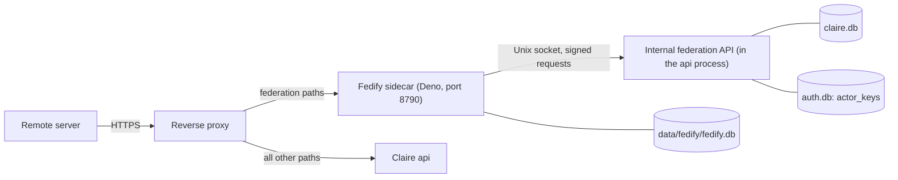

# Federation Implementation Reference (Phase FP1)

Basis: units FP1-1 to FP1-6 (commits `56d40c9` to `75d79e18`) and the FP1-7 tests (2026-11-11). Readers: agents and operators who change or operate the Fedify sidecar federation. Design record: [`ACCOUNT_IDP_AND_FEDIFY_SIDECAR_INTEGRATION_DESIGN.md`](../design/ACCOUNT_IDP_AND_FEDIFY_SIDECAR_INTEGRATION_DESIGN.md).

This document tells what the code does now. The design document is a historical record: it also contains phases that are not implemented. Section 13 lists the differences between the code and the design.

## 1. Scope and State

Phase FP1 implements discovery only. A remote server can resolve the handle `@username@{host}` to an actor document and can get the public keys of the actor.

| Function | State in FP1 |
| :--- | :--- |
| WebFinger, NodeInfo, actor document, instance actor | Implemented |
| Internal federation API: `config`, `heartbeat`, `actors`, `keys` | Implemented |
| Actor keys in `auth.db` | Implemented |
| Instance switch `federation`, readiness checks GF1 to GF7 | Implemented (API and CLI). There is no console screen. |
| Step-up condition on `profile_public`, alternate link on the profile page | Implemented |
| Inbox, followers, domain blocks | Not implemented (phase FP2). The sidecar has read paths only: a method that is not `GET` or `HEAD` gets 405 on each federation path, and thus `POST /ap/actors/{public_id}/inbox` and `POST /ap/inbox` return 405. A `GET` of an inbox, followers, or outbox path returns 404. |
| Outbox, published objects, publishing | Not implemented (phase FP3). The paths return 404. |

Claire sends no activity to a remote server in FP1. The sidecar makes one type of outbound request: the public self-check to the public origin of this instance (Section 7.2).

## 2. Architecture



- Claire is canonical. The sidecar reads account data through the internal API for each request. The sidecar stores no account data.
- Control goes in one direction: the sidecar calls Claire. Claire does not call the sidecar.
- Claire does not register the federation paths. A federation path that gets to the Claire public listener returns 404, because it is not in `ROUTE_POLICY`.
- The sidecar returns 404 for all paths that are not federation paths, without a call to Claire.

| File | Function |
| :--- | :--- |
| `src/claire/api/federation_internal.py` | Unix socket listener, `ListenerRouter`, service key, `SignedRequestMiddleware`, `sign_request` |
| `src/claire/api/federation_routes.py` | Route table and sealed models of the internal API, `CONTRACT_VERSION`, `read_heartbeat` |
| `src/claire/store/actor_keys.py` | Key generation, encrypted storage, `ensure_actor_keys`, `load_actor_keys` |
| `src/claire/accounts/federation_readiness.py` | Readiness checks GF1 to GF7 |
| `src/claire/api/accounts_routes/federation.py` | `GET` and `POST /api/admin/federation` |
| `sidecar/fedify/src/internal_api.ts` | Signed client of the internal API with sealed response shapes |
| `sidecar/fedify/src/sidecar.ts` | WebFinger, NodeInfo, actor documents, instance actor, public self-check |
| `sidecar/fedify/src/main.ts` | Entry point: database, Unix socket client, heartbeat, HTTP listener |

## 3. Actor Rule

An account is a federation actor only when all these conditions are true:

1. The instance setting `federation` is `on`.
2. The instance mode is `network`.
3. The account status is `active`.
4. `profile_public` is 1.
5. The account has a USERNAME.

All other states give the same 404 on the internal API (`{"error": "not_found"}`) and on the public paths of the sidecar (`Not Found`, `text/plain`). This includes an unknown account, a suspended account, a purged account, and a public ID that is not a positive decimal number of 19 digits or less without a leading zero. The code gives no 410 in FP1.

The actor ID contains `accounts.public_id`, not the USERNAME: `{origin}/ap/actors/{public_id}`. `{origin}` is the canonical origin that Claire supplies in `config` (`WebRuntimeConfig.public_origin`). The sidecar does not read the request `Host` header to make a URL.

## 4. Public Paths of the Sidecar

All paths return 404 when `federation` is `off` or the mode is `single`.

| Method | Path | Answer |
| :--- | :--- | :--- |
| `GET` | `/.well-known/webfinger?resource=acct:{username}@{handle_host}` | JRD. `subject` is the `acct:` URI. The `self` link (type `application/activity+json`) is the actor ID. The link `http://webfinger.net/rel/profile-page` is `{origin}/@{username}/`. |
| `GET` | `/.well-known/nodeinfo` | Link to `{origin}/nodeinfo/2.1` |
| `GET` | `/nodeinfo/2.1` | `software.name` `claire-bible`, `software.version`, `protocols` `["activitypub"]`, `openRegistrations` `false`, `usage.users.total` = number of federation actors, `localPosts` 0, `localComments` 0 |
| `GET` | `/ap/actors/{public_id}` | Actor document of type `Person` |
| `GET` | `/ap/actors/instance` | Instance actor of type `Application` |

Rules of the sidecar (`sidecar/fedify/src/sidecar.ts`):

- The sidecar accepts only these paths: exact `/.well-known/webfinger`, exact `/.well-known/nodeinfo`, exact `/nodeinfo/2.1`, and paths below `/ap/`. `/nodeinfo/2.0` returns 404.
- The sidecar removes these request headers before Fedify gets the request: `Cookie`, `Authorization`, `Forwarded`, `X-Forwarded-For`, `X-Forwarded-Host`, `X-Forwarded-Proto`, `X-Forwarded-Port`. A response has no `Set-Cookie` header.
- An actor request with an `Accept` header that does not permit an ActivityPub format gets 406.
- If the internal API is not available, the answer is 503 with `Retry-After: 5`. The sidecar does not give a 404 or an old answer in this condition.
- The sidecar caches the `config` answer for 5 seconds. Thus a change of the switch or the mode has an effect on NodeInfo after 5 seconds at most. An actor path stops immediately, because Claire refuses the actor record.

### 4.1 Actor Document (`Person`)

| Property | Value |
| :--- | :--- |
| `id` | `{origin}/ap/actors/{public_id}` |
| `type` | `Person` |
| `preferredUsername` | `accounts.username` |
| `name` | `accounts.display_name` |
| `url` | `{origin}/@{username}/` |
| `inbox` | `{origin}/ap/actors/{public_id}/inbox` |
| `endpoints.sharedInbox` | `{origin}/ap/inbox` |
| `publicKey` | RSA 2048 public key. The key ID is `{actor ID}#main-key`. |
| `assertionMethod` | Multikey entries for the keys of the actor, with the Ed25519 key |
| `published` | `accounts.activated_at`. The sidecar sets no value when the account has no activation time. |
| `manuallyApprovesFollowers` | `false` |

- The document has no `outbox`, `followers`, `following`, `summary`, or `icon` property.
- The `inbox` and `sharedInbox` URLs are in the document, but those paths return 404 until phase FP2.
- The document has no email address, no external identity value, no instance role, and no internal `accounts.id`.

### 4.2 Instance Actor

- Path `/ap/actors/instance`, type `Application`, `preferredUsername` `claire`, `name` = the handle host, `manuallyApprovesFollowers` `true`.
- The WebFinger handle is `acct:claire@{handle_host}`. `claire` is in `RESERVED_USERNAMES`, so no account can have this USERNAME.
- The instance actor has its own key pairs (`actor_keys.account_id` 0).
- Claire has no actor record for `instance`: `GET /internal/federation/v1/actors/instance` returns 404. The sidecar makes the document from `config` and the keys.

## 5. Internal Federation API

### 5.1 Listener

- The `api` process opens a second listener on a Unix domain socket: `{data_dir}/run/federation.sock` (absolute path), mode 0660. `open_federation_socket` sets the mode with the umask at the time of the bind and then with `chmod`.
- One uvicorn `Server` serves the public socket and the internal socket in the same event loop (`run_api` in `src/claire/api/server.py`).
- `ListenerRouter` (the outermost ASGI layer, made in `wrap_web_app` in `src/claire/api/security.py`) selects the internal sub-application when `scope["server"]` is `(socket path, None)`. It does not read the `Host` header. The internal sub-application is outside all public middleware.
- The internal paths do not exist on the public listener: `/internal/federation/v1/...` is not in `ROUTE_POLICY` and returns 404 there.
- If the bind fails, `run_api` prints `internal federation listener failed ...` and continues with the public listener only. Then GF2 fails, because no heartbeat arrives.
- The process removes the socket file at a normal stop. If a socket file stays from an earlier process, the next start replaces it.

### 5.2 Service Key and Signature

- Service key file: `{data_dir}/auth/fedify_service.key`, 32 random bytes, mode 0600. `claire migrate` makes the file if it does not exist (`ensure_service_key`). It does not change an existing key, but it sets the mode to 0600 again and fails if the file does not contain 32 bytes.
- The middleware reads the key file at the first request and keeps the key in memory. The sidecar reads the key file at its start.
- Each request must have these two headers, each one time:

| Header | Value |
| :--- | :--- |
| `X-Claire-Timestamp` | Unix time in seconds, ASCII decimal digits, 12 characters at most |
| `X-Claire-Signature` | HMAC-SHA256 with the service key, lowercase hex |

- Signature input (UTF-8, four lines divided by `\n`):

```text
{METHOD}
{request target}
{timestamp}
{SHA-256 of the body, lowercase hex}
```

- The request target is the path as sent, and `?` with the query string if there is one.
- Claire refuses a request when the difference between its clock and the timestamp is more than 60 seconds (`MAX_REQUEST_AGE_SECONDS`), in the two directions.
- Absolute-form request target: the Deno HTTP client uses the Unix socket as an HTTP proxy and sends `GET http://claire.internal/internal/...`. The middleware changes this target to its path before the signature check and before routing. Thus the client signs the path only. The host name `claire.internal` is a placeholder and has no function.
- Body limit: 1048576 bytes (`MAX_BODY_BYTES`).
- No `Principal` credential (cookie, API token, OAuth token) is valid on this listener. The handlers do not read one.

Error responses. All have the body `{"error": "<code>"}` and `Cache-Control: no-store`.

| Status | Code | Condition |
| :--- | :--- | :--- |
| 401 | `invalid_signature` | A header is absent or occurs more than one time, the timestamp is not valid, the timestamp is outside the window, or the signature is wrong. All these conditions give the same body. The log has the reason. |
| 413 | `body_too_large` | The body is larger than the limit |
| 503 | `service_key_unavailable` | The key file is absent or does not contain 32 bytes |
| 404 | `not_found` | The path is not in the route table (after the signature check), or the actor does not exist |
| 405 | `method_not_allowed` | Wrong method for a path |
| 400 | `invalid_request` | The heartbeat body does not agree with the model |
| 409 | `contract_version_mismatch` | The heartbeat has a different contract major version |
| 500 | `internal_error` | A handler failed |

### 5.3 Endpoints

The path prefix is `/internal/federation/v1`. Request and response models are sealed (`extra="forbid"`, `strict=True`). All responses have `Cache-Control: no-store`.

| Method | Path | Response fields |
| :--- | :--- | :--- |
| `GET` | `/config` | `contract_version`, `canonical_origin`, `handle_host`, `mode` (`single` or `network`), `federation` (`off` or `on`), `software` (`name`, `version`), `trusted_proxies` (list of networks from `CLAIRE_TRUSTED_PROXIES`), `federated_actors` |
| `POST` | `/heartbeat` | Request: `contract_version` (`major.minor`), `sidecar_version`, `queue_depth`, `self_check` (`ok`: true, false, or null; `checked_at`). Response: `contract_version`, `federation`. |
| `GET` | `/actors/by-username/{username}` | Actor record, or 404. The lookup changes the USERNAME to lowercase. |
| `GET` | `/actors/{public_id}` | Actor record, or 404 |
| `GET` | `/actors/{public_id}/keys` | `public_id`, `keys`: list of `alg` (`rsa2048`, `ed25519`), `public_jwk`, `private_jwk`. `{public_id}` can be `instance`. 404 when the account is not an actor, or when federation is not active. |

- Actor record: `public_id` (decimal string), `username`, `display_name`, `activated_at`, `updated_at`, `profile_url`. The record has no field from `auth.db`.
- `federated_actors` is 0 when federation is not active. If not, it is the number of accounts that agree with the actor rule.
- `/config` answers in all states. It does not return 404 when federation is `off`.
- The sidecar does not use `trusted_proxies` in FP1.
- Heartbeat record: Claire writes the request and `received_at` to `{data_dir}/run/federation_heartbeat.json` (temporary file, then `os.replace`). A heartbeat with a different major version is not recorded.

### 5.4 Contract Version

- `CONTRACT_VERSION` is `"1.0"` on the two sides (`src/claire/api/federation_routes.py`, `sidecar/fedify/src/internal_api.ts`).
- Claire refuses a heartbeat with a different major version (409). The sidecar refuses a `config` answer with a different major version (`ContractError`).
- The sidecar checks each response against a sealed shape. An absent field, an extra field, or a wrong type is an error.

### 5.5 Contract Fixtures

- Directory: `tests/fixtures/federation_contract/`. Each JSON file is one call, with the keys `request`, `status`, and `response`.
- The Python test `tests/test_federation_routes.py` and the Deno tests in `sidecar/fedify/tests/` read the same files. Each side has a test that fails when a fixture file has no test.
- The key pairs in `actor_keys.json` and `instance_actor_keys.json` are test keys.

## 6. Keys

- Table `actor_keys` in `auth.db` (version 5, see [`SCHEMA_VERSIONING.md`](SCHEMA_VERSIONING.md)). Primary key `(account_id, alg)`. `account_id` 0 is the instance actor.
- Each actor has two key pairs: `rsa2048` (RSA 2048, public exponent 65537, for HTTP Signatures) and `ed25519` (for Object Integrity Proofs). The `cryptography` package generates them.
- The public key is a JWK in plaintext (`public_jwk`). The private key is a JWK that `SecretService` encrypts (AES-256-GCM) with the additional authenticated data `actor_key|{account_id}|{alg}`. A ciphertext that is moved to a different account or algorithm does not decrypt.
- Lazy generation: Claire generates the keys at the first `GET /actors/{public_id}/keys` request for an actor. A later request returns the same keys. The `profile_public` change does not generate keys.
- `ensure_actor_keys` does not replace an existing key. There is no key rotation function.
- The sidecar keeps imported keys in memory for 60 seconds at most (`KEY_CACHE_SECONDS`). After that time it requests the keys again.
- `ActorKeyPair` hides the private JWK in its `repr`. The end-to-end test examines the sidecar log for private key fields.
- Sidecar database: `data/fedify/fedify.db` (Fedify `SqliteKvStore` and `SqliteMessageQueue`, WAL mode). The sidecar makes the file with mode 0600 and sets the mode again at each start. A Fedify queue message for a delivery contains the private keys of the sender (design item FT3), thus the file is a secret store. The FP1 code sends no activity, so no delivery is queued now.

## 7. Instance Switch and Readiness Checks

### 7.1 Switch

- The switch is the key `federation` in `instance_settings` of `claire.db`. Values: `off` and `on`. No row means `off`. An unknown value raises `RuntimeError` (`AccountStore.federation_state`). No schema version change was necessary.
- `CB_FEDERATION=1` starts the sidecar container only. It does not change this switch.

### 7.2 Checks GF1 to GF7

`check_federation_readiness` in `src/claire/accounts/federation_readiness.py` does all checks. The checks do not change data.

| ID | Passes when |
| :--- | :--- |
| GF1 | The instance mode is `network`. |
| GF2 | `{data_dir}/run/federation_heartbeat.json` has a `received_at` time that is 0 to 120 seconds old (`HEARTBEAT_MAX_AGE_SECONDS`), and its contract major version is that of Claire. A time that is later than the clock fails. |
| GF3 | `{data_dir}/auth/fedify_service.key` is a regular file with mode 0600 and 32 bytes. |
| GF4 | `SecretService` can load the master key (`CLAIRE_SECRET_KEY` or `{data_dir}/auth/master.key`). The check does not make a key file. |
| GF5 | The environment is not `production`, or the canonical origin starts with `https://`. A runtime configuration that is not valid fails. |
| GF6 | The heartbeat is recent and its `self_check.ok` is `true`. |
| GF7 | One `GET {public origin}/.well-known/oauth-authorization-server` returns status 200 and a JSON object whose `issuer` is the public origin. Timeout 5 seconds, no redirects, no environment proxy settings, 65536 bytes at most. |

- The sidecar sends a heartbeat at its start and then each 30 seconds.
- Public self-check of the sidecar (`publicSelfCheck`): `GET {origin}/.well-known/webfinger?resource=acct:claire@{handle_host}`, no redirects, timeout 10 seconds. Each answer of the sidecar has the header `X-Claire-Fedify-Instance` with a random value of that sidecar process. The check passes when the answer has the value of this process. The status of the answer is not important. This shows that the reverse proxy sends the federation paths to this sidecar. The header value shows no instance data.
- The sidecar does the self-check at each heartbeat, also while `federation` is `off` or the mode is `single` (the WebFinger answer is then 404, with the header). Thus GF6 can pass before the admin sets the switch to `on`. `tests/test_fedify_sidecar.py` does this with a real Claire process and a real sidecar process.
- GF7 shows that the reverse proxy still sends `/.well-known/oauth-authorization-server` to Claire. The process that does the check (the `api` process or the CLI process) sends the request.

### 7.3 Admin API

The two routes are for the admin only (`ROUTE_POLICY`: `_system("admin")`). Other principals get 404.

`GET /api/admin/federation` returns, with `Cache-Control: no-store`:

```json
{
  "federation": "off",
  "mode": "network",
  "readiness": {"items": [{"id": "GF1", "name": "...", "passed": true, "detail": "..."}], "passed": false},
  "heartbeat": {"received_at": 1800000300.0, "contract_version": "1.0", "sidecar_version": "0.1.0", "queue_depth": 0, "self_check": {"ok": null, "checked_at": null}}
}
```

- `heartbeat` is `null` when there is no record.
- Each request does all checks again, GF7 with its network request also. The result is not cached.

`POST /api/admin/federation` with the body `{"federation": "on"}` or `{"federation": "off"}`:

| Condition | Response |
| :--- | :--- |
| Not the same origin | 403 `forbidden` |
| No recent authentication | 401 `reauth_required`, or 403 `step_up_requires_session` for a bearer credential |
| Body is not an object with the one field `federation` and a known value | 400 `invalid_request` |
| The value is the current state | 200 `{"federation": "<state>", "changed": false}`. No check, no audit row. |
| Change to `on` and a check fails | 400 `{"error": "readiness_failed", "detail": "...", "failures": [...]}`. `failures` contains the items that did not pass. |
| Change accepted | 200 `{"federation": "<state>", "changed": true}`. Claire writes an `admin_audit` row with the action `federation.update`. |

The change to `off` has no readiness condition.

### 7.4 CLI

```bash
uv run claire instance check --federation --json
```

```bash
./cb-manuscript app instance check --federation --json
```

- The JSON output is `{"check": "federation", "items": [...], "passed": true}`. Without `--json` the command prints one line for each check and a summary line.
- The exit code is 0 only when all checks pass.
- `--network` and `--federation` are mutually exclusive, and one of them is necessary.

## 8. Account Effects

### 8.1 Step-Up Rule for `profile_public` (FD11)

`PATCH /api/me` requires recent authentication when all these conditions are true: `federation` is `on`, the request sets `profile_public` to 1, and the stored value is 0. The check occurs before all writes, so a `display_name` change in the same request is not stored when the request is refused.

| Condition | Response |
| :--- | :--- |
| Session without authentication in the last 15 minutes | 401 `{"error": "reauth_required", "reauth": "/api/auth/reauth"}` with a `WWW-Authenticate` header |
| Bearer credential (not a session channel) | 403 `{"error": "step_up_requires_session"}` |
| Change from 1 to 0, or 1 to 1 | No condition |
| `federation` is `off` | No condition |

- `/settings/account`: when the mode is `network` and `federation` is `on`, the switch has the attribute `data-step-up` (`password` for an account with a password, `session` for an account without one) and a hint paragraph (`data-federation-hint`). The hint says that a change to private pauses federation and does not remove copies on other servers.
- `console_account.js` opens a password dialog before it sends the change to public when the attribute is `password`. The dialog calls `POST /api/auth/reauth`. An account without a password has no dialog: the server answers from the session age.
- Details of the account routes: [`ACCOUNTS.md`](ACCOUNTS.md) §5.3 and §5.5.

### 8.2 Alternate Link on the Profile Page

When the account is a federation actor, the profile page `/@{username}/` (not a theme page) has:

- `<link rel="alternate" type="application/activity+json" href="{actor ID}">` in the `head`.
- The header `Link: <{actor ID}>; rel="alternate"; type="application/activity+json"`.

The page keeps its HTML format for all `Accept` values. The path has no content negotiation. The owner of a paused profile sees the page without the link.

### 8.3 Mode Change Refusal

`POST /api/admin/instance/mode` refuses the change from `network` to `single` while `federation` is `on`: 400 `{"error": "federation_enabled", "detail": "Cannot switch to single mode while federation is on"}`. The admin must set `federation` to `off` first.

### 8.4 Pause

A change of `profile_public` to 0, a suspension, and `federation` `off` make the actor paths return 404. Claire sends no activity for these events in FP1. The keys stay in `actor_keys`, so the actor has the same keys when it is available again.

## 9. Deployment

### 9.1 Compose

- Service `fedify` in `docker-compose.yml`, behind the Compose profile `federation`. The service does not start when the profile is not active.
- `cb-manuscript` adds `--profile federation` to all Compose commands when `CB_FEDERATION=1`. The value must be exactly `0` or `1`.
- `CB_FEDIFY_PORT` is the host port of the sidecar on `CB_API_BIND` (default 8790, `.env.dev.example` uses 8791). The container port is always 8790. `cb-manuscript` refuses a `CB_FEDIFY_PORT` that is equal to `CB_API_PORT` or a role host port.
- `CB_FEDIFY_IMAGE` is the image name (default `claire-bible-fedify`). The tag is `CB_IMAGE_TAG`. The build context is `sidecar/fedify/`.
- The service starts after `api` is healthy (`depends_on`).
- The service has no `env_file`. The values of `.env` do not go into this container.
- User: `CB_UID:CB_GID`, the same as the Claire services. Thus the process can read the service key (0600), connect to the socket (0660), and write `data/fedify/`.

Mounts of the `fedify` container (no other mount is permitted: `scripts/ci.sh` and `tests/test_federation_compose.py` examine this):

| Host path | Container path | Mode |
| :--- | :--- | :--- |
| `{data}/run` | `/data/run` | read and write |
| `{data}/fedify` | `/data/fedify` | read and write |
| `{data}/auth/fedify_service.key` | `/data/auth/fedify_service.key` | read-only |

- The container does not mount `data/auth/` as a directory, the data directory, or `claire.db`.
- `create_host_path: false` stops the start when a source path does not exist. `cb-manuscript` makes `{data}/run` (mode 0770) and `{data}/fedify` (mode 0700) before a start when `CB_FEDERATION=1`. `claire migrate` makes the service key file.

### 9.2 Sidecar Environment Variables

`docker-compose.yml` sets these values. The defaults are in `sidecar/fedify/src/main.ts`.

| Variable | Default | Function |
| :--- | :--- | :--- |
| `CLAIRE_FEDIFY_SOCKET` | `/data/run/federation.sock` | Unix socket of the internal API |
| `CLAIRE_FEDIFY_SERVICE_KEY_FILE` | `/data/auth/fedify_service.key` | Service key file |
| `CLAIRE_FEDIFY_DB` | `/data/fedify/fedify.db` | Sidecar database |
| `CLAIRE_FEDIFY_HOST` | `0.0.0.0` | Listen address |
| `CLAIRE_FEDIFY_PORT` | `8790` | Listen port |

### 9.3 Image and Deno Permission Flags

- Base image `denoland/deno:2.9.8`. The build caches the dependencies with the frozen lock file `deno.lock`. `deno.json` pins the Fedify minor version (`~2.3.0`).
- The image keeps the license files of the npm dependencies in `/app/licenses/` and the file `/app/THIRD_PARTY_LICENSES.md`.
- Command of the image:

```text
deno run --frozen --cached-only --allow-net --allow-read=/data,/app --allow-write=/data/fedify,/data/run/federation.sock --allow-env=CLAIRE_FEDIFY_SOCKET,CLAIRE_FEDIFY_SERVICE_KEY_FILE,CLAIRE_FEDIFY_DB,CLAIRE_FEDIFY_HOST,CLAIRE_FEDIFY_PORT src/main.ts
```

- `--allow-net` has no host list in the image. Deno requires write access to a Unix socket to connect to it, so the socket path is in `--allow-write`.
- The flags contain the default paths. A different `CLAIRE_FEDIFY_SOCKET` or `CLAIRE_FEDIFY_DB` value needs different flags.

### 9.4 Start Sequence

1. Set `CB_FEDERATION=1` (and `CB_FEDIFY_PORT` if necessary) in the env file.
2. Run `./cb-manuscript update` or `./cb-manuscript up`. `claire migrate` (a step of `install` and `update`) makes the service key.
3. Configure the reverse proxy (Section 10).
4. Run `./cb-manuscript app instance check --federation --json`.
5. Set the switch with `POST /api/admin/federation`. Read the first item of Section 12 before this step.

## 10. Reverse Proxy Rules

The repository has no reverse proxy configuration. The operator configures the proxy. [`EXTERNAL_ACCESS.md`](EXTERNAL_ACCESS.md) has an Nginx example.

| Match | Path | Destination |
| :--- | :--- | :--- |
| Exact | `/.well-known/webfinger` | Sidecar (`CB_FEDIFY_PORT`) |
| Exact | `/.well-known/nodeinfo` | Sidecar |
| Prefix | `/nodeinfo/` | Sidecar |
| Prefix | `/ap/` | Sidecar |
| All other paths | | Claire (`CB_API_PORT`) |

- Do not send the prefix `/.well-known/` to the sidecar. `/.well-known/oauth-authorization-server` and `/.well-known/oauth-protected-resource` must stay on Claire. GF7 examines this.
- Wrong rules fail closed: Claire returns 404 for the federation paths, and the sidecar returns 404 for the paths of Claire. GF6 and GF7 show the two directions.
- The rules apply to the app host only (`CLAIRE_FQDN`).
- The sidecar has no request rate limit. A rate limit is a function of the reverse proxy.

## 11. Security Notes

These statements are true for the code now.

- The internal API has no network exposure: it is on a Unix socket, the listener selects it, and each request needs a signature with a 60-second window.
- The service key gives access to the internal API only. It is not a `Principal` and cannot call a `ROUTE_POLICY` route.
- `GET /actors/{public_id}/keys` returns private keys in plaintext on the internal socket. This is the only path that does so.
- The sidecar container has no access to `claire.db`, `auth.db`, `master.key`, or the `.env` values.
- The sidecar never sets the Fedify option `allowPrivateAddress`. A sidecar test reads the source directory and fails if the option is there.
- No external identity value (`iss`, `sub`, email, provider ID) is in an internal API response. `tests/test_federation_routes.py` puts values in `account_identities` and searches all responses.
- In single mode no federation path shows a USERNAME: all paths return 404. `tests/test_fedify_sidecar.py` examines this with a real Claire process (S9).
- All states that are not federated give the same 404, so a remote client cannot find which private accounts exist.
- A signature made with the key of one actor is not valid for a different actor (`sidecar/fedify/tests/discovery_e2e_test.ts`).

## 12. Known Limits

1. There is no console screen `/admin/federation`. The admin uses the API or the CLI.
2. `GET /api/admin/federation` has no cache. Each request sends the GF7 request to the public origin from the `api` process (timeout 5 seconds). The check runs in a thread, not in the event loop.
3. Unix socket path limit: Linux permits about 107 bytes for a socket path. On a host run with a long data directory path the bind fails, and the internal listener does not start (Section 5.1). The Compose path `/app/data/run/federation.sock` is short.
4. A socket file can stay after the process stops on a signal. The next start replaces it.
5. The middleware keeps the service key in memory. A replaced key file has no effect until the `api` process and the sidecar start again.
6. No 410 for a purged actor. The actor ID of a purged account returns 404. Tombstones come in a later phase.
7. `actor_keys` rows are not deleted at purge. `delete_actor_keys` exists but no code calls it.
8. The sidecar does not use `trusted_proxies`. It removes all `X-Forwarded-*` headers.
9. `./cb-manuscript backup` leaves out `data/run/`, `data/fedify/`, and `data/auth/fedify_service.key`. After a restore, `claire migrate` makes a new service key and the sidecar starts with an empty database: deliveries that were in the queue are lost (design Section 4.3). The storage scan of the support bundle skips `data/fedify/` and `data/run/` ([`OPERATIONS.md`](OPERATIONS.md)).
10. License items for the owner are in `sidecar/fedify/THIRD_PARTY_LICENSES.md`: `tslib` has the license 0BSD, which the design list does not name, and the JSR packages publish no license file.

## 13. Differences from the Design

| Design | Code |
| :--- | :--- |
| `actor_keys` is `auth.db` version 4 (§10.2) | Version 5. Version 4 was used by the per-account features before FP1. |
| `GET`, `PUT /api/admin/federation` (§9.2) | `GET`, `POST` |
| Keys are generated when the account first becomes an actor (§7 item 1, §8.1) | Keys are generated at the first keys request of the sidecar |
| `/actors/{public_id}` returns 410 for a removed actor (§6.2) | 404 only in FP1 |
| The sidecar reads `X-Forwarded-*` from trusted proxies (§5.1 rule 5) | The sidecar removes these headers and reads none |
| Actor document has `outbox` and `followers` (§5.2) | Not in the document in FP1 |
| `/config` has limits and a domain-block ETag (§6.2) | Not in the response. `federated_actors` is in the response. |
| Deno flags limit the process to the network, the data directory, and the socket directory (§4.2) | `--allow-read=/data,/app`, and `--allow-net` without a host list |

## 14. Tests

| File | Scope |
| :--- | :--- |
| `tests/test_federation_internal.py` | Service key file, signature, time window, body limit, listener selection, socket mode, internal paths on the socket only |
| `tests/test_actor_keys.py` | `auth.db` version 5 migration, key generation, encryption with the additional authenticated data |
| `tests/test_federation_routes.py` | Internal endpoints against the fixtures, actor rule, sealed models, no identity field |
| `tests/test_federation_step_up.py` | Step-up rule, switch markup, alternate link, step-up dialog in a browser |
| `tests/test_federation_readiness.py` | GF1 to GF7, admin API, CLI |
| `tests/test_federation_compose.py` | Mounts, profile, user, Dockerfile flags, license table |
| `tests/test_fedify_sidecar.py` | Runs the Deno tests, and two end-to-end runs with a real Claire process and a real sidecar process: discovery with the single-mode USERNAME check, and the self-check while federation is off |
| `sidecar/fedify/tests/` | Internal API client, public paths, discovery end-to-end with a signed fetch |

```bash
uv run pytest tests/test_federation_internal.py tests/test_actor_keys.py tests/test_federation_routes.py tests/test_federation_step_up.py tests/test_federation_readiness.py tests/test_federation_compose.py tests/test_fedify_sidecar.py -q
```

Run the Deno commands from `sidecar/fedify/`:

```bash
deno task test
```

```bash
deno task check
```

- `tests/test_fedify_sidecar.py` and the sidecar step of `scripts/ci.sh` are skipped when `deno` is not installed.
- No test calls a public server. All servers are local.
