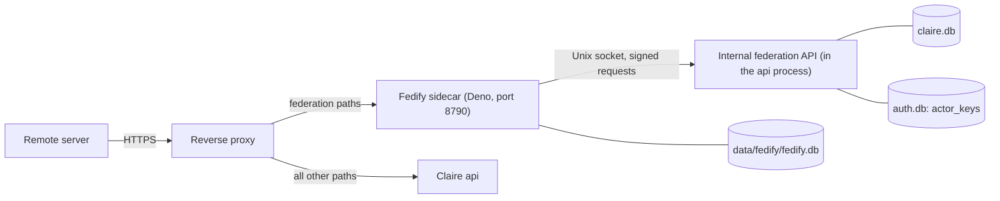

# Federation Implementation Reference (Phase FP1)

Basis: units FP1-1 to FP1-6 (commits `56d40c9` to `75d79e18`) and the FP1-7 tests (2026-11-11). Readers: agents and operators who change or operate the Fedify sidecar federation. Design record: [`ACCOUNT_IDP_AND_FEDIFY_SIDECAR_INTEGRATION_DESIGN.md`](../design/ACCOUNT_IDP_AND_FEDIFY_SIDECAR_INTEGRATION_DESIGN.md).

This document tells what the code does now. The design document is a historical record: it also contains phases that are not implemented. Section 13 lists the differences between the code and the design.

## 1. Scope and State

Phase FP1 implements discovery only. A remote server can resolve the handle `@username@{host}` to an actor document and can get the public keys of the actor. Phase FP2 (followers) is complete: a remote server can follow an actor and gets an `Accept`, an account owner can see and remove followers, and the admin can block domains.

| Function | State |
| :--- | :--- |
| WebFinger, NodeInfo, actor document, instance actor | Implemented |
| Internal federation API: `config`, `heartbeat`, `actors`, `keys` | Implemented |
| Actor keys in `auth.db` | Implemented |
| Instance switch `federation`, readiness checks GF1 to GF7 | Implemented (API, CLI, and the console section `/admin/federation`) |
| Step-up condition on `profile_public`, alternate link on the profile page | Implemented |
| `claire.db` version 17: followers, tombstones, domain blocks (Section 5.6) | Implemented (FP2-1). No code writes a tombstone before phase FP3. |
| Internal federation API: `inbox-events`, `followers`, `domain-blocks` (Section 5.3) | Implemented (FP2-2). The sidecar uses them for the inboxes and the followers collection (FP2-3). |
| Public inboxes, `Accept(Follow)`, public followers collection, blocked domains in the sidecar (Section 4.3) | Implemented (FP2-3) |
| Management of followers and domain blocks: API and console sections `/settings/federation` and `/admin/federation` (Section 7.5) | Implemented (FP2-4) |
| `claire.db` version 18: published objects and the outbox; routes `POST /api/federation/publish` and `POST /api/federation/retract` (Section 7.6) | Implemented (FP3-1) |
| Internal federation API: `outbox-tasks`, task acknowledgement, `objects`, `actors/{public_id}/outbox` (Section 5.8) | Implemented in Claire, with client functions in the sidecar (FP3-2) |
| Sidecar task poller, delivery of `Create`, `Update`, and `Delete` of an `Article` to followers, public object path and outbox collection (Section 4.4) | Implemented (FP3-3) |
| Actor tasks (`update_actor`, `delete_actor`), privacy triggers, native actor in the `/syndication` dialog, recovery command | Not implemented (units FP3-4 and FP3-5). The sidecar leaves an actor task with Claire. |

The sidecar makes these outbound requests: the public self-check to the public origin of this instance (Section 7.2), signed fetches of remote actor documents and keys for the signature check of an inbox activity, deliveries of `Accept` and `Reject` for a `Follow` (Section 4.3), and deliveries of published objects to the inboxes of followers (Section 4.4).

## 2. Architecture



- Claire is canonical. The sidecar reads account data through the internal API for each request. The sidecar stores no account data.
- Control goes in one direction: the sidecar calls Claire. Claire does not call the sidecar.
- Claire does not register the federation paths. A federation path that gets to the Claire public listener returns 404, because it is not in `ROUTE_POLICY`.
- The sidecar returns 404 for all paths that are not federation paths, without a call to Claire.

| File | Function |
| :--- | :--- |
| `src/claire/api/federation_internal.py` | Unix socket listener, `ListenerRouter`, service key, `SignedRequestMiddleware`, `sign_request` |
| `src/claire/api/federation_routes.py` | Route table and sealed models of the internal API, `CONTRACT_VERSION`, `read_heartbeat` |
| `src/claire/store/actor_keys.py` | Key generation, encrypted storage, `ensure_actor_keys`, `load_actor_keys` |
| `src/claire/accounts/federation_readiness.py` | Readiness checks GF1 to GF7 |
| `src/claire/api/accounts_routes/federation.py` | `GET` and `POST /api/admin/federation` |
| `sidecar/fedify/src/internal_api.ts` | Signed client of the internal API with sealed response shapes |
| `sidecar/fedify/src/sidecar.ts` | WebFinger, NodeInfo, actor documents, instance actor, public self-check |
| `sidecar/fedify/src/main.ts` | Entry point: database, Unix socket client, heartbeat, HTTP listener |

## 3. Actor Rule

An account is a federation actor only when all these conditions are true:

1. The instance setting `federation` is `on`.
2. The instance mode is `network`.
3. The account status is `active`.
4. `profile_public` is 1.
5. The account has a USERNAME.

All other states give the same 404 on the internal API (`{"error": "not_found"}`) and on the public paths of the sidecar (`Not Found`, `text/plain`). This includes an unknown account, a suspended account, a purged account, and a public ID that is not a positive decimal number of 19 digits or less without a leading zero. The code gives no 410 in FP1.

The actor ID contains `accounts.public_id`, not the USERNAME: `{origin}/ap/actors/{public_id}`. `{origin}` is the canonical origin that Claire supplies in `config` (`WebRuntimeConfig.public_origin`). The sidecar does not read the request `Host` header to make a URL.

## 4. Public Paths of the Sidecar

All paths return 404 when `federation` is `off` or the mode is `single`.

| Method | Path | Answer |
| :--- | :--- | :--- |
| `GET` | `/.well-known/webfinger?resource=acct:{username}@{handle_host}` | JRD. `subject` is the `acct:` URI. The `self` link (type `application/activity+json`) is the actor ID. The link `http://webfinger.net/rel/profile-page` is `{origin}/@{username}/`. |
| `GET` | `/.well-known/nodeinfo` | Link to `{origin}/nodeinfo/2.1` |
| `GET` | `/nodeinfo/2.1` | `software.name` `claire-bible`, `software.version`, `protocols` `["activitypub"]`, `openRegistrations` `false`, `usage.users.total` = number of federation actors, `localPosts` 0, `localComments` 0 |
| `GET` | `/ap/actors/{public_id}` | Actor document of type `Person` |
| `GET` | `/ap/actors/instance` | Instance actor of type `Application` |
| `POST` | `/ap/actors/{public_id}/inbox` | Personal inbox (Section 4.3) |
| `POST` | `/ap/inbox` | Shared inbox (Section 4.3) |
| `GET` | `/ap/actors/{public_id}/followers` | `OrderedCollection` with `totalItems` and no follower |
| `GET` | `/ap/actors/{public_id}/outbox` | `OrderedCollection` of the public objects, in pages (Section 4.4) |
| `GET` | `/ap/objects/{object_public_id}` | Published object of type `Article`, or 410 with a `Tombstone` (Section 4.4) |

Rules of the sidecar (`sidecar/fedify/src/sidecar.ts`):

- The sidecar accepts only these paths: exact `/.well-known/webfinger`, exact `/.well-known/nodeinfo`, exact `/nodeinfo/2.1`, and paths below `/ap/`. `/nodeinfo/2.0` returns 404.
- The sidecar removes these request headers before Fedify gets the request: `Cookie`, `Authorization`, `Forwarded`, `X-Forwarded-For`, `X-Forwarded-Host`, `X-Forwarded-Proto`, `X-Forwarded-Port`. A response has no `Set-Cookie` header.
- An actor request with an `Accept` header that does not permit an ActivityPub format gets 406.
- If the internal API is not available, the answer is 503 with `Retry-After: 5`. The sidecar does not give a 404 or an old answer in this condition.
- The sidecar caches the `config` answer for 5 seconds. Thus a change of the switch or the mode has an effect on NodeInfo after 5 seconds at most. An actor path stops immediately, because Claire refuses the actor record.

### 4.1 Actor Document (`Person`)

| Property | Value |
| :--- | :--- |
| `id` | `{origin}/ap/actors/{public_id}` |
| `type` | `Person` |
| `preferredUsername` | `accounts.username` |
| `name` | `accounts.display_name` |
| `url` | `{origin}/@{username}/` |
| `inbox` | `{origin}/ap/actors/{public_id}/inbox` |
| `endpoints.sharedInbox` | `{origin}/ap/inbox` |
| `publicKey` | RSA 2048 public key. The key ID is `{actor ID}#main-key`. |
| `assertionMethod` | Multikey entries for the keys of the actor, with the Ed25519 key |
| `published` | `accounts.activated_at`. The sidecar sets no value when the account has no activation time. |
| `manuallyApprovesFollowers` | `false` |

- `followers` is `{actor ID}/followers`.
- The document has no `outbox`, `following`, `summary`, or `icon` property.
- The document has no email address, no external identity value, no instance role, and no internal `accounts.id`.

### 4.2 Instance Actor

- Path `/ap/actors/instance`, type `Application`, `preferredUsername` `claire`, `name` = the handle host, `manuallyApprovesFollowers` `true`.
- The WebFinger handle is `acct:claire@{handle_host}`. `claire` is in `RESERVED_USERNAMES`, so no account can have this USERNAME.
- The instance actor has its own key pairs (`actor_keys.account_id` 0).
- Claire has no actor record for `instance`: `GET /internal/federation/v1/actors/instance` returns 404. The sidecar makes the document from `config` and the keys.

### 4.3 Inboxes and the Followers Collection (Unit FP2-3)

Answer of an inbox path, in this sequence:

| Condition | Answer |
| :--- | :--- |
| The method is not `POST` | 405 with `Allow: POST` |
| The internal API is not available | 503 with `Retry-After: 5` |
| Federation is not active | 404 |
| The body is larger than `limits.inbox_body_bytes` of `config` (1048576) | 413. The sidecar stops the read at the limit. |
| The account of a personal inbox is not an actor | 404 |
| Fedify cannot verify the signature | 401 |
| The host of the `actor` of the activity is a blocked domain | 403. This answer comes only after a valid signature. |
| All other conditions | 202 |

- Fedify verifies the activity (HTTP Signatures, Linked Data Signatures, or Object Integrity Proofs) and fetches the key of the remote actor. That fetch is signed: with the key of the recipient for a personal inbox, and with the key of the instance actor for the shared inbox.
- With the queue of `data/fedify/fedify.db`, Fedify gives 202 and then runs the listener from the inbox queue. If the listener fails (for example, the internal API is not available), Fedify tries again. The sidecar never accepts an activity on behalf of Claire.
- One listener gets all activity types. It makes the event of Section 5.7 and sends it to `POST /inbox-events`. Claire decides: the sidecar has no list of the v1 types.
- Event fields: `object_type` has a value only for an `Undo` (the type of the activity that is undone). `recipient_public_id` is null for the shared inbox and for the inbox of the instance actor. `verified_by` names the strongest mechanism that the activity has (`proof`, then `signature`, then the HTTP signature); the sidecar cannot see which mechanism Fedify used.
- `accepted` with `reply` `accept` for a `Follow`: the sidecar sends `Accept` to the inbox of the remote actor, signed with the key of the actor that was followed. The `Accept` ID is `{actor ID}#accepts/{hash of the Follow ID}`. The object is the `Follow` with IDs only.
- `rejected` for a `Follow`: the sidecar sends `Reject` only for the reason `recipient_mismatch` and only when the actor that was followed has a key. For the other reasons there is no key to sign with (the account is not an actor, federation is off), or a delivery is not permitted (blocked domain, address that is not permitted).
- The sidecar drops an activity without a call to Claire when: the actor host is blocked; the activity has no ID or no actor; or the document of the remote actor has no inbox or cannot be read. A `Delete` of an actor whose document is gone is in this group.
- Blocked domains: the sidecar keeps the list of `/domain-blocks` in memory and reads it again when `domain_blocks_etag` in `config` changes (`config` stays 5 seconds in memory). The subdomain rule is the same as in Claire (Section 5.6). Claire makes the final check for each event.
- Fedify does not run the listener two times for the same activity ID in the same inbox. Thus a `Follow` that comes again with the same ID gets no second `Accept`.
- Counters: `Sidecar.counters` has the number of activities by result (`accepted`, `rejected`, `ignored`, `blocked`, `dropped`) since the start of the process. The sidecar writes one log line for each result that is not `accepted`. The counters do not go to Claire.
- Followers collection: a public read gets `totalItems` from Claire and an empty item list. The delivery code (Section 4.4) reads all pages of `/actors/{public_id}/followers` through `Sidecar.followerRecipients`.

### 4.4 Publishing: Task Poller, Objects, and the Outbox Collection (Unit FP3-3)

**Task poller.** `sidecar/fedify/src/main.ts` calls `Sidecar.processOutboxTasks` each 5 seconds. One call takes 10 tasks at most from `GET /outbox-tasks`. When a call gets 10 tasks, the next call follows immediately. Only one poll runs at a time. No task is taken while federation is not active.

| Task | Activity | Activity ID |
| :--- | :--- | :--- |
| `create` | `Create` with the `Article` | `{object ID}#create` |
| `update` | `Update` with the `Article` | `{object ID}#updates/{updated_at in milliseconds}` |
| `delete` | `Delete` with a `Tombstone` that has the object ID | `{object ID}#delete` |
| `update_actor`, `delete_actor` | None in this unit. The sidecar sends no acknowledgement, and Claire gives the task again after its lease (unit FP3-4). | |

- The object ID is `{origin}/ap/objects/{object_public_id}`. The activity IDs have no random part and no task number. Thus a second handoff of the same task makes the same activity, and a remote server that has the activity makes no second object (design Section 9.3).
- For `create` and `update` the sidecar reads `/objects/{id}`. For `delete` it reads nothing.
- `Article` fields: `id`, `attributedTo` (the actor ID), `name`, `content`, `url`, `published`, `updated`, `to` (the public collection), and `cc` (the followers collection of the actor). The activity has the same `actor`, `to`, and `cc`. There are no tags and no attachments (design Section 9.1).
- Recipients: all followers of the actor (`Sidecar.deliveryRecipients`). A follower whose actor, inbox, or shared inbox is on a blocked domain gets no delivery. A shared inbox gets one delivery for all its followers.
- The sidecar gives the activity to Fedify (`sendActivity`), signed with the key of the actor, and then sends the acknowledgement `handed_off`. With the queue of `data/fedify/fedify.db`, Fedify delivers from the queue and tries again after a failure. The ordering key of the queue is the object ID: the activities of one object go to a remote server in sequence.
- An actor without followers that can get a delivery: the task is `handed_off` and nothing is sent.
- `rejected` with an error code, and no delivery: `object_gone` (the object was retracted before the handoff: its `delete` task follows), `object_not_found` (Claire does not show the object, for example the theme is private now), `actor_mismatch` (the object is of a different actor).
- An error in one task (the internal API or the followers are not available, the actor has no key) gives no acknowledgement for that task and does not stop the other tasks. Claire gives the task again after its lease.
- Counters: `Sidecar.outboxCounters` has the number of tasks by result (`handed_off`, `rejected`, `failed`, `skipped`) since the start of the process. The counters do not go to Claire.

**Object path.** `GET /ap/objects/{object_public_id}`:

| Condition | Answer |
| :--- | :--- |
| Claire gives the record | 200 with the `Article`, the same form as in the delivery |
| Claire gives 410 | 410 with `{"@context", "id", "type": "Tombstone", "formerType": "Article", "deleted"}` and the content type `application/activity+json` |
| All other conditions | 404, the same body as for all 404 answers |
| The `Accept` header does not permit an ActivityPub format | 406 |

**Outbox collection.** `GET /ap/actors/{public_id}/outbox` gives `totalItems` and the link `first`. A page (`?cursor=`) has 20 items at most, newest first, and the link `next` when Claire has more objects. An item is `Create` with the activity ID of the table above, `actor`, `published`, `to`, `cc`, and the object ID as `object`. An item does not have the `Article`: a reader gets it from the object path. The collection has the objects of public themes only (Section 5.8). An account that is not an actor, and the instance actor, get 404.

## 5. Internal Federation API

### 5.1 Listener

- The `api` process opens a second listener on a Unix domain socket: `{data_dir}/run/federation.sock` (absolute path), mode 0660. `open_federation_socket` sets the mode with the umask at the time of the bind and then with `chmod`.
- One uvicorn `Server` serves the public socket and the internal socket in the same event loop (`run_api` in `src/claire/api/server.py`).
- `ListenerRouter` (the outermost ASGI layer, made in `wrap_web_app` in `src/claire/api/security.py`) selects the internal sub-application when `scope["server"]` is `(socket path, None)`. It does not read the `Host` header. The internal sub-application is outside all public middleware.
- The internal paths do not exist on the public listener: `/internal/federation/v1/...` is not in `ROUTE_POLICY` and returns 404 there.
- If the bind fails, `run_api` prints `internal federation listener failed ...` and continues with the public listener only. Then GF2 fails, because no heartbeat arrives.
- The process removes the socket file at a normal stop. If a socket file stays from an earlier process, the next start replaces it.

### 5.2 Service Key and Signature

- Service key file: `{data_dir}/auth/fedify_service.key`, 32 random bytes, mode 0600. `claire migrate` makes the file if it does not exist (`ensure_service_key`). It does not change an existing key, but it sets the mode to 0600 again and fails if the file does not contain 32 bytes.
- The middleware reads the key file at the first request and keeps the key in memory. The sidecar reads the key file at its start.
- Each request must have these two headers, each one time:

| Header | Value |
| :--- | :--- |
| `X-Claire-Timestamp` | Unix time in seconds, ASCII decimal digits, 12 characters at most |
| `X-Claire-Signature` | HMAC-SHA256 with the service key, lowercase hex |

- Signature input (UTF-8, four lines divided by `\n`):

```text
{METHOD}
{request target}
{timestamp}
{SHA-256 of the body, lowercase hex}
```

- The request target is the path as sent, and `?` with the query string if there is one.
- Claire refuses a request when the difference between its clock and the timestamp is more than 60 seconds (`MAX_REQUEST_AGE_SECONDS`), in the two directions.
- Absolute-form request target: the Deno HTTP client uses the Unix socket as an HTTP proxy and sends `GET http://claire.internal/internal/...`. The middleware changes this target to its path before the signature check and before routing. Thus the client signs the path only. The host name `claire.internal` is a placeholder and has no function.
- Body limit: 1048576 bytes (`MAX_BODY_BYTES`).
- No `Principal` credential (cookie, API token, OAuth token) is valid on this listener. The handlers do not read one.

Error responses. All have the body `{"error": "<code>"}` and `Cache-Control: no-store`.

| Status | Code | Condition |
| :--- | :--- | :--- |
| 401 | `invalid_signature` | A header is absent or occurs more than one time, the timestamp is not valid, the timestamp is outside the window, or the signature is wrong. All these conditions give the same body. The log has the reason. |
| 413 | `body_too_large` | The body is larger than the limit |
| 503 | `service_key_unavailable` | The key file is absent or does not contain 32 bytes |
| 404 | `not_found` | The path is not in the route table (after the signature check), or the actor does not exist |
| 405 | `method_not_allowed` | Wrong method for a path |
| 400 | `invalid_request` | The heartbeat body does not agree with the model |
| 409 | `contract_version_mismatch` | The heartbeat has a different contract major version |
| 500 | `internal_error` | A handler failed |

### 5.3 Endpoints

The path prefix is `/internal/federation/v1`. Request and response models are sealed (`extra="forbid"`, `strict=True`). All responses have `Cache-Control: no-store`.

| Method | Path | Response fields |
| :--- | :--- | :--- |
| `GET` | `/config` | `contract_version`, `canonical_origin`, `handle_host`, `mode` (`single` or `network`), `federation` (`off` or `on`), `software` (`name`, `version`), `trusted_proxies` (list of networks from `CLAIRE_TRUSTED_PROXIES`), `federated_actors`, `limits` (`inbox_body_bytes`), `domain_blocks_etag` |
| `POST` | `/heartbeat` | Request: `contract_version` (`major.minor`), `sidecar_version`, `queue_depth`, `self_check` (`ok`: true, false, or null; `checked_at`). Response: `contract_version`, `federation`. |
| `GET` | `/actors/by-username/{username}` | Actor record, or 404. The lookup changes the USERNAME to lowercase. |
| `GET` | `/actors/{public_id}` | Actor record, or 404 |
| `GET` | `/actors/{public_id}/keys` | `public_id`, `keys`: list of `alg` (`rsa2048`, `ed25519`), `public_jwk`, `private_jwk`. `{public_id}` can be `instance`. 404 when the account is not an actor, or when federation is not active. |
| `GET` | `/actors/{public_id}/followers` | `public_id`, `total`, `items` (newest first: `id`, `actor_iri`, `inbox_iri`, `shared_inbox_iri`), `next_max_id`. Query: one of `max_id`, `min_id`, `since_id`, and `limit` (1 to 80, default 20). 404 when the account is not an actor. 400 `invalid_request` for a query that is not valid. |
| `POST` | `/inbox-events` | One verified inbound activity. The response is the decision (Section 5.7). |
| `GET` | `/actors/{public_id}/outbox` | `public_id`, `total`, `items` (newest first: `id`, `published_at`, `updated_at`), `next_max_id`. The query is that of `/followers`. 404 when the account is not an actor. |
| `GET` | `/outbox-tasks` | `tasks`: oldest first, each with `id`, `kind`, `actor_public_id`, `object_public_id`, `created_at`, `lease_until`. Query: `limit` (1 to 50, default 20). The request gives a lease on each task that it returns (Section 5.8). |
| `POST` | `/outbox-tasks/{id}/ack` | Request: `result` (`handed_off` or `rejected`), `error_code` (null, or 1 to 64 characters of `a-z`, `0-9`, `_`). Response: `id`, `status`. 404 for a task that does not exist. |
| `GET` | `/objects/{object_public_id}` | Object record: `public_id`, `actor_public_id`, `type` (`Article`), `name`, `content`, `url`, `published_at`, `updated_at`. 404, or 410 `{"error": "gone", "gone_at": ...}` for a deleted object. |
| `GET` | `/domain-blocks` | `etag`, `domains` (lowercase ASCII, in order). The response has an `ETag` header. A request with the same value in `If-None-Match` gets 304 without a body. |

- Actor record: `public_id` (decimal string), `username`, `display_name`, `activated_at`, `updated_at`, `profile_url`. The record has no field from `auth.db`.
- `federated_actors` is 0 when federation is not active. If not, it is the number of accounts that agree with the actor rule.
- `/config` answers in all states. It does not return 404 when federation is `off`.
- The sidecar does not use `trusted_proxies` in FP1.
- `limits.inbox_body_bytes` is 1048576 (`INBOX_BODY_LIMIT_BYTES`). It is the largest body of a public inbox request that the sidecar must read (unit FP2-3).
- `domain_blocks_etag` is the entity tag of the `/domain-blocks` response. The sidecar reads `config` at short intervals and can thus see a change of the list without a second request.
- `/domain-blocks` answers in all states of the federation switch.
- `next_max_id` is the `id` of the last item when the page is full. If not, it is null. `id` is `federation_followers.public_id` as a decimal string.
- Heartbeat record: Claire writes the request and `received_at` to `{data_dir}/run/federation_heartbeat.json` (temporary file, then `os.replace`). A heartbeat with a different major version is not recorded.

### 5.4 Contract Version

- `CONTRACT_VERSION` is `"1.1"` on the two sides (`src/claire/api/federation_routes.py`, `sidecar/fedify/src/internal_api.ts`).
- Claire refuses a heartbeat with a different major version (409). The sidecar refuses a `config` answer with a different major version (`ContractError`).
- The sidecar checks each response against a sealed shape. An absent field, an extra field, or a wrong type is an error.
- Unit FP3-2 added four endpoints and changed no shape that existed. The version stays 1.1.
- Version 1.1 (unit FP2-2) added `limits` and `domain_blocks_etag` to `config`, and the three endpoints of phase FP2. Because the shapes are sealed, a sidecar of version 1.0 refuses the `config` answer of version 1.1. Claire and the sidecar must come from the same commit.

### 5.5 Contract Fixtures

- Directory: `tests/fixtures/federation_contract/`. Each JSON file is one call, with the keys `request`, `status`, and `response`.
- The Python test `tests/test_federation_routes.py` and the Deno tests in `sidecar/fedify/tests/` read the same files. Each side has a test that fails when a fixture file has no test.
- The key pairs in `actor_keys.json` and `instance_actor_keys.json` are test keys.

### 5.6 Follower Data (`claire.db` Version 17)

- Tables: `federation_followers` (key `(account_id, actor_iri)`, `public_id` is the time-ordered cursor number), `federation_tombstones`, `federation_domain_blocks`. The definitions are in [`SCHEMA_VERSIONING.md`](SCHEMA_VERSIONING.md).
- Store functions: `src/claire/store/federation.py`. No function there commits.
- Domain form: lowercase ASCII (punycode) without a trailing dot. An IPv4 address is permitted, for development instances. `normalize_domain` refuses a scheme, a port, a path, and a space.
- A block of a domain also applies to its subdomains (`blocking_domain`). An IP address has an exact comparison only. The port has no effect.
- The entity tag of the block list is the first 32 hexadecimal characters of the SHA-256 of the domains in order, with one line for each domain, in double quotation marks.

### 5.7 Inbox Event Contract

Request body of `POST /inbox-events` (all fields are necessary; a field that can be null is marked):

| Field | Value |
| :--- | :--- |
| `event_id` | ID of the activity. Claire writes nothing with it. |
| `type` | Type of the activity, for example `Follow` |
| `object_type` | Null, or the type of the object. For an `Undo` it is the type of the activity that is undone. |
| `recipient_public_id` | Public ID of the actor whose inbox got the activity. Null for the shared inbox. |
| `actor` | `iri`, `inbox`, `shared_inbox` (can be null) of the remote actor |
| `object_iri` | Null, or the ID of the object. For an `Undo` it is the object of the activity that is undone. |
| `verified_by` | `http-signature`, `ld-signature`, or `object-integrity-proof` |

Response: `decision` (`accepted`, `rejected`, `ignored`), `reply` (`accept` or null), `reason` (a code or null). A body outside the model gets 400 `invalid_request`.

Claire makes the decision in this sequence:

1. Federation is not active (the switch is `off`, or the mode is `single`): `rejected`, reason `federation_off`.
2. An address of the remote actor is not permitted: `rejected`, reason `invalid_actor`. The scheme must be `https`. `http` is permitted only when the canonical origin of the instance uses `http` (development). An address with credentials, without a valid host, or on the origin of this instance is not permitted. The rule applies to `iri`, `inbox`, and `shared_inbox`.
3. The host of one of these addresses is blocked: `rejected`, reason `blocked_domain`. This check comes before the type check.
4. The type is outside the v1 set: `ignored`, reason `unsupported_type`. The v1 set is `Follow`; `Undo` with `object_type` `Follow`; `Delete` with `object_iri` equal to `actor.iri`; `Update` with `object_iri` equal to `actor.iri`.
5. `Delete` of the remote actor: Claire deletes the actor from the followers of all accounts. `accepted`.
6. `Update` of the remote actor: Claire replaces the inbox addresses in all rows of the actor. `accepted`.
7. `Follow` and `Undo(Follow)`: `object_iri` must be `{canonical_origin}/ap/actors/{public_id}`. If not: `rejected`, reason `not_an_actor`. If `recipient_public_id` is not null and is a different ID: `rejected`, reason `recipient_mismatch`.
8. `Follow`: the account must agree with the actor rule (Section 3). If not: `rejected`, reason `not_an_actor`. Claire stores the follower. `accepted` with `reply` `accept`. A repeated `Follow` keeps the row and its number, replaces the inbox addresses if they are different, and gives the same decision.
9. `Undo(Follow)`: the account must exist. Claire deletes the row, also for a paused account. `accepted`. A repeated `Undo` gives the same decision.

Claire writes one log line for each event with the type, the decision, and the reason. The line has no address.

### 5.8 Outbox Tasks and Objects (Unit FP3-2)

**Tasks.**

- A task is ready when its status is `pending` and it has no lease, or its lease ended (`lease_until` is not after the time of the request).
- `GET /outbox-tasks` returns the oldest ready tasks and sets `lease_until` to the time of the request plus 300 seconds (`OUTBOX_LEASE_SECONDS`). A second request in that time does not get the same task. The request changes data, although the method is `GET` (design Section 6.2).
- A task that the sidecar does not acknowledge stays `pending`, and Claire gives it again after its lease.
- Claire gives only the tasks of accounts that are actors now. When federation is not active the list is empty. A task of a paused account waits, because the sidecar cannot get the key of that account.
- `POST /outbox-tasks/{id}/ack` with `handed_off` sets the status and `handed_off_at`. `rejected` sets the status and `error_code`: the sidecar uses it for a task that it cannot convert, and Claire does not give the task again. A task that has a result does not change: a second acknowledgement returns the first result.
- The task has IDs only. The sidecar reads the object with `/objects/{id}` when it converts the task.

**Objects.**

- A tombstone of kind `object` gives 410 with `gone_at`. This check comes first, and it does not depend on the federation switch.
- The record is given only while federation is active, the account of the object is an actor, the theme is public, and the document exists and is not hidden. All other conditions give the same 404.
- `content` is `documents.detail_html`, or the render of `documents.detail` (`render_to_html`) when there is no compiled HTML. Then the `nh3` sanitizer with its default allowlist cleans it. `name` is the document title.
- `url` is the share page of the document, `{origin}/p?s={token}`, or null when the document has no share that is in effect. The publish route makes a share.
- The outbox collection counts and lists only the objects of themes that are public now.

## 6. Keys

- Table `actor_keys` in `auth.db` (version 5, see [`SCHEMA_VERSIONING.md`](SCHEMA_VERSIONING.md)). Primary key `(account_id, alg)`. `account_id` 0 is the instance actor.
- Each actor has two key pairs: `rsa2048` (RSA 2048, public exponent 65537, for HTTP Signatures) and `ed25519` (for Object Integrity Proofs). The `cryptography` package generates them.
- The public key is a JWK in plaintext (`public_jwk`). The private key is a JWK that `SecretService` encrypts (AES-256-GCM) with the additional authenticated data `actor_key|{account_id}|{alg}`. A ciphertext that is moved to a different account or algorithm does not decrypt.
- Lazy generation: Claire generates the keys at the first `GET /actors/{public_id}/keys` request for an actor. A later request returns the same keys. The `profile_public` change does not generate keys.
- `ensure_actor_keys` does not replace an existing key. There is no key rotation function.
- The sidecar keeps imported keys in memory for 60 seconds at most (`KEY_CACHE_SECONDS`). After that time it requests the keys again.
- `ActorKeyPair` hides the private JWK in its `repr`. The end-to-end test examines the sidecar log for private key fields.
- Sidecar database: `data/fedify/fedify.db` (Fedify `SqliteKvStore` and `SqliteMessageQueue`, WAL mode). The sidecar makes the file with mode 0600 and sets the mode again at each start. A Fedify queue message for a delivery contains the private keys of the sender (design item FT3), thus the file is a secret store. The FP1 code sends no activity, so no delivery is queued now.

## 7. Instance Switch and Readiness Checks

### 7.1 Switch

- The switch is the key `federation` in `instance_settings` of `claire.db`. Values: `off` and `on`. No row means `off`. An unknown value raises `RuntimeError` (`AccountStore.federation_state`). No schema version change was necessary.
- `CB_FEDERATION=1` starts the sidecar container only. It does not change this switch.

### 7.2 Checks GF1 to GF7

`check_federation_readiness` in `src/claire/accounts/federation_readiness.py` does all checks. The checks do not change data.

| ID | Passes when |
| :--- | :--- |
| GF1 | The instance mode is `network`. |
| GF2 | `{data_dir}/run/federation_heartbeat.json` has a `received_at` time that is 0 to 120 seconds old (`HEARTBEAT_MAX_AGE_SECONDS`), and its contract major version is that of Claire. A time that is later than the clock fails. |
| GF3 | `{data_dir}/auth/fedify_service.key` is a regular file with mode 0600 and 32 bytes. |
| GF4 | `SecretService` can load the master key (`CLAIRE_SECRET_KEY` or `{data_dir}/auth/master.key`). The check does not make a key file. |
| GF5 | The environment is not `production`, or the canonical origin starts with `https://`. A runtime configuration that is not valid fails. |
| GF6 | The heartbeat is recent and its `self_check.ok` is `true`. |
| GF7 | One `GET {public origin}/.well-known/oauth-authorization-server` returns status 200 and a JSON object whose `issuer` is the public origin. Timeout 5 seconds, no redirects, no environment proxy settings, 65536 bytes at most. |

- The sidecar sends a heartbeat at its start and then each 30 seconds.
- Public self-check of the sidecar (`publicSelfCheck`): `GET {origin}/.well-known/webfinger?resource=acct:claire@{handle_host}`, no redirects, timeout 10 seconds. Each answer of the sidecar has the header `X-Claire-Fedify-Instance` with a random value of that sidecar process. The check passes when the answer has the value of this process. The status of the answer is not important. This shows that the reverse proxy sends the federation paths to this sidecar. The header value shows no instance data.
- The sidecar does the self-check at each heartbeat, also while `federation` is `off` or the mode is `single` (the WebFinger answer is then 404, with the header). Thus GF6 can pass before the admin sets the switch to `on`. `tests/test_fedify_sidecar.py` does this with a real Claire process and a real sidecar process.
- GF7 shows that the reverse proxy still sends `/.well-known/oauth-authorization-server` to Claire. The process that does the check (the `api` process or the CLI process) sends the request.

### 7.3 Admin API

The two routes are for the admin only (`ROUTE_POLICY`: `_system("admin")`). Other principals get 404.

`GET /api/admin/federation` returns, with `Cache-Control: no-store`:

```json
{
  "federation": "off",
  "mode": "network",
  "readiness": {"items": [{"id": "GF1", "name": "...", "passed": true, "detail": "..."}], "passed": false},
  "heartbeat": {"received_at": 1800000300.0, "contract_version": "1.0", "sidecar_version": "0.1.0", "queue_depth": 0, "self_check": {"ok": null, "checked_at": null}}
}
```

- `heartbeat` is `null` when there is no record.
- Each request does all checks again, GF7 with its network request also. The result is not cached.

`POST /api/admin/federation` with the body `{"federation": "on"}` or `{"federation": "off"}`:

| Condition | Response |
| :--- | :--- |
| Not the same origin | 403 `forbidden` |
| No recent authentication | 401 `reauth_required`, or 403 `step_up_requires_session` for a bearer credential |
| Body is not an object with the one field `federation` and a known value | 400 `invalid_request` |
| The value is the current state | 200 `{"federation": "<state>", "changed": false}`. No check, no audit row. |
| Change to `on` and a check fails | 400 `{"error": "readiness_failed", "detail": "...", "failures": [...]}`. `failures` contains the items that did not pass. |
| Change accepted | 200 `{"federation": "<state>", "changed": true}`. Claire writes an `admin_audit` row with the action `federation.update`. |

The change to `off` has no readiness condition.

### 7.4 CLI

```bash
uv run claire instance check --federation --json
```

```bash
./cb-manuscript app instance check --federation --json
```

- The JSON output is `{"check": "federation", "items": [...], "passed": true}`. Without `--json` the command prints one line for each check and a summary line.
- The exit code is 0 only when all checks pass.
- `--network` and `--federation` are mutually exclusive, and one of them is necessary.

### 7.5 Console and Account Routes (Unit FP2-4)

**Account routes.** The routes are for the owner of an account, in network mode only (`ROUTE_POLICY`: `_any("owner", modes=NETWORK_ONLY)`). Single mode gives 404. The routes use the account of the credential. No route reads an account from the request.

`GET /api/federation/status` returns, with `Cache-Control: no-store`:

```json
{"federation": "on", "handle": "@alice@claire.example.com", "actor_id": "https://claire.example.com/ap/actors/116412345678901234", "is_actor": true, "actor_state": "active", "followers": {"total": 2}, "pending_tasks": 0}
```

- `actor_state` is `active`, or the first condition of the actor rule (Section 3) that fails, in this sequence: `account_not_active`, `no_username`, `federation_off`, `profile_not_public`.
- `handle` and `actor_id` are null only when the account has no USERNAME.
- `pending_tasks` is the number of outbox tasks of the account with the status `pending` (unit FP3-1).

`GET /api/federation/followers` returns one cursor page, newest first: `total`, `items` (`id`, `actor_iri`, `created_at`), `next_max_id`. Query parameters: `limit` (1 to 80, default 20) and one of `max_id`, `min_id`, `since_id`. A query that is not valid gets 400 `invalid_request`. The inbox addresses are not in the response.

`DELETE /api/federation/followers` with the body `{"actor_iri": "..."}`:

| Condition | Response |
| :--- | :--- |
| Cookie request that is not from the same origin | 403 (`AuthenticationMiddleware`) |
| The body is not an object with the one field `actor_iri` (string, 1 to 2048 characters) | 400 `invalid_request` |
| The account of the caller has no follower with this address | 404 `follower_not_found` |
| Row deleted | 200 `{"removed": true, "followers": {"total": n}}` |

- The delete key is `(account of the caller, actor_iri)`. The route cannot delete a follower of a different account.
- The route needs no recent authentication and writes no audit row.
- The route deletes the row only. Claire sends no `Reject(Follow)`: that needs the outbox of phase FP3. The remote server can send `Follow` again, and Claire stores the follower again.

**Domain blocks.** The routes are for the admin only (`_system("admin")`). Other principals get 404, as on all `/api/admin/*` routes.

- `GET /api/admin/federation/domain-blocks` returns `domain_blocks`: a list of `domain`, `note`, `created_at`, in the order of the domain.
- `POST` with `{"domain": "...", "note": "..."}` adds a block. `note` is optional: 200 characters at most, no control characters. A new block gets 201 with `"created": true`. An existing block gets 200 with `"created": false`, and the row is not changed.
- `DELETE` with `{"domain": "..."}` removes a block: 200, or 404 `domain_block_not_found`.
- `POST` and `DELETE` have the guards of `POST /api/admin/federation`: same origin (403 `forbidden`), then recent authentication (401 `reauth_required`, or 403 `step_up_requires_session` for a bearer credential).
- A domain that `normalize_domain` refuses gets 400 `invalid_domain`. Other body errors get 400 `invalid_request` or `invalid_note`.
- Each change writes an `admin_audit` row: `federation.domain_block_add` or `federation.domain_block_remove`, with the detail `{"domain": "..."}`.
- A new block does not delete followers that exist. The sidecar reads the new list when the entity tag in `config` changes, after 5 seconds at most.

**Console sections.**

- `/settings/federation` (owner): handle, actor ID, actor state, follower count, and the follower list with a remove control (`console_account.js`). In single mode the section shows a notice only and no USERNAME.
- `/admin/federation` (admin): the switch, the readiness checks GF1 to GF7, the last heartbeat of the sidecar, and the domain block list with add and remove (`console_admin.js`). The page gets the checks from `GET /api/admin/federation` after it loads, because check GF7 sends a network request. When a change gets 401 `reauth_required`, the shared reauth dialog of the console opens and the change is sent again.
- A member response has no `/admin/` link and no `console_admin.js`. The pages have no inline event handlers.

### 7.6 Publishing Routes (Unit FP3-1)

The routes need `collaborator` access or more, in network mode only (`ROUTE_POLICY`: `_any("collaborator", modes=NETWORK_ONLY)`). A `readonly` credential cannot call them. The principal must have an account, and the theme must be of that account: the admin cannot publish for a member. A collaborator can use only a theme with `is_collaborator_accessible`.

`POST /api/federation/publish` with the body `{"theme": "<theme number>", "document_id": "..."}`:

| Condition | Response |
| :--- | :--- |
| The body is not this object (`theme` is a decimal string, `document_id` has 1 to 200 characters) | 400 `invalid_request` |
| No theme with this number that the caller can use | 404 `theme_not_found` |
| The account is not an actor (Section 3) | 409 `not_an_actor` with `actor_state` |
| The theme is not public | 409 `theme_not_public` |
| No document with this ID in the theme | 404 `document_not_found` |
| The document is hidden | 409 `document_not_public` |
| The document has no body (`detail` and `detail_html` are empty) | 409 `document_has_no_body` |
| Published | 202 with `object` (`id`, `url`, `published_at`, `updated_at`), `task` (`id`, `kind`), `created` |

- The first publish of a document makes the `federation_objects` row and a `create` task. A later publish changes `updated_at` and makes an `update` task. The object ID stays.
- The object row and the task row are in one transaction. If the task insert fails, the object row is not stored.
- Before that transaction the route makes sure that the document has a share page (`doc_shares`). That page is the public page of the document.
- `object.url` is `{origin}/ap/objects/{id}`. The sidecar serves that path (Section 4.4).
- The account of the task and `published_by_account_id` are the account of the caller. No function has a default account (`tests/test_federation_publish.py` reads the federation modules for this).

`POST /api/federation/retract` with the body `{"object_id": "<decimal>"}`:

- An object that does not exist, or is of a different account, or is in a theme that the caller cannot use, gets 404 `object_not_found`.
- If not, one transaction writes the tombstone (`federation_tombstones`, kind `object`), deletes the object row, and makes a `delete` task. The response is 202 with `retracted`, `object_id`, and `task`.
- A new publish of the same document makes a new object ID. The old ID stays a tombstone.
- A retract is permitted when the account is not an actor now. The task waits until the account is an actor again (Section 5.8). The object ID gives 410 immediately.

A cookie request that is not from the same origin gets 403 (`AuthenticationMiddleware`). The routes need no recent authentication.

## 8. Account Effects

### 8.1 Step-Up Rule for `profile_public` (FD11)

`PATCH /api/me` requires recent authentication when all these conditions are true: `federation` is `on`, the request sets `profile_public` to 1, and the stored value is 0. The check occurs before all writes, so a `display_name` change in the same request is not stored when the request is refused.

| Condition | Response |
| :--- | :--- |
| Session without authentication in the last 15 minutes | 401 `{"error": "reauth_required", "reauth": "/api/auth/reauth"}` with a `WWW-Authenticate` header |
| Bearer credential (not a session channel) | 403 `{"error": "step_up_requires_session"}` |
| Change from 1 to 0, or 1 to 1 | No condition |
| `federation` is `off` | No condition |

- `/settings/account`: when the mode is `network` and `federation` is `on`, the switch has the attribute `data-step-up` (`password` for an account with a password, `session` for an account without one) and a hint paragraph (`data-federation-hint`). The hint says that a change to private pauses federation and does not remove copies on other servers.
- `console_account.js` opens a password dialog before it sends the change to public when the attribute is `password`. The dialog calls `POST /api/auth/reauth`. An account without a password has no dialog: the server answers from the session age.
- Details of the account routes: [`ACCOUNTS.md`](ACCOUNTS.md) §5.3 and §5.5.

### 8.2 Alternate Link on the Profile Page

When the account is a federation actor, the profile page `/@{username}/` (not a theme page) has:

- `<link rel="alternate" type="application/activity+json" href="{actor ID}">` in the `head`.
- The header `Link: <{actor ID}>; rel="alternate"; type="application/activity+json"`.

The page keeps its HTML format for all `Accept` values. The path has no content negotiation. The owner of a paused profile sees the page without the link.

### 8.3 Mode Change Refusal

`POST /api/admin/instance/mode` refuses the change from `network` to `single` while `federation` is `on`: 400 `{"error": "federation_enabled", "detail": "Cannot switch to single mode while federation is on"}`. The admin must set `federation` to `off` first.

### 8.4 Pause

A change of `profile_public` to 0, a suspension, and `federation` `off` make the actor paths return 404. Claire sends no activity for these events in FP1. The keys stay in `actor_keys`, so the actor has the same keys when it is available again.

## 9. Deployment

### 9.1 Compose

- Service `fedify` in `docker-compose.yml`, behind the Compose profile `federation`. The service does not start when the profile is not active.
- `cb-manuscript` adds `--profile federation` to all Compose commands when `CB_FEDERATION=1`. The value must be exactly `0` or `1`.
- `CB_FEDIFY_PORT` is the host port of the sidecar on `CB_API_BIND` (default 8790, `.env.dev.example` uses 8791). The container port is always 8790. `cb-manuscript` refuses a `CB_FEDIFY_PORT` that is equal to `CB_API_PORT` or a role host port.
- `CB_FEDIFY_IMAGE` is the image name (default `claire-bible-fedify`). The tag is `CB_IMAGE_TAG`. The build context is `sidecar/fedify/`.
- The service starts after `api` is healthy (`depends_on`).
- The service has no `env_file`. The values of `.env` do not go into this container.
- User: `CB_UID:CB_GID`, the same as the Claire services. Thus the process can read the service key (0600), connect to the socket (0660), and write `data/fedify/`.

Mounts of the `fedify` container (no other mount is permitted: `scripts/ci.sh` and `tests/test_federation_compose.py` examine this):

| Host path | Container path | Mode |
| :--- | :--- | :--- |
| `{data}/run` | `/data/run` | read and write |
| `{data}/fedify` | `/data/fedify` | read and write |
| `{data}/auth/fedify_service.key` | `/data/auth/fedify_service.key` | read-only |

- The container does not mount `data/auth/` as a directory, the data directory, or `claire.db`.
- `create_host_path: false` stops the start when a source path does not exist. `cb-manuscript` makes `{data}/run` (mode 0770) and `{data}/fedify` (mode 0700) before a start when `CB_FEDERATION=1`. `claire migrate` makes the service key file.

### 9.2 Sidecar Environment Variables

`docker-compose.yml` sets these values. The defaults are in `sidecar/fedify/src/main.ts`.

| Variable | Default | Function |
| :--- | :--- | :--- |
| `CLAIRE_FEDIFY_SOCKET` | `/data/run/federation.sock` | Unix socket of the internal API |
| `CLAIRE_FEDIFY_SERVICE_KEY_FILE` | `/data/auth/fedify_service.key` | Service key file |
| `CLAIRE_FEDIFY_DB` | `/data/fedify/fedify.db` | Sidecar database |
| `CLAIRE_FEDIFY_HOST` | `0.0.0.0` | Listen address |
| `CLAIRE_FEDIFY_PORT` | `8790` | Listen port |

### 9.3 Image and Deno Permission Flags

- Base image `denoland/deno:2.9.8`. The build caches the dependencies with the frozen lock file `deno.lock`. `deno.json` pins the Fedify minor version (`~2.3.0`).
- The image keeps the license files of the npm dependencies in `/app/licenses/` and the file `/app/THIRD_PARTY_LICENSES.md`.
- Command of the image:

```text
deno run --frozen --cached-only --allow-net --allow-read=/data,/app --allow-write=/data/fedify,/data/run/federation.sock --allow-env=CLAIRE_FEDIFY_SOCKET,CLAIRE_FEDIFY_SERVICE_KEY_FILE,CLAIRE_FEDIFY_DB,CLAIRE_FEDIFY_HOST,CLAIRE_FEDIFY_PORT src/main.ts
```

- `--allow-net` has no host list in the image. Deno requires write access to a Unix socket to connect to it, so the socket path is in `--allow-write`.
- The flags contain the default paths. A different `CLAIRE_FEDIFY_SOCKET` or `CLAIRE_FEDIFY_DB` value needs different flags.

### 9.4 Start Sequence

1. Set `CB_FEDERATION=1` (and `CB_FEDIFY_PORT` if necessary) in the env file.
2. Run `./cb-manuscript update` or `./cb-manuscript up`. `claire migrate` (a step of `install` and `update`) makes the service key.
3. Configure the reverse proxy (Section 10).
4. Run `./cb-manuscript app instance check --federation --json`.
5. Set the switch with `POST /api/admin/federation`. Read the first item of Section 12 before this step.

## 10. Reverse Proxy Rules

The repository has no reverse proxy configuration. The operator configures the proxy. [`EXTERNAL_ACCESS.md`](EXTERNAL_ACCESS.md) has an Nginx example.

| Match | Path | Destination |
| :--- | :--- | :--- |
| Exact | `/.well-known/webfinger` | Sidecar (`CB_FEDIFY_PORT`) |
| Exact | `/.well-known/nodeinfo` | Sidecar |
| Prefix | `/nodeinfo/` | Sidecar |
| Prefix | `/ap/` | Sidecar |
| All other paths | | Claire (`CB_API_PORT`) |

- Do not send the prefix `/.well-known/` to the sidecar. `/.well-known/oauth-authorization-server` and `/.well-known/oauth-protected-resource` must stay on Claire. GF7 examines this.
- Wrong rules fail closed: Claire returns 404 for the federation paths, and the sidecar returns 404 for the paths of Claire. GF6 and GF7 show the two directions.
- The rules apply to the app host only (`CLAIRE_FQDN`).
- The inbox paths get `POST` requests from remote servers. The proxy must send the body and the headers `Signature`, `Signature-Input`, `Digest`, `Content-Digest`, `Date`, and `Host` without a change. The `Host` value must be the app host, because the signature includes it.
- The sidecar has no request rate limit. A rate limit is a function of the reverse proxy.

## 11. Security Notes

These statements are true for the code now.

- The internal API has no network exposure: it is on a Unix socket, the listener selects it, and each request needs a signature with a 60-second window.
- The service key gives access to the internal API only. It is not a `Principal` and cannot call a `ROUTE_POLICY` route.
- `GET /actors/{public_id}/keys` returns private keys in plaintext on the internal socket. This is the only path that does so.
- The sidecar container has no access to `claire.db`, `auth.db`, `master.key`, or the `.env` values.
- The sidecar never sets the Fedify option `allowPrivateAddress`. A sidecar test reads the source directory and fails if the option is there.
- No external identity value (`iss`, `sub`, email, provider ID) is in an internal API response. `tests/test_federation_routes.py` puts values in `account_identities` and searches all responses.
- In single mode no federation path shows a USERNAME: all paths return 404. `tests/test_fedify_sidecar.py` examines this with a real Claire process (S9).
- All states that are not federated give the same 404, so a remote client cannot find which private accounts exist.
- A signature made with the key of one actor is not valid for a different actor (`sidecar/fedify/tests/discovery_e2e_test.ts`).

## 12. Known Limits

1. Follower removal by the owner sends no `Reject(Follow)` (Section 7.5). A new domain block does not delete followers that exist.
2. `GET /api/admin/federation` has no cache. Each request sends the GF7 request to the public origin from the `api` process (timeout 5 seconds). The check runs in a thread, not in the event loop.
3. Unix socket path limit: Linux permits about 107 bytes for a socket path. On a host run with a long data directory path the bind fails, and the internal listener does not start (Section 5.1). The Compose path `/app/data/run/federation.sock` is short.
4. A socket file can stay after the process stops on a signal. The next start replaces it.
5. The middleware keeps the service key in memory. A replaced key file has no effect until the `api` process and the sidecar start again.
6. No 410 for a purged actor. The actor ID of a purged account returns 404. Tombstones come in a later phase.
7. `actor_keys` rows are not deleted at purge. `delete_actor_keys` exists but no code calls it.
8. The sidecar does not use `trusted_proxies`. It removes all `X-Forwarded-*` headers.
9. `./cb-manuscript backup` leaves out `data/run/`, `data/fedify/`, and `data/auth/fedify_service.key`. After a restore, `claire migrate` makes a new service key and the sidecar starts with an empty database: deliveries that were in the queue are lost (design Section 4.3). The storage scan of the support bundle skips `data/fedify/` and `data/run/` ([`OPERATIONS.md`](OPERATIONS.md)).
10. Followers of a remote actor that is gone can stay: most servers sign `Delete(Person)` with a key that is not available after the removal, so the signature check fails (401) and Claire gets no event.
11. `Reject(Follow)` is sent in one condition only (Section 4.3). A `Follow` of an account that is not an actor gets no reply.
12. The inbox counters of the sidecar are in memory only. Claire does not get them.
13. A development instance on a private address cannot follow: Fedify refuses private and loopback addresses for the key fetch (FS1).
14. `claire.db` has no record of the event IDs. Idempotency comes from the follower key only.
15. The follower page has 80 items at most. A delivery to many followers needs one request for each page, for each task.
16. A delivery starts 5 seconds at most after the publish request, when the sidecar runs. Claire has no record of the result for each inbox: a task is `handed_off` when Fedify has the activity (design Section 9.3). The outbox counters of the sidecar are in memory only.
17. A theme that changes to private makes no `Delete` task before unit FP3-4. The object path and the outbox stop immediately (Section 5.8), but remote servers keep their copy.
18. An actor task (`update_actor`, `delete_actor`) that Claire gives stays `pending` and comes again each 300 seconds. No code makes such a task before unit FP3-4.
19. A block of a domain after the handoff does not remove a delivery that is in the queue of the sidecar.
20. The outbox collection has `Create` items only. It does not list `Update` and `Delete` activities.
21. License items for the owner are in `sidecar/fedify/THIRD_PARTY_LICENSES.md`: `tslib` has the license 0BSD, which the design list does not name, and the JSR packages publish no license file.

## 13. Differences from the Design

| Design | Code |
| :--- | :--- |
| `actor_keys` is `auth.db` version 4 (§10.2) | Version 5. Version 4 was used by the per-account features before FP1. |
| `GET`, `PUT /api/admin/federation` with the switch, the domain blocks, and the sidecar health (§9.2) | `GET`, `POST /api/admin/federation` for the switch and the health. The domain blocks are at `/api/admin/federation/domain-blocks` (`GET`, `POST`, `DELETE`). |
| `GET /api/federation/status` has the follower count and the pending task count (§9.2) | The follower list is a second route, `GET /api/federation/followers`. |
| After a follower removal the sidecar sends `Reject(Follow)` (§11 item 2) | Not sent before the outbox of FP3 |
| End-to-end test: follow from a second development instance (§14.2) | The remote server is in the test process (`sidecar/fedify/e2e/follow_e2e.ts`), with a real Claire process. Claire cannot send a `Follow`, and Fedify refuses the loopback address of a second instance (FS1). |
| Keys are generated when the account first becomes an actor (§7 item 1, §8.1) | Keys are generated at the first keys request of the sidecar |
| `/actors/{public_id}` returns 410 for a removed actor (§6.2) | 404 only in FP1 |
| The sidecar reads `X-Forwarded-*` from trusted proxies (§5.1 rule 5) | The sidecar removes these headers and reads none |
| The outbox is a paged `OrderedCollection` of public objects (§5.1) | The items are `Create` activities that refer to the objects by ID |
| A deleted object returns 410 with a `Tombstone` (§5.3) | The same. The `Tombstone` is plain JSON from the sidecar, not a Fedify object. |
| `rejected`: the sidecar sends `Reject` for a `Follow` (§6.3) | Only for the reason `recipient_mismatch` (Section 4.3) |
| An `ignored` activity increments a telemetry counter (§6.3) | A counter in the memory of the sidecar and a log line |
| `claire.db` version 17 has the tables of FP2 and FP3 (§10.1) | Version 17 has the three tables of FP2 and one more index (`idx_federation_followers_actor`). Version 18 has the two tables of FP3 and one more index (`idx_federation_objects_account`). |
| The inbox event has `event_id`, `type`, `recipient_public_id`, `actor`, `object_iri`, `verified_by` (§6.3) | The event also has `object_type`, to identify `Undo(Follow)`. `recipient_public_id` and `object_iri` can be null. The decision also has `reason`. |
| `rejected` is for a blocked domain or a recipient that is not an actor (§6.3) | Also for federation that is not active, an address that is not permitted, and a recipient that is not the object of the `Follow` |
| `/config` has limits (§6.2) | One limit: `inbox_body_bytes`. `federated_actors` is also in the response. |
| Deno flags limit the process to the network, the data directory, and the socket directory (§4.2) | `--allow-read=/data,/app`, and `--allow-net` without a host list |

## 14. Tests

| File | Scope |
| :--- | :--- |
| `tests/test_federation_internal.py` | Service key file, signature, time window, body limit, listener selection, socket mode, internal paths on the socket only |
| `tests/test_actor_keys.py` | `auth.db` version 5 migration, key generation, encryption with the additional authenticated data |
| `tests/test_schema_v17.py` | `claire.db` version 17 migration, follower key, cursor pages, tombstones, domain form and subdomain rule |
| `tests/test_federation_routes.py` | Internal endpoints against the fixtures, actor rule, sealed models, no identity field, inbox event decisions, follower pages, domain block entity tag, outbox task lease and acknowledgement, object record and its public conditions, outbox collection, and two end-to-end runs with a real `api` process: follow events through the socket, and publish on the public listener with the handoff on the socket |
| `tests/test_federation_step_up.py` | Step-up rule, switch markup, alternate link, step-up dialog in a browser |
| `tests/test_federation_readiness.py` | GF1 to GF7, admin API, CLI |
| `tests/test_federation_compose.py` | Mounts, profile, user, Dockerfile flags, license table |
| `tests/test_fedify_sidecar.py` | Runs the Deno tests, and two end-to-end runs with a real Claire process and a real sidecar process: discovery with the single-mode USERNAME check, the followers total, the inbox answers 405, 401, 413, and 404, and the outbox poller of the process; and the self-check while federation is off. Also the runs of the two files in `sidecar/fedify/e2e/`. |
| `tests/test_federation_publish.py` | `claire.db` version 18 migration, lease and acknowledgement of outbox tasks, publish and retract rules, one transaction for the object and the task, no default account |
| `tests/test_federation_console.py` | Status and actor state, follower pages, follower removal for the own account only, single mode, domain block guards and audit rows, the two console sections, and one end-to-end run in a browser |
| `sidecar/fedify/e2e/follow_e2e.ts` (run by `tests/test_fedify_sidecar.py`) | Phase FP2 end to end: signed `Follow` through the sidecar code to a real Claire process, `Accept` with a signature check, shared inbox, blocked domain, `Undo(Follow)`, and the follower rows in `claire.db` |
| `sidecar/fedify/e2e/publish_e2e.ts` (run by `tests/test_fedify_sidecar.py`) | Unit FP3-3 end to end: documents that were published and retracted through the public API of a real Claire process, the handoff through the sidecar code, `Create` and `Delete` at a test inbox with a signature check, no delivery to a blocked domain, the object path with 200 and 410, the outbox collection, and the task rows in `claire.db` |
| `sidecar/fedify/tests/outbox_test.ts` | Task conversion to `Create`, `Update`, and `Delete`, signature check of the deliveries, stable IDs at a second handoff, rejected tasks, errors without an acknowledgement, blocked domains, object path, outbox collection |
| `sidecar/fedify/tests/inbox_test.ts` | Signed `Follow` to `Accept` with a signature check of the delivery, 401, 403 for a blocked domain, block list in memory, event fields against the fixtures, `Reject` rule, internal API failure, body limit, followers collection |
| `sidecar/fedify/tests/` | Internal API client, public paths, discovery end-to-end with a signed fetch |

```bash
uv run pytest tests/test_federation_internal.py tests/test_actor_keys.py tests/test_federation_routes.py tests/test_federation_step_up.py tests/test_federation_readiness.py tests/test_federation_compose.py tests/test_fedify_sidecar.py -q
```

Run the Deno commands from `sidecar/fedify/`:

```bash
deno task test
```

```bash
deno task check
```

- `tests/test_fedify_sidecar.py` and the sidecar step of `scripts/ci.sh` are skipped when `deno` is not installed.
- No test calls a public server. All servers are local.
