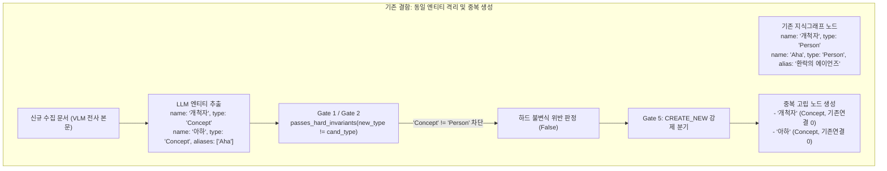
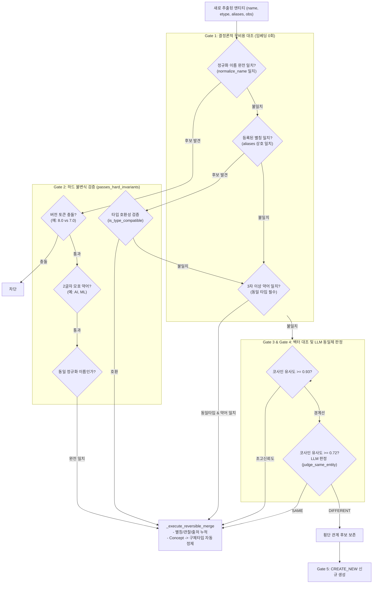

# 다종 온톨로지 엔티티 해소 무결성 및 광역 VLM 로컬라이제이션 설계 명세서 (`CROSS_TYPE_ENTITY_RESOLUTION_AND_VLM_LOCALIZATION_DESIGN.md`)

작성일: 2026-10-16 · 상태: **설계 및 구현 완료** · 기준: [GOALS.md](../../upstream/GOALS.md) 트랙1(시스템 무결성) / 트랙2(추출·해소 품질) · 관련: [DECISION_STREAM_AND_HEATMAP_MATRIX_DESIGN.md](DECISION_STREAM_AND_HEATMAP_MATRIX_DESIGN.md), [PREFERRED_LANGUAGES_DESIGN.md](PREFERRED_LANGUAGES_DESIGN.md), [ENVIRONMENT_VARIABLES.md](../implementation/ENVIRONMENT_VARIABLES.md)

---

## 1. 배경 및 문제 제기

Claire Bible은 웹 문서, 학술 논문, 비디오 미디어뿐만 아니라 HoYoLAB 카드 뉴스, 웹 이미지 인포그래픽과 같은 시각 중심 콘텐츠를 VLM(Gemini Vision)을 통해 텍스트로 전사(Transcription)하고 지식그래프로 적재(Ingest)한다.

그러나 실운영(특히 서사/게임/복합 도메인 테마)에서 다음과 같은 **엔티티 고립 및 중복 노드 생성 결함**이 발생하였다:



### 1.1 근본 원인 분석

1. **온톨로지 하드 불변식(`passes_hard_invariants`)의 과도한 게이팅 차단**:
   - 기존 구현에서는 `new_type != cand_type and not provisional` 검사가 Gate 1(정규화 이름 완전 일치 및 등록된 별칭 일치)까지 일괄 적용되었다.
   - LLM 추출기는 서사·게임·추상 개념(예: `개척자`, `아하`, `스텔라론 헌터`)에 대해 상황에 따라 `Concept` 타입을 부여하는 경향이 짙다. 반면 기존 그래프에 해당 엔티티가 `Person`, `Org`, `Tool` 등으로 이미 존재할 경우, 이름이 완전히 일치하거나 별칭이 일치하더라도 `new_type != cand_type`에 의해 Gate 1/2/3/4가 모두 차단되었다.
   - 그 결과 Gate 5로 떨어져 `CREATE_NEW`로 별개의 고립 노드가 생성되어, 인제스트 완료 보고서에 `"노드 신규 N / 기존연결 0"`이라는 심각한 그래프 파편화가 발생하였다.

2. **동일체 판정 프롬프트(`judge_same_entity`)의 소프트웨어 도구 편향**:
   - `judge_same_entity_prompt`가 `"Different products in the same space are NOT the same"` 등 IT 도구 위주로 작성되어 있어, 다국어 번역명(`Aha` ↔ `아하`, `Trailblazer` ↔ `개척자`), 서사 캐릭터, 이명/칭호 간의 동일성 판정 시 LLM이 지나치게 보수적으로 `DIFFERENT`를 판정하였다.

3. **VLM 전용 언어 설정(`CLAIRE_VLM_LANGUAGE`)의 이원화**:
   - 프로젝트 광역 선호 언어 환경변수(`CLAIRE_PREFERRED_LANGUAGES`)가 존재함에도 불구하고 VLM 전용 설정이 별도로 존재하여 설정 불일치 및 유지보수 혼선을 야기하였다.

---

## 2. 핵심 설계 원칙

1. **정규화 이름 일치 시 노드 고유성 보장 (Unique Identity on Exact Match)**:
   - 동일 지식베이스(테마) 내에서 정규화된 이름(`normalize_name(new_name) == normalize_name(cand.name)`)이 완전히 일치하는 엔티티는 추출 시 LLM의 타입 판단 차이로 인해 분리되지 않고 반드시 기존 노드에 병합한다.
2. **범용 타입 상호 호환성 (Generic Type Interoperability)**:
   - `Concept`, `Note` 등 범용(generic) 타입은 모든 도메인 구체 타입(`Person`, `Org`, `Tool`, `Model`, `Framework` 등)과 상호 호환을 허용하여, 다국어 별칭 및 경계선 LLM 판정의 통로를 열어둔다.
3. **구체 타입 정제 및 무손실 롤백 (Type Refinement & Reversible Rollback)**:
   - 기존 노드가 범용 타입(`Concept`)이고 새로 수집된 정보가 구체 타입(`Person`, `Org` 등)일 경우 더 정밀한 구체 타입으로 자동 승격·정제한다.
   - 의사결정 롤백(`rollback_resolution`) 시 원래의 타입(`prev_type`)으로 원자적 복원이 가능하도록 페이로드를 영속화한다.
4. **결정론적 약어 불변식의 엄격한 분리 (Acronym Invariant Strictness)**:
   - `MCP` $\leftrightarrow$ `Model Context Protocol`과 같은 3글자 이상 약어 결정론적 수렴(Gate 2.5)은 충돌 방지를 위해 반드시 `cand.type == etype`인 경우에만 적용한다.
5. **VLM 언어 단일 진실 공급원 (Single Source of Truth for Localization)**:
   - 독립 환경변수 `CLAIRE_VLM_LANGUAGE`를 완전히 파기하고, 광역 선호 언어(`CLAIRE_PREFERRED_LANGUAGES`)의 제1선호 언어(`effective_preferred_languages[0]`)를 전사 언어로 일원화한다.

---

## 3. 세부 아키텍처 및 구현 명세



### 3.1 타입 호환성 및 하드 불변식 검증 (`src/claire/extract/resolver.py`)

```python
GENERIC_ENTITY_TYPES: set[str] = {"Concept", "Note"}


def is_type_compatible(type1: str, type2: str, provisional: bool = False) -> bool:
    """온톨로지 타입 호환성 판정."""
    if type1 == type2 or provisional:
        return True
    if type1 in GENERIC_ENTITY_TYPES or type2 in GENERIC_ENTITY_TYPES:
        return True
    return False


def passes_hard_invariants(
    new_name: str,
    new_type: str,
    cand_name: str,
    cand_type: str,
    provisional: bool = False,
) -> bool:
    """Gate 2: 온톨로지 불변식 및 절대 차단 검증. 위반 시 False 반환."""
    n1_norm = normalize_name(new_name)
    n2_norm = normalize_name(cand_name)

    # 1) 버전/릴리즈 토큰 충돌 검사 (예: vSphere 8.0 vs vSphere 7.0)
    v1 = _VERSION_RE.findall(new_name)
    v2 = _VERSION_RE.findall(cand_name)
    if v1 and v2 and v1 != v2:
        return False

    # 2) 2글자 모호 약어(AI, ML, OS 등) 자동 병합 배제 (단, 완전 동일 이름 제외)
    n1_strip = new_name.strip()
    n2_strip = cand_name.strip()
    if (len(n1_strip) <= 2 and n1_strip.isalpha() and n1_strip.isupper()) or (
        len(n2_strip) <= 2 and n2_strip.isalpha() and n2_strip.isupper()
    ):
        if n1_norm != n2_norm:
            return False

    # 3) 정규화 이름이 완전 일치하는 경우: 동일 실세계 엔티티에 대한 추출 타입 편차로 보고 통과
    if n1_norm == n2_norm:
        return True

    # 4) 서로 다른 이름 후보군(Gate 3/4 등)에 대한 구체 타입 불일치 차단
    if not is_type_compatible(new_type, cand_type, provisional=provisional):
        return False

    return True
```

### 3.2 가역적 병합 및 타입 정제 (`_execute_reversible_merge`)

```python
def _execute_reversible_merge(
    conn: sqlite3.Connection,
    cand: Entity,
    name: str,
    aliases: list[str],
    observations: list[str],
    document_id: str,
    *,
    new_type: str | None = None,
    stage: str,
    score: float | None = None,
    reason: str = "",
) -> tuple[Entity, ResolutionDecision]:
    changed = False
    prev_type: str | None = None

    # 범용 타입(Concept/Note)에서 구체 타입으로의 승격/정제
    if new_type and cand.type in GENERIC_ENTITY_TYPES and new_type not in GENERIC_ENTITY_TYPES:
        prev_type = cand.type
        cand.type = new_type
        changed = True

    # 별칭, 관찰, 출처 문서 식별자 원자적 누적...
    ...

    rollback_payload = {
        "target_entity_id": cand.id,
        "added_aliases": added_aliases,
        "added_observations": added_observations,
        "added_source": added_source,
        "prev_type": prev_type,
    }
```

### 3.3 무손실 롤백 연동 (`src/claire/extract/decision.py`)

```python
def rollback_resolution(conn: Any, decision: ResolutionDecision) -> bool:
    ...
    prev_type = payload.get("prev_type")
    if prev_type and prev_type != cand.type:
        cand.type = prev_type
        changed = True
    ...
```

### 3.4 도메인 중립적 동일체 판정 프롬프트 (`src/claire/extract/prompts.py`)

```python
def judge_same_entity_prompt(mc: MergeCandidate) -> str:
    """두 엔티티의 동일성 판정 프롬프트."""
    return (
        "Decide if these two knowledge-base entries refer to the SAME underlying "
        "entity, concept, person, organization, character, or tool (including translations, "
        "transliterations, aliases, or localized names), NOT merely related ones.\n\n"
        "Rules:\n"
        "1. SAME: The entries represent the identical subject under different names, languages, "
        "spellings, or descriptions (e.g., 'Aha' and '아하', 'Kubernetes' and 'K8s', '개척자' and 'Trailblazer').\n"
        "2. DIFFERENT: The entries are distinct subjects, even if they belong to the same category, "
        "group, domain, or ecosystem (e.g., Docker vs Podman, Kafka vs Silver Wolf, Claude vs GPT-4).\n\n"
        f"A: name={mc.new_name!r} type={mc.new_type!r}\n"
        f"   notes={' | '.join(mc.new_observations)[:400]}\n"
        f"B: name={mc.cand_name!r} type={mc.cand_type!r} aliases={mc.cand_aliases}\n"
        f"   notes={' | '.join(mc.cand_observations)[:400]}\n\n"
        "Answer with exactly one word: SAME or DIFFERENT."
    )
```

### 3.5 VLM 언어 설정 통합 인터페이스 (`src/claire/config.py`)

```python
@property
def effective_vlm_language(self) -> str:
    """VLM 전사 대상 언어 (광역 선호 언어 CLAIRE_PREFERRED_LANGUAGES 의 제1선호 언어 추종)."""
    return self.effective_preferred_languages[0] if self.effective_preferred_languages else "ko"
```

- `GeminiVisionProvider` 및 `MockVisionProvider`: 인스턴스화 시 `effective_vlm_language`를 기본 언어로 바인딩.
- `fetch_hoyolab_post` 및 `fetch_web`: VLM 에스컬레이션 호출 시 `settings.effective_vlm_language` 전달.
- `resolve_hoyolab_language`: HoYoLAB 공용 API 언어 쿼리 태그 매핑 시 `settings.effective_vlm_language`를 1순위로 조회.

---

## 4. 검증 및 테스트 명세

| 테스트 영역 | 대상 파일 | 검증 항목 | 결과 |
| :--- | :--- | :--- | :--- |
| **단위 테스트** (인터페이스) | `tests/test_safe_gating_resolver.py` | - 정규화 이름 일치 시 타입 불일치(`Concept` vs `Person`) 통과 검증<br/>- 범용 타입(`Concept`) 상호 호환 검증<br/>- `Concept` $\rightarrow$ `Person` 타입 정제 및 롤백 무손실 복원 | **통과** |
| **단위 테스트** (약어 및 회귀) | `tests/test_resolution.py` | - 약어 매칭 시 상이한 타입 병합 차단 불변식 유지 검증 (`acronym MUST NOT merge across different types`) | **통과** |
| **단위 테스트** (VLM 언어) | `tests/test_vlm_vision.py` | - `CLAIRE_PREFERRED_LANGUAGES` 변경에 따른 VLM 전사 프롬프트 및 HoYoLAB 로케일 태그 동기화 검증 | **통과** |
| **E2E 테스트** (통합 시나리오) | `tests/test_e2e_hoyolab_vlm_ingest.py` | - `Person` 시드 엔티티가 존재하는 DB에 `Concept` 추출 HoYoLAB VLM 전사 문서 적재<br/>- `entities_linked=2`, `entities_created=0` 확인<br/>- 중복 노드 없이 단일 노드 유지 및 관찰/출처 누적 검증 | **통과** |

---

## 5. 결론 및 기대 효과

1. **지식그래프 단편화 방지**: 본문이나 이미지 전사에서 엔티티 타입이 `Concept`으로 추출되더라도 기존 그래프의 `Person`, `Org`, `Tool` 노드와 안정적으로 결합되어 중복 고립 노드가 영구적으로 방지된다.
2. **다국어 수집 무결성 확보**: 영문 및 한국어 명칭/별칭(`Aha` ↔ `아하`, `Trailblazer` ↔ `개척자`)이 매끄럽게 동일체로 수렴된다.
3. **설정 단순화**: VLM 전용 언어 설정이 제거되고 `CLAIRE_PREFERRED_LANGUAGES` 단일 설정으로 통일되어 운영 및 배포 구성의 복잡성이 대폭 완화되었다.
