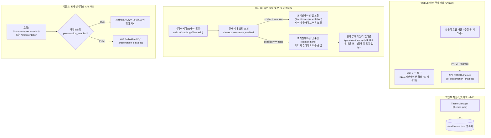

# 데이터베이스(테마)별 프레젠테이션 기능 활성/비활성 제어 설계 명세서
(Per-Database Presentation Feature Flag & WebUI Architecture Specification)

**문서 번호:** DESIGN-THEME-PRES-20261012-01  
**작성 주체:** Claire Bible Architecture & UI/UX Team  
**상태:** **설계 검토 및 구현 준비 (Ready for Review & Implementation)**  
**관련 문서:**  
- [`docs/origin/design/MULTI_THEME_ARCHITECTURE_DESIGN.md`](MULTI_THEME_ARCHITECTURE_DESIGN.md)  
- [`docs/origin/design/LLM_PRESENTATION_AUTHORING_AND_COMPOSITION_DESIGN.md`](LLM_PRESENTATION_AUTHORING_AND_COMPOSITION_DESIGN.md)  
- [`docs/origin/design/ASCIIDOCTOR_REVEALJS_PRESENTATION_UIUX_DESIGN.md`](ASCIIDOCTOR_REVEALJS_PRESENTATION_UIUX_DESIGN.md)  
- [`docs/contracts/API_HTTP_CONTRACT.md`](../../contracts/API_HTTP_CONTRACT.md)  

---

## 1. 배경 및 문제 정의 (Background & Problem Statement)

### 1.1 배경
Claire Bible은 멀티 테마(`CLAIRE_MULTI_THEME=1`) 아키텍처를 통해 여러 독립된 SQLite 데이터베이스 인스턴스를 물리적으로 격리하여 운용한다.
시스템 UI 및 사용자 경험 관점에서 데이터베이스는 **"테마(Theme)"**로 정의되며, 각 테마는 고유한 지식 축적 목적을 가진다:
- **연구 및 발표 지식베이스**: 학술 논문, 아키텍처 보고서 등 슬라이드 발표(Presentation) 기능이 핵심 자산인 지식베이스.
- **아카이브 및 로그 지식베이스**: 시스템 로그, 스크랩 원문, 코드 저장소, 로우 데이터 등 슬라이드 발표 기능이 전혀 필요하지 않은 지식베이스.
- **내부 메모 및 데일리 노트**: 간이 메모 보관용으로 프레젠테이션 생성에 따른 LLM 자원 소모가 불필요한 지식베이스.

### 1.2 기존 구현의 한계
1. **전역 일괄 노출**:
   - 현재 프레젠테이션 탭(`centertab-presentation`)은 WebUI 중앙 상단에 무조건 노출되며, 모든 데이터베이스에서 공통적으로 활성화되어 있다.
   - 슬라이드 기능이 불필요한 데이터베이스에서도 사용자가 실수로 '프레젠테이션 생성'을 클릭하면 고비용 LLM 저작(`compose`) 및 Asciidoctor 컴파일(`compile`) 파이프라인이 구동되어 토큰과 시스템 리소스를 낭비한다.
2. **데이터베이스 레벨의 기능 제어(Feature Flag) 부재**:
   - `ThemeInfo` 메타데이터에는 `is_public`, `is_collaborator_accessible`, `default_focus`, `fqdn`, `ga_measurement_id` 등은 존재하지만, 기능 모듈(프레젠테이션) 단위의 활성화 스위치가 존재하지 않는다.
3. **인지 부하 및 UI 오염**:
   - 슬라이드가 전혀 없는 데이터베이스에서도 프레젠테이션 탭, 리더기 슬라이드 버튼, 슬라이드 생성 유도 배너 등이 항상 노출되어 사용자에게 불필요한 인지 부하를 준다.

### 1.3 핵심 설계 목표
- **데이터베이스(테마)별 독립 제어**: 각 데이터베이스(기본 테마 `id=0` 포함)마다 프레젠테이션 기능의 켬/끔(`presentation_enabled`)을 독립적으로 설정 가능.
- **기본값 비활성 (Disabled by Default)**: 신규 생성 테마 및 기존 테마의 기본값을 **비활성(`False`)**으로 지정하여, 자원 낭비를 방지하고 필요한 지식베이스에서만 관리자가 명시적으로 활성화하도록 강제.
- **WebUI 원클릭 관리**: 지식 관리자(Owner)가 WebUI의 '테마 관리' 패널에서 손쉽게 프레젠테이션 기능을 토글(Toggle)하고 상태를 직관적으로 파악할 수 있는 UI 제공.
- **동적 탭 가시성 및 비활성 안내**: 비활성화된 데이터베이스 선택 시 프레젠테이션 탭을 완전히 숨기며, 임의로 프레젠테이션 뷰에 머물거나 진입한 경우에도 뷰를 강제로 리다이렉트하지 않고 기존 `#presentation-empty` 배너를 통해 기능 비활성 상태를 명확히 안내.
- **백엔드 보안 및 API 가드**: 비활성화된 데이터베이스의 문서에 대한 프레젠테이션 생성/조회/컴파일 요청을 `403 Forbidden`으로 엄격히 차단.

---

## 2. 전체 아키텍처 및 데이터 흐름 (Architecture & Workflow)



---

## 3. 계층별 상세 설계 (Detailed Layer Design)

### 3.1 데이터 모델 계층 (`src/claire/store/theme.py`)

#### 1) `ThemeInfo` 데이터 클래스 확장
```python
@dataclass
class ThemeInfo:
    id: int
    seq: int
    label: str
    description: str = ""
    icon: str = "📚"
    db_path: str = ""
    vault_path: str = ""
    is_default: bool = False
    is_public: bool = True
    is_collaborator_accessible: bool = True
    default_focus: str = ""
    fqdn: str = ""
    ga_measurement_id: str = ""
    sorcerer: str = ""
    presentation_enabled: bool = False  # 신규: 데이터베이스별 프레젠테이션 활성화 플래그 (기본값: False)
    created_at: float = 0.0
    updated_at: float = 0.0
```

#### 2) 직렬화 및 역직렬화 (`to_dict` / `from_dict`)
- `to_dict()`: `presentation_enabled` 필드를 JSON 딕셔너리로 직렬화.
- `from_dict(data)`:
  ```python
  presentation_enabled=bool(
      data.get("presentation_enabled", data.get("is_presentation_enabled", False))
  )
  ```
  - 기존 레지스트리에 필드가 없는 경우에도 안전하게 `False`로 역직렬화.
- `_build_default_theme()`:
  - 기본 테마(`id=0`) 생성 시 `presentation_enabled=False`로 초기화.

#### 3) `ThemeManager` CRUD 메서드 확장
- `define_theme(...)`: `presentation_enabled: bool = False` 인자를 추가하여 테마 정의 시 반영.
- `update_theme(...)`: `presentation_enabled: bool | None = None` 인자를 추가하여 전달 시 갱신.
- `_save_registry()`: `themes.json`에 원자적(atomic write)으로 저장.

---

### 3.2 백엔드 API 계층 (`src/claire/api/server.py`)

#### 1) 테마 목록 및 정의/수정 엔드포인트
- `GET /themes`: 반환되는 각 테마 항목에 `presentation_enabled` 불리언 값을 포함.
- `POST /themes`: `presentation_enabled` 본문 파라미터를 수신하여 신규 테마 생성 (기본값 `False`).
- `PATCH /themes`: `presentation_enabled` 불리언 값을 수신하여 테마 설정 갱신.

#### 2) 프레젠테이션 엔드포인트 인가 가드 (Authorization Guard)
다음 엔드포인트 호출 시, 대상 문서가 소속된 테마(데이터베이스)의 `presentation_enabled`를 검증:
- `GET /p/presentation` (HTML 프레젠테이션 뷰어)
- `GET /document/presentation` (프레젠테이션 메타데이터 조회)
- `POST /document/presentation/generate` (비동기 생성 요청)
- `POST /document/presentation/compose` (LLM 저작 요청)
- `POST /document/presentation/compile` (Asciidoctor 컴파일 요청)
- `GET|PUT /document/presentation/adoc` (AsciiDoc 원문 조회 및 수정)

**비활성화 시 처리 정책:**
- JSON API (`/document/presentation/*`):
  ```json
  HTTP 403 Forbidden
  {
    "error": "presentation_disabled",
    "detail": "이 데이터베이스에서는 프레젠테이션 기능이 비활성화되어 있습니다."
  }
  ```
- HTML 페이지 (`/p/presentation`):
  - 안내 페이지(`render_unready_presentation_page` 또는 전용 비활성 페이지)를 반환하거나 HTTP 403 응답:
  - "해당 데이터베이스의 프레젠테이션 기능이 비활성화되어 있습니다. 지식 관리자에게 문의하세요." 문구와 함께 문서 본문 복귀 링크 제공.

---

### 3.3 WebUI 프론트엔드 계층 설계

#### 1) 테마 관리 패널 (`openThemeManager` in `src/claire/static/js/app.js`)

**A. 테마 카드 상태 표시 및 퀵 토글 (Owner & Collaborator):**
- 각 테마 카드 우측 도구 모음에 프레젠테이션 활성 상태 뱃지 렌더링:
  - 활성화 상태:
    ```html
    <span style="color:#38bdf8;font-weight:600;font-size:12px;background:rgba(56,189,248,0.12);padding:2px 6px;border-radius:4px" title="프레젠테이션 기능 활성화됨">📊 프레젠테이션 활성</span>
    ```
  - 비활성화 상태:
    ```html
    <span style="color:var(--muted,#888);font-weight:600;font-size:12px;background:rgba(136,136,136,0.1);padding:2px 6px;border-radius:4px" title="프레젠테이션 기능 비활성화됨">🚫 프레젠테이션 비활성</span>
    ```
- 소유자(Owner) 전용 원클릭 빠른 토글 버튼:
  - 활성화 상태일 때: `<button type="button" class="sec" onclick="toggleThemePresentation(${t.id}, false)">프레젠테이션 끄기</button>`
  - 비활성화 상태일 때: `<button type="button" class="sec" onclick="toggleThemePresentation(${t.id}, true)">프레젠테이션 켜기</button>`

**B. 테마 옵션 상세 뷰 (`#theme-options-view-${t.id}`):**
- 항목 추가:
  ```html
  <div>• <b>프레젠테이션 기능</b>: ${t.presentation_enabled ? '<span style="color:#38bdf8;font-weight:600;">활성화됨 📊</span>' : '<span style="color:var(--muted);font-weight:600;">비활성화됨 (기본값) 🚫</span>'}</div>
  ```

**C. 테마 수정 폼 (`#theme-edit-form-${t.id}`):**
- 체크박스 옵션 추가:
  ```html
  <div style="flex:1;display:flex;align-items:center;padding-top:14px;">
    <label style="font-size:12px;cursor:pointer;">
      <input id="editthemep-pres-${t.id}" type="checkbox" ${t.presentation_enabled ? 'checked' : ''} style="width:auto;margin-right:4px;vertical-align:middle;"/>
      프레젠테이션 기능 활성화
    </label>
  </div>
  ```
- `updateThemeFromUI(themeId)` 함수에서 `payload.presentation_enabled = presEl.checked;` 전송.

**D. 새 테마 생성 폼 (`➕ 새 테마 추가`):**
- 체크박스 옵션 추가 (기본값: 체크 해제):
  ```html
  <div style="flex:1;display:flex;align-items:center;padding-top:14px;">
    <label style="font-size:12px;cursor:pointer;">
      <input id="newthemep-pres" type="checkbox" style="width:auto;margin-right:4px;vertical-align:middle;"/>
      프레젠테이션 기능 활성화
    </label>
  </div>
  ```
- `createThemeFromUI()` 함수에서 `payload.presentation_enabled = presEl.checked;` 전송.

---

#### 2) 작업 영역 탭 및 뷰 동적 제어 (`src/claire/static/js/app.js`, `reader.js`)

**A. 탭 가시성 동적 동기화 (`syncPresentationTabVisibility()`):**
- 현재 활성화된 테마 객체(`activeTheme` 또는 `themes.find(t => t.id === activeThemeId)`)의 `presentation_enabled` 확인.
- `#centertab-presentation` 요소 제어:
  - `presentation_enabled === true`:
    - 탭 버튼 표시: `tabEl.style.display = 'inline-flex';`
    - `tabEl.removeAttribute('aria-hidden');`
  - `presentation_enabled === false`:
    - 탭 버튼 숨김: `tabEl.style.display = 'none';`
    - `tabEl.setAttribute('aria-hidden', 'true');`

**B. 비활성 뷰 상태 안내 (Inert Empty State):**
- 뷰를 강제로 전환(`setCenterView`)하는 인위적 폴백은 브라우저 History, 모바일 드로어, 뷰 라우팅 간의 부작용 및 연쇄 게이팅(Cascading Gating) 문제를 유발하므로 배제한다.
- 탭 버튼이 숨겨져 일반적인 진입은 차단되지만, 만약 사용자가 이미 프레젠테이션 뷰에 머문 상태에서 비활성 테마로 전환하거나 URL 직접 진입한 경우:
  - 프레젠테이션 뷰 내부의 기존 `#presentation-empty` 배너를 그대로 활용하여 안내:
    - 제목: `프레젠테이션 기능이 비활성화되어 있습니다`
    - 설명: `이 데이터베이스에서는 프레젠테이션 기능이 꺼져 있습니다. 테마 관리에서 기능을 활성화할 수 있습니다.`
    - 생성 버튼(`#presentation-gen-btn`)은 노출하지 않음 (`display: none`).
  - 사용자의 의도나 현재 뷰 컨텍스트를 강제로 탈취하지 않고, 정적인 안내(Inert state)만을 표시하여 결합도를 최소화한다.

**C. 리더기 액션 버튼 및 칩 제어 (`reader.js`):**
- 문서 상세 보기 시 활성 테마의 프레젠테이션이 비활성화되어 있다면:
  - 상단 툴바의 `rslides` 단추(`rslidesbtn`) 숨김.
  - 메타데이터 태그의 슬라이드 생성 유도 칩 및 슬라이드 링크 칩 비노출.
  - 우측 패널의 프레젠테이션 정보 행 숨김.

---

### 3.4 CLI 관리 계층 (`src/claire/cli.py`)

지식 관리자가 터미널 환경에서도 손쉽게 프레젠테이션 기능을 제어할 수 있도록 CLI 옵션 확장:

#### 1) 테마 정의 (`claire theme define`)
```bash
claire theme define "학술 논문 아카이브" --presentation     # 프레젠테이션 활성화
claire theme define "서버 시스템 로그"                     # 기본값: 비활성화 (--no-presentation)
```

#### 2) 테마 수정 (`claire theme update`)
```bash
claire theme update 1 --presentation     # 테마 #1 프레젠테이션 활성화
claire theme update 1 --no-presentation  # 테마 #1 프레젠테이션 비활성화
```

#### 3) 테마 목록 (`claire theme list`)
목록 출력 시 프레젠테이션 활성 여부 플래그를 표기:
```text
ID  Seq  Label             Public  Collab  Pres   FQDN                 DB Path
-----------------------------------------------------------------------------------------
0   0    기본 지식베이스     YES     NO      OFF    -                    data/claire.db
1   1    학술 연구소         YES     YES     ON     ai.example.com       data/themes/1/claire.db
2   2    시스템 로그 수집     NO      NO      OFF    -                    data/themes/2/claire.db
```

---

## 4. 기존 시스템 호환성 및 마이그레이션 (Backward Compatibility)

1. **무중단 인메모리 호환**:
   - `ThemeInfo.from_dict()`에서 `presentation_enabled` 키가 누락된 경우 기본값 `False`로 파싱되므로, 기존 `data/themes.json`과의 완전한 하위 호환성을 보장.
   - 데이터베이스 스키마 마이그레이션이 불필요 (메타데이터는 SQLite가 아닌 `themes.json`에서 관리됨).
2. **단일 테마 모드(`CLAIRE_MULTI_THEME=0`) 동작 보장**:
   - 단일 테마 환경에서도 기본 테마(`id=0`)의 `presentation_enabled`가 `False`로 시작하며, 설정(`CLAIRE_PRESENTATION_ENABLED=1` 또는 테마 관리 패널)을 통해 필요 시 켤 수 있음.
3. **글로벌 기본값 변경에 따른 테스트 스위트 보정**:
   - 기존 E2E 테스트(`workspace.spec.js` 등) 중 프레젠테이션 탭의 가시성을 단정(`expect('#centertab-presentation').toBeVisible()`)하는 테스트 케이스는, 테스트 시드 데이터에서 프레젠테이션을 명시적으로 활성화하거나 토글 후 검증하도록 정합성 업데이트 수행.

---

## 5. 검증 및 테스트 계획 (Verification & Testing Plan)

사용자 가이드라인(Testing Rules)을 준수하여 I/O 경계, 모듈 간 인터페이스, 그리고 1개 이상의 신규 기능 E2E 테스트를 작성:

### 5.1 모듈 인터페이스 및 I/O 단위 테스트
1. **`tests/test_theme_presentation_flag.py`**:
   - `ThemeInfo` 기본 직렬화 및 역직렬화 시 `presentation_enabled=False` 검증.
   - `ThemeManager.define_theme` 및 `update_theme`에서 `presentation_enabled` 설정/토글 및 `themes.json` 저장 검증.
   - `GET /themes`, `POST /themes`, `PATCH /themes` HTTP API 응답 내 `presentation_enabled` 반영 검증.
   - 프레젠테이션 비활성 테마의 문서에 대해 `POST /document/presentation/generate`, `GET /p/presentation` 호출 시 `403 Forbidden` 차단 검증.

### 5.2 End-to-End (E2E) 브라우저 테스트
1. **`e2e/theme_presentation_toggle.spec.js`**:
   - 비활성화된 기본 테마에서 접속 시 상단 `#centertab-presentation` 탭이 DOM에서 보이지 않음을 검증 (`toBeHidden`).
   - 테마 관리 UI(`openThemeManager`)를 열어 프레젠테이션 활성화 버튼 클릭 후 저장.
   - 상단 `#centertab-presentation` 탭이 즉시 가시화(`toBeVisible`)되고 클릭 시 프레젠테이션 뷰로 정상 전환됨을 검증.
   - 프레젠테이션 뷰가 열린 상태에서 비활성화된 다른 테마로 전환 시, 자동으로 `graph` 또는 `reader` 뷰로 폴백됨을 검증.

---

## 6. 결론 및 승인 요청 (Conclusion & Recommendation)

본 설계는 리소스 소모가 큰 프레젠테이션 생성 기능을 필요한 지식베이스에만 선택적으로 개방하고, 기본값을 안전하게 비활성화(`False`)함으로써 시스템의 견고성과 UX 명확성을 동시에 확보한다.
설계 명세 검토 후 승인 시 즉시 구현 및 E2E 테스트를 진행할 수 있다.
